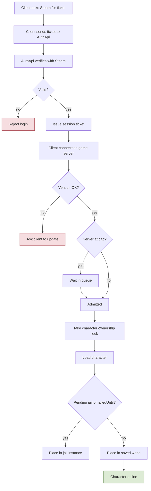
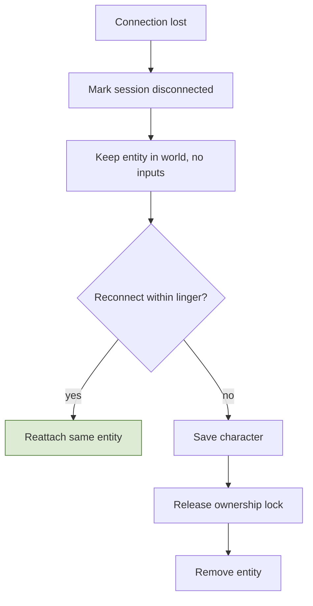
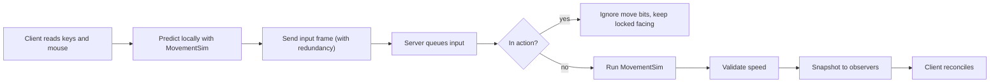
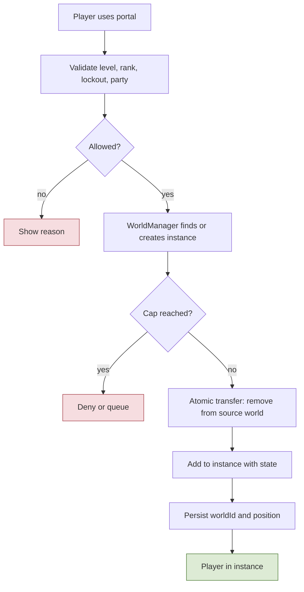
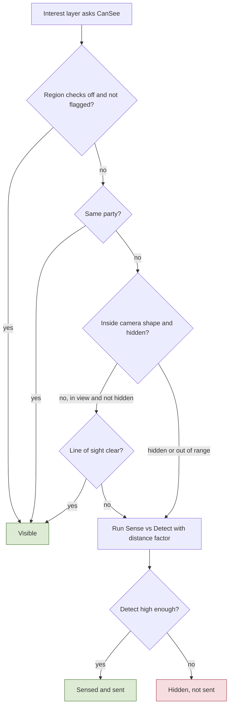
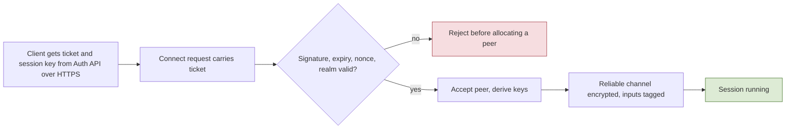

# 2. Foundation Systems

## 2.1 Accounts, login, characters, sessions
**Rules**
- **R-2.1-01** Login is **Steam only**. The account key is the SteamID; there are no passwords or other login providers. The Auth API verifies the Steam session ticket (single use, cancelled when the session ends) and issues its own short-lived session ticket for the game server.
- **R-2.1-02** Family Sharing: bans apply to the owner's account as well as the borrowing account.
- **R-2.1-03** **Realms:** the game launches with **one realm**, but the architecture is realm-aware: a **global database** (accounts by SteamID, bans, realm directory, character counts per realm) and a **database per realm** (characters, items, economy, guilds, territories, quests, arena). Tickets and character data carry a `realmId`. Players come from several regions: host the first realm near most early players; regional realms can be added later.
- **R-2.1-04** One active session per account; a new login replaces the old one.
- **R-2.1-05** Characters: **4 slots per realm** (config), unique names, **soft delete with a grace period**.
- **R-2.1-06** A character is loaded in exactly one place at a time (ownership lock).
- **R-2.1-07** **Logout is blocked** while the character is in combat (`lastCombatAt` + window) and while a bad-honor character is dead (arrest window).
- **R-2.1-08** A **disconnect keeps the character in the world** for a linger period (config per region: longer in combat, none in safe zones). The character is unresponsive but attackable, killable, arrestable. Reconnecting within the linger reattaches to the same entity. For a dead bad-honor player the linger is at least the arrest window.
- **R-2.1-09** Login **queue** when the world reaches its cap (lingering characters count); reconnecting players skip the queue. Graceful shutdown: announce, block logins, save all, disconnect, stop. Client/server protocol versions must match.
- **R-2.1-10** Interactive operations (trade, forge session, contract step) roll back safely if the session is lost.

**Implementation**
- `AuthApi`: verifies tickets with the Steam Web API, creates or loads the account row, returns the character list, issues a signed session ticket (account ID, expiry). A dev login exists behind a build flag: the MSBuild property `DevLogin` (default true only in Debug) defines `DEV_LOGIN` and compiles `Identity/Dev`; Release builds leave it out, and it is used only with `MMORPG_AUTH_IDENTITY=dev`. v0 (endpoints in 9.10): the Steam provider is a stub that refuses every login until the Web API call exists; one realm per Auth API process; plain HTTP is refused except on loopback. Family Sharing bans (R-2.1-02) wait for the bans table; the owner SteamID is stored.
- `SessionManager` validates the ticket, takes a Redis ownership lock `char:{id}` (TTL refreshed by heartbeat), loads the character (`CharacterRepository`, optimistic concurrency by version column), places it in its saved world and position (or the main map if the instance is gone).
- `LingerManager` keeps a map of disconnected entities with expiry timestamps; on expiry the character is saved and removed.
- `LoginQueue` is a Redis sorted set; the Workers service admits players when capacity frees up.
- Saves: periodic, on key events (trade, craft, level-up, death), on logout, via `SaveScheduler` with dirty flags.
- **Implementation (M1, backlog B4):** `src/GameServer/Sessions`. `SessionManager` runs on the world's simulation thread; Redis and PostgreSQL calls run as tasks whose results return through a completion queue read in tick phase 1, so the tick never waits on I/O and reattach, replace and expiry are decided on one thread in command order.
  - Login: the character is the one in the ticket's slot; the lock key is `{prefix}realm:{realmId}:char:{characterId}` (character ids are per realm database), value = a token per hold, TTL `SessionSettings.OwnershipLockTtlMs`, refreshed every `HeartbeatIntervalMs` by compare-and-expire; the row is read again after the lock. The saved position is used when the saved `world_id` is `main`, otherwise the main map spawn.
  - A lock held by another server refuses the login (`CharacterUnavailable`); a failed load releases the lock and refuses (`ServerUnavailable`). A login for an account already online here kicks the old client (`SessionReplaced`) and treats it as a disconnect, so its character lingers. A login for a character still in this world (online, lingering, or closing) reattaches to the same entity without a database read.
  - A lock that is lost, or that cannot be refreshed for a whole TTL, and a save that finds another writer (version conflict) remove the character **without saving** and kick the client (`CharacterUnavailable`, session end reason `OwnershipLost`).
  - `LingerManager`: window `LingerInCombatMs` while `lastCombatAt + CombatStateMs` is in the future, otherwise `LingerOutOfCombatMs` (`StartingValuesM1`). Expiry: logout save, then removal once the save is in, then the lock is released (compare-and-delete). The logout save is the last one: volatile changes after it is issued (regeneration while it is in flight) are not marked again, so they never hold the removal for the next volatile save. Safe-zone linger 0 waits for region flags.
  - Graceful shutdown: block logins (`ServerMaintenance`), stop the simulation, end every session, save every character (at most `ShutdownSaveTimeoutMs`), release the locks, then stop the transport (which sends the kicks). A crashed world is not saved; its locks expire with their TTL.
  - Admin kick (spec 7.4, admin panel v0): a phase 1 command like a login. The client is kicked with `Kicked` and the session ends with reason `Kicked` like a disconnect, so the character lingers (R-2.1-08; user decision 2026-10-26) and is then saved and released as usual. A character that is already lingering is left as it is (`NotConnected`). Packets the transport still receives from a kicked peer are dropped, never opened with its closed keys.
  - Not yet: the login queue (TODO(B4-queue)), the logout request blocked in combat (no combat state yet), the shutdown announcement, replacing a session on another server (needs pub/sub, with the WorldManager).

**Talks to** emits `SessionStarted`, `SessionEnded`, `CharacterCreated`, `CharacterDeleted`; calls `Persistence`, `WorldManager`, `SentencingService` (pending jail on login).

**Flow: Login and session start**

**Flow: Disconnect and linger**

## 2.2 Networking and movement
**Rules**
- **R-2.2-01** **WASD** moves, the **mouse** sets facing (while a **target lock** is on, the locked target sets it instead, R-2.2-06), **left click** normal attack, **Ctrl** dodge, **right click** defend/parry. Hotbar: left side 1 2 3 / 4 5 6, right side Q E R / F Z plus one unassigned slot, two rows per side around the central gauge (section 9.6; configurable).
- **R-2.2-02** Skills and attacks cannot happen while moving: movement stops before the action lands. **Facing is locked** from the moment an action starts and only changes after it completes.
- **R-2.2-03** Movement speed comes from the movement-speed stat (grows slightly with level). Mounts add a speed modifier outside combat; being hit dismounts; disabled by region flags.
- **R-2.2-04** Click-to-move is not used.
- **R-2.2-05** The camera stays centred on the character at a fixed **45-degree pitch**; the player can turn it **horizontally** around the character, never vertically (placeholder keys **C** and **V** until the hotkey config decides). WASD stays screen-relative (W moves toward the top of the screen). Because input frames carry only the four key bits (8 world directions), the yaw settles on the nearest 45-degree step when the turn keys are released, so screen-relative movement is exact at rest.
- **R-2.2-06** **Target lock** (user decision 2026-10-26), a **facing aid only**: **Tab** locks the nearest valid target within the acquire range; **Tab again** moves the lock to the nearest valid target not yet locked in this round (when every one was, a new round starts at the nearest); **a second press within the double-press window** clears the lock instead. While locked, the facing follows the locked target instead of the mouse; attacks, hit shapes and effects still aim with the facing as before (no tab-target for effects, section 3.1 Targeting), location-targeted skills keep the cursor point, and R-2.2-02 still holds (the facing stays locked while an action runs). Valid targets in M1: living monsters and bosses (players wait for the PvP targeting rules). The lock breaks when the target dies, despawns or leaves the interest area, when it is farther than the break range, and on the player's own death or a disconnect; no line-of-sight check in M1. The camera does nothing while locked (R-2.2-05 unchanged).
- **R-2.2-07** **Body collision** (user decision 2026-10-27): living monsters and bosses **block movement**: a player cannot walk, dash or dodge through a monster's body, and a monster cannot walk or dash through a player's or another monster's body. **Players pass through each other** (TODO(open): the push rule between players, decided with PvP). A body is the circle of `bodyRadiusCm` that hits use (`ClassDef`, `MonsterDef`). A walk **slides** along a body, so a player can walk round a monster; a dash or a dodge **stops** at contact (the dash ends early; the action's timing and its i-frames are unchanged), so dodging through the boss is impossible. Nobody pushes: the mover yields. A monster's chase still stops at its attack reach; collision only prevents overlap. Dead bodies do not block. Placement (spawn, login, respawn, a leash reset to the spawn point) is never blocked and pushes nobody; bodies that overlap may only move apart or sideways, never deeper.

**Implementation**
- `Shared/Simulation/MovementSim` advances position from (WASD bits, facing, speed, dt). The client predicts with it; the server runs the same code from received inputs. The server applies one input frame per player per tick (none when nothing arrived, so frames are never invented) and sends its authoritative state with the newest applied input sequence in every snapshot; the client corrects only when its error exceeds a tolerance (client config) and reconciles by replaying unacknowledged inputs.
  - **Input catch-up** (fix/parry-feel; bug fix approved by the orchestrator 2026-10-26, confirmed by the user 2026-10-27 after play): one frame in and one out per tick never drains a burst, so a jitter or a client hitch left frames queued for good, which added their ticks to the player's input delay and to the view lag its parries and dodges are judged with (R-3.1-03; measured on main: +1 frame on LAN with a 60 fps client, +2 to +4 at rtt100). When the queue still holds frames after the tick's dequeue for `ServerLoop.inputBacklogTicks` ticks in a row (placeholder 10), the tick applies up to `ServerLoop.maxInputFramesPerTick` frames (placeholder 2, at most `maxQueuedInputFrames`) until it is drained: phase 2 steps `MovementSim` once per frame, as the client predicted them; the action machine steps once on their buttons OR-ed together (every press is kept; a release and a new press inside the same catch-up tick read as one hold), facing and keys of the newest frame, the hotbar slot of the newest frame that holds one; the acknowledged sequence is the newest; the view clock (R-3.1-03) is the one of the frame with the first new press, else the newest. A full queue still drops its oldest frame (`maxQueuedInputFrames`), but the dropped frame's held buttons and hotbar slot carry over to the frame after it, so only its movement is lost. Catching up over dropping keeps movement continuous (no lost steps, no correction for position); the client only sees an action-timeline correction when a catch-up tick ran two of its predicted machine steps as one.
- Client side (backlog D1, `unity/Assets/Game/Prediction`): the client predicts one `MovementSim` step per input frame it sends and keeps the frames until a snapshot acknowledges them. It compares the server state with the state it predicted after the acknowledged frame; only an error above `ClientPrediction.CorrectionToleranceCm` (at least 2 cm, because snapshots round each axis to whole cm) rebases on the server state and replays the later frames. The visual correction fades over `CorrectionSmoothingMs`, or snaps above `CorrectionSnapCm`. Other entities are drawn `StartingValuesM1.InterpolationDelayMs` behind, blended between snapshots. The client reads the same `data/tables` files as the server with the portable `Shared/Data/ConfigTableReader`.
- The server validates distance per tick against `maxSpeed(stat + mount)` with a tolerance, and counts violations for telemetry and bot scoring. M1: `Shared/Simulation/SpeedCheck` at the end of phase 2, measured from where the previous phase 2 left the entity (so moves made outside `MovementSim` are caught too; a dash the server moves in phase 3 moves this reference with it, D2), tolerance `ServerLoop.SpeedTolerancePercent`, times the frames applied that tick on a catch-up tick (one step each); a violation is counted and recorded as telemetry `SpeedViolation`, not corrected.
- Collision (M1): `MovementSim.Step` with the exported `WorldGrid` resolves the move one axis at a time (X, then Y) against the walkability grid, stopping each axis before the first non-walkable cell, so walls are slid along and corners cannot be cut; the mover is a point because the exporter grows blockers by the agent radius. Server phase 2 and client prediction run the same code (`Shared/World/GridCollision`). The client loads the same exported world, verified with the shared `Shared/World/WorldPackage` checks the server's loader uses, and draws the local player at the grid height under its predicted position. A stop just before a wall's +X or +Y edge rounds onto the wall cell in a whole-cm snapshot, so a rebase from a non-walkable position steps back one raw unit, which is exactly where the server stopped. Bodies: next bullet.
- **Body collision (M1, R-2.2-07)**: `Shared/Simulation/BodyCollision`, run by the server and by client prediction on the same bodies, so a blocked move ends on the same raw position.
  - **Who blocks whom:** `BodyCollision.Blocks` (player by monster, monster by player and monster; never player by player). Only living combatants block; they are gathered through `IBodyBlockers` into a `BodyList` in entity-id order.
  - **Contact:** a move enters a body when the centre distance drops below the two radii added up less `BodyCollisionSettings.overlapToleranceCm`. The move stops at its first contact (the nearest along the move; equal contacts go to the lower id), integer math with `SweptCircle`. With the `slide` response the rest of the move then goes on along the body's tangent, swept again, at most `maxSlideIterations` times (the last pass stops). A body the mover already touches or overlaps blocks only the part of the move towards its centre.
  - **Order of one move:** the body sweep, then the world grid (`GridCollision`), then for monsters the no-entry clip (`KeepOut`), then a guard: an end pushed deeper into a body by those clips does not move (a body against a wall). `MovementSim.Step` and `StepAlong` (walks, the `walkResponse`) and `MovementSim.Dash` (Dash effects, the `dashResponse`) take the bodies; with none they are the grid-only steps.
  - **Effect on other checks:** a blocked move only shortens, never longer than the unblocked one and never a jump. The speed check (below) and the lag-compensation history (recorded after the move) are unchanged.
  - **Server:** phase 2 (players' walks, every catch-up frame, and the monster AI's walk) and phase 3 (dashes) gather from the `SpatialGrid` (`World/BodyBlockers`) where the bodies stand at that moment: entities move in id order, so the bodies before the mover have already moved this tick. The mover yields; nothing pushes in M1.
  - **Client prediction:** `LocalPlayerPredictor.UseBodies` gathers the living monsters of the `EntityRegistry` at their **newest snapshot** position (`RegistryBodyBlockers`; radii by kind and def id, `BodyRadii`), once per predicted frame and once per replay (the same list for every replayed frame). That is the nearest the client knows to where the server collides. With a still monster (idle, attacking, waiting at reach: nearly every contact) both sides stop at the same place within the snapshot rounding (under 1 cm, inside `CorrectionToleranceCm`), so there is no correction. A monster walking into contact gives a correction of about what it walks over the round trip, faded by `CorrectionSmoothingMs`. The bots (`ClientCore`) predict the same way. The F4 hitbox view draws a cross where the own body touches a monster's.
  - **Config:** `BodyCollisionSettings` (singleton): `walkResponse` and `dashResponse` (`stop`, `slide`; placeholders `slide` and `stop`), `overlapToleranceCm` (0..50, placeholder 2), `maxSlideIterations` (1..4, placeholder 2). Without the table bodies block nothing. Reload class `Restart`: the client reads its tables only at start.
  - **Cross-table rules** (`CombatRules.TryBuild`, so `DataValidator`, the server start and the hot reload all check them):
    - the tolerance is below the smallest `bodyRadiusCm`;
    - two of the largest bodies fit the sweep (`SweptCircle.MaxRaw`, 4096 cm);
    - every monster's shortest attack hits the smallest class body standing at contact in front of it. Otherwise it would stand at contact and never attack (spec 3.1, monster AI).
  - **Not in M1:** the world grid still treats every mover as the 40 cm agent, so a large body (the boss) can overlap walls visually.
- **Input buffering:** a press during an action's last frames is buffered for a configurable window (`ActionDef.bufferWindowMs`) and fires when the action ends; the newest press wins (section 3.1, D2).
- While an action is active the sim ignores move bits and the stored facing is the one captured at action start. Facing changes between actions are rate-limited (sanity check).
- Target lock (R-2.2-06) is **client only**: the facing in the input frame is an input either way, so the server needs no change and validates nothing about where the facing came from (the open rate limit above applies to both sources alike). `unity/Assets/Game/Input/Core/TargetLock` picks, cycles and breaks the lock; the candidates are the monsters as drawn at the render time (`TargetCandidates`), and the facing points from the predicted own position to the locked target's drawn position, the view the server rewinds this player's hits to (R-3.1-03). `PredictionDevClient` sends that facing instead of the mouse's while locked and raises `WorldClientFeed.LockedTargetChanged` for the HUD (spec 9.12). Config: `TargetLockSettings` (client-only, `doublePressWindowMs`, `acquireRangeCm`, `breakRangeCm` between the acquire range and `StartingValuesM1.interestRadiusCm`, `cycleOrder` `distance` or `clockwise`; placeholders 300 ms, 1500 cm, 2000 cm, `distance`), the key in the `Hotkeys` row `targetLock` (Tab), checked by the table's set rule. A press acts at once (lock or cycle) and a second press within the window clears it, so a double press always ends unlocked; a dead target clears the lock without switching to the next.
- Hotbar layouts are stored server-side per character; the server validates that the used skill is learned and on the bar.

**Talks to** calls `ActionMachine` (start/cancel actions), `StatBlock` (speed), `Regions` (mount flags); emits `Moved` (sampled, telemetry only).

**Flow: Input to simulation**

## 2.3 World, spatial grid, interest management, instances, regions
**Rules**
- **R-2.3-01** One **continuous main map** with no loading screens, cities, biomes, monsters; small towns around it; 3 main cities with fast travel between them only. The map size is not used for sizing right now.
- **R-2.3-02** Instances (dungeons, raids, jail, GvG sieges) are separate worlds around the map, entered through portals.
- **R-2.3-03** Players only see what the fixed camera shows, so the **interest area is small**: the camera's ground footprint (rectangular/elliptical, aligned to the camera) plus a margin for fast movement and entities arriving. One update rate for everything inside.
- **R-2.3-04** Terrain streams in chunks on the client; entities never depend on chunk loading (the server sends height data or the client holds entities until ground exists).
- **R-2.3-05** Region flags decide PvP, honor policy, visibility checks, death drops, mounts, fees (section 2.3 table).

**Implementation**
- `SpatialGrid`: uniform cells (size about half the interest radius). Each entity is registered in a cell. `InterestManager` computes per-player visible sets from nearby cells and emits enter/leave (spawn/despawn) deltas when a player crosses a cell or an entity moves.
- `RegionDef` volumes are authored in Unity and exported with collision/navigation data by `Tools/UnityExporter` into server-readable files (heightmap, simplified blockers, navmesh, region volumes). A per-cell region lookup array makes flag checks one array read. M1: the walkability grid carries the region index and ground height per cell (`grid.bin`, `Shared/World/WorldGridFormat`); every walkable cell belongs to exactly one region (overlapping volumes and walkable ground outside every volume are export errors); a region's flags are the `RegionDefaults` row of its `RegionDef.areaType` (M1 carries `pvpMode`, honor effects and `deathDrop`; the other flags come with their systems). Overlapping walkable surfaces fit as extra grid layers; TODO(open): how an entity picks or changes layer, so v1 grids hold one layer.
- **The first field zone (M2, WP-M2-7, spec 12.8):** the M1 sample world grew into one world of the city and the zone (world id `m1`, `data/world/m1`, scene `M1Sample.unity`; the server still loads one `MMORPG_WORLD_DIR`): X -50..390 m, Z -200..200 m, 50 cm cells (880 x 800, `grid.bin` v2 run-length, about 80 KB). Regions: `m1.city` (normalCity), `m1.combat` (the M1 combat area by the gate) and four open-world rings `field1.ring1` to `field1.ring4` east of the gate (each several volumes; ring 1, wrapping `m1.combat`, is the tutorial area of 12.3), so the demand loop counts per type and ring (R-4.2-03). Low ridges with passes separate the rings; a road runs from the gate to the field boss's plateau (1 m up) at the far end. The client loads the authored scene for its look (`WorldSceneLoader`); it is one scene, so **no terrain streaming yet** (R-2.3-04 applies once the main map outgrows a scene). The zone has no bridge or other overlapping surface, so the layer question (10.4 [M1]) stays open. Interest and grid settings are unchanged (30 m interest radius, 15 m cells; checked by the 50-bot run in the zone, 11.5 `m2-zone`).
- `World` is the common abstraction (entity registry, grid, tick, interest query, collision). `WorldManager` creates instances from templates on demand, enforces player caps, tracks and destroys them. The main map and instances share the interface, so instances can later move to separate processes.
- **Instance entry** is an atomic handoff: remove from the source world, validate cap, create/join, transfer state, persist `worldId + position`. Reverse on exit. A crashed instance resolves to a defined outcome (return players to the main map).
- Large coordinates: positions are sent relative to a region origin or quantized; Unity uses a floating origin.

| Region flag | Values | Used by |
|---|---|---|
| pvpMode | off / armed-only / always-on | PvpRules |
| honorPolicy | allowed / unwelcome | GuardNpcAi, Disguise |
| visibilityChecks | off / forced-only / full | VisibilityService |
| deathDrop | on / off / confiscate | Death handling |
| mountsAllowed | true / false | Mounts |
| feeProfile | default / owner rates | FeeService |
| ownerGuildId | none / guild | Territory, FeeService |
| arenaQueue | true / false | Arena queue (cities only) |
| raidStart | true / false | Raid window start (cities only) |
| arenaRuleset | off / normalized | Stat normalization, neutral rank factor, no drops/honor |

**Default flags by area type**
| Area | PvP | Honor effects | Drops | Notes |
|---|---|---|---|---|
| Normal city | off | on | off | NPC guards attack bad-honor players; robe needed for them |
| Lawless city | always on | **off** (kills do not change honor) | **on** | taking someone's loot still adds the stolen mark, with no honor loss |
| Open world | armed only | on | on | loot bags, stolen marks |
| Regular dungeon | off | off | **off** | party instance |
| Raid | off | off | off | personal loot |
| Arena | always on (teams) | off | off | normalized stats |
| Siege | always on (sides) | off | off | |

**Talks to** emits `EnteredRegion`, `LeftRegion`, `InstanceCreated`, `InstanceClosed`; consumed by Law, Guilds, Economy.

**Flow: Enter an instance through a portal**

## 2.4 Visibility: Sense, Detect, line of sight
**Rules**
- **R-2.4-01** By default a player sees what is in **eye vision** (inside the camera shape and not blocked) and not hidden. Entities that are **hidden by a skill**, or **outside eye vision** (beyond the camera range or blocked by walls/terrain), go through the check; if it passes, the observer **senses** them.
- **R-2.4-02** Every player has **Sense** (hides) and **Detect** (reveals). With distance: `effectiveDetect = Detect x distanceFactor(distance)`. If the hider's Sense > effectiveDetect the hider stays hidden; if equal both see each other; if Sense < effectiveDetect the observer sees the hider. Closer distance makes detection easier (distance bands).
- **R-2.4-03** Area effects hit hidden players. **Monsters** use the same rule and must pass it to aggro. Attacks and skills **break hiding or raise Sense temporarily**. **Party members always see each other.**
- **R-2.4-04** Checks are **disabled in cities** except for flagged entities (bad-honor, disguised, hidden by skill).
- **R-2.4-05** Hidden entities are **never sent** to clients.
- **R-2.4-06** The **disguise robe** (6.2) gives any player Sense, and **any observer (guards or ordinary players)** is tested against it with the same Sense vs Detect check.

**Implementation**
- `IVisibilityQuery.CanSee(observer, target)` is called by the interest layer. Order, cheap to expensive: region mode, same party, camera shape, distance, Sense vs Detect with distance factor, line of sight.
- Line of sight: grid/heightmap ray stepping (DDA) against server collision data; results cached per pair and reused until either entity moves to a new sub-cell; checks run at 2-5 Hz in a per-tick time budget.
- **Hysteresis:** the reveal threshold is slightly easier than the hide threshold, so boundary cases do not flicker or spam spawn/despawn.
- Temporary Sense changes are timed `StatModifier`s (source: skill), so recomputation happens through the stat system.
- A per-region set of **flagged entities** limits city checks to a few players; guards evaluate only that set at low rate.

**Talks to** reads `StatBlock`, `Regions`, `CollisionData`, `Party`; emits `Detected`, `Revealed`; consumed by GuardNpcAi, monster aggro.

**Flow: Visibility decision for one pair**

## 2.5 Network security
**Rules**
- **R-2.5-01** The Auth API issues a **signed, single-use session ticket** (account, realm, slot, about 60 s expiry, nonce, key ID). The client sends it in the LiteNetLib connection request, and the server **validates it before accepting the peer**.
- **R-2.5-02** The Auth API also gives the client a **session key** over HTTPS; the same key travels inside the ticket encrypted with the server secret. The **reliable channel is encrypted** with authenticated encryption (ChaCha20-Poly1305 or AES-GCM, sequence-based nonce, replay window). The unreliable channel is not encrypted, but **client inputs carry a short integrity tag** (truncated MAC with the session key).
- **R-2.5-03** Unused LiteNetLib features are disabled (unconnected messages, NAT punch-through, discovery). Limits: connection attempts per IP, pending and total peers, packet size, packets per second per peer, reliable backlog, and actions per second per character.
- **R-2.5-04** Decoders bound-check every length and count, cap MemoryPack message sizes, never deserialize client-chosen types, and are fuzz-tested.
- **R-2.5-05** Infrastructure: only the UDP game port and the Auth API (HTTPS) are public; database and Redis are private; the **admin panel is reachable only through a VPN or IP allowlist**. **AWS Shield Standard** at launch; Global Accelerator may be added later for latency. Signing keys live in the parameter store and rotate by key ID.
- **R-2.5-06** Security events (failed connects, MAC or decryption failures, rate-limit hits) go to telemetry and abuse scoring.
- **R-2.5-07** **Every MemoryPack payload is guarded before deserialization.** One entry point reads every reliable message: the id must be registered, the message must fit the id's size cap (from config for client messages), and the whole body must match the id's declared layout (member counts, bounded strings in strict UTF-8, bounded array counts, nothing left over) before MemoryPack is called. The guard is allocation free and linear in the message size, and the cap is checked first, so it cannot be used to amplify CPU or memory. A new message id cannot be read without a layout and, when clients send it, a cap. Reason: MemoryPack trusts its length headers; a crafted string header makes it read past the buffer and kills the process (2026-10-25).

**Implementation**
- `TicketValidator` (signature, expiry, nonce cache in Redis: key `{prefix}nonce:{hex}` set if absent with the ticket's remaining lifetime as TTL, checked synchronously during connection approval; if Redis cannot be reached the ticket is refused with `ServerUnavailable`), `SessionCrypto` (per-direction ChaCha20-Poly1305 on reliable messages, truncated HMAC-SHA256 tag on client input packets) wrapping whole messages inside the transport rather than as a LiteNetLib packet layer (a packet layer would have to parse LiteNetLib's internal datagram format; the cost is that LiteNetLib headers and acks are not authenticated), `RateLimiter` per IP (IPv6 per /64), server-wide and per peer, limits in the `NetSecurity` table, fuzz tests for every decoder in CI. Reliable messages (R-2.5-07): `Shared/Protocol/ReliableMessageReader` holds one spec per `ReliableMessageId` (direction, body type, `MemoryPackLayout`, protocol bound) and is the only code that calls MemoryPack's deserializer, after `MemoryPackGuard` accepted the body; `InputRouter` runs `ReliableMessageReader.IsWellFormed` with the id's `ReliableMessageCaps` cap on every reliable message before it routes anything (a client id without a row is refused, and the DataValidator reports the missing row). Tests fail for an id without a spec or a fuzz sample, and for a client id without a route. `SessionCrypto` is in `Shared/Security` so client and server share one framing; the server plugs in the platform ChaCha20-Poly1305, the Unity client a managed RFC 8439 implementation (interop tests prove they match byte for byte). Client side: `ClientConnection` in `unity/Assets/Game/Net/Client` surfaces `ConnectRejectReason` for the login UI and drops the connection when a server message fails to open.
- Plain HTTP (R-2.5-02, R-2.5-05): the Auth API and the admin panel listen on plain HTTP only on loopback (`GameServer/Host/HttpListenPolicy`). Dev containers (docker compose, spec 11.3; user decision 2026-10-26): inside a container a service must listen on the wildcard address for its published port to reach it, so a wildcard bind is allowed only when the build has the dev login (`DevLogin`, Debug), `MMORPG_DEV_CONTAINER_HTTP=true` is set and the official .NET image's `DOTNET_RUNNING_IN_CONTAINER=true` holds; `docker-compose.yml` publishes those ports on the host's 127.0.0.1 only. A Release build never allows it. TODO(infra): TLS in front of both for staging and production.

**Flow: Secure connection**

