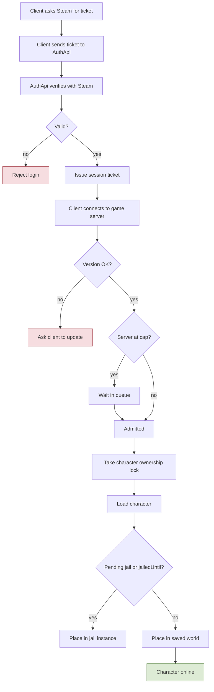
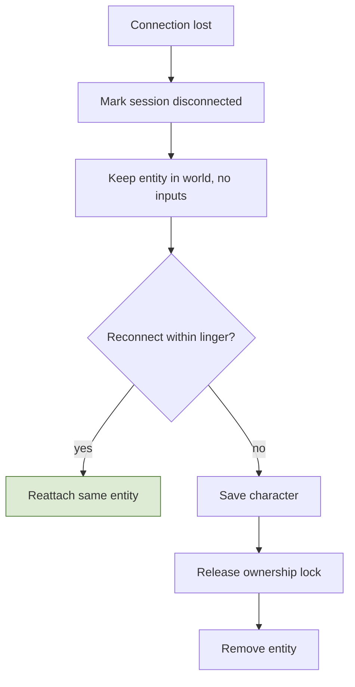
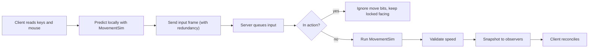
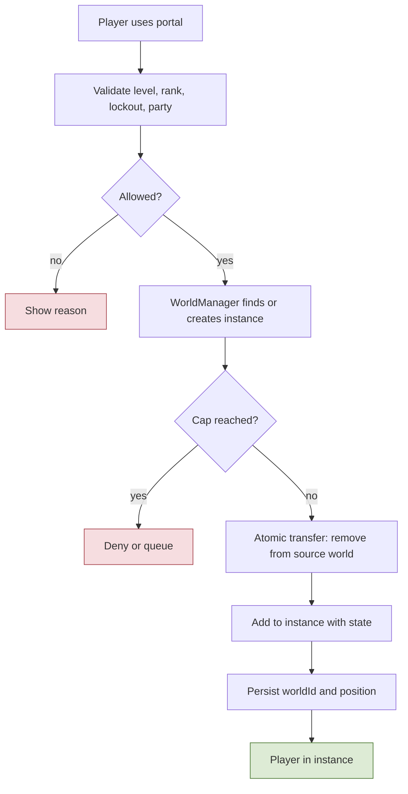
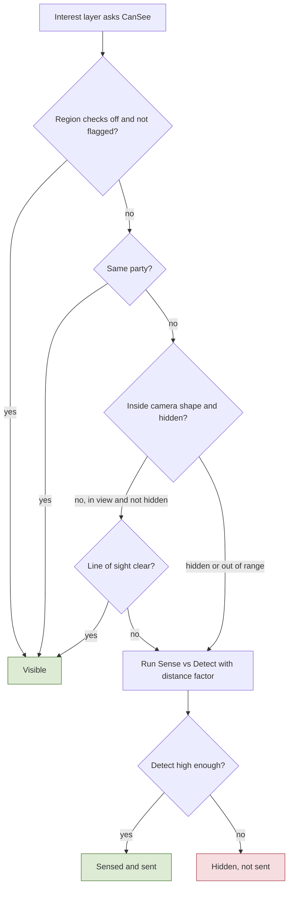
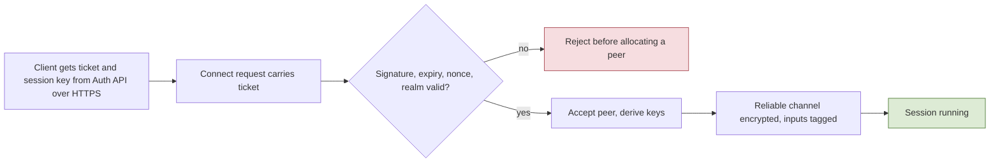

# 2. Foundation Systems

## 2.1 Accounts, login, characters, sessions
**Rules**
- **R-2.1-01** Login is **Steam only**. The account key is the SteamID; there are no passwords or other login providers. The Auth API verifies the Steam session ticket (single use, cancelled when the session ends) and issues its own short-lived session ticket for the game server.
- **R-2.1-02** Family Sharing: bans apply to the owner's account as well as the borrowing account.
- **R-2.1-03** **Realms:** the game launches with **one realm**, but the architecture is realm-aware: a **global database** (accounts by SteamID, bans, realm directory, character counts per realm) and a **database per realm** (characters, items, economy, guilds, territories, quests, arena). Tickets and character data carry a `realmId`. Players come from several regions: host the first realm near most early players; regional realms can be added later.
- **R-2.1-04** One active session per account; a new login replaces the old one.
- **R-2.1-05** Characters: **4 slots per realm** (config), unique names, **soft delete with a grace period**.
- **R-2.1-06** A character is loaded in exactly one place at a time (ownership lock).
- **R-2.1-07** **Logout is blocked** while the character is in combat (`lastCombatAt` + window) and while a bad-honor character is dead (arrest window).
- **R-2.1-08** A **disconnect keeps the character in the world** for a linger period (config per region: longer in combat, none in safe zones). The character is unresponsive but attackable, killable, arrestable. Reconnecting within the linger reattaches to the same entity. For a dead bad-honor player the linger is at least the arrest window.
- **R-2.1-09** Login **queue** when the world reaches its cap (lingering characters count); reconnecting players skip the queue. Graceful shutdown: announce, block logins, save all, disconnect, stop. Client/server protocol versions must match.
- **R-2.1-10** Interactive operations (trade, forge session, contract step) roll back safely if the session is lost.

**Implementation**
- `AuthApi`: verifies tickets with the Steam Web API, creates or loads the account row, returns the character list, issues a signed session ticket (account ID, expiry). A dev login exists behind a build flag.
- `SessionManager` validates the ticket, takes a Redis ownership lock `char:{id}` (TTL refreshed by heartbeat), loads the character (`CharacterRepository`, optimistic concurrency by version column), places it in its saved world and position (or the main map if the instance is gone).
- `LingerManager` keeps a map of disconnected entities with expiry timestamps; on expiry the character is saved and removed.
- `LoginQueue` is a Redis sorted set; the Workers service admits players when capacity frees up.
- Saves: periodic, on key events (trade, craft, level-up, death), on logout, via `SaveScheduler` with dirty flags.

**Talks to** emits `SessionStarted`, `SessionEnded`, `CharacterCreated`, `CharacterDeleted`; calls `Persistence`, `WorldManager`, `SentencingService` (pending jail on login).

**Flow: Login and session start**

**Flow: Disconnect and linger**

## 2.2 Networking and movement
**Rules**
- **R-2.2-01** **WASD** moves, the **mouse** sets facing, **left click** normal attack, **Ctrl** dodge, **right click** defend/parry. Hotbar: left side 1 2 3 / 4 5 6, right side Q E R / F Z plus one unassigned slot, two rows per side around the central gauge (section 9.6; configurable).
- **R-2.2-02** Skills and attacks cannot happen while moving: movement stops before the action lands. **Facing is locked** from the moment an action starts and only changes after it completes.
- **R-2.2-03** Movement speed comes from the movement-speed stat (grows slightly with level). Mounts add a speed modifier outside combat; being hit dismounts; disabled by region flags.
- **R-2.2-04** Click-to-move is not used.

**Implementation**
- `Shared/Simulation/MovementSim` advances position from (WASD bits, facing, speed, dt). The client predicts with it; the server runs the same code from received inputs. The server applies one input frame per player per tick (none when nothing arrived, so frames are never invented) and sends its authoritative state with the newest applied input sequence in every snapshot; the client corrects only when its error exceeds a tolerance (client config) and reconciles by replaying unacknowledged inputs.
- The server validates distance per tick against `maxSpeed(stat + mount)` with a tolerance, and counts violations for telemetry and bot scoring. M1: `Shared/Simulation/SpeedCheck` at the end of phase 2, measured from where the previous phase 2 left the entity (so moves made outside `MovementSim` are caught too), tolerance `ServerLoop.SpeedTolerancePercent`; a violation is counted and recorded as telemetry `SpeedViolation`, not corrected.
- Collision (M1): `MovementSim.Step` with the exported `WorldGrid` resolves the move one axis at a time (X, then Y) against the walkability grid, stopping each axis before the first non-walkable cell, so walls are slid along and corners cannot be cut; the mover is a point because the exporter grows blockers by the agent radius. Server phase 2 and client prediction run the same code (`Shared/World/GridCollision`).
- **Input buffering:** a press during an action's last frames is buffered for a configurable window and fires when the action ends.
- While an action is active the sim ignores move bits and the stored facing is the one captured at action start. Facing changes between actions are rate-limited (sanity check).
- Hotbar layouts are stored server-side per character; the server validates that the used skill is learned and on the bar.

**Talks to** calls `ActionMachine` (start/cancel actions), `StatBlock` (speed), `Regions` (mount flags); emits `Moved` (sampled, telemetry only).

**Flow: Input to simulation**

## 2.3 World, spatial grid, interest management, instances, regions
**Rules**
- **R-2.3-01** One **continuous main map** with no loading screens, cities, biomes, monsters; small towns around it; 3 main cities with fast travel between them only. The map size is not used for sizing right now.
- **R-2.3-02** Instances (dungeons, raids, jail, GvG sieges) are separate worlds around the map, entered through portals.
- **R-2.3-03** Players only see what the fixed camera shows, so the **interest area is small**: the camera's ground footprint (rectangular/elliptical, aligned to the camera) plus a margin for fast movement and entities arriving. One update rate for everything inside.
- **R-2.3-04** Terrain streams in chunks on the client; entities never depend on chunk loading (the server sends height data or the client holds entities until ground exists).
- **R-2.3-05** Region flags decide PvP, honor policy, visibility checks, death drops, mounts, fees (section 2.3 table).

**Implementation**
- `SpatialGrid`: uniform cells (size about half the interest radius). Each entity is registered in a cell. `InterestManager` computes per-player visible sets from nearby cells and emits enter/leave (spawn/despawn) deltas when a player crosses a cell or an entity moves.
- `RegionDef` volumes are authored in Unity and exported with collision/navigation data by `Tools/UnityExporter` into server-readable files (heightmap, simplified blockers, navmesh, region volumes). A per-cell region lookup array makes flag checks one array read. M1: the walkability grid carries the region index and ground height per cell (`grid.bin`, `Shared/World/WorldGridFormat`); every walkable cell belongs to exactly one region (overlapping volumes and walkable ground outside every volume are export errors); a region's flags are the `RegionDefaults` row of its `RegionDef.areaType` (M1 carries `pvpMode`, honor effects and `deathDrop`; the other flags come with their systems). Overlapping walkable surfaces fit as extra grid layers; TODO(open): how an entity picks or changes layer, so v1 grids hold one layer.
- `World` is the common abstraction (entity registry, grid, tick, interest query, collision). `WorldManager` creates instances from templates on demand, enforces player caps, tracks and destroys them. The main map and instances share the interface, so instances can later move to separate processes.
- **Instance entry** is an atomic handoff: remove from the source world, validate cap, create/join, transfer state, persist `worldId + position`. Reverse on exit. A crashed instance resolves to a defined outcome (return players to the main map).
- Large coordinates: positions are sent relative to a region origin or quantized; Unity uses a floating origin.

| Region flag | Values | Used by |
|---|---|---|
| pvpMode | off / armed-only / always-on | PvpRules |
| honorPolicy | allowed / unwelcome | GuardNpcAi, Disguise |
| visibilityChecks | off / forced-only / full | VisibilityService |
| deathDrop | on / off / confiscate | Death handling |
| mountsAllowed | true / false | Mounts |
| feeProfile | default / owner rates | FeeService |
| ownerGuildId | none / guild | Territory, FeeService |
| arenaQueue | true / false | Arena queue (cities only) |
| raidStart | true / false | Raid window start (cities only) |
| arenaRuleset | off / normalized | Stat normalization, neutral rank factor, no drops/honor |

**Default flags by area type**
| Area | PvP | Honor effects | Drops | Notes |
|---|---|---|---|---|
| Normal city | off | on | off | NPC guards attack bad-honor players; robe needed for them |
| Lawless city | always on | **off** (kills do not change honor) | **on** | taking someone's loot still adds the stolen mark, with no honor loss |
| Open world | armed only | on | on | loot bags, stolen marks |
| Regular dungeon | off | off | **off** | party instance |
| Raid | off | off | off | personal loot |
| Arena | always on (teams) | off | off | normalized stats |
| Siege | always on (sides) | off | off | |

**Talks to** emits `EnteredRegion`, `LeftRegion`, `InstanceCreated`, `InstanceClosed`; consumed by Law, Guilds, Economy.

**Flow: Enter an instance through a portal**

## 2.4 Visibility: Sense, Detect, line of sight
**Rules**
- **R-2.4-01** By default a player sees what is in **eye vision** (inside the camera shape and not blocked) and not hidden. Entities that are **hidden by a skill**, or **outside eye vision** (beyond the camera range or blocked by walls/terrain), go through the check; if it passes, the observer **senses** them.
- **R-2.4-02** Every player has **Sense** (hides) and **Detect** (reveals). With distance: `effectiveDetect = Detect x distanceFactor(distance)`. If the hider's Sense > effectiveDetect the hider stays hidden; if equal both see each other; if Sense < effectiveDetect the observer sees the hider. Closer distance makes detection easier (distance bands).
- **R-2.4-03** Area effects hit hidden players. **Monsters** use the same rule and must pass it to aggro. Attacks and skills **break hiding or raise Sense temporarily**. **Party members always see each other.**
- **R-2.4-04** Checks are **disabled in cities** except for flagged entities (bad-honor, disguised, hidden by skill).
- **R-2.4-05** Hidden entities are **never sent** to clients.
- **R-2.4-06** The **disguise robe** (6.2) gives any player Sense, and **any observer (guards or ordinary players)** is tested against it with the same Sense vs Detect check.

**Implementation**
- `IVisibilityQuery.CanSee(observer, target)` is called by the interest layer. Order, cheap to expensive: region mode, same party, camera shape, distance, Sense vs Detect with distance factor, line of sight.
- Line of sight: grid/heightmap ray stepping (DDA) against server collision data; results cached per pair and reused until either entity moves to a new sub-cell; checks run at 2-5 Hz in a per-tick time budget.
- **Hysteresis:** the reveal threshold is slightly easier than the hide threshold, so boundary cases do not flicker or spam spawn/despawn.
- Temporary Sense changes are timed `StatModifier`s (source: skill), so recomputation happens through the stat system.
- A per-region set of **flagged entities** limits city checks to a few players; guards evaluate only that set at low rate.

**Talks to** reads `StatBlock`, `Regions`, `CollisionData`, `Party`; emits `Detected`, `Revealed`; consumed by GuardNpcAi, monster aggro.

**Flow: Visibility decision for one pair**

## 2.5 Network security
**Rules**
- **R-2.5-01** The Auth API issues a **signed, single-use session ticket** (account, realm, slot, about 60 s expiry, nonce, key ID). The client sends it in the LiteNetLib connection request, and the server **validates it before accepting the peer**.
- **R-2.5-02** The Auth API also gives the client a **session key** over HTTPS; the same key travels inside the ticket encrypted with the server secret. The **reliable channel is encrypted** with authenticated encryption (ChaCha20-Poly1305 or AES-GCM, sequence-based nonce, replay window). The unreliable channel is not encrypted, but **client inputs carry a short integrity tag** (truncated MAC with the session key).
- **R-2.5-03** Unused LiteNetLib features are disabled (unconnected messages, NAT punch-through, discovery). Limits: connection attempts per IP, pending and total peers, packet size, packets per second per peer, reliable backlog, and actions per second per character.
- **R-2.5-04** Decoders bound-check every length and count, cap MemoryPack message sizes, never deserialize client-chosen types, and are fuzz-tested.
- **R-2.5-05** Infrastructure: only the UDP game port and the Auth API (HTTPS) are public; database and Redis are private; the **admin panel is reachable only through a VPN or IP allowlist**. **AWS Shield Standard** at launch; Global Accelerator may be added later for latency. Signing keys live in the parameter store and rotate by key ID.
- **R-2.5-06** Security events (failed connects, MAC or decryption failures, rate-limit hits) go to telemetry and abuse scoring.

**Implementation**
- `TicketValidator` (signature, expiry, nonce cache in Redis), `SessionCrypto` (per-direction ChaCha20-Poly1305 on reliable messages, truncated HMAC-SHA256 tag on client input packets) wrapping whole messages inside the transport rather than as a LiteNetLib packet layer (a packet layer would have to parse LiteNetLib's internal datagram format; the cost is that LiteNetLib headers and acks are not authenticated), `RateLimiter` per IP (IPv6 per /64), server-wide and per peer, limits in the `NetSecurity` table, fuzz tests for every decoder in CI. `SessionCrypto` is in `Shared/Security` so client and server share one framing; the server plugs in the platform ChaCha20-Poly1305, the Unity client a managed RFC 8439 implementation (interop tests prove they match byte for byte). Client side: `ClientConnection` in `unity/Assets/Game/Net/Client` surfaces `ConnectRejectReason` for the login UI and drops the connection when a server message fails to open.

**Flow: Secure connection**

