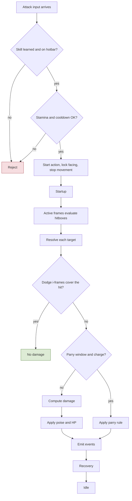
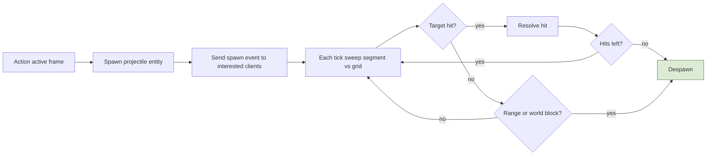
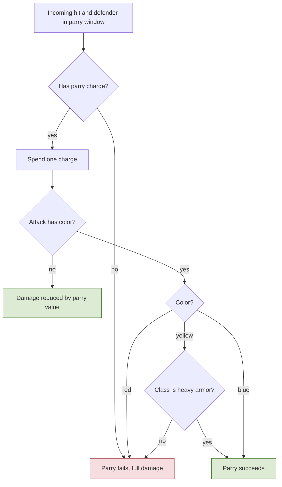
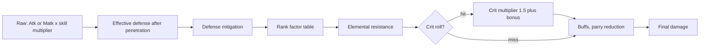
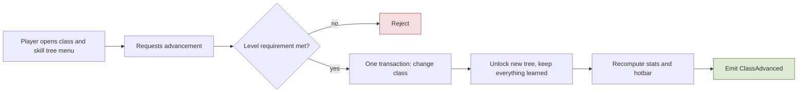
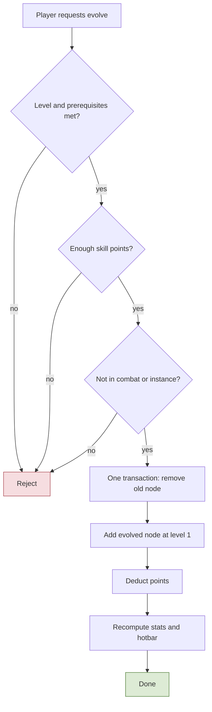
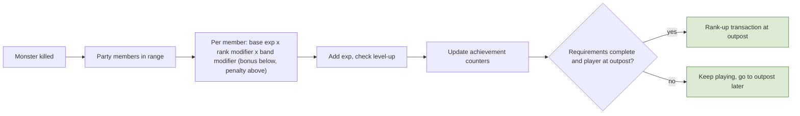
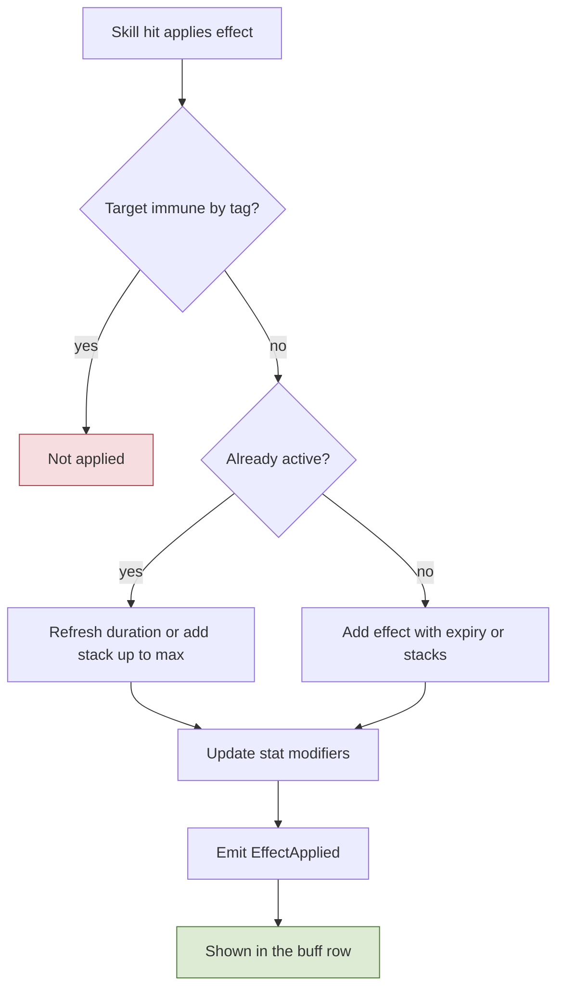
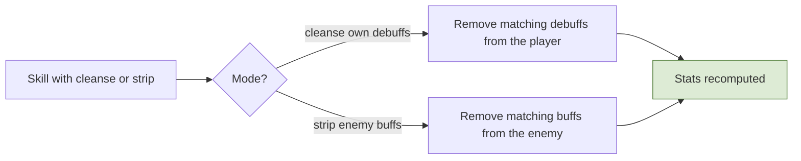
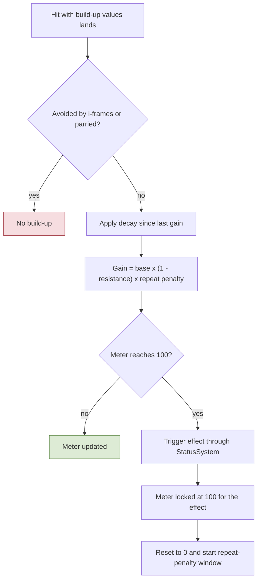

# 3. Combat, Stats, Classes, Progression

## 3.1 Action state machine and hit resolution
**Rules**
- **R-3.1-01** Every attack, skill, dodge, parry, harvest, and arrest is an **action** with startup, active, recovery windows (some are channels). Movement is ignored during actions; facing is locked at start; inputs can be buffered; which actions cancel which is data.
- **R-3.1-02** Stamina and other limits (souls-like): actions cost stamina and may have cooldowns; stamina regen sets the combat rhythm. Cooldown reduction exists (capped). Attack/cast speed scales action durations.
- **R-3.1-03** Hits are resolved from **shapes** (cone, box, capsule) defined per action and evaluated by the server during active frames against nearby entities from the grid. **Lag compensation** (cap **200 ms**): monsters hitting players use a **pending hit** that waits up to the defender's half round-trip (capped) for a dodge or parry input, judged on the defender's own timeline by input timestamps; players hitting monsters are checked against a short **position history** rewound to what the attacker saw (capped); in **PvP** the attacker gets a smaller rewind (100 ms) and the defender rule applies to dodge and parry. A monster attack's startup must exceed reaction time plus the cap (validated in the action tables). Clock sync and timestamp limits stop clients from claiming impossible timings.
- **R-3.1-04** Tick rate **20 Hz**; inputs carry sub-tick timestamps so timing is judged between ticks. **No heavy attacks**: normal attacks and **skills both consume stamina**.
- **R-3.1-05** Monster attack telegraphs are server events: the start event carries the action ID, start tick, direction (fixed at start), and the optional parry color.
- **R-3.1-06** **Normal attacks** are each class's default attack: one action with a single strike, no heavy or charged variant (R-3.1-04).
- **R-3.1-07** **Skills are built from categories that combine.** A skill is one action whose phases carry one or more **effects**, each pinned to a phase and an offset inside it:
  - **Simple action**: one offensive or defensive effect (a strike, a heal). Example: Cross Cut, Heal.
  - **Channeling**: a `Channel` phase that must complete before the following effects fire. Example: a charged spell.
  - **Buff/Debuff**: applies or removes a status (section 3.7). Example: Haste, Cleanse.
  - **Dash**: moves the caster during a phase (the action moves the entity; movement keys stay ignored, R-3.1-01). Example: a charge.
  - **Ground effect**: spawns an area on the ground with a duration and a tick rate. Example: a fire circle.

  Any combination is allowed: "channel, then a fire circle" is a `Channel` phase plus a ground effect in `Active`; "dash, then strike" is a dash in `Startup` plus a strike in `Active`. Normal attacks use the same model (one strike).
- **R-3.1-08** **Every hit carries poise damage** (section 3.3), from normal attacks and skills alike, and a **flinch power** (R-3.3-07).
- **R-3.1-09** **A channel is interrupted only by a flinch or a poise break** (R-3.3-01, R-3.3-07); damage alone does not interrupt it. An interrupted channel fires none of its later effects.

**Implementation**
- `ActionMachine` per entity: states `Idle, Startup, Active, Recovery, Channel, Dodge, Parry, Flinched, Staggered, Dead`. `ActionDef` rows (shared data): duration per phase in ms, `staminaCost`, `cooldown`, `movesDuring=false`, `hitboxes[]` (shape, offset, active window), `projectile?`, `chargeCost?`, `iFrames?`, `parryClassPve?`, `parryClassPvp?`, `gaugeDelta`, `cancelableBy[]`, `interruptConditions[]` (for channels).
- `HitResolver` (phase 5): for each active hitbox, query grid, filter targets (faction, `PvpRules`, party/guild immunity, visibility not required for area effects), then per target: dodge i-frames (judged with lag compensation) → parry check → damage (3.4) → poise (3.3) → apply → emit events. Order is deterministic.
- Skills are generic **effect types** (projectile, area, buff, dash, summon...) configured by data. A new skill is data plus visuals; code is needed only for a new effect type.
- Effects (R-3.1-07) are rows of their own table (`ActionEffectDef`: `id`, `actionId` [Ref `ActionDef`], `kind`, `phase`, `offsetMs`, plus the kind's parameters), because config rows hold no nested objects. Kinds for M1: `Strike` (hit shapes, poise damage, flinch power, flinch ms), `Projectile` (3.2), `Heal`, `ApplyStatus`, `RemoveStatus`, `Dash` (distance, duration, collision with the world grid), `GroundArea` (shape, duration, tick rate, damage and poise per tick, never flinch: R-3.3-09). `Summon` comes later. An effect fires when its phase reaches its offset; effects of an interrupted or cancelled action that have not fired are dropped.
- The client uses the same `ActionDef` tables to predict animations and cooldowns.
- **M1 implementation (backlog D2)**, `Shared/Simulation/Actions` (`ActionMachine`, `ActionCatalog`), run by server phase 3 (`GameServer/Combat/ActionRunner`) and by client prediction on the same inputs:
  - Phases run **Startup, Channel, Active, Recovery**; a phase of 0 ms is skipped, any other lasts its ms **rounded up to whole ticks** (so it lasts at least one tick). Dodge and parry are actions of kind `dodge` and `parry` with the same phases; `Flinched` and `Staggered` are machine states with a length, `Dead` is reserved. Snapshot state codes: 0 Idle, 1 Startup, 2 Channel, 3 Active, 4 Recovery, 5 Flinched, 6 Staggered, 7 Dead.
  - A **press** is a button held in this input frame and not in the previous one (a hotbar slot: a slot number that changed); without an input frame nothing is pressed and time still passes. At most one press per tick, by priority **dodge, parry, hotbar skill, attack**; the others are dropped.
  - Idle: the press starts its action (refused with `OnCooldown` while the cooldown, counted from the start, runs; an empty slot with `SkillNotLearned`). During an action: it **cancels** the action when listed in `cancelableBy` and the action has reached `cancelFrom`; else it is **buffered** when the action is within its `bufferWindowMs` of the end (the newest press wins; it fires on the tick the action ends); else it is dropped without a message. While flinched or staggered presses are dropped.
  - Starting locks the facing to that tick's aim. Movement (phase 2) ignores move keys and facing while the machine is busy, so an action started on a tick stops movement from the next tick.
  - Effects fire on the tick their phase reaches `offsetMs` (rounded up, kept inside the phase), once; a cancel or an interrupt drops the unfired ones. Fired effects go to `IActionEffectSink` on the server (Strike, Projectile: D3; Heal, statuses, GroundArea: D6). A **Dash** moves the entity along the locked facing, `distanceCm` spread evenly over `durationMs` (integer sine table `FixedTrig`), each step with world collision; the server moves the speed-check reference with it.
  - `ActionMachine.Interrupt(Flinch | PoiseBreak, durationMs)` for D4: a poise break staggers from any state; a flinch cancels Startup or Channel (or catches an idle or flinched entity), and is ignored during Active and Recovery, during a dodge, in super armor phases and while staggered. An interrupt forgets the buffered press.
  - Refusals go to the client on the reliable channel (`ActionResult`: input sequence, action, slot, `ActionReason`); started actions need no message, the snapshot shows them (action id 12 bits and age 8 bits per entity, or age and length for a flinch or stagger). The server publishes `ActionStarted`.
  - The client predicts the machine with movement, keeps its state per pending input, and reconciles the snapshot's action state like a position: a different state, action or age at the acknowledged input rebases on the server's action and replays the pending inputs. The buffered press and cooldowns are not sent and stay as predicted. Phase changes and fired effects reach the visuals through `IActionPhaseListener` (local player) and `RemoteActionTracker` (others).
  - Until the class kits (backlog E), one `ActionBindings` row maps left click, Ctrl, right click and the hotbar slots to actions for everyone. TODO(D4): stamina, charges, i-frames, parry. TODO(D5): attack and cast speed scale the durations.

**Talks to** reads `StatBlock`, `SkillTree`, `Hotbar`, `PvpRules`; emits `ActionStarted`, `HitLanded`, `Damaged`, `Killed`, `Died`; consumed by Progression, Law, Economy, Telemetry.

**Flow: One attack from input to result**

## 3.2 Projectiles
**Rules**
- **R-3.2-01** Archers and many monsters fire projectiles. Some **stop at the first target** and others pierce (`maxHits`). Same system for monsters and players.
- **R-3.2-02** Projectiles hit through the normal rules: faction, PvP armed state, party/guild immunity, parry colors, poise.

**Implementation**
- `ProjectileSystem` (phase 4): projectile entities with owner, origin, direction (locked facing), speed, range/lifetime, hit radius, `maxHits`, `stopsOnWorld`, per-hit damage falloff (optional), a set of already-hit targets (no double hits).
- **Swept collision**: test the segment moved this tick against grid neighbors (prevents tunneling). World blocking uses server collision data. Processed in projectile ID order; capped per owner; pooled.
- Network: one **spawn event** (type, origin, direction, speed, start tick) to players whose interest area the path crosses; clients simulate the straight path deterministically; the server sends hit and despawn events; late spawns are fast-forwarded from the start tick.

**Talks to** calls `HitResolver`; emits `ProjectileSpawned`, `ProjectileHit`.

**Flow: Projectile lifecycle**

## 3.3 Poise, dodge, parry
**Rules**
- **R-3.3-01** **Poise:** every entity has one poise bar. A hit subtracts poise damage; at zero the entity is staggered, the bar resets, and a short stagger immunity starts (no chain stuns). Regeneration is lazy (from timestamps). Hits in a tick resolve in deterministic order.
- **R-3.3-02** **Dodge (Ctrl):** a movement action with an **i-frame window** (hits landing inside it are ignored; hits before or after it resolve normally). It costs stamina and **one charge from its own pool** (separate from parry), recharging over time. The i-frame window is judged on the defender's timeline with the 200 ms compensation cap.
- **R-3.3-03** **Parry (right click):** a parry attempt **spends one parry charge when it starts**, **even if it fails** (wrong color, no heavy armor, bad timing). A character has a set number of charges (for example 3) that recharge over time (lazy by timestamp).
- **R-3.3-04** **Colors exist only on specific attacks** (mainly bosses, a few monsters, a few PvP skills): **red** cannot be parried, **yellow** only by heavy armor wearers, **blue** by everyone. **Uncolored attacks:** a parry reduces damage (config value or derived parry stat).
- **R-3.3-05** Block/parry strength is derived from other stats. **Armor class (heavy or not) is defined by the character's class** (a field in `ClassDef`), not by equipment, so there is no mixed-set rule and no weight system.
- **R-3.3-06** Colors can differ for PvE and PvP (`parryClassPve`, `parryClassPvp`).
- **R-3.3-07** **Flinch (small stagger)**, separate from the poise break: every hit carries a `flinchPower` and a base `flinchMs` (set per attack, so a jab and a heavy skill differ). Every entity has a `flinchResist`, a `flinchDurationPercent` and a `flinchImmunityMs` (per monster type in `MonsterDef`, per class in `ClassDef`). When `flinchPower >= flinchResist`, the target is not flinch-immune, and its current phase has no super armor (R-3.3-08), the target **flinches** for `flinchMs x flinchDurationPercent / 100`:
  - an action in **Startup or Channel is cancelled** (this stops a monster from attacking non-stop after being hit); an action already in Active or Recovery finishes, so hits can trade; a **dodge is never interrupted**;
  - the target then ignores further flinches for `flinchImmunityMs` (no stunlock); damage and poise damage still apply.
  - It applies to **players and monsters alike**, in PvE and PvP; dodge i-frames and parries avoid it as they avoid the hit. A poise break in the same hit supersedes the flinch.
- **R-3.3-08** **Super armor:** an `ActionDef` can mark phases as super armor (mainly boss telegraphs). Flinch is ignored during them; a poise break still staggers.
- **R-3.3-09** **Ground effects deal damage and poise damage per tick but never flinch**, so standing in an area cannot stunlock.

**Implementation**
- `PoiseSystem`: `{current, max, lastHitTick, immuneUntilTick}` per entity; on hit apply pending regen, subtract, break → trigger `Staggered` action, reset, set immunity. Lives in `Combat`.
- `FlinchSystem` (R-3.3-07): `{flinchImmuneUntilTick}` per entity, with the entity's `flinchResist`, `flinchDurationPercent` and `flinchImmunityMs` from `MonsterDef` or `ClassDef`. Per hit, after poise: if no poise break, check super armor, immunity and resist; on a flinch, cancel a Startup or Channel action, start a `Flinched` action for the scaled duration, set immunity, emit `Flinched`. Every value is config (tuned in backlog K).
- `ChargeMeter` (used by parry and dodge): `{charges, max, lastChangeTime, rechargeMs}` computed on read. `ParrySystem`: resource meter `{charges, max, lastChangeTime, rechargeMs}` computed on read; resolution returns an explicit result enum (Success, Reduced, FailedRed, FailedArmor, FailedTiming, NoCharge) sent to the client so UI can explain failures.
- Telegraph: the attack-start event includes the color (2 bits) for the colored warning.

**Talks to** reads `StatBlock`, equipment armor class; emits `ParryAttempted`, `Staggered`, `Flinched`.

**Flow: Parry resolution**

## 3.4 Stats and damage formula
**Rules**
- **R-3.4-01** **Primary attributes** (from levels): STR, DEX, STA, INT.
- **R-3.4-02** **Derived stats:** Atk, Magic atk, Crit rate, Crit damage, Def, Magic def, movement speed, attack/cast speed, poise, HP/MP/stamina regen, elemental and status resistances, physical and magic penetration, cooldown reduction (capped), Sense, Detect, parry/block values. Block/parry are derived from other stats; no equip weight; no item find/luck.
- **R-3.4-03** **Resource meters:** HP, MP, Stamina, **intoxication** (potions are toxic; limits how many can be drunk), **food satiety** (food gives stats but you cannot overeat), parry charges. Intoxication and satiety decay with time (computed from timestamps on login).
- **R-3.4-04** **Damage formula** (pure function, integer math): (1) raw = Atk or Matk x skill multiplier (+ flat); (2) effective defense = max(0, Def x (1 - pen%) - flatPen); (3) mitigation = effDef / (effDef + C), C scaled by rank; (4) rank factor from a table (attacker rank vs defender rank, bounded); (5) elemental factor = 1 - resistance (capped, weakness allowed); (6) crit: if the roll succeeds, x(1.5 + crit damage bonus), crit chance and bonus capped; (7) buffs, debuffs, parry reduction, optional small variance. Balance is a later step.
- **R-3.4-05** **Status effects:** see section 3.7.

**Implementation**
- `StatBlock`: base + a list of `StatModifier {statId, flat, percent, sourceType, sourceId, expiresAt}`. Source types: gear, skill, buff, food, potion, gem, enchant, mount, title (later). Derived values are cached and recomputed only when a modifier is added/removed or an attribute changes. Enchant bonus is computed from a config table by level (not baked into items).
- `DamageCalc` lives in `Shared/Simulation` so clients can show tooltip estimates; the server is authoritative. Unit tests use a grid of cases; `EconomySimulator`/Monte Carlo tools cover balance.

**Talks to** consumed by every combat system; emits `StatsChanged`.

**Flow: Damage calculation pipeline**

## 3.5 Classes, skills, skill tree, gauges
**Rules**
- **R-3.5-01** A player starts with one of four **initial classes: Warrior, Archer, Mage, or Assist** (the four roots) and advances through the tree when the level requirement is met (**levels 30, 50, and 80**, from the class and skill-tree menu; the class gauge unlocks at **level 100**). **Advancing is a player action in the class/skill-tree menu**: it is not automatic and does not happen at an outpost. **Class is permanent**; no multiclass; no account-wide systems. A future item might allow re-choosing.
- **R-3.5-02** **32 final classes** under 4 roots (Warrior, Archer, Mage, Assist), each root with 2 branches, each branch 2 sub-branches, each sub-branch 2 final classes. Each class has its own **gauge**.
- **R-3.5-03** Skills are **active** (10-15 per class at the end; they evolve) and **passive** (status/bonus effects). Both have levels (for example max 5).
- **R-3.5-04** After a class change nothing is reset; a **new tree** becomes available, and its skills have a **minimum level** to learn (all trees and skills). One **skill point per level**. **Evolving** a skill is a new node that replaces the old one, **costs points, and starts at level 1** (old levels are lost). **Respec is free, any time**, but blocked in combat, instances, and boss fights; it clears evolved nodes too.
- **R-3.5-05** Base skills are reused through evolution (fire spark → fireball → branch variants): same skill with extra stats and a new visual, defined by inheritance with overrides.
- **R-3.5-06** PvP needs an **armed** hotbar skill (section 6.1) and a **disguise robe** skill exists for everyone (section 6.3).

| Root | Branch / sub-branch | Final classes (weapon, element, role) |
|---|---|---|
| Warrior | Swordman / Sword Master | Slayer (dual swords, physical/blood, DPS); Fencer (physical, DPS) |
| Warrior | Swordman / Berserker | Barbarian (big axe, physical, off tank/DPS); Highlander (big sword, physical, tank/DPS) |
| Warrior | Knight / Spearman | Light Storm (spear, lightning, off tank/tank); Dragoon (spear, fire, DPS/off tank) |
| Warrior | Knight / Royal Knight | Guardian (sword and shield, holy, tank/support); General (big sword, physical/fire, DPS/off tank) |
| Archer | Bow Master / Ranger | Elemental Shooter (bow, multi-element, DPS/support); Spirit Caller (bow, multi-element, support/DPS) |
| Archer | Bow Master / Hunter | Sniper (bow, physical, DPS); Wind Waker (bow, wind, DPS/off tank) |
| Archer | Thief / Assassin | Reaper (scythe, dark, DPS); Venom (dual dagger, poison, DPS) |
| Archer | Thief / Jester | Trickster (dual dagger, dark, DPS); Shadow (dual pistol, dark, DPS) |
| Mage | Wizard / Archmage | Elementor (staff, multi-element, DPS); Druid (wand and shield, earth, support/tank) |
| Mage | Wizard / Summoner | Beast Tamer (wand and shield, multi-element, tank/DPS); Bard (harp, multi-element, DPS/support) |
| Mage | Arcanist / Mentalist | Psyker (wand and book, dark, DPS); Void (book, dark/gravity, DPS) |
| Mage | Arcanist / Sorcerer | Warlock (staff, dark, DPS); Necromancer (book, dark, DPS/tank) |
| Assist | Priest / Saint | Angel (staff, holy, support); White Mage (wand and book, holy, DPS) |
| Assist | Priest / Templar | Executioner (big axe, holy, off tank/DPS); Paladin (sword and book, holy, tank/support) |
| Assist | Scout / Fighter | Asura (gloves, holy, tank/DPS); Illuminated (vajra, holy, DPS/support) |
| Assist | Scout / Monk | Wukong (stick, earth, tank/off tank); Iron Fist (gloves, fire, off tank/DPS) |

Gauges already described: Slayer **Vital Points** (3 strikes), Barbarian **No Fear of Pain** (less HP, more damage), Light Storm **Charge** (plus and minus), Dragoon **Dragon Rage** (progressive damage until awakening), Elemental Shooter **Overcharger** (4 bars, one per element; a full bar adds its effect), Spirit Caller **Elemental Affinity** (last spirits used decide the effect), Sniper **Precision** (each hit on the same target raises damage), Reaper **Soul Reaper** (kills drain points). The gauges of the other classes are **placeholders** until they are designed (decided soon).

**Implementation**
- `SkillTree` rows: `{nodeId, family, classId, minCharLevel, prereqs[], maxLevel, pointCost, kind(active|passive), evolvesFrom?}`. `SkillDef` inherits a parent definition and overrides only changed fields; a validation tool prints the resolved skill.
- Character stores learned `(nodeId, level)` only; points spent are derived. `learn`, `upgrade`, `evolve`, `respec` are atomic transactions with checks on points, level, prerequisites, and state.
- `SkillEvolution` table keyed by `(family, classId)` → node used for that class (the tree branches). Class advancement is requested from the class/skill-tree menu; the server validates the level requirement and runs one atomic, idempotent transaction (class, unlock new tree, recompute stats).
- Passive effects are stat modifiers or triggers from a small fixed trigger list (on hit, on crit...). `ClassGauge` is a per-class meter updated by action `gaugeDelta` and events, defined in data.
- Balance check sheet: total node cost versus about 130 points available at max level.

**Talks to** reads/writes `StatBlock`, `Hotbar`; emits `SkillLearned`, `SkillEvolved`, `ClassAdvanced`, `Respecced`.

**Flow: Class advancement from the menu**

**Flow: Evolve a skill**

## 3.6 Experience, rank, achievements
**Rules**
- **R-3.6-01** **Level:** kill monsters for exp; each level needs a minimum exp. **Rank** (F to SS) is separate and is raised by **achievements**, not by level.
- **R-3.6-02** **Rank and level are independent.** Each rank has an **overlapping level band**: F 0-25, E 5-40, D 15-50, C 25-70, B 35-85, A 45-100, S 55-125, SS 70-130 (table `RankLevelRanges`). Level is never capped by rank.
- **R-3.6-03** **Exp = base x rankModifier(player rank, monster rank) x bandModifier(level vs rank band)**: inside the band 1.0; **below the band minimum a small bonus** (grows with the gap, capped); above the band maximum the heavy penalty, multiplicative. Same rank gives 1.0; higher-rank monsters give more. A player above their rank's level range receives a heavy penalty (the intentional **dead zone**) and should pivot to achievements. **No exp floor.** Per party member, each with their own rank and level.
- **R-3.6-04** Rank change is **not automatic**. When the achievement requirements (minimum number and categories) are complete, the player must **go to an Adventurer Guild outpost** to change rank; the server checks the requirements at that moment. A level-15 player may reach rank E. The client shows the exp multiplier and rank progress.
- **R-3.6-05** Achievements must be completable without exp (exploration, crafting, forging, instance clears, monster kills, returning stolen items...).

**Implementation**
- `ExpService` consumes `Killed` events (per member in range), computes via two config tables, applies level-ups, emits `LevelUp`. `AchievementService` keeps idempotent per-character counters from events; `RankService.TryRankUp` is called only from the outpost interaction: it checks requirement tables, persists, announces, emits `RankChanged`.
- Rank-up requirements, exp curves, band bonus/penalty curves, and modifier matrices are config. Monsters show a **recommended level range**, since rank no longer implies level.

**Talks to** consumes `Killed`, `Crafted`, `QuestStepDone`, `ItemReturned`, etc.; emits `LevelUp`, `RankChanged`, `AchievementDone`.

**Flow: Kill to exp and rank**

## 3.7 Status effects (buffs and debuffs)
**Rules**
- **R-3.7-01** Skills apply **buffs and debuffs**. Each has either a **duration in seconds** or **stacks**, depending on the skill itself.
- **R-3.7-02** **Immunity** is used in few cases, mainly **bosses**.
- **R-3.7-03** A skill may **cleanse debuffs from the player** or **remove buffs from an enemy**, depending on the skill.
- **R-3.7-04** **Pets and mounts are on/off states** chosen by the player: while active they appear in the HUD buff row, and when disabled they stop showing. They are not damage-over-time style effects and need no timer.
- **R-3.7-05** Effects from potions and food use the same system. The concrete list of effects and their numbers is Open (config).

**Implementation**
- `StatusEffectDef` (shared data): `{id, kind(buff|debuff), durationSec | maxStacks, stackRule, dispellable, tags, modifiers[], tickEffect?}`. `StatusSystem` keeps a list of active effects per entity `{effectId, sourceId, expiresAt | stacks}`; expiry is checked on demand from timestamps (no timers) in tick phase 6.
- Effects change stats through `StatModifier`s (source type `buff`/`debuff`), so the stat system recomputes only on change. Periodic damage uses a tick effect evaluated in the fixed tick order.
- `immuneTags` on an entity (boss definitions) block applying matching effects. `Cleanse(target, filter)` removes the player's own debuffs; `Strip(target, filter)` removes buffs from an enemy; both are skill effect types with data-driven filters.
- Snapshots carry the active effect IDs (and stack counts) for the buff row; pets and mounts are flags in the same row.

**Talks to** reads/writes `StatBlock`; emits `EffectApplied`, `EffectRemoved`, `EffectCleansed`; consumed by HUD sync and Telemetry.

**Flow: Apply a status effect**

**Flow: Cleanse and strip**

## 3.8 Build-ups
**Rules**
- **R-3.8-01** Five build-ups: **Blood loss** (one hit of a percentage of max HP), **Burn** (damage over time), **Cold** (burst damage plus a slow), **Poison** (damage over time), **Lightning** (several small bursts over the duration).
- **R-3.8-02** Each target has a **meter from 0 to 100 per build-up**. At 100 the effect **triggers**; the meter stays full while the effect lasts and then **resets to 0**.
- **R-3.8-03** **Gain:** attacks and skills raise specific build-ups (fire spark raises Burn). Amount = `base x (1 - target's resistance to that element) x repeat penalty`; resistance is capped.
- **R-3.8-04** **Reduction:** attacks and skills can also lower build-ups (fire spark lowers Cold), and healing skills can remove part of the meters like a cleanse; cleanse can also end an active effect.
- **R-3.8-05** **Repeat penalty:** after a trigger, gains of that build-up are **reduced for a window**; a further trigger inside the window deepens the reduction, so chains get progressively harder.
- **R-3.8-06** **Decay:** after a few seconds without a hit that raises it, a meter **drops at a steady rate**.
- **R-3.8-07** **Dodge and parry:** hits avoided by i-frames and successful parries apply **no build-up**; an uncolored parry reduces build-up by the same percentage as the damage.
- **R-3.8-08** **Bosses:** a cap or lower multiplier on percentage-of-max-HP effects, set per boss, plus immunity tags.
- **R-3.8-09** Damage over time is **credited to whoever applied it** (exp, honor, PvP flags, kill credit). Meters are volatile: they reset on death, logout, and at each arena round, and are not saved. The arena normalizes build-up resistances.
- **R-3.8-10** One resistance stat per element is used for both damage and build-up, with **separate formulas in config**, so they can become two stats later without code changes.

**Implementation**
- `BuildupDef` per type: resistance stat, triggered status-effect ID (the effect runs through `StatusSystem`, section 3.7), repeat-penalty window and multipliers, decay delay and rate, boss rules. Action data lists build-up changes per hit (for example `Burn +20, Cold -10`).
- `BuildupMeters` on each entity: value, last gain time, penalty-until, penalty level per type. Decay is computed from timestamps on read or hit (no timers).
- `HitResolver` applies build-up changes after the dodge and parry checks, in fixed tick order; a trigger hands off to `StatusSystem`. Snapshots carry meter values (one byte each) only when they change, and **only to the player who owns them**: other players', monsters', and bosses' meters are never sent or shown.
- Milestone 1 includes the framework with **Burn only** (for the Mage's fire spark); the other four arrive with the real skill kits in Milestone 2.

**Talks to** reads `StatBlock` (resistances); calls `StatusSystem`; emits `BuildupTriggered`; consumed by HUD sync and Telemetry.

**Flow: Build-up on hit**

