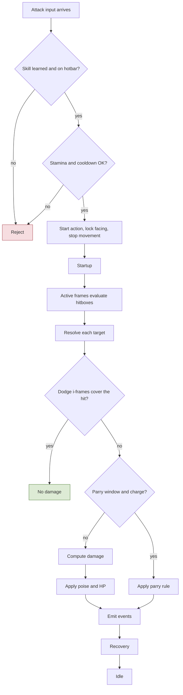
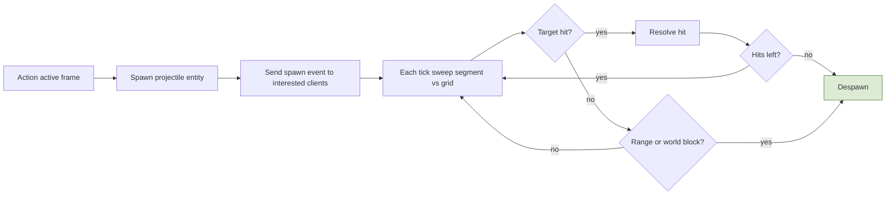
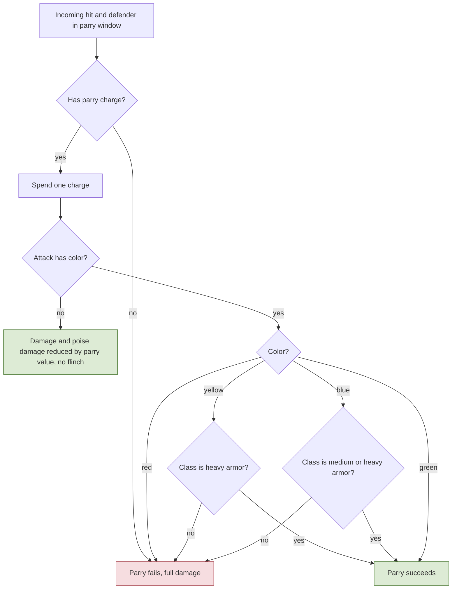
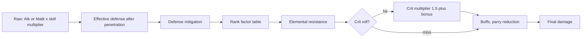
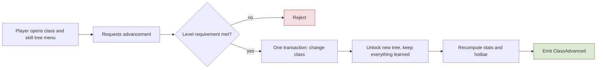
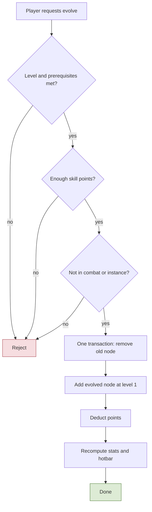
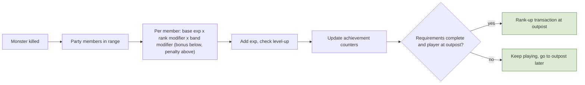
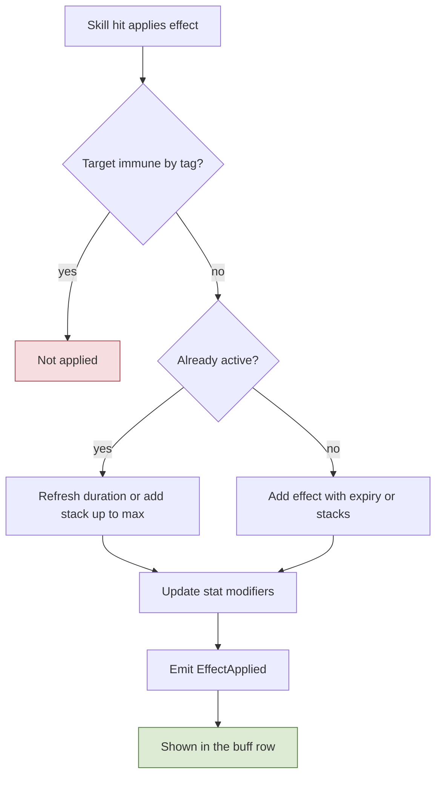
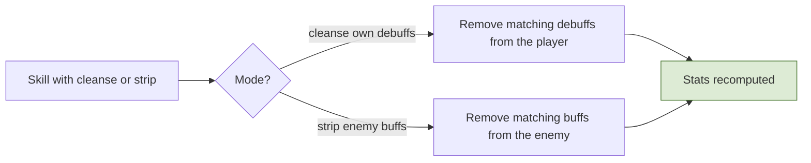
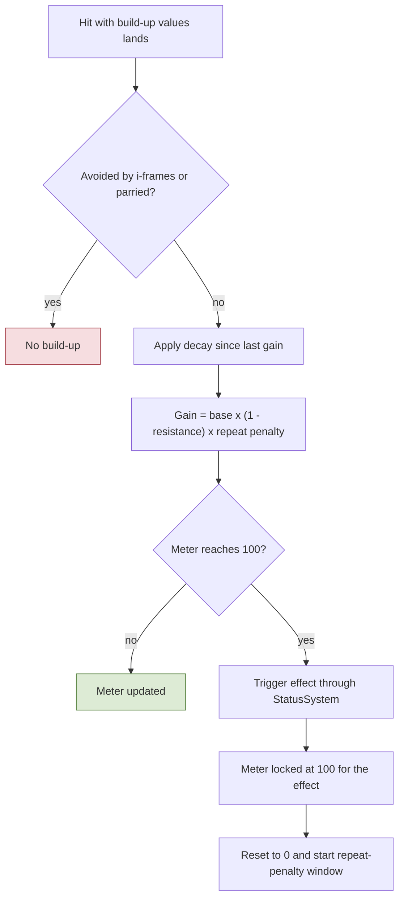

# 3. Combat, Stats, Classes, Progression

## 3.1 Action state machine and hit resolution
**Rules**
- **R-3.1-01** Every attack, skill, dodge, parry, harvest, and arrest is an **action** with startup, active, recovery windows (some are channels). Movement is ignored during actions; facing is locked at start; inputs can be buffered; which actions cancel which is data.
- **R-3.1-02** Stamina and other limits (souls-like): actions cost stamina and may have cooldowns; stamina regen sets the combat rhythm. Cooldown reduction exists (capped). Attack/cast speed scales action durations.
- **R-3.1-03** Hits are resolved from **shapes** (cone, box, capsule) defined per action and evaluated by the server during active frames against nearby entities from the grid. **Lag compensation** (cap **200 ms**): monsters hitting players use a **pending hit** that waits up to the defender's view lag (round trip plus interpolation delay, capped) for a dodge or parry input, judged on the defender's own timeline by input timestamps (the view tick it rendered others at); players hitting monsters are checked against a short **position history** rewound to what the attacker saw (capped); in **PvP** the attacker gets a smaller rewind (100 ms) and the defender rule applies to dodge and parry. A monster attack's startup must exceed reaction time plus the cap (validated in the action tables). Clock sync and timestamp limits stop clients from claiming impossible timings.
- **R-3.1-04** Tick rate **20 Hz**; inputs carry sub-tick timestamps so timing is judged between ticks. **No heavy attacks**: normal attacks and **skills both consume stamina**. Skills also cost a small amount of **MP** (`mpCost`); normal attacks, the dodge and the parry cost none. A start without enough MP is refused with `NoMp`.
- **R-3.1-05** Monster attack telegraphs are server events: the start event carries the action ID, start tick, direction (fixed at start), and the optional parry color (3 bits: none, red, yellow, blue, green; R-3.3-04).
- **R-3.1-06** **Normal attacks** are each class's default attack: one action with a single strike, no heavy or charged variant (R-3.1-04).
- **R-3.1-07** **Skills are built from categories that combine.** A skill is one action whose phases carry one or more **effects**, each pinned to a phase and an offset inside it:
  - **Simple action**: one offensive or defensive effect (a strike, a heal). Example: Cross Cut, Heal.
  - **Channeling**: a `Channel` phase that must complete before the following effects fire. Example: a charged spell.
  - **Buff/Debuff**: applies or removes a status (section 3.7). Example: Haste, Cleanse.
  - **Dash**: moves the caster during a phase (the action moves the entity; movement keys stay ignored, R-3.1-01). Example: a charge.
  - **Ground effect**: spawns an area on the ground with a duration and a tick rate. Example: a fire circle.

  Any combination is allowed: "channel, then a fire circle" is a `Channel` phase plus a ground effect in `Active`; "dash, then strike" is a dash in `Startup` plus a strike in `Active`. Normal attacks use the same model (one strike).

  **Targeting:** there is no tab-target. Effects that heal, apply or remove a status, or spawn a ground area choose who they affect with **hit shapes and a target filter** (`self`, `allies`, `enemies`), aimed with the locked facing like attacks; with no party or PvP (M1) every other player counts as an ally. A **location-targeted** skill (for example a heal) takes the cursor point within the skill's maximum range (a farther point is pulled back to it); the point is **locked when the action starts**, like the facing, and the effect lands there, for example when its channel completes.
- **R-3.1-08** **Every hit carries poise damage** (section 3.3), from normal attacks and skills alike, and a **flinch power** (R-3.3-07).
- **R-3.1-09** **A channel is interrupted only by a flinch or a poise break** (R-3.3-01, R-3.3-07); damage alone does not interrupt it. An interrupted channel fires none of its later effects.

**Implementation**
- `ActionMachine` per entity: states `Idle, Startup, Active, Recovery, Channel, Dodge, Parry, Flinched, Staggered, Dead`. `ActionDef` rows (shared data): duration per phase in ms, `staminaCost`, `cooldown`, `movesDuring=false`, `hitboxes[]` (shape, offset, active window), `projectile?`, `chargeCost?`, `iFrames?`, `parryClassPve?`, `parryClassPvp?`, `gaugeDelta`, `cancelableBy[]`, `interruptConditions[]` (for channels).
- `HitResolver` (phase 5): for each active hitbox, query grid, filter targets (faction, `PvpRules`, party/guild immunity, visibility not required for area effects), then per target: dodge i-frames (judged with lag compensation) → parry check → damage (3.4) → poise (3.3) → apply → emit events. Order is deterministic.
- Skills are generic **effect types** (projectile, area, buff, dash, summon...) configured by data. A new skill is data plus visuals; code is needed only for a new effect type.
- Effects (R-3.1-07) are rows of their own table (`ActionEffectDef`: `id`, `actionId` [Ref `ActionDef`], `kind`, `phase`, `offsetMs`, plus the kind's parameters), because config rows hold no nested objects. Kinds for M1: `Strike` (hit shapes, poise damage, flinch power, flinch ms), `Projectile` (3.2), `Heal`, `ApplyStatus`, `RemoveStatus`, `Dash` (distance, duration, collision with the world grid), `GroundArea` (shape, duration, tick rate, damage and poise per tick, never flinch: R-3.3-09). `Summon` comes later. An effect fires when its phase reaches its offset; effects of an interrupted or cancelled action that have not fired are dropped.
- **Hit shapes** (R-3.1-03, backlog D3; these are the `hitboxes[]` of `ActionDef` above, the active window being the effect's phase and offset) are rows of `HitShapeDef`: `id`, `effectId` [Ref `ActionEffectDef`], `kind` (`cone`, `box`, `capsule`), `forwardOffsetCm` and `sideOffsetCm` (the shape origin along the locked facing and to its right), and the sizes `rangeCm` and `halfAngleDeg` (cone: apex at the origin, axis forward, 1-180 degrees each side), `lengthCm` and `widthCm` (box: from the origin forward, centered across), `lengthCm` and `radiusCm` (capsule: every point within the radius of the segment from the origin forward; length 0 is a circle). A size the kind does not use is 0. Every `Strike` and `GroundArea` effect has 1 to 4 shapes, and no other kind has any. Shapes are placed when the effect fires from the caster's position and locked facing; a target (position and radius) is hit when its circle touches any shape of the effect, once per effect. Geometry in `Shared/Simulation/Combat` (`HitShape`; `SweptCircle` for the projectile sweep of 3.2), integer math with the facing table `FixedTrig`, so the client can predict it.
- The client uses the same `ActionDef` tables to predict animations and cooldowns.
- **M1 implementation (backlog D2)**, `Shared/Simulation/Actions` (`ActionMachine`, `ActionCatalog`), run by server phase 3 (`GameServer/Combat/ActionRunner`) and by client prediction on the same inputs:
  - Phases run **Startup, Channel, Active, Recovery**; a phase of 0 ms is skipped, any other lasts its ms **rounded up to whole ticks** (so it lasts at least one tick). Dodge and parry are actions of kind `dodge` and `parry` with the same phases; `Flinched` and `Staggered` are machine states with a length, `Dead` is reserved. Snapshot state codes: 0 Idle, 1 Startup, 2 Channel, 3 Active, 4 Recovery, 5 Flinched, 6 Staggered, 7 Dead.
  - A **press** is a button held in this input frame and not in the previous one (a hotbar slot: a slot number that changed); without an input frame nothing is pressed and time still passes. At most one press per tick, by priority **dodge, parry, hotbar skill, attack**; the others are dropped.
  - Idle: the press starts its action (refused with `OnCooldown` while the cooldown, counted from the start, runs; an empty slot with `SkillNotLearned`). During an action: it **cancels** the action when listed in `cancelableBy` and the action has reached `cancelFrom`; else it is **buffered** when the action is within its `bufferWindowMs` of the end (the newest press wins; it fires on the tick the action ends); else it is dropped without a message. While flinched or staggered presses are dropped.
  - Starting locks the facing to that tick's aim. Movement (phase 2) ignores move keys and facing while the machine is busy, so an action started on a tick stops movement from the next tick.
  - Effects fire on the tick their phase reaches `offsetMs` (rounded up, kept inside the phase), once; a cancel or an interrupt drops the unfired ones. Fired effects go to `IActionEffectSink` on the server (Strike, Projectile: D3; Heal, statuses, GroundArea: D6). A **Dash** moves the entity along the locked facing, `distanceCm` spread evenly over `durationMs` (integer sine table `FixedTrig`), each step with world collision; the server moves the speed-check reference with it.
  - `ActionMachine.Interrupt(Flinch | PoiseBreak, durationMs)` for D4: a poise break staggers from any state; a flinch cancels Startup or Channel (or catches an idle or flinched entity), and is ignored during Active and Recovery, during a dodge, in super armor phases and while staggered. An interrupt forgets the buffered press.
  - Refusals go to the client on the reliable channel (`ActionResult`: input sequence, action, slot, `ActionReason`); started actions need no message, the snapshot shows them (action id 12 bits and age 8 bits per entity, or age and length for a flinch or stagger). The server publishes `ActionStarted`.
  - The client predicts the machine with movement, keeps its state per pending input, and reconciles the snapshot's action state like a position: a different state, action or age at the acknowledged input rebases on the server's action and replays the pending inputs. The buffered press and cooldowns are not sent and stay as predicted. Phase changes and fired effects reach the visuals through `IActionPhaseListener` (local player) and `RemoteActionTracker` (others).
  - Until the class kits (backlog E), one `ActionBindings` row maps left click, Ctrl, right click and the hotbar slots to actions for everyone. I-frames and parry in `HitResolver`: see the D3 and D4 (defence) bullets below. TODO(D5): attack and cast speed scale the durations.
- **M1 implementation (backlog D4, first part: costs)**:
  - `ActionDef` has `staminaCost`, `chargePool` (`none`, `dodge`, `parry`) and, for dodges only, `iFramesStartMs` and `iFramesMs`. Validator: attacks, skills and dodges cost stamina (R-3.1-04, R-3.3-02); a dodge uses the `dodge` pool, a parry the `parry` pool, nothing else spends charges; a dodge has an i-frame window inside the action and nothing else has one. `ActionBindings` checks the bound actions against spec 12.7 in `StartingValuesM1` (dodge length, i-frames and cost, parry window, normal attack cost, skill costs within `skillStaminaCostMin..Max`). The parry costs no stamina for now: TODO(open) whether it should (R-3.1-02 says actions cost stamina, 12.7 lists no parry cost). Attacks and skills may carry a parry color, `parryClassPve` (used when a monster attacks) and `parryClassPvp` (a player), each `none`, `red`, `yellow`, `blue` or `green` (R-3.3-04, R-3.3-06); validator: only attacks and skills, and only with a `Strike` or `Projectile` effect.
  - A start is checked in this order: cooldown (`OnCooldown`), a charge of the action's pool (`DodgeNoCharge`, `ParryNoCharge`), stamina (`NoStamina`). Only when all pass are the stamina and the charge spent and the action started, so a refusal changes nothing (a refused cancel leaves the running action going; a buffered press is checked when it would start). The parry charge is spent on that start whatever the parry later does (R-3.3-03).
  - Stamina is not machine state: the machine asks the caller through `IActionResources.TrySpendStamina(cost)` (server: the entity's stamina meter; the client predicts it the same way). The dodge and parry `ChargeMeter`s are machine state (`ActionMachineState`), so the client predicts charges and their refusals.
  - The machine counts its own ticks (`ActionMachineState.Tick`: one per step, the count cooldowns already use); the charge meters are in those ticks. Recharge times round up to whole ticks (4 s = 80 ticks at 20 Hz). The i-frame window starts at `iFramesStartMs` rounded up and lasts `iFramesMs` rounded up, kept inside the action; the M1 dodge has it over its Active phase (50 ms to 300 ms).
  - Snapshots do not carry stamina or charges yet: a rebase keeps the predicted charges. TODO: reconcile charges and stamina from the own-entity snapshot (spec 9.4) once it carries them.
- **M1 implementation (backlog D3, hit resolution; D4, poise and flinch)**, `GameServer/Combat`:
  - Phase 3 hands fired effects to `EffectRouter`: a `Strike` is queued (`StrikeQueue`) with the caster's position at that moment (after its dash) and its locked facing; a `Projectile` goes to the ProjectileSystem (3.2). Phase 5 (`StrikeResolver`) resolves the queue in firing order (attacker id): the grid cells around the caster wide enough for the effect's shapes, the largest body radius and the rewind margin; candidates in entity-id order; `CanHit`; a hit when the target's body circle (`bodyRadiusCm` of `ClassDef`/`MonsterDef`) touches any shape, once per effect.
  - `CanHit`: never the attacker itself; both sides fight and are alive (a strike of an attacker that died earlier in the tick lands nowhere); monsters never hit monsters; a player hits a player only when `PvpRules.CanDamage` allows it, which in M1 it never does (spec 6.1: no first class change yet).
  - Lag compensation (R-3.1-03): each applied input frame sets the player's view lag, the applied tick minus the frame's view tick (spec 1.7), under the clock-sync limits of the D4 defence bullet below (0 without a view or for a view of a tick not run yet, at most `lagCompensationCapMs`), rounded down to whole ticks. A player's strike tests a monster where its position history had it that many ticks before. Everything else is tested where it stands; a monster's hit on a player is a pending hit (D4 defence bullet). TODO(WP6-PvP): the PvP attacker rewind (`pvpAttackerRewindMs`) and the defender rule in PvP (PvP is off in M1).
  - The per-target pipeline (`HitResolver`, shared by strikes and projectiles through `IHitTargetResolver`), in order: (1) dodge i-frames: a dodge inside its i-frame window ignores the hit (no damage, poise or flinch), judged on the defender's timeline for a pending hit and on the target's machine at resolve time otherwise; (2) parry: `ParrySystem` (spec 3.3); (3) damage: `DamageCalc` with one crit roll from the world's seeded generator (seed and stream logged as telemetry `WorldRng`), skill multiplier = the effect's `damagePercent` x the request's percent / 100 (projectile falloff), `damageKind` physical (Atk) or magic (Matk), no element yet (TODO(D6)); (4) HP is drained, and at 0 the target dies, which supersedes poise and flinch; (5) otherwise `PoiseSystem`, then `FlinchSystem` when poise did not break (3.3); (6) events `ParryAttempted` (when a parry met the hit), `HitLanded`, `Damaged` (HP lost, HP after, crit; only when HP was lost), `Staggered` or `Flinched`, `Killed`, `Died`. A dodged or parried hit emits no `HitLanded` yet (TODO(open): whether it emits `HitLanded`). Every resolved hit, dodged ones too, sets `lastCombatAt` (UTC) on the players involved and goes into the tick's hit message (spec 1.7).
  - Death: `Combatant.Die` and `ActionMachine.Kill` (state `Dead`: nothing runs, presses and interrupts are dropped; a dead combatant reads 0 HP and does not regenerate). A dead monster leaves in phase 8 and respawns after `monsterRespawnMs` (F).
  - **Player respawn (user decision 2026-10-22):** a dead player comes back `playerRespawnDelayMs` (`StartingValuesM1`, placeholder 5000) after its death, in phase 8, at the city's player spawn marker (`ServerLoop.playerSpawnMarkerId`), with full HP, MP, stamina and poise (`Combatant.Revive`), an idle action machine with full charge pools and no cooldowns (`ActionMachine.Revive`), and a fresh position history; the speed check restarts there and `Respawned` is published (8.1). Lingering players respawn too. There is no prompt yet: the spec 9 respawn prompt comes with the HUD (backlog I). A character saved at 0 HP logs in at the city spawn with full meters. TODO(M5): the bad-honor respawn lock (R-6.3-03).
  - Monsters get the world's action catalog at spawn; phase 3 runs their machines on what their AI requests (below), so flinches and staggers run out like a player's.
- **M1 implementation (backlog F, monster AI)**, `GameServer/AI` (`MonsterAi`, `MonsterBrain` on each `Monster`, `MonsterAiRules`, `MonsterAttack`, `MonsterAiEvents`). One generic AI for every monster type; what differs is data: `MonsterDef.attacks` (ActionDef ids in priority order), `moveSpeedCmPerSec`, `aggroRangeCm`, `leashRangeCm`, and the shared `MonsterAiSettings` (`thinkIntervalMs`, `homeToleranceCm`, `leashTimeoutMs`, `noEntryAreaTypes`). Deterministic: monsters in entity-id order, no random numbers, ties to the lower entity id, integer math (`FixedTrig.AngleOf` for directions).
  - Phase 7 decides, per monster, what it does next tick; phase 2 of the next tick walks (`MovementSim.StepAlong`: along a binary angle at the monster's speed, then the shared grid collision; the position history is recorded after it), phase 3 starts the requested attack through the same `ActionMachine` players use (`ActionInput.Request`: from Idle only, with the cooldown check; the start locks the facing and publishes `ActionStarted`; strikes and projectiles resolve like a player's). Monsters pay no stamina (TODO(open), `MonsterDef`).
  - **Aggro (R-2.4-03; user decision 2026-10-22):** an idle monster scans every `thinkIntervalMs` (spread over the ticks by entity id) for the nearest player inside `aggroRangeCm` that is alive, outside a no-entry region, and that it can see through `IVisibilityQuery`. A player that damages an idle monster (the `Damaged` event) becomes its target at its next think, if the monster can see that player, whatever the distance.
  - **Chase and attack:** the monster keeps its target until the target dies, leaves the world, can no longer be seen or stands in a no-entry region, or until the monster is farther than `leashRangeCm` from its spawn point. While its machine is idle it starts the first attack of `attacks` that is off cooldown and would hit the target if started now, aimed at it: strikes are tested with their own hit shapes placed after the dashes that fire before them, projectiles reach their `rangeCm` plus hit radius. With none, it walks toward the target until its shortest attack would reach, then waits facing it.
  - **Leash (user decision 2026-10-22):** without a target the monster walks home ignoring players (hits still land, but do not re-aggro it); within `homeToleranceCm` of its spawn point it gets full HP and poise back (`Combatant.RestoreFull`), takes the marker's facing and is idle again. A walk home that gets no closer for `leashTimeoutMs` (no pathfinding in M1) ends with the monster placed at its spawn point.
  - **The safe city (user decision 2026-10-22):** monsters never enter regions whose area type is in `noEntryAreaTypes` (`normalCity`, `lawlessCity`): a walk or dash step ending in one keeps only the axis that stays out (it slides along the border), and a target standing in one is dropped.
  - Validator on `MonsterDef` (R-3.1-03): every attack is an `attack` or `skill` action with a `Strike` or `Projectile` effect and a `startupMs` of at least `StartingValuesM1.monsterAttackStartupMinMs`; no attack twice; `leashRangeCm > aggroRangeCm`; a monster with a spawn point has at least one attack.
  - M1 types: `m1.demon` (melee: a claw, a pounce that dashes 3 m then strikes) at spawn points a and b; `m1.alien` (ranged: a spit projectile from 12 m, a slap up close) at c and d. Their hits on players are pending hits judged on the defender's timeline (D4 defence bullet below); their attacks are uncolored in M1 (the boss brings colored attacks).
  - **The M1 boss (WP10; user decisions 2026-10-23)**: `m1.cyclopsBoss` (`MonsterDef.boss`) at spawn point `m1.spawn.combat.boss`, the north-east corner of the combat area (its leash circle stays clear of the city), respawning after `bossRespawnMs` (10 min, spec 12.7). It runs the generic AI above (R-6.7-06); its attacks, in priority order, each with its own action id and its own visual entry (placeholder clips):

    | Action | Color (`parryClassPve`, R-3.3-04) | Hit | Startup | Cooldown | Super armor (R-3.3-08) |
    |---|---|---|---|---|---|
    | `monster.cyclops.stomp` | red | circle of 4.5 m around the boss | 1200 ms | 12 s | Startup, Active |
    | `monster.cyclops.slam` | yellow | 5 m straight ahead, 80 cm each side | 900 ms | 8 s | Startup |
    | `monster.cyclops.sweep` | blue | half circle of 4 m | 800 ms | 6 s | Startup |
    | `monster.cyclops.swipe` | green | 90 degree cone of 3.5 m | 600 ms | none | none |
    | `monster.cyclops.rockThrow` | none (a parry reduces it) | projectile `cyclopsRock`, 15 m | 1000 ms | 5 s | none |

    So up close it uses its melee attacks as their cooldowns allow, at 6-15 m only the rock reaches, farther it walks in; every startup is at least the monster minimum (R-3.1-03). Placeholder stats for 3-4 players (backlog K tunes them): 6000 HP, 400 poise, `flinchResist` 20 so the strongest player hits flinch the startup of the swipe and the rock throw, while super armor protects the others (a poise break still staggers it).
    - **Target loss:** a boss that loses its target (dead, gone, unseen, in a no-entry region) while inside its leash takes the nearest player it would aggro (alive, seen, outside no-entry regions, inside `aggroRangeCm`, ties to the lower entity id); it walks home only when there is none. Normal monsters go home.
    - **Leash and reset:** as for every monster: past `leashRangeCm` (25 m) it walks home ignoring players and gets full HP and poise back there.
    - Validator: a `MonsterDef.boss` row with a spawn point needs at least one attack with a `parryClassPve` color and one with a super armor phase (backlog F "telegraphed attacks, including colored ones").
    - TODO(open): boss phases (attacks or behaviour changing at an HP threshold), threat or target switching while the target is valid, the boss bar engagement rule (`BossEngaged/Left`, spec 9, backlog I).
- **M1 implementation (backlog D4, defence on the defender's timeline; WP6, user decisions)**, `GameServer/Combat` (`DefenceTimeline`, `PendingHits`, `ParrySystem`, `ParryColors`):
  - **The defender's clock.** An input frame's view clock is its view tick plus `SubTick / 64` (spec 1.7: the fraction of the tick the client rendered others at, R-3.1-04). Its view lag is the applied tick minus that clock, in 1/64 ticks.
  - **How the round trip is known.** LiteNetLib measures it with its own ping (`RoundTripTime`). The transport reports it with every input packet (`ITransportListener.OnRoundTripTime`, network thread), and the session's input queue holds it for phase 1 (-1 until a sample exists).
  - **Clock-sync limits** (R-3.1-03), applied in phase 1 to every applied frame:
    - no view, or a view of a tick not run yet, gives lag 0;
    - the view clock never goes back: an older claim is raised to the last applied one, and a new connection resets it;
    - the lag is at most the round trip + `interpolationDelayMs` + `clockSyncToleranceMs` (`StartingValuesM1`, placeholder 50 ms), and never more than `lagCompensationCapMs`; before the first round-trip sample only the cap applies.

    Clamped claims are counted per kind. The same limited lag drives the attacker rewind of the D3 bullet.
  - **Defensive starts.** Phase 3 records each dodge or parry that starts (a buffered one too, at that tick's lag) with when it started on the view clock (the start tick minus the lag) and how many ticks the server machine really ran it. A dodge a stagger cuts short covers only those ticks. A parry press refused with `ParryNoCharge` is recorded too, with the window it would have had. The player keeps the last 4.
  - **Pending hit** (R-3.1-03): `HitResolver.Resolve` queues every monster hit on a player, strike or projectile (`HitOutcome.Pending`).
    - It lands in phase 5, after that tick's strikes, once `hitTick + min(cap, the defender's lag rounded up)` is reached. By then every input the defender sent while seeing the hit's tick has been applied. With lag 0 it lands in the same phase 5.
    - Due hits land in the order they happened: phase 4 projectile order, then phase 5 attacker-id order.
    - A pending hit still lands when its attacker died after swinging. It is dropped when the target died or left the world.
    - HP, poise and flinch act on the target's state at landing.
    - A lingering player (no client) has lag 0.
    - Other hits (players on monsters) are judged at once on the target's machine.
  - **Judging.** The newest defensive start whose span on the view clock contains the hit's tick decides: the hit's position in it is `(hitTick x 64 - viewStart) / 64` action ticks.
    - A dodge with that tick in its i-frames ignores the hit (R-3.3-02).
    - A parry goes to `ParrySystem` (spec 3.3): in its Active phase by color and armor class; in Startup or Recovery `FailedTiming`. A no-charge press whose would-be Active covers the hit gives `NoCharge`; outside it, it is no parry.
    - Then `ParryAttempted` (defender, attacker, action, color, result; actor: the defender), and an `ActionResult` with the parry reason (spec 9.7) to the defender's client, echoing the input sequence of the frame that started the parry.
  - **Telegraph color** (R-3.1-05): `ParryColors.Of(attacker, action)` gives a monster's action its `parryClassPve` and a player's its `parryClassPvp`. `ActionStarted` carries it (players in phase 3; the monster step of backlog F calls the same helper), and snapshots carry it in 3 bits for entities in an action (spec 1.7). Clients keep it as the entity's telegraph color (TODO(I): drawing it).

**Talks to** reads `StatBlock`, `SkillTree`, `Hotbar`, `PvpRules`; emits `ActionStarted`, `HitLanded`, `Damaged`, `Killed`, `Died`; consumed by Progression, Law, Economy, Telemetry.

**Flow: One attack from input to result**

## 3.2 Projectiles
**Rules**
- **R-3.2-01** Archers and many monsters fire projectiles. Some **stop at the first target** and others pierce (`maxHits`). Same system for monsters and players.
- **R-3.2-02** Projectiles hit through the normal rules: faction, PvP armed state, party/guild immunity, parry colors, poise.

**Implementation**
- `ProjectileSystem` (phase 4): projectile entities with owner, origin, direction (locked facing), speed, range/lifetime, hit radius, `maxHits`, `stopsOnWorld`, per-hit damage falloff (optional), a set of already-hit targets (no double hits).
- **Swept collision**: test the segment moved this tick against grid neighbors (prevents tunneling): `SweptCircle.Hits` tests the segment against the target circle grown by the projectile's hit radius and returns the distance along the segment where it first touches, so hits on one segment are taken in that order (ties by entity ID). World blocking uses server collision data. Processed in projectile ID order; capped per owner; pooled.
- Network: one **spawn event** (type, origin, direction, speed, start tick) to players whose interest area the path crosses; clients simulate the straight path deterministically; the server sends hit and despawn events; late spawns are fast-forwarded from the start tick.
- **M1 implementation (backlog D3)**:
  - Data: `ProjectileDef` rows (`id`, `netId` 1-4095, `speedCmPerSec`, `rangeCm` (the lifetime is range / speed), `hitRadiusCm`, `maxHits`, `stopsOnWorld`, `falloffPercentPerHit`, `visualId` [Ref `EntityVisualDef`]); a `Projectile` effect names one with `projectileId` and, like a strike, carries the poise damage, flinch power and flinch ms of each of its hits (R-3.1-08). Validator: every hit up to `maxHits` still deals damage (`(maxHits - 1) * falloff < 100`), and one tick's step stays within the sweep limit (4096 cm). `ProjectileSettings` (singleton): `maxPerOwner`, `maxActive` (pool size), `eventRepeatTicks`.
  - Path (`Shared/Simulation/Combat/ProjectilePath`, shared with the client): from the owner's position on whole cm along the locked facing rounded to the wire's 1024 steps (the facing table's own resolution); after phase 4 of tick T it is at `PositionAt(T - startTick + 1)`, the distance after n steps being `min(limit, speed * n / tickRate)`. A projectile that stops on the world has its whole path cast once against the walkability grid (`Shared/World/GridRay`, supercover: it cannot slip between two cells that touch at a corner), so the client stops it at the same raw point. The grid is grown by the agent radius, so it stops that far in front of a wall.
  - `ProjectileSystem` (phase 4): projectiles in id order (their own ids, not entity ids). Each tick's segment is swept against living combatants of the grid cells around it except the owner, each a circle of its `bodyRadiusCm` grown by the projectile's hit radius; hits are taken by entry distance, ties by entity id. Each goes through the shared hit pipeline (the world's `HitResolver` as `IHitTargetResolver`, hooked in as `EffectRouter.Projectiles`: `CanHit`, then `Resolve` with source `Projectile` and `100 - k * falloff` percent for hit k). Damaged, Killed and Parried count toward `maxHits` (a parried projectile is blocked); Dodged does not (it flies on through a dodge); a counted or dodged target is never tested again. A monster's projectile on a player is a pending hit (R-3.1-03) decided later, so it counts toward `maxHits` when it happens: on its last hit the projectile stops at the player even if the player dodges it (user decision, WP6). It ends, first that applies: `Hit` at `maxHits`, `World` at the wall, `Range`; and `OwnerGone` when its owner leaves the world (a dead owner still in the world keeps its projectiles). Over `maxPerOwner` or with the pool empty the new spawn is refused and counted. Targets are not rewound (the projectile itself is simulated over time). Emits `ProjectileSpawned` and `ProjectileHit` (counted hits).
  - Network (phase 10, every tick): hot messages `ProjectileSpawn` (3) and `ProjectileDespawn` (5) of spec 1.7. A player gets the spawn when the part of the path still to draw crosses its interest square (so players reached later get a late spawn), and the despawn when it got the spawn; a piercing hit that does not end the projectile is not sent (damage feedback is its own message). Each event is sent `eventRepeatTicks` ticks in a row against loss; clients drop duplicates by id. TODO(open): whether a player that cannot see a hidden owner (spec 2.4) gets its projectiles, since the origin shows where the owner stood.
  - Client (`ProjectileTracker`, `ProjectileViews`): rebuilds the path from the spawn and its `ProjectileDef`, draws it at the interpolation render time like other remote entities, applies a despawn when the render time reaches its tick, and ends it at its range or wall on its own if the despawn is lost. TODO: draw the local player's own projectiles on the predicted tick.

**Talks to** calls `HitResolver`; emits `ProjectileSpawned`, `ProjectileHit`.

**Flow: Projectile lifecycle**

## 3.3 Poise, dodge, parry
**Rules**
- **R-3.3-01** **Poise:** every entity has one poise bar. A hit subtracts poise damage; at zero the entity is staggered, the bar resets, and a short stagger immunity starts (no chain stuns). Regeneration is lazy (from timestamps). Hits in a tick resolve in deterministic order.
- **R-3.3-02** **Dodge (Ctrl):** a movement action with an **i-frame window** (hits landing inside it are ignored; hits before or after it resolve normally). It costs stamina and **one charge from its own pool** (separate from parry), recharging over time. The i-frame window is judged on the defender's timeline with the 200 ms compensation cap.
- **R-3.3-03** **Parry (right click):** a parry attempt **spends one parry charge when it starts**, **even if it fails** (wrong color, armor too light, bad timing). A character has a set number of charges (for example 3) that recharge over time (lazy by timestamp).
- **R-3.3-04** **Colors exist only on specific attacks** (mainly bosses, a few monsters, a few PvP skills): **red** cannot be parried, **yellow** only by heavy armor wearers, **blue** by medium or heavy armor wearers, **green** by everyone. **Uncolored attacks:** a parry reduces damage (config value or derived parry stat).
- **R-3.3-05** Block/parry strength is derived from other stats. **Armor class (light, medium or heavy) is defined by the character's class** (`ClassDef.armorClass`, R-3.5-08), not by equipment, so there is no mixed-set rule and no weight system. A learned skill-tree passive can set another tier (R-3.5-08).
- **R-3.3-06** Colors can differ for PvE and PvP (`parryClassPve`, `parryClassPvp`).
- **R-3.3-07** **Flinch (small stagger)**, separate from the poise break: every hit carries a `flinchPower` and a base `flinchMs` (set per attack, so a jab and a heavy skill differ). Every entity has a `flinchResist`, a `flinchDurationPercent` and a `flinchImmunityMs` (per monster type in `MonsterDef`, per class in `ClassDef`). When `flinchPower >= flinchResist`, the target is not flinch-immune, and its current phase has no super armor (R-3.3-08), the target **flinches** for `flinchMs x flinchDurationPercent / 100`:
  - an action in **Startup or Channel is cancelled** (this stops a monster from attacking non-stop after being hit); an action already in Active or Recovery finishes, so hits can trade; a **dodge is never interrupted**;
  - the target then ignores further flinches for `flinchImmunityMs` (no stunlock); damage and poise damage still apply.
  - It applies to **players and monsters alike**, in PvE and PvP; dodge i-frames and parries avoid it as they avoid the hit. A poise break in the same hit supersedes the flinch.
- **R-3.3-08** **Super armor:** an `ActionDef` can mark phases as super armor (mainly boss telegraphs). Flinch is ignored during them; a poise break still staggers.
- **R-3.3-09** **Ground effects deal damage and poise damage per tick but never flinch**, so standing in an area cannot stunlock.

**Implementation**
- `PoiseSystem`: `{current, max, lastHitTick, immuneUntilTick}` per entity; on hit apply pending regen, subtract, break → trigger `Staggered` action, reset, set immunity. Lives in `Combat`.
- `FlinchSystem` (R-3.3-07): `{flinchImmuneUntilTick}` per entity, with the entity's `flinchResist`, `flinchDurationPercent` and `flinchImmunityMs` from `MonsterDef` or `ClassDef`. Per hit, after poise: if no poise break, check super armor, immunity and resist; on a flinch, cancel a Startup or Channel action, start a `Flinched` action for the scaled duration, set immunity, emit `Flinched`. Every value is config (tuned in backlog K).
- **M1 implementation (backlog D4, poise and flinch)**, `GameServer/Combat/PoiseSystem` and `FlinchSystem`, in ticks:
  - Poise regeneration (user decision): linear, lazy from `lastHitTick`: nothing for `poiseRegenDelayMs` after the last hit that dealt poise damage, then `poiseRegenPercentPerSec` of the bar per second (`StartingValuesM1`, placeholders 2000 ms and 25%). A hit first folds the regeneration in, then subtracts.
  - A break (bar at 0) staggers the entity for `staggerMs` (`StartingValuesM1`, one value for every entity in M1, placeholder 1000 ms; user decision) from any state but death, resets the bar to max and starts `staggerImmunityMs`. During stagger immunity poise damage is ignored (user decision), so the next break needs a full bar after it ends.
  - A flinch's immunity (`flinchImmunityMs`) starts when the flinch ends, so a flinch never chains into the next one. A flinch the action machine refuses (Active, Recovery, a dodge, super armor, a stagger) starts no immunity. Ground areas (`HitSource.GroundArea`) never flinch (R-3.3-09).
- `ChargeMeter` (used by parry and dodge): `{charges, max, lastChangeTime, rechargeMs}` computed on read. M1 (`Shared/Simulation/Actions/ChargeMeter`): integer, in ticks of the action machine's clock; while below max it gains one charge per recharge time from `lastChangeTick`. Spending from a full pool starts the recharge at that tick; spending from a recharging pool keeps the progress towards the next charge. Pool sizes and recharge times are `StartingValuesM1` (`dodgeCharges`, `dodgeRechargeMs`, `parryCharges`, `parryRechargeMs`); the machine spends the charge when the dodge or parry starts (section 3.1 D4 notes). `ParrySystem`: resource meter `{charges, max, lastChangeTime, rechargeMs}` computed on read; resolution returns an explicit result enum (Success, Reduced, FailedRed, FailedArmor, FailedTiming, NoCharge) sent to the client so UI can explain failures.
- Telegraph: the attack-start event includes the color (3 bits: none and four colors) for the colored warning.
- **M1 implementation (backlog D4, ParrySystem; WP6, user decisions)**, `GameServer/Combat/ParrySystem` (a pure function), judged on the defender's timeline (section 3.1 D4 defence bullet):
  - The charge is spent when the parry starts (R-3.3-03, the action machine), so a hit meets either a running parry or a parry press refused for want of a charge. A refused press whose would-be window covers the hit gives `NoCharge`; outside that window it is no parry at all.
  - The window is the parry action's Active phase (spec 12.7: 200 ms). A hit in its Startup (pressed too late) or Recovery (too early) gives `FailedTiming`.
  - In the window, by the attack's color (`parryClassPve` for a monster's attack, `parryClassPvp` for a player's, R-3.3-06) and the defender's `armorClass` (from `ClassDef`; monsters are light and do not parry in M1):

    | Color | Light | Medium | Heavy |
    |---|---|---|---|
    | none | `Reduced` | `Reduced` | `Reduced` |
    | red | `FailedRed` | `FailedRed` | `FailedRed` |
    | yellow | `FailedArmor` | `FailedArmor` | `Success` |
    | blue | `FailedArmor` | `Success` | `Success` |
    | green | `Success` | `Success` | `Success` |

  - What follows:
    - `Success` voids the hit: no damage, poise damage or flinch. It does nothing to the attacker. TODO(open): parry consequences for the attacker (stagger, riposte).
    - `Reduced` cuts the damage (step 7 of R-3.4-04, `ParryReductionPercent`) and the poise damage by `uncoloredDamageReductionPercent` (`StartingValuesM1`, spec 12.7: 50%), and never flinches.
    - `FailedRed`, `FailedArmor`, `FailedTiming` and `NoCharge` take the full hit.
  - Every result publishes `ParryAttempted` and sends the defender's client an `ActionResult` with the reason `ParrySuccess`, `ParryReduced`, `ParryFailedRed`, `ParryFailedArmor`, `ParryFailedTiming` or `ParryNoCharge` (spec 9.7, texts in `ReasonCodeStrings`). The hit message (spec 1.7) shows a success as `parried`.
  - There is no separate `ParryDef` or `ParryColors` table in M1 (spec 8.5): the colors are `ActionDef` fields and the reduction is a `StartingValuesM1` value. TODO(D5): a derived parry stat (R-3.3-05, R-3.4-02).

**Talks to** reads `StatBlock`, the class's armor class; emits `ParryAttempted`, `Staggered`, `Flinched`.

**Flow: Parry resolution**

## 3.4 Stats and damage formula
**Rules**
- **R-3.4-01** **Primary attributes** (from levels): STR, DEX, STA, INT.
- **R-3.4-02** **Derived stats:** Atk, Magic atk, Crit rate, Crit damage, Def, Magic def, movement speed, attack/cast speed, poise, HP/MP/stamina regen, elemental and status resistances, physical and magic penetration, cooldown reduction (capped), Sense, Detect, parry/block values. Block/parry are derived from other stats; no equip weight; no item find/luck.
- **R-3.4-03** **Resource meters:** HP, MP, Stamina, **intoxication** (potions are toxic; limits how many can be drunk), **food satiety** (food gives stats but you cannot overeat), parry charges. Intoxication and satiety decay with time (computed from timestamps on login).
- **R-3.4-04** **Damage formula** (pure function, integer math): (1) raw = Atk or Matk x skill multiplier (+ flat); (2) effective defense = max(0, Def x (1 - pen%) - flatPen); (3) mitigation = effDef / (effDef + C), C scaled by rank; (4) rank factor from a table (attacker rank vs defender rank, bounded); (5) elemental factor = 1 - resistance (capped, weakness allowed); (6) crit: if the roll succeeds, x(1.5 + crit damage bonus), crit chance and bonus capped; (7) buffs, debuffs, parry reduction, optional small variance. Balance is a later step.
- **R-3.4-05** **Status effects:** see section 3.7.
- **R-3.4-06** **Minimum damage per hit:** a damaging hit (raw damage above 0) that lands is not reduced below `MinDamagePerHit` (`DamageConstants`, default 1) by defense, rank factor or resistance; the minimum is applied after step (5), so a crit still multiplies it and the explicit nullifiers of step (7) (a 100% parry reduction, a -100% damage modifier) can still reach 0. Hits with no damage part (for example poise only) stay at 0. Immunity, i-frames and successful colored parries are resolved before damage, so they never deal the minimum.
- **R-3.4-07** **Elements (10):** Fire, Ice, Water, Wind, Earth, Lightning, Holy, Dark, Blood, Poison. Each has one resistance stat (R-3.8-10). Physical and magic are damage kinds, not elements.

**Implementation**
- `StatBlock`: base + a list of `StatModifier {statId, flat, percent, sourceType, sourceId, expiresAt}`. Source types: gear, skill, buff, food, potion, gem, enchant, mount, title (later). Derived values are cached and recomputed only when a modifier is added/removed or an attribute changes. Enchant bonus is computed from a config table by level (not baked into items).
- `DamageCalc` lives in `Shared/Simulation` so clients can show tooltip estimates; the server is authoritative. Unit tests use a grid of cases; `EconomySimulator`/Monte Carlo tools cover balance.
- **Combatants on server entities (M1, D5 wiring):** `GameServer/Combat/Combatant` on `Entity.Combatant`: `Faction` (player, monster), `StatBlock`, `ResourceMeters` (HP, MP, stamina), alive/dead (`Die(tick)`), poise `{current, max, lastHitTick, immuneUntilTick}` (R-3.3-01, ticks), `flinchImmuneUntilTick` with the template's `flinchResist`, `flinchDurationPercent`, `flinchImmunityMs` (R-3.3-07), `armorClass` (light, medium or heavy, R-3.3-05), the body radius hit shapes test against (`bodyRadiusCm` of `ClassDef` or `MonsterDef`, 1 to 5000 cm; placeholders 40 cm for every class, 45-120 cm for monsters), rank, and a fixed-size position history filled at the end of tick phase 2 (capacity: `lagCompensationCapMs` in ticks plus the current tick, R-3.1-03). `CombatRules` builds them: players from their `ClassDef` (base `maxHp`, `maxMp`, `hpRegen`, `mpRegen`, `atk`, `matk`, `def`, `mdef`; stamina pool and regen from `StartingValuesM1` for every class; rank F until characters store a rank), monsters from `MonsterDef`. The meters run on the world's simulation time (tick x tick length), set at every spawn. A new character (never placed) starts with full meters, a returning one with its saved HP/MP/stamina (clamped to the max); saves write the meters. A `class_id` without a `ClassDef` row refuses the login (`CharacterUnavailable`). Phase 3 (`ActionRunner`) pays action stamina from the combatant's meter at the tick's time, so short stamina refuses with `NoStamina`. PoiseSystem, FlinchSystem and HitResolver (backlog D3, D4) change this state; they are not part of it.

**Talks to** consumed by every combat system; emits `StatsChanged`.

**Flow: Damage calculation pipeline**

## 3.5 Classes, skills, skill tree, gauges
**Rules**
- **R-3.5-01** A player starts with one of four **initial classes: Warrior, Archer, Mage, or Assist** (the four roots) and advances through the tree when the level requirement is met (**levels 30, 50, and 80**, from the class and skill-tree menu; the class gauge unlocks at **level 100**). **Advancing is a player action in the class/skill-tree menu**: it is not automatic and does not happen at an outpost. **Class is permanent**; no multiclass; no account-wide systems. A future item might allow re-choosing.
- **R-3.5-02** **32 final classes** under 4 roots (Warrior, Archer, Mage, Assist), each root with 2 branches, each branch 2 sub-branches, each sub-branch 2 final classes. Each class has its own **gauge**.
- **R-3.5-03** Skills are **active** (10-15 per class at the end; they evolve) and **passive** (status/bonus effects). Both have levels (for example max 5).
- **R-3.5-04** After a class change nothing is reset; a **new tree** becomes available, and its skills have a **minimum level** to learn (all trees and skills). One **skill point per level**, from level 1: a new character has its normal attack and 1 point, so its first skill is the player's choice from the root tree. Inside a tree, a link between two skills is a **prerequisite** (learn the first, at a required level, before the second). **Evolving** a skill is a new node that replaces the old one, **costs points, and starts at level 1**; the old node's levels and **the points spent on it are lost** (no refund). A skill evolves only from the skill it names (`evolvesFrom`), which belongs to an earlier tier of the same class line. One base skill can have **several evolutions on a line** (at any later tier): the player takes one of them. **Respec is free, any time**, but blocked in combat, instances, and boss fights; it clears evolved nodes too.
- **R-3.5-05** Base skills are reused through evolution (fire spark → fireball → branch variants): same skill with extra stats and a new visual, defined by inheritance with overrides.
- **R-3.5-06** PvP needs an **armed** hotbar skill (section 6.1) and a **disguise robe** skill exists for everyone (section 6.3).
- **R-3.5-07** **Weapons:** a skill can require weapon types (any of a list). A class line lists the weapon types it can use, and some are unlocked by tree nodes (weapon unlocks, one level). A character fights with **one equipped weapon set and does not swap** during a fight: the Archer uses a bow or dual daggers, the Assist a staff or gloves. A skill whose weapon is not equipped stays learned and on the hotbar, its slot is greyed, and a press is refused with `WrongWeapon`. When the equipped weapon can be changed is Open (M2, with gear).
- **R-3.5-08** **Armor tier per class** (R-3.3-05): roots **Warrior heavy, Assist medium, Archer light, Mage light**; a later class keeps the tier of its earlier tier unless its own row sets one. A learned tree **passive can set another tier** (for example the Knight's Combat Training sets medium); one tier applies at a time, and the last armor passive on the class line wins.

| Root | Branch / sub-branch | Final classes (weapon, element, role) |
|---|---|---|
| Warrior | Swordman / Sword Master | Slayer (dual swords, physical/blood, DPS); Fencer (physical, DPS) |
| Warrior | Swordman / Berserker | Barbarian (big axe, physical, off tank/DPS); Highlander (big sword, physical, tank/DPS) |
| Warrior | Knight / Spearman | Light Storm (spear, lightning, off tank/tank); Dragoon (spear, fire, DPS/off tank) |
| Warrior | Knight / Royal Knight | General (sword and shield, physical, tank/support); Fire Heart (big sword, fire, DPS) |
| Archer | Bow Master / Ranger | Elemental Shooter (bow, multi-element, DPS/support); Spirit Caller (bow, multi-element, support/DPS) |
| Archer | Bow Master / Hunter | Sniper (bow, physical, DPS); Wind Waker (bow, wind, DPS/off tank) |
| Archer | Thief / Assassin | Reaper (scythe, dark, DPS); Venom (dual dagger, poison, DPS) |
| Archer | Thief / Jester | Trickster (dual dagger, dark, DPS); Shadow (dual pistol, dark, DPS) |
| Mage | Wizard / Archmage | Elementor (staff, multi-element, DPS); Druid (wand and shield, earth, support/tank) |
| Mage | Wizard / Summoner | Beast Tamer (wand and shield, multi-element, tank/DPS); Bard (harp, multi-element, DPS/support) |
| Mage | Arcanist / Mentalist | Psyker (wand and book, dark, DPS); Void (book, dark/gravity, DPS) |
| Mage | Arcanist / Sorcerer | Warlock (staff, dark, DPS); Necromancer (book, dark, DPS/tank) |
| Assist | Priest / Saint | Angel (staff, holy, support); White Mage (wand and book, holy, DPS) |
| Assist | Priest / Templar | Executioner (big axe, holy, off tank/DPS); Paladin (sword and book, holy, tank/support) |
| Assist | Scout / Fighter | Asura (gloves, holy, tank/DPS); Illuminated (vajra, holy, DPS/support) |
| Assist | Scout / Monk | Wukong (stick, earth, tank/off tank); Iron Fist (gloves, fire, off tank/DPS) |

A gauge is **class data, not a skill-tree node**: it unlocks by itself at level 100 and costs no points. Gauges already described: Slayer **Vital Points** (3 strikes), Barbarian **No Fear of Pain** (less HP, more damage), Light Storm **Charges** (skills add positive or negative charges: even, more stagger damage; more positive, more lightning damage and penetration; more negative, more crit chance, crit damage and stagger damage; one side at 100% and the other at 0% starts an overcharge, buffs Open, then the bar returns to 50/50), Dragoon **Dragon Awakening** (each hit landed raises dragon power, damage taken lowers it, buffs at 100% Open), Fire Heart **Spirit of Fire** (skills that hit add fire stacks; a full bar raises fire damage, fire resistance and the area of fire skills), General **War Specialist** (to be designed), Elemental Shooter **Overcharger** (4 bars, one per element; a full bar adds its effect), Spirit Caller **Elemental Affinity** (last spirits used decide the effect), Sniper **Precision** (each hit on the same target raises damage), Reaper **Soul Reaper** (kills drain points). The gauges of the other classes are **placeholders** until they are designed (decided soon).

**Implementation**
- `SkillTree` rows: `{nodeId, family, classId, minCharLevel, prereqs[] (node and level), maxLevel, pointCost, kind(active|passive|weaponUnlock), evolvesFrom?, weapons[], element?}`. `SkillDef` inherits a parent definition and overrides only changed fields; a validation tool prints the resolved skill.
- **Design source of the trees:** `docs/design/skill-trees.json` (every class of the table above with its weapons, elements, armor tier, role and gauge text, and every node with its links), edited with `src/Tools/SkillTreeEditor` (a single HTML page that checks links, evolution choices, weapons and the point budget). The M2 `SkillTree` rows are generated from it. The M1 starting kits and the M2 outline: `docs/design/skills-m1-proposal.md`.
- Character stores learned `(nodeId, level)` only; points spent are derived. `learn`, `upgrade`, `evolve`, `respec` are atomic transactions with checks on points, level, prerequisites, and state.
- `SkillEvolution` table keyed by `(family, classId)` → node used for that class (the tree branches). Class advancement is requested from the class/skill-tree menu; the server validates the level requirement and runs one atomic, idempotent transaction (class, unlock new tree, recompute stats).
- Passive effects are stat modifiers or triggers from a small fixed trigger list (on hit, on crit...). `ClassGauge` is a per-class meter updated by action `gaugeDelta` and events, defined in data.
- Balance check sheet: total node cost versus about 130 points available at max level.
- **`ClassDef` v0 (M1):** one row per root class (`warrior`, `archer`, `mage`, `assist`: the `class_id` values character creation writes; `CharacterCreationConfig.allowedInitialClasses` must name rows), with `netId` (the spawn event's definition id), `visualId` (`EntityVisualDef`), `armorClass` (`light`, `medium`, `heavy`; R-3.5-08), the base stats above, `poiseMax` (spec 12.7: 100) and the flinch fields of R-3.3-07. Placeholder numbers. Armor tiers of the roots are decided (R-3.5-08: Warrior heavy, Assist medium, Archer and Mage light); the data follows WP6's armor tier field. TODO(open): primary attributes STR, DEX, STA, INT and their formulas (R-3.4-01).
- **M1 (backlog E):** a fixed starting kit per root class, 5 skills from its root tree on Q E R F and 1 plus its own normal attack (`ActionBindings` row per class; kit tables, placeholder numbers and the data each skill needs in `docs/design/skills-m1-proposal.md`). No `ClassGauge` system in M1: the HUD gauge is a locked frame (spec 9.3).

**Talks to** reads/writes `StatBlock`, `Hotbar`; emits `SkillLearned`, `SkillEvolved`, `ClassAdvanced`, `Respecced`.

**Flow: Class advancement from the menu**

**Flow: Evolve a skill**

## 3.6 Experience, rank, achievements
**Rules**
- **R-3.6-01** **Level:** kill monsters for exp; each level needs a minimum exp. **Rank** (F to SS) is separate and is raised by **achievements**, not by level.
- **R-3.6-02** **Rank and level are independent.** Each rank has an **overlapping level band**: F 0-25, E 5-40, D 15-50, C 25-70, B 35-85, A 45-100, S 55-125, SS 70-130 (table `RankLevelRanges`). Level is never capped by rank.
- **R-3.6-03** **Exp = base x rankModifier(player rank, monster rank) x bandModifier(level vs rank band)**: inside the band 1.0; **below the band minimum a small bonus** (grows with the gap, capped); above the band maximum the heavy penalty, multiplicative. Same rank gives 1.0; higher-rank monsters give more. A player above their rank's level range receives a heavy penalty (the intentional **dead zone**) and should pivot to achievements. **No exp floor.** Per party member, each with their own rank and level.
- **R-3.6-04** Rank change is **not automatic**. When the achievement requirements (minimum number and categories) are complete, the player must **go to an Adventurer Guild outpost** to change rank; the server checks the requirements at that moment. A level-15 player may reach rank E. The client shows the exp multiplier and rank progress.
- **R-3.6-05** Achievements must be completable without exp (exploration, crafting, forging, instance clears, monster kills, returning stolen items...).

**Implementation**
- `ExpService` consumes `Killed` events (per member in range), computes via two config tables, applies level-ups, emits `LevelUp`. `AchievementService` keeps idempotent per-character counters from events; `RankService.TryRankUp` is called only from the outpost interaction: it checks requirement tables, persists, announces, emits `RankChanged`.
- Rank-up requirements, exp curves, band bonus/penalty curves, and modifier matrices are config. Monsters show a **recommended level range**, since rank no longer implies level.

**Talks to** consumes `Killed`, `Crafted`, `QuestStepDone`, `ItemReturned`, etc.; emits `LevelUp`, `RankChanged`, `AchievementDone`.

**Flow: Kill to exp and rank**

## 3.7 Status effects (buffs and debuffs)
**Rules**
- **R-3.7-01** Skills apply **buffs and debuffs**. Each has either a **duration in seconds** or **stacks**, depending on the skill itself.
- **R-3.7-02** **Immunity** is used in few cases, mainly **bosses**.
- **R-3.7-03** A skill may **cleanse debuffs from the player** or **remove buffs from an enemy**, depending on the skill.
- **R-3.7-04** **Pets and mounts are on/off states** chosen by the player: while active they appear in the HUD buff row, and when disabled they stop showing. They are not damage-over-time style effects and need no timer.
- **R-3.7-05** Effects from potions and food use the same system. The concrete list of effects and their numbers is Open (config).

**Implementation**
- `StatusEffectDef` (shared data): `{id, kind(buff|debuff), durationSec | maxStacks, stackRule, dispellable, tags, modifiers[], tickEffect?}`. `StatusSystem` keeps a list of active effects per entity `{effectId, sourceId, expiresAt | stacks}`; expiry is checked on demand from timestamps (no timers) in tick phase 6.
- Effects change stats through `StatModifier`s (source type `buff`/`debuff`), so the stat system recomputes only on change. Periodic damage uses a tick effect evaluated in the fixed tick order.
- `immuneTags` on an entity (boss definitions) block applying matching effects. `Cleanse(target, filter)` removes the player's own debuffs; `Strip(target, filter)` removes buffs from an enemy; both are skill effect types with data-driven filters.
- Snapshots carry the active effect IDs (and stack counts) for the buff row; pets and mounts are flags in the same row.

**Talks to** reads/writes `StatBlock`; emits `EffectApplied`, `EffectRemoved`, `EffectCleansed`; consumed by HUD sync and Telemetry.

**Flow: Apply a status effect**

**Flow: Cleanse and strip**

## 3.8 Build-ups
**Rules**
- **R-3.8-01** Five build-ups: **Blood loss** (one hit of a percentage of max HP), **Burn** (damage over time), **Cold** (burst damage plus a slow), **Poison** (damage over time), **Lightning** (several small bursts over the duration).
- **R-3.8-02** Each target has a **meter from 0 to 100 per build-up**. At 100 the effect **triggers**; the meter stays full while the effect lasts and then **resets to 0**.
- **R-3.8-03** **Gain:** attacks and skills raise specific build-ups (fire spark raises Burn). Amount = `base x (1 - target's resistance to that element) x repeat penalty`; resistance is capped.
- **R-3.8-04** **Reduction:** attacks and skills can also lower build-ups (fire spark lowers Cold), and healing skills can remove part of the meters like a cleanse; cleanse can also end an active effect.
- **R-3.8-05** **Repeat penalty:** after a trigger, gains of that build-up are **reduced for a window**; a further trigger inside the window deepens the reduction, so chains get progressively harder.
- **R-3.8-06** **Decay:** after a few seconds without a hit that raises it, a meter **drops at a steady rate**.
- **R-3.8-07** **Dodge and parry:** hits avoided by i-frames and successful parries apply **no build-up**; an uncolored parry reduces build-up by the same percentage as the damage.
- **R-3.8-08** **Bosses:** a cap or lower multiplier on percentage-of-max-HP effects, set per boss, plus immunity tags.
- **R-3.8-09** Damage over time is **credited to whoever applied it** (exp, honor, PvP flags, kill credit). Meters are volatile: they reset on death, logout, and at each arena round, and are not saved. The arena normalizes build-up resistances.
- **R-3.8-10** One resistance stat per element is used for both damage and build-up, with **separate formulas in config**, so they can become two stats later without code changes. Build-up to element (R-3.4-07): Burn fire, Cold ice, Lightning lightning, Blood loss blood, Poison poison.

**Implementation**
- `BuildupDef` per type: resistance stat, triggered status-effect ID (the effect runs through `StatusSystem`, section 3.7), repeat-penalty window and multipliers, decay delay and rate, boss rules. Action data lists build-up changes per hit (for example `Burn +20, Cold -10`).
- `BuildupMeters` on each entity: value, last gain time, penalty-until, penalty level per type. Decay is computed from timestamps on read or hit (no timers).
- `HitResolver` applies build-up changes after the dodge and parry checks, in fixed tick order; a trigger hands off to `StatusSystem`. Snapshots carry meter values (one byte each) only when they change, and **only to the player who owns them**: other players', monsters', and bosses' meters are never sent or shown.
- Milestone 1 includes the framework with **Burn only** (for the Mage's fire spark); the other four arrive with the real skill kits in Milestone 2.

**Talks to** reads `StatBlock` (resistances); calls `StatusSystem`; emits `BuildupTriggered`; consumed by HUD sync and Telemetry.

**Flow: Build-up on hit**

