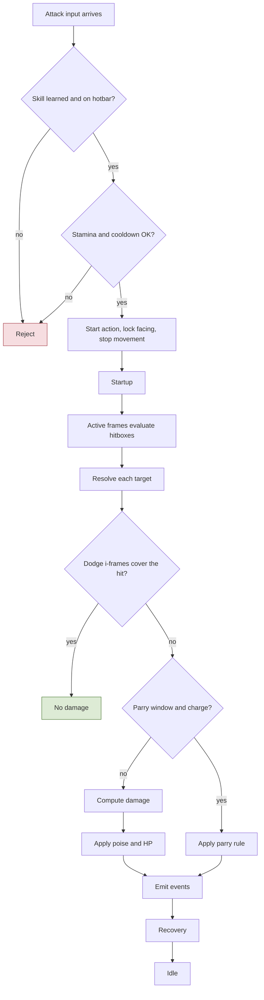
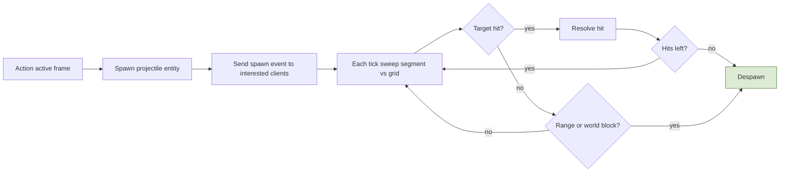
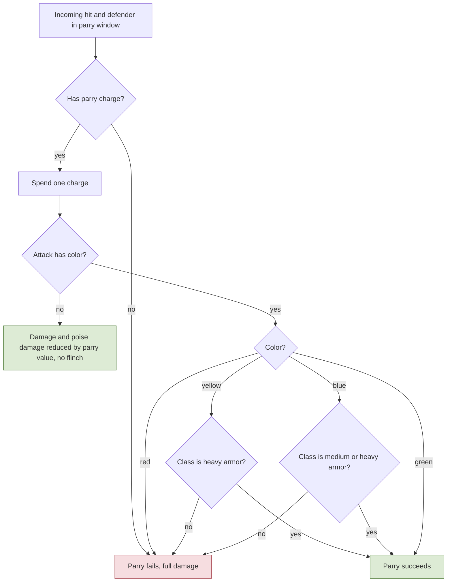
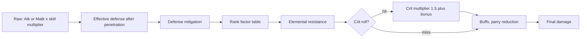
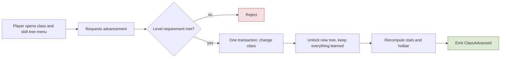
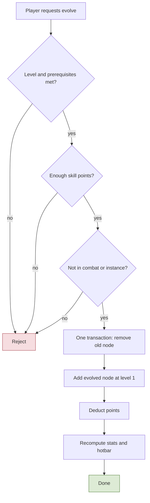
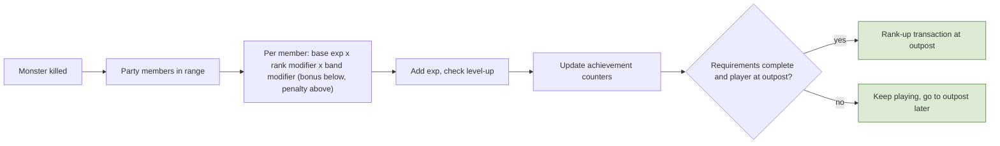
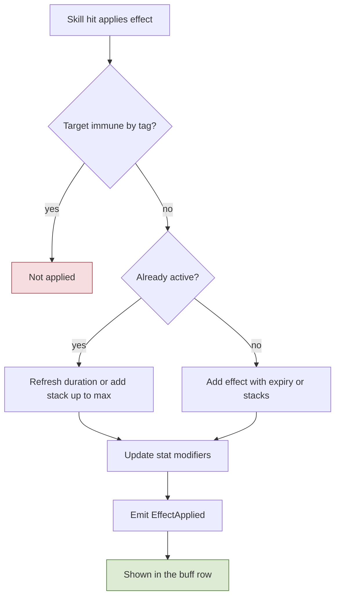
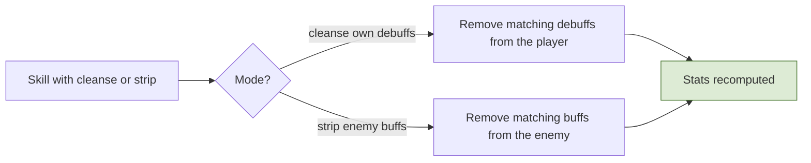
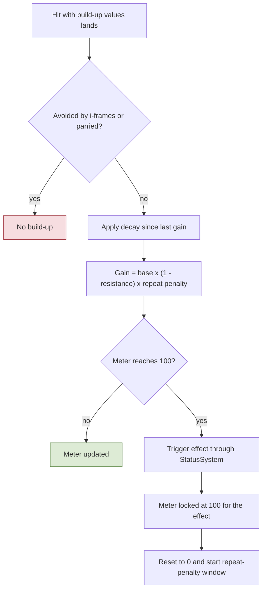

# 3. Combat, Stats, Classes, Progression

## 3.1 Action state machine and hit resolution
**Rules**
- **R-3.1-01** Every attack, skill, dodge, parry, harvest, and arrest is an **action** with startup, active, recovery windows (some are channels). Movement is ignored during actions; facing is locked at start; inputs can be buffered; which actions cancel which is data.
- **R-3.1-02** Stamina and other limits (souls-like): actions cost stamina and may have cooldowns; stamina regen sets the combat rhythm. Cooldown reduction exists (capped). Attack/cast speed scales action durations.
- **R-3.1-03** Hits are resolved from **shapes** (cone, box, capsule) defined per action and evaluated by the server during active frames against nearby entities from the grid. **Lag compensation** (cap **200 ms**): monsters hitting players use a **pending hit** that waits up to the defender's view lag (round trip plus interpolation delay, capped) for a dodge or parry input, judged on the defender's own timeline by input timestamps (the view tick it rendered others at); players hitting monsters are checked against a short **position history** rewound to what the attacker saw (capped); in **PvP** the attacker gets a smaller rewind (100 ms) and the defender rule applies to dodge and parry. A monster attack's startup must exceed reaction time plus the cap (validated in the action tables). Clock sync and timestamp limits stop clients from claiming impossible timings.
- **R-3.1-04** Tick rate **20 Hz**; inputs carry sub-tick timestamps so timing is judged between ticks. **No heavy attacks**: normal attacks and **skills both consume stamina**. Skills also cost a small amount of **MP** (`mpCost`); normal attacks, the dodge and the parry cost none. A start without enough MP is refused with `NoMp`.
- **R-3.1-05** Monster attack telegraphs are server events: the start event carries the action ID, start tick, direction (fixed at start), and the optional parry color (3 bits: none, red, yellow, blue, green; R-3.3-04).
- **R-3.1-06** **Normal attacks** are each class's default attack: a **chain of hits** (R-3.1-10), each hit one action with a single strike or shot, no heavy or charged variant (R-3.1-04).
- **R-3.1-07** **Skills are built from categories that combine.** A skill is one action whose phases carry one or more **effects**, each pinned to a phase and an offset inside it:
  - **Simple action**: one offensive or defensive effect (a strike, a heal). Example: Cross Cut, Heal.
  - **Channeling**: a `Channel` phase that must complete before the following effects fire. Example: a charged spell.
  - **Buff/Debuff**: applies or removes a status (section 3.7). Example: Haste, Cleanse.
  - **Dash**: moves the caster during a phase (the action moves the entity; movement keys stay ignored, R-3.1-01). Example: a charge.
  - **Ground effect**: spawns an area on the ground with a duration and a tick rate. Example: a fire circle.

  Any combination is allowed: "channel, then a fire circle" is a `Channel` phase plus a ground effect in `Active`; "dash, then strike" is a dash in `Startup` plus a strike in `Active`. Normal attacks use the same model (one strike).

  **Targeting:** there is no tab-target. Effects that heal, apply or remove a status, or spawn a ground area choose who they affect with **hit shapes and a target filter** (`self`, `allies`, `enemies`), aimed with the locked facing like attacks; with no party or PvP (M1) every other player counts as an ally. A **location-targeted** skill (for example a heal) takes the cursor point within the skill's maximum range (a farther point is pulled back to it); the point is **locked when the action starts**, like the facing, and the effect lands there, for example when its channel completes. The **target lock** (Tab, R-2.2-06, user decision 2026-10-26) does not change this: it is a facing aid that turns the facing toward the locked monster, so shapes still choose who they affect; a location-targeted skill still takes the cursor point, not the locked target's position.
- **R-3.1-08** **Every hit carries poise damage** (section 3.3), from normal attacks and skills alike, and a **flinch power** (R-3.3-07).
- **R-3.1-09** **A channel is interrupted only by a flinch or a poise break** (R-3.3-01, R-3.3-07); damage alone does not interrupt it. An interrupted channel fires none of its later effects.
- **R-3.1-10** **Attack chains** (user decisions 2026-10-26): every class's normal attack is a chain of **4 hits**, each its own action with its own timings, effects and animation. Pressing attack inside the running hit's **chain window** asks for the next hit: a press from `chainFromMs` (the start of the hit's Active phase) is kept and the next hit starts at `chainLinkMs` (inside Recovery, after the hit's effects), or at once when the press comes later; the rest of the hit's recovery is skipped only by chaining. The fourth hit ends the chain (a heavier finisher: longer startup and recovery, more damage and poise damage). **No idle grace:** if no press came before the hit ends, the next press is hit 1; any other action (a dodge cancel, a skill), a flinch, a stagger or death also return the chain to hit 1. Every hit costs the normal attack's stamina (spec 12.7) and keeps the attack's cancel rules (the dodge cancels it from Recovery; the parry does not). All four classes chain (the Archer and the Mage with four shots). The HUD shows nothing new in M1 (the animation shows the hit). Monsters do not chain. TODO(art): with the real attack animations, each melee hit of a chain carries a small forward advance (user note 2026-10-27: in place, the combo feels flat); as a per-hit `Dash` distance in the chain rows or root motion mirrored by the server, never a client-only offset.

**Implementation**
- `ActionMachine` per entity: states `Idle, Startup, Active, Recovery, Channel, Dodge, Parry, Flinched, Staggered, Dead`. `ActionDef` rows (shared data): duration per phase in ms, `staminaCost`, `mpCost`, `cooldown`, `movesDuring=false`, `hitboxes[]` (shape, offset, active window), `projectile?`, `chargeCost?`, `iFrames?`, `parryClassPve?`, `parryClassPvp?`, `gaugeDelta`, `cancelableBy[]`, `interruptConditions[]` (for channels).
- `HitResolver` (phase 5): for each active hitbox, query grid, filter targets (faction, `PvpRules`, party/guild immunity, visibility not required for area effects), then per target: dodge i-frames (judged with lag compensation) → parry check → damage (3.4) → poise (3.3) → apply → emit events. Order is deterministic.
- Skills are generic **effect types** (projectile, area, buff, dash, summon...) configured by data. A new skill is data plus visuals; code is needed only for a new effect type.
- Effects (R-3.1-07) are rows of their own table (`ActionEffectDef`: `id`, `actionId` [Ref `ActionDef`], `kind`, `phase`, `offsetMs`, plus the kind's parameters), because config rows hold no nested objects. Kinds for M1: `Strike` (hit shapes, poise damage, flinch power, flinch ms), `Projectile` (3.2), `Heal`, `ApplyStatus`, `RemoveStatus`, `Dash` (distance, duration, collision with the world grid and with bodies, R-2.2-07), `GroundArea` (shape, duration, tick rate, damage and poise per tick, never flinch: R-3.3-09). `Summon` comes later. Version 2 (backlog D6) adds `element` (R-3.4-07; Strike, Projectile, GroundArea; default `none`), `targets` (`self`, `allies`, `enemies`, one or more: Heal, ApplyStatus, RemoveStatus, GroundArea), `healPercent` (Heal) and `statusKind` (RemoveStatus by kind); these fields may be left out of a row (`[Optional]` in the row type, both readers), so rows written without them keep the defaults. WP11 (backlog D6, without a version change so the rows of parallel branches stay valid) adds `[Optional]` `buildUpReduction` (RemoveStatus and Heal, R-3.8-04) and `visualId` (GroundArea, its `EntityVisualDef` row), and the GroundArea damage and heal fields (D6 ground area bullet below); build-up changes per hit are `EffectBuildUpDef` rows (spec 3.8). An effect fires when its phase reaches its offset; effects of an interrupted or cancelled action that have not fired are dropped.
- **Hit shapes** (R-3.1-03, backlog D3; these are the `hitboxes[]` of `ActionDef` above, the active window being the effect's phase and offset) are rows of `HitShapeDef`: `id`, `effectId` [Ref `ActionEffectDef`], `kind` (`cone`, `box`, `capsule`), `forwardOffsetCm` and `sideOffsetCm` (the shape origin along the locked facing and to its right), and the sizes `rangeCm` and `halfAngleDeg` (cone: apex at the origin, axis forward, 1-180 degrees each side), `lengthCm` and `widthCm` (box: from the origin forward, centered across), `lengthCm` and `radiusCm` (capsule: every point within the radius of the segment from the origin forward; length 0 is a circle). A size the kind does not use is 0. Every `Strike` and `GroundArea` effect, and every `Heal`, `ApplyStatus` or `RemoveStatus` whose `targets` include `allies` or `enemies`, has 1 to 4 shapes; no other effect has any (a `self`-only effect needs none, R-3.1-07). Shapes are placed when the effect fires from the caster's position and locked facing; a target (position and radius) is hit when its circle touches any shape of the effect, once per effect. Geometry in `Shared/Simulation/Combat` (`HitShape`; `SweptCircle` for the projectile sweep of 3.2), integer math with the facing table `FixedTrig`, so the client can predict it.
- The client uses the same `ActionDef` tables to predict animations and cooldowns.
- **M1 implementation (backlog D2)**, `Shared/Simulation/Actions` (`ActionMachine`, `ActionCatalog`), run by server phase 3 (`GameServer/Combat/ActionRunner`) and by client prediction on the same inputs:
  - Phases run **Startup, Channel, Active, Recovery**; a phase of 0 ms is skipped, any other lasts its ms **rounded up to whole ticks** (so it lasts at least one tick). Dodge and parry are actions of kind `dodge` and `parry` with the same phases; `Flinched` and `Staggered` are machine states with a length, `Dead` is reserved. Snapshot state codes: 0 Idle, 1 Startup, 2 Channel, 3 Active, 4 Recovery, 5 Flinched, 6 Staggered, 7 Dead.
  - A **press** is a button held in this input frame and not in the previous one (a hotbar slot: a slot number that changed); without an input frame nothing is pressed and time still passes. At most one press per tick, by priority **dodge, parry, hotbar skill, attack**; the others are dropped.
  - Idle: the press starts its action (refused with `OnCooldown` while the cooldown, counted from the start, runs; an empty slot with `SkillNotLearned`). During an action: it **cancels** the action when listed in `cancelableBy` and the action has reached `cancelFrom`; else it is **buffered** when the action is within its `bufferWindowMs` of the end (the newest press wins; it fires on the tick the action ends); else it is dropped without a message. While flinched or staggered presses are dropped.
  - Starting locks the facing to that tick's aim. Movement (phase 2) ignores move keys and facing while the machine is busy, so an action started on a tick stops movement from the next tick.
  - Effects fire on the tick their phase reaches `offsetMs` (rounded up, kept inside the phase), once; a cancel or an interrupt drops the unfired ones. Fired effects go to `IActionEffectSink` on the server (Strike, Projectile: D3; Heal and statuses: D6, phase 6; GroundArea: the `GroundAreaSystem`, D6 ground area bullet below). A **Dash** moves the entity along the locked facing turned by its `directionOffsetDeg` (optional, whole degrees clockwise, default 0; the Archer's Back Step uses 180), `distanceCm` spread evenly over `durationMs` (integer sine table `FixedTrig`), each step with world collision and body collision (R-2.2-07: it stops at a body, the `dashResponse`; the dash ends early, the action and its i-frames run on unchanged); the server moves the speed-check reference with it. Its `dashDirection` (optional, default `facing`) is data: `facing` as above, or `moveInput`, along the movement keys held on the tick the action starts (world axes, R-2.2-01; the keys are machine state, `ActionMachineState.StartKeys`, and a client rebase keeps the predicted ones since snapshots carry only the facing), and with no key held along the locked facing turned by `directionOffsetDeg` (0 forward, 180 a step back). The dodge's Dash (`dodge.dash`) moves `StartingValuesM1.dodgeDistanceCm` (spec 12.7: 4 m) over its Active phase, which is its i-frame window (R-3.3-02). R-3.3-02 (user decision 2026-10-26): the dodge and the Archer's Dash are `moveInput` with `directionOffsetDeg` 180 (no key held: backward), the Back Step stays `facing` with 180; `ActionBindings` checks the bound dodge.
  - `ActionMachine.Interrupt(Flinch | PoiseBreak, durationMs)` for D4: a poise break staggers from any state; a flinch cancels Startup or Channel (or catches an idle or flinched entity), and is ignored during Active and Recovery, during a dodge, in super armor phases and while staggered. An interrupt forgets the buffered press.
  - Refusals go to the client on the reliable channel (`ActionResult`: input sequence, action, slot, `ActionReason`); started actions need no message, the snapshot shows them (action id 12 bits and age 8 bits per entity, or age and length for a flinch or stagger). The server publishes `ActionStarted`.
  - The client predicts the machine with movement, keeps its state per pending input, and reconciles the snapshot's action state like a position: a different state, action or age at the acknowledged input rebases on the server's action and replays the pending inputs. The buffered press and cooldowns are not sent and stay as predicted. A predicted action the server is not running gets its cooldown back (the server refused or never got the press), except when the server is flinched or staggered since no earlier than the action's start: the interrupt cancelled an action the server started, and the server keeps its cooldown. Phase changes and fired effects reach the visuals through `IActionPhaseListener` (local player) and `RemoteActionTracker` (others).
  - **Bindings per class (backlog E, spec 9.6):** `ActionBindings` has one row per `ClassDef` row (`classId`, validated: every class has one), mapping left click to the class's own normal attack, Ctrl to the dodge, right click to the parry and the hotbar slots (input slot numbers: 1-6 keys 1-6, 7 Q, 8 E, 9 R, 10 F, 11 Z) to its kit. `ActionCatalog` turns each row into an `ActionLoadout`; the machine state holds its entity's loadout (cooldowns stay per catalog index). The server gives a player its class's loadout at spawn; monsters have none (they start actions through the AI's request). The client takes its class from its own spawn event (the definition id is the `ClassDef` net id) and predicts with the same row; until then its presses predict nothing and the server's state corrects it. TODO(B4): the enter-world message carries the class, since the own spawn rides one unreliable snapshot. I-frames and parry in `HitResolver`: see the D3 and D4 (defence) bullets below. TODO(D5): attack and cast speed scale the durations.
  - **Attack chains (R-3.1-10):** three optional `ActionDef` fields: `chainNext` (the next hit, empty for none), `chainFromMs` and `chainLinkMs` (both 0 without a `chainNext`). The existing rows `attack.<class>` are hit 1 (net ids 1, 4, 5, 6, so bindings, monsters and older data are unchanged), the rows `attack.<class>.2` to `.4` the later hits (net ids 11-13, 41-43, 51-53, 61-63; placeholder timings). In the machine the attack button during a hit with a `chainNext` is a chain press: from `chainLinkMs` it starts the next hit at once, from `chainFromMs` it becomes the buffered press and starts the next hit on the link tick, cutting the running hit like a cancel (its effects have fired); earlier it is dropped. Other buttons keep the cancel and buffer rules. The chain is only the running hit and its buffered press, so it needs no state of its own: a hit that ends, a cancel, an interrupt, death or a retune clear it, the snapshot's action id (each hit its own net id) carries it, `ActionStarted` and telemetry name each hit, and prediction runs it from the same input frames (no protocol change). A start is checked and paid as any other (cooldown, stamina, MP): a refused hit leaves the running hit going, and a later press inside its window may try again. `ActionInput.Request` (monsters) never chains. The link is rounded up to ticks and kept after the last effect's fire tick and before the end of the hit. Validator: `chainNext` only on attacks and never the row itself; `chainFromMs <= chainLinkMs < ` the action's length, and `chainFromMs` no later than the start of the buffer window (an attack press in the buffer window is always a chain press); `chainLinkMs` after every effect of the hit; a row with a `chainNext` lies on the chain of some `ActionBindings.normalAttack` and is no `MonsterDef` attack. `ActionBindings` walks each class's chain: it ends (no cycle), every hit is an attack with no cooldown and no MP that costs `StartingValuesM1.normalAttackStaminaCost`, and the hits after the first belong to that class only. Every hit has a `UiStrings` name (`action.<id>`, for refusal toasts). Visuals: one `AnimationSet` entry per hit (placeholder takes, `EntityVisualPrefabBuilder`).
  - **Dev hot reload (WP17, spec 11.7):** reloaded action tables swap in at a tick boundary through `ActionMachine.Retune`, on the server and in prediction alike: a running action ends like a cancel to Idle (no phase mixes two timings), flinch, stagger and death run on, the buffered press is forgotten, cooldowns keep counting down clamped to the new `cooldownMs`. A reload keeps every `ActionDef` row, its order and its net id.
- **M1 implementation (backlog D4, first part: costs)**:
  - `ActionDef` has `staminaCost`, `chargePool` (`none`, `dodge`, `parry`) and, for dodges only, `iFramesStartMs` and `iFramesMs`. Validator: attacks, skills and dodges cost stamina (R-3.1-04, R-3.3-02); a dodge uses the `dodge` pool, a parry the `parry` pool, nothing else spends charges; a dodge has an i-frame window inside the action and nothing else has one. `ActionBindings` checks the bound actions against spec 12.7 in `StartingValuesM1` (dodge length, i-frames, cost and dash distance against `dodgeDistanceCm`, parry window, normal attack cost, skill costs within `skillStaminaCostMin..Max`). The parry costs no stamina for now: TODO(open) whether it should (R-3.1-02 says actions cost stamina, 12.7 lists no parry cost). Attacks and skills may carry a parry color, `parryClassPve` (used when a monster attacks) and `parryClassPvp` (a player), each `none`, `red`, `yellow`, `blue` or `green` (R-3.3-04, R-3.3-06); validator: only attacks and skills, and only with a `Strike` or `Projectile` effect.
  - `ActionDef.mpCost` (R-3.1-04, backlog E): validator: 0 for attacks, dodges and parries; a skill on a class's hotbar costs 1 to the class's `maxMp` (spec 12.7: small, sized to the pool). Monsters pay neither stamina nor MP (TODO(open), `MonsterDef`).
  - A start is checked in this order: cooldown (`OnCooldown`), a charge of the action's pool (`DodgeNoCharge`, `ParryNoCharge`), stamina (`NoStamina`), MP (`NoMp`). Only when all pass are the stamina, the MP and the charge spent and the action started, so a refusal changes nothing (a refused cancel leaves the running action going; a buffered press is checked when it would start). The parry charge is spent on that start whatever the parry later does (R-3.3-03).
  - Stamina and MP are not machine state: the machine asks the caller through `IActionResources.TrySpend(staminaCost, mpCost)`, which checks stamina, then MP, and spends both or nothing (server: the entity's meters). The client does not predict stamina or MP yet: its spends always pass, the server refuses with `NoStamina` or `NoMp` and the snapshot corrects the prediction (user decision 2026-10-23; TODO: predict both from the own-entity meters of the snapshot header). The dodge and parry `ChargeMeter`s are machine state (`ActionMachineState`), so the client predicts charges and their refusals.
  - The machine counts its own ticks (`ActionMachineState.Tick`: one per step, the count cooldowns already use); the charge meters are in those ticks. Recharge times round up to whole ticks (4 s = 80 ticks at 20 Hz). The i-frame window starts at `iFramesStartMs` rounded up and lasts `iFramesMs` rounded up, kept inside the action; the M1 dodge has it over its Active phase (50 ms to 300 ms).
  - Snapshots do not carry stamina or charges yet: a rebase keeps the predicted charges. TODO: reconcile charges and stamina from the own-entity snapshot (spec 9.4) once it carries them.
- **M1 implementation (backlog D3, hit resolution; D4, poise and flinch)**, `GameServer/Combat`:
  - Phase 3 hands fired effects to `EffectRouter`: a `Strike` is queued (`StrikeQueue`) with the caster's position at that moment (after its dash) and its locked facing; a `Projectile` goes to the ProjectileSystem (3.2). Phase 5 (`StrikeResolver`) resolves the queue in firing order (attacker id): the grid cells around the caster wide enough for the effect's shapes, the largest body radius and the rewind margin; candidates in entity-id order; `CanHit`; a hit when the target's body circle (`bodyRadiusCm` of `ClassDef`/`MonsterDef`) touches any shape, once per effect.
  - `CanHit`: never the attacker itself; both sides fight and are alive (a strike of an attacker that died earlier in the tick lands nowhere); monsters never hit monsters; a player hits a player only when `PvpRules.CanDamage` allows it, which in M1 it never does (spec 6.1: no first class change yet).
  - Lag compensation (R-3.1-03): each applied input frame sets the player's view lag, the applied tick minus the frame's view tick (spec 1.7), under the clock-sync limits of the D4 defence bullet below (0 without a view or for a view of a tick not run yet, at most `lagCompensationCapMs`), rounded down to whole ticks. A player's strike tests a monster where its position history had it that many ticks before. Everything else is tested where it stands; a monster's hit on a player is a pending hit (D4 defence bullet). TODO(WP6-PvP): the PvP attacker rewind (`pvpAttackerRewindMs`) and the defender rule in PvP (PvP is off in M1).
  - The per-target pipeline (`HitResolver`, shared by strikes and projectiles through `IHitTargetResolver`), in order: (1) dodge i-frames: a dodge inside its i-frame window ignores the hit (no damage, poise or flinch), judged on the defender's timeline for a pending hit and on the target's machine at resolve time otherwise; (2) parry: `ParrySystem` (spec 3.3); (3) damage: `DamageCalc` with one crit roll from the world's seeded generator (seed and stream logged as telemetry `WorldRng`), skill multiplier = the effect's `damagePercent` x the request's percent / 100 (projectile falloff), `damageKind` physical (Atk) or magic (Matk), the effect's `element` (step 5) and step 7 from the attacker's `damageDealtPercent` plus the defender's `damageTakenPercent` (status modifiers, backlog D6); (4) HP is drained, and at 0 the target dies, which supersedes poise and flinch; (5) otherwise `PoiseSystem`, then `FlinchSystem` when poise did not break (3.3); (6) events `ParryAttempted` (when a parry met the hit), `HitLanded`, `Damaged` (HP lost, HP after, crit; only when HP was lost), `Staggered` or `Flinched`, `Killed`, `Died`. A dodged or parried hit emits no `HitLanded` yet (TODO(open): whether it emits `HitLanded`). Every resolved hit, dodged ones too, sets `lastCombatAt` (UTC) on the players involved and goes into the tick's hit message (spec 1.7).
  - Death: `Combatant.Die` and `ActionMachine.Kill` (state `Dead`: nothing runs, presses and interrupts are dropped; a dead combatant reads 0 HP and does not regenerate). A dead monster leaves in phase 8 and respawns after `monsterRespawnMs` (F).
  - **Player respawn (user decision 2026-10-22):** a dead player comes back `playerRespawnDelayMs` (`StartingValuesM1`, placeholder 5000) after its death, in phase 8, at the city's player spawn marker (`ServerLoop.playerSpawnMarkerId`), with full HP, MP, stamina and poise (`Combatant.Revive`), an idle action machine with full charge pools and no cooldowns (`ActionMachine.Revive`), and a fresh position history; the speed check restarts there and `Respawned` is published (8.1). Lingering players respawn too. There is no prompt yet: the spec 9 respawn prompt comes with the HUD (backlog I). A character saved at 0 HP logs in at the city spawn with full meters. TODO(M5): the bad-honor respawn lock (R-6.3-03).
  - Monsters get the world's action catalog at spawn; phase 3 runs their machines on what their AI requests (below), so flinches and staggers run out like a player's.
- **M1 implementation (backlog F, monster AI)**, `GameServer/AI` (`MonsterAi`, `MonsterBrain` on each `Monster`, `MonsterAiRules`, `MonsterAttack`, `MonsterAiEvents`). One generic AI for every monster type; what differs is data: `MonsterDef.attacks` (ActionDef ids in priority order), `moveSpeedCmPerSec`, `aggroRangeCm`, `leashRangeCm`, and the shared `MonsterAiSettings` (`thinkIntervalMs`, `homeToleranceCm`, `leashTimeoutMs`, `noEntryAreaTypes`). Deterministic: monsters in entity-id order, no random numbers, ties to the lower entity id, integer math (`FixedTrig.AngleOf` for directions).
  - Phase 7 decides, per monster, what it does next tick; phase 2 of the next tick walks (`MovementSim.StepAlong`: along a binary angle at the monster's speed, then the shared grid collision, with players' and other monsters' bodies blocking it (R-2.2-07: it slides round them and pushes nobody); the position history is recorded after it), phase 3 starts the requested attack through the same `ActionMachine` players use (`ActionInput.Request`: from Idle only, with the cooldown check; the start locks the facing and publishes `ActionStarted`; strikes and projectiles resolve like a player's). Monsters pay no stamina (TODO(open), `MonsterDef`).
  - **Aggro (R-2.4-03; user decision 2026-10-22):** an idle monster scans every `thinkIntervalMs` (spread over the ticks by entity id) for the nearest player inside `aggroRangeCm` that is alive, outside a no-entry region, and that it can see through `IVisibilityQuery`. A player that damages an idle monster (the `Damaged` event) becomes its target at its next think, if the monster can see that player, whatever the distance.
  - **Chase and attack:** the monster keeps its target until the target dies, leaves the world, can no longer be seen or stands in a no-entry region, or until the monster is farther than `leashRangeCm` from its spawn point. While its machine is idle it starts the first attack of `attacks` that is off cooldown and would hit the target if started now, aimed at it: strikes are tested with their own hit shapes placed after the dashes that fire before them, projectiles reach their `rangeCm` plus hit radius. With none, it walks toward the target until its shortest attack would reach, then waits facing it. Body collision (R-2.2-07) only keeps it out of the target's body: a validator rule (`CombatRules.TryBuild`) makes every monster's shortest attack hit the smallest class body at contact, so a monster stopped at a body can still attack.
  - **Leash (user decision 2026-10-22):** without a target the monster walks home ignoring players (hits still land, but do not re-aggro it; their bodies still block the walk, R-2.2-07); within `homeToleranceCm` of its spawn point it gets full HP and poise back (`Combatant.RestoreFull`), takes the marker's facing and is idle again. A walk home that gets no closer for `leashTimeoutMs` (no pathfinding in M1) ends with the monster placed at its spawn point.
  - **The safe city (user decision 2026-10-22):** monsters never enter regions whose area type is in `noEntryAreaTypes` (`normalCity`, `lawlessCity`): a walk or dash step ending in one keeps only the axis that stays out (it slides along the border), and a target standing in one is dropped.
  - Validator on `MonsterDef` (R-3.1-03): every attack is an `attack` or `skill` action with a `Strike` or `Projectile` effect and a `startupMs` of at least `StartingValuesM1.monsterAttackStartupMinMs`; no attack twice; `leashRangeCm > aggroRangeCm`; a monster with a spawn point has at least one attack.
  - M1 types: `m1.demon` (melee: a claw, a pounce that dashes 3 m then strikes) at spawn points a and b; `m1.alien` (ranged: a spit projectile from 12 m, a slap up close) at c and d. Their hits on players are pending hits judged on the defender's timeline (D4 defence bullet below); their attacks are uncolored in M1 (the boss brings colored attacks).
  - **The M1 boss (WP10; user decisions 2026-10-23)**: `m1.cyclopsBoss` (`MonsterDef.boss`) at spawn point `m1.spawn.combat.boss`, the north-east corner of the combat area (its leash circle stays clear of the city), respawning after `bossRespawnMs` (10 min, spec 12.7). It runs the generic AI above (R-6.7-06); its attacks, in priority order, each with its own action id and its own visual entry (placeholder clips):

    | Action | Color (`parryClassPve`, R-3.3-04) | Hit | Startup | Cooldown | Super armor (R-3.3-08) |
    |---|---|---|---|---|---|
    | `monster.cyclops.stomp` | red | circle of 4.5 m around the boss | 1200 ms | 12 s | Startup, Active |
    | `monster.cyclops.slam` | yellow | 5 m straight ahead, 80 cm each side | 900 ms | 8 s | Startup |
    | `monster.cyclops.sweep` | blue | half circle of 4 m | 800 ms | 6 s | Startup |
    | `monster.cyclops.swipe` | green | 90 degree cone of 3.5 m | 600 ms | none | none |
    | `monster.cyclops.rockThrow` | none (a parry reduces it) | projectile `cyclopsRock`, 15 m | 1000 ms | 5 s | none |

    So up close it uses its melee attacks as their cooldowns allow, at 6-15 m only the rock reaches, farther it walks in; every startup is at least the monster minimum (R-3.1-03). Elements (R-3.4-07): the stomp and the rock are `earth`, the slam, sweep and swipe have none (plain physical blows). Placeholder stats for 3-4 players (backlog K tunes them): 6000 HP, 400 poise, `flinchResist` 20 so the strongest player hits flinch the startup of the swipe and the rock throw, while super armor protects the others (a poise break still staggers it).
    - **Target loss:** a boss that loses its target (dead, gone, unseen, in a no-entry region) while inside its leash takes the nearest player it would aggro (alive, seen, outside no-entry regions, inside `aggroRangeCm`, ties to the lower entity id); it walks home only when there is none. Normal monsters go home.
    - **Leash and reset:** as for every monster: past `leashRangeCm` (25 m) it walks home ignoring players and gets full HP and poise back there.
    - Validator: a `MonsterDef.boss` row with a spawn point needs at least one attack with a `parryClassPve` color and one with a super armor phase (backlog F "telegraphed attacks, including colored ones").
    - TODO(open): boss phases (attacks or behaviour changing at an HP threshold), threat or target switching while the target is valid.
    - Boss bar engagement (user decision 2026-10-24, backlog I): a client display rule from hit messages, no `BossEngaged/Left` message in M1: the bar shows while the player hit the boss or was hit by it within `HudSettings.bossEngageTimeoutMs` (spec 9.12).
- **M1 implementation (backlog D4, defence on the defender's timeline; WP6, user decisions)**, `GameServer/Combat` (`DefenceTimeline`, `PendingHits`, `ParrySystem`, `ParryColors`):
  - **The defender's clock.** An input frame's view clock is its view tick plus `SubTick / 64` (spec 1.7: the fraction of the tick the client rendered others at, R-3.1-04). Its view lag is the applied tick minus that clock, in 1/64 ticks.
  - **How the round trip is known.** LiteNetLib measures it with its own ping (`RoundTripTime`). The transport reports it with every input packet (`ITransportListener.OnRoundTripTime`, network thread), and the session's input queue holds it for phase 1 (-1 until a sample exists).
  - **Clock-sync limits** (R-3.1-03), applied in phase 1 to every applied frame:
    - no view, or a view of a tick not run yet, gives lag 0;
    - the view clock never goes back: an older claim is raised to the last applied one, and a new connection resets it;
    - the lag is at most the round trip + `interpolationDelayMs` + `clockSyncToleranceMs` (`StartingValuesM1`, placeholder 50 ms), and never more than `lagCompensationCapMs`; before the first round-trip sample only the cap applies.

    Clamped claims are counted per kind. The same limited lag drives the attacker rewind of the D3 bullet.
  - **Defensive starts.** Phase 3 records each dodge or parry that starts (a buffered one too, at that tick's lag) with when it started on the view clock (the start tick minus the lag) and how many ticks the server machine really ran it. A dodge a stagger cuts short covers only those ticks. A parry press refused with `ParryNoCharge` is recorded too, with the window it would have had. The player keeps the last 4.
  - **Pending hit** (R-3.1-03): `HitResolver.Resolve` queues every monster hit on a player, strike or projectile (`HitOutcome.Pending`).
    - It lands in phase 5, after that tick's strikes, once `hitTick + min(cap, the defender's lag rounded up)` is reached. By then every input the defender sent while seeing the hit's tick has been applied. With lag 0 it lands in the same phase 5.
    - Due hits land in the order they happened: phase 4 projectile order, then phase 5 attacker-id order.
    - A pending hit still lands when its attacker died after swinging. It is dropped when the target died or left the world.
    - HP, poise and flinch act on the target's state at landing.
    - A lingering player (no client) has lag 0.
    - Other hits (players on monsters) are judged at once on the target's machine.
  - **Judging.** The newest defensive start whose span on the view clock contains the hit's tick decides: the hit's position in it is `(hitTick x 64 - viewStart) / 64` action ticks.
    - A dodge with that tick in its i-frames ignores the hit (R-3.3-02).
    - A parry goes to `ParrySystem` (spec 3.3): in its Active phase by color and armor class; in Startup or Recovery `FailedTiming`. A no-charge press whose would-be Active covers the hit gives `NoCharge`; outside it, it is no parry.
    - Then `ParryAttempted` (defender, attacker, action, color, result; actor: the defender), and an `ActionResult` with the parry reason (spec 9.7) to the defender's client, echoing the input sequence of the frame that started the parry.
  - **Telegraph color** (R-3.1-05): `ParryColors.Of(attacker, action)` gives a monster's action its `parryClassPve` and a player's its `parryClassPvp`. `ActionStarted` carries it (players in phase 3; the monster step of backlog F calls the same helper), and snapshots carry it in 3 bits for entities in an action (spec 1.7). Clients keep it as the entity's telegraph color (TODO(I): drawing it).
- **M1 implementation (backlog D6, WP8: heals, statuses, target filter; user decisions 2026-10-23)**, `GameServer/Combat` (`StatusSystem`, `EffectRouter`):
  - **Not hits.** `Heal`, `ApplyStatus` and `RemoveStatus` effects are queued in phase 3 with the caster's position and locked facing (like strikes) and resolved in **phase 6**, after the hits, in firing order. They have no dodge i-frames, parry or pending hit: they land on whoever their targets cover. A status that should be dodgeable would ride on a strike as an on-hit status: TODO(open) (WP11/M2). A caster that died before phase 6 fires nothing.
  - **Target filter** (`targets`): `self` is the caster, whatever the shapes; `allies` are the living entities of the caster's faction other than itself whose body circle touches one of the effect's shapes (every other player in M1; monsters for a monster); `enemies` are the ones `CanHit` accepts. Targets are tested where they stand (no rewind) and handled in entity-id order. A `self`-only effect has no shapes; one that reaches allies or enemies has 1 to 4.
  - **Heal:** each target gains `healPercent` of the caster's Matk (read in phase 6), rounded down, capped at its max HP (`ResourceMeters.Restore`, which does not restart the regeneration delay); never on the dead, never a crit (TODO(open): crits on heals). `Healed` is published when HP was gained, and the hit message carries it as kind `healed` (protocol 7) for heal numbers. A heal never targets enemies (validator).
  - `ApplyStatus` and `RemoveStatus` follow section 3.7.
- **M1 implementation (backlog D6, WP11: ground areas; user decisions 2026-10-24)**, `GameServer/Combat` (`GroundAreaSystem`, `GroundArea`), `Net/GroundAreaSender`:
  - **Data.** A `GroundArea` effect has `durationMs`, `tickIntervalMs` (at most the duration), `targets` and 1 to 4 hit shapes. With `enemies` each tick deals `damagePercent` of Atk or Matk (`damageKind`, required), `poiseDamage` and its `element`, and may carry build-up changes (`EffectBuildUpDef`, spec 3.8); with `self` or `allies` each tick heals `healPercent` of the caster's Matk (required); both in one area are allowed. Never a flinch power (R-3.3-09, validator). Optional `visualId`: the area's look (an `EntityVisualDef` row); empty draws the placeholder built from its shapes. `GroundAreaSettings` (singleton, placeholders): `maxPerOwner` 4, `maxActive` 128 (the pool), `eventRepeatTicks` 3.
  - **Placing** (phase 3, when the effect fires): the shapes at the owner's position on whole cm and its locked facing at the wire's resolution (10 bits, like projectiles), so clients draw what the server tests; the heal per tick is read from the owner's Matk then. Over `maxPerOwner` live areas or with the pool empty it is refused and counted. `GroundAreaSpawned` (8.1).
  - **Ticks** (phase 5, after the strikes and before the due pending hits; areas in id order, targets in entity-id order): placed on tick T, an area covers ticks T to T + n - 1 (n = `durationMs` in ticks, rounded up) and ticks on T, T + k, T + 2k... inside that span (k = `tickIntervalMs` rounded up), so a duration that is not a multiple of the interval has no partial last tick (1000 ms every 300 ms at 20 Hz: ticks at T, T+6, T+12, T+18; the fire circle 5000/500: 10 ticks). Targets are tested where they stand (no rewind: the area persists and clients see it). An enemy (`CanHit`) inside a shape is hit through the shared pipeline with `HitSource.GroundArea`: dodge i-frames avoid it, a parry is not judged against it (the tick lands in full, no `ParryAttempted`), damage, poise and build-ups apply, never a flinch; a monster's area on a player is a pending hit like any monster hit. An ally inside (same faction, not the owner) or the owner inside (`self`) is healed (`Healed`, heal notice).
  - **End:** `Expired` in phase 5 of T + n; `OwnerDied` when its owner is dead at its next phase 5; `OwnerGone` when its owner leaves the world. Ended areas stay `eventRepeatTicks` ticks for their despawn, then go back to the pool.
  - **Wire** (protocol 9, spec 1.7): hot messages `GroundAreaSpawn` (6) and `GroundAreaDespawn` (7). A player gets the spawn while the square the shapes reach overlaps its interest square, and the despawn if it got the spawn. Clients (`GroundAreaTracker`, `GroundAreaViews`) find the effect by action net id and effect index in the shared tables, draw it over its span at the interpolation render time, and end it on their own at the end of its duration if the despawn is lost. TODO(open): whether a player that cannot see a hidden owner gets its areas (rule 9, as for projectiles).
  - TODO(open): areas that follow their owner (does the Mage's Flamethrower move with the Mage? M1 places it once, like every area), location-targeted areas (the cursor point of R-3.1-07).

**Talks to** reads `StatBlock`, `SkillTree`, `Hotbar`, `PvpRules`; emits `ActionStarted`, `HitLanded`, `Damaged`, `Killed`, `Died`; consumed by Progression, Law, Economy, Telemetry.

**Flow: One attack from input to result**

## 3.2 Projectiles
**Rules**
- **R-3.2-01** Archers and many monsters fire projectiles. Some **stop at the first target** and others pierce (`maxHits`). Same system for monsters and players.
- **R-3.2-02** Projectiles hit through the normal rules: faction, PvP armed state, party/guild immunity, parry colors, poise.

**Implementation**
- `ProjectileSystem` (phase 4): projectile entities with owner, origin, direction (locked facing), speed, range/lifetime, hit radius, `maxHits`, `stopsOnWorld`, per-hit damage falloff (optional), a set of already-hit targets (no double hits).
- **Swept collision**: test the segment moved this tick against grid neighbors (prevents tunneling): `SweptCircle.Hits` tests the segment against the target circle grown by the projectile's hit radius and returns the distance along the segment where it first touches, so hits on one segment are taken in that order (ties by entity ID). World blocking uses server collision data. Processed in projectile ID order; capped per owner; pooled.
- Network: one **spawn event** (type, origin, direction, speed, start tick) to players whose interest area the path crosses; clients simulate the straight path deterministically; the server sends hit and despawn events; late spawns are fast-forwarded from the start tick.
- **M1 implementation (backlog D3)**:
  - Data: `ProjectileDef` rows (`id`, `netId` 1-4095, `speedCmPerSec`, `rangeCm` (the lifetime is range / speed), `hitRadiusCm`, `maxHits`, `stopsOnWorld`, `falloffPercentPerHit`, `visualId` [Ref `EntityVisualDef`]); a `Projectile` effect names one with `projectileId` and, like a strike, carries the poise damage, flinch power and flinch ms of each of its hits (R-3.1-08). Validator: every hit up to `maxHits` still deals damage (`(maxHits - 1) * falloff < 100`), and one tick's step stays within the sweep limit (4096 cm). `ProjectileSettings` (singleton): `maxPerOwner`, `maxActive` (pool size), `eventRepeatTicks`.
  - Path (`Shared/Simulation/Combat/ProjectilePath`, shared with the client): from the owner's position on whole cm along the locked facing rounded to the wire's 1024 steps (the facing table's own resolution); after phase 4 of tick T it is at `PositionAt(T - startTick + 1)`, the distance after n steps being `min(limit, speed * n / tickRate)`. A projectile that stops on the world has its whole path cast once against the walkability grid (`Shared/World/GridRay`, supercover: it cannot slip between two cells that touch at a corner), so the client stops it at the same raw point. The grid is grown by the agent radius, so it stops that far in front of a wall.
  - `ProjectileSystem` (phase 4): projectiles in id order (their own ids, not entity ids). Each tick's segment is swept against living combatants of the grid cells around it except the owner, each a circle of its `bodyRadiusCm` grown by the projectile's hit radius; hits are taken by entry distance, ties by entity id. Each goes through the shared hit pipeline (the world's `HitResolver` as `IHitTargetResolver`, hooked in as `EffectRouter.Projectiles`: `CanHit`, then `Resolve` with source `Projectile` and `100 - k * falloff` percent for hit k). Damaged, Killed and Parried count toward `maxHits` (a parried projectile is blocked); Dodged does not (it flies on through a dodge); a counted or dodged target is never tested again. A monster's projectile on a player is a pending hit (R-3.1-03) decided later, so it counts toward `maxHits` when it happens: on its last hit the projectile stops at the player even if the player dodges it (user decision, WP6). It ends, first that applies: `Hit` at `maxHits`, `World` at the wall, `Range`; and `OwnerGone` when its owner leaves the world (a dead owner still in the world keeps its projectiles). Over `maxPerOwner` or with the pool empty the new spawn is refused and counted. Targets are not rewound (the projectile itself is simulated over time). Emits `ProjectileSpawned` and `ProjectileHit` (counted hits).
  - Network (phase 10, every tick): hot messages `ProjectileSpawn` (3) and `ProjectileDespawn` (5) of spec 1.7. A player gets the spawn when the part of the path still to draw crosses its interest square (so players reached later get a late spawn), and the despawn when it got the spawn; a piercing hit that does not end the projectile is not sent (damage feedback is its own message). Each event is sent `eventRepeatTicks` ticks in a row against loss; clients drop duplicates by id. TODO(open): whether a player that cannot see a hidden owner (spec 2.4) gets its projectiles, since the origin shows where the owner stood.
  - Client (`ProjectileTracker`, `ProjectileViews`): rebuilds the path from the spawn and its `ProjectileDef`, draws it at the interpolation render time like other remote entities, applies a despawn when the render time reaches its tick, and ends it at its range or wall on its own if the despawn is lost. TODO: draw the local player's own projectiles on the predicted tick.

**Talks to** calls `HitResolver`; emits `ProjectileSpawned`, `ProjectileHit`.

**Flow: Projectile lifecycle**

## 3.3 Poise, dodge, parry
**Rules**
- **R-3.3-01** **Poise:** every entity has one poise bar. A hit subtracts poise damage; at zero the entity is staggered, the bar resets, and a short stagger immunity starts (no chain stuns). Regeneration is lazy (from timestamps). Hits in a tick resolve in deterministic order.
- **R-3.3-02** **Dodge (Ctrl):** a movement action with an **i-frame window** (hits landing inside it are ignored; hits before or after it resolve normally). It costs stamina and **one charge from its own pool** (separate from parry), recharging over time. The i-frame window is judged on the defender's timeline with the 200 ms compensation cap. **Direction** (user decision 2026-10-26): the dodge moves along the movement input held at the press (the world direction of the movement keys, not the facing); with no movement input it moves backward, away from the locked facing. The Archer's Dash follows the same rule; the Back Step keeps its 180 degree offset from the facing.
- **R-3.3-03** **Parry (right click):** a parry attempt **spends one parry charge when it starts**, **even if it fails** (wrong color, armor too light, bad timing). A character has a set number of charges (for example 3) that recharge over time (lazy by timestamp).
- **R-3.3-04** **Colors exist only on specific attacks** (mainly bosses, a few monsters, a few PvP skills): **red** cannot be parried, **yellow** only by heavy armor wearers, **blue** by medium or heavy armor wearers, **green** by everyone. **Uncolored attacks** are the monsters' default attacks (their normal attacks, the bulk of what a monster does): a parry reduces damage (config value or derived parry stat), and they get **no telegraph** in the final game, since the attack animation itself is the tell; only colored attacks are telegraphed (spec 9.3). M1 placeholder: while the monster animations are placeholders, uncolored attacks keep a faint uncolored ground telegraph so they can be read at all (user decision 2026-10-26); it goes away with the real animations, not with a rule change.
- **R-3.3-05** Block/parry strength is derived from other stats. **Armor class (light, medium or heavy) is defined by the character's class** (`ClassDef.armorClass`, R-3.5-08), not by equipment, so there is no mixed-set rule and no weight system. A learned skill-tree passive can set another tier (R-3.5-08).
- **R-3.3-06** Colors can differ for PvE and PvP (`parryClassPve`, `parryClassPvp`).
- **R-3.3-07** **Flinch (small stagger)**, separate from the poise break: every hit carries a `flinchPower` and a base `flinchMs` (set per attack, so a jab and a heavy skill differ). Every entity has a `flinchResist`, a `flinchDurationPercent` and a `flinchImmunityMs` (per monster type in `MonsterDef`, per class in `ClassDef`). When `flinchPower >= flinchResist`, the target is not flinch-immune, and its current phase has no super armor (R-3.3-08), the target **flinches** for `flinchMs x flinchDurationPercent / 100`:
  - an action in **Startup or Channel is cancelled** (this stops a monster from attacking non-stop after being hit); an action already in Active or Recovery finishes, so hits can trade; a **dodge is never interrupted**;
  - the target then ignores further flinches for `flinchImmunityMs` (no stunlock); damage and poise damage still apply.
  - It applies to **players and monsters alike**, in PvE and PvP; dodge i-frames and parries avoid it as they avoid the hit. A poise break in the same hit supersedes the flinch.
- **R-3.3-08** **Super armor:** an `ActionDef` can mark phases as super armor (mainly boss telegraphs). Flinch is ignored during them; a poise break still staggers.
- **R-3.3-09** **Ground effects deal damage and poise damage per tick but never flinch**, so standing in an area cannot stunlock.

**Implementation**
- `PoiseSystem`: `{current, max, lastHitTick, immuneUntilTick}` per entity; on hit apply pending regen, subtract, break → trigger `Staggered` action, reset, set immunity. Lives in `Combat`.
- `FlinchSystem` (R-3.3-07): `{flinchImmuneUntilTick}` per entity, with the entity's `flinchResist`, `flinchDurationPercent` and `flinchImmunityMs` from `MonsterDef` or `ClassDef`. Per hit, after poise: if no poise break, check super armor, immunity and resist; on a flinch, cancel a Startup or Channel action, start a `Flinched` action for the scaled duration, set immunity, emit `Flinched`. Every value is config (tuned in backlog K).
- **M1 implementation (backlog D4, poise and flinch)**, `GameServer/Combat/PoiseSystem` and `FlinchSystem`, in ticks:
  - Poise regeneration (user decision): linear, lazy from `lastHitTick`: nothing for `poiseRegenDelayMs` after the last hit that dealt poise damage, then `poiseRegenPercentPerSec` of the bar per second (`StartingValuesM1`, placeholders 2000 ms and 25%). A hit first folds the regeneration in, then subtracts.
  - A break (bar at 0) staggers the entity for `staggerMs` (`StartingValuesM1`, one value for every entity in M1, placeholder 1000 ms; user decision) from any state but death, resets the bar to max and starts `staggerImmunityMs`. During stagger immunity poise damage is ignored (user decision), so the next break needs a full bar after it ends.
  - A flinch's immunity (`flinchImmunityMs`) starts when the flinch ends, so a flinch never chains into the next one. A flinch the action machine refuses (Active, Recovery, a dodge, super armor, a stagger) starts no immunity. Ground areas (`HitSource.GroundArea`) never flinch (R-3.3-09); their ticks are avoided by dodge i-frames but never parried (user decision 2026-10-24, spec 3.1 D6 ground area bullet).
- **M1 implementation (R-3.3-02, the dodge's movement; first play session P2)**: the `dodge` action carries a Dash effect (`ActionEffectDef` `dodge.dash`) of `StartingValuesM1.dodgeDistanceCm` (placeholder 400 cm) over its whole Active phase, so the move and the i-frame window coincide; it moves like every dash (shared `ActionMachine`, world collision, the speed-check reference moved with it, predicted by the client with the same code). `ActionBindings` checks the bound dodge's Dash distances against `dodgeDistanceCm`. Its direction (R-3.3-02, user decision 2026-10-26) is `dashDirection` `moveInput` with `directionOffsetDeg` 180: the world direction of the movement keys held on the tick it starts, as `MovementSim` resolves them (the input frame carries them, so prediction uses the server's input), and backward from the locked facing when none is held; the facing stays the one locked at the start (R-3.1-01), it does not turn toward the move. `ActionBindings` refuses a bound dodge whose dash differs. The Archer's Dash uses the same rule.
- `ChargeMeter` (used by parry and dodge): `{charges, max, lastChangeTime, rechargeMs}` computed on read. M1 (`Shared/Simulation/Actions/ChargeMeter`): integer, in ticks of the action machine's clock; while below max it gains one charge per recharge time from `lastChangeTick`. Spending from a full pool starts the recharge at that tick; spending from a recharging pool keeps the progress towards the next charge. Pool sizes and recharge times are `StartingValuesM1` (`dodgeCharges`, `dodgeRechargeMs`, `parryCharges`, `parryRechargeMs`); the machine spends the charge when the dodge or parry starts (section 3.1 D4 notes). `ParrySystem`: resource meter `{charges, max, lastChangeTime, rechargeMs}` computed on read; resolution returns an explicit result enum (Success, Reduced, FailedRed, FailedArmor, FailedTiming, NoCharge) sent to the client so UI can explain failures.
- Telegraph: the attack-start event includes the color (3 bits: none and four colors) for the colored warning.
- **M1 implementation (backlog D4, ParrySystem; WP6, user decisions)**, `GameServer/Combat/ParrySystem` (a pure function), judged on the defender's timeline (section 3.1 D4 defence bullet):
  - The charge is spent when the parry starts (R-3.3-03, the action machine), so a hit meets either a running parry or a parry press refused for want of a charge. A refused press whose would-be window covers the hit gives `NoCharge`; outside that window it is no parry at all.
  - The window is the parry action's Active phase (spec 12.7: 200 ms). A hit in its Startup (pressed too late) or Recovery (too early) gives `FailedTiming`.
  - In the window, by the attack's color (`parryClassPve` for a monster's attack, `parryClassPvp` for a player's, R-3.3-06) and the defender's `armorClass` (from `ClassDef`; monsters are light and do not parry in M1):

    | Color | Light | Medium | Heavy |
    |---|---|---|---|
    | none | `Reduced` | `Reduced` | `Reduced` |
    | red | `FailedRed` | `FailedRed` | `FailedRed` |
    | yellow | `FailedArmor` | `FailedArmor` | `Success` |
    | blue | `FailedArmor` | `Success` | `Success` |
    | green | `Success` | `Success` | `Success` |

  - What follows:
    - `Success` voids the hit: no damage, poise damage or flinch. It does nothing to the attacker. TODO(open): parry consequences for the attacker (stagger, riposte).
    - `Reduced` cuts the damage (step 7 of R-3.4-04, `ParryReductionPercent`) and the poise damage by `uncoloredDamageReductionPercent` (`StartingValuesM1`, spec 12.7: 50%), and never flinches.
    - `FailedRed`, `FailedArmor`, `FailedTiming` and `NoCharge` take the full hit.
  - Every result publishes `ParryAttempted` and sends the defender's client an `ActionResult` with the reason `ParrySuccess`, `ParryReduced`, `ParryFailedRed`, `ParryFailedArmor`, `ParryFailedEarly`, `ParryFailedLate` or `ParryNoCharge` (spec 9.7, texts in `ReasonCodeStrings`). A `FailedTiming` result says which side of the window the hit fell on (protocol 15, fix/parry-feel 2026-10-26): `ParryFailedLate` when the hit landed in the parry's Startup, `ParryFailedEarly` in its Recovery; the older `ParryFailedTiming` code stays in the enum (append only) and is no longer sent. The hit message (spec 1.7) shows a success as `parried`.
  - There is no separate `ParryDef` or `ParryColors` table in M1 (spec 8.5): the colors are `ActionDef` fields and the reduction is a `StartingValuesM1` value. TODO(D5): a derived parry stat (R-3.3-05, R-3.4-02).

**Talks to** reads `StatBlock`, the class's armor class; emits `ParryAttempted`, `Staggered`, `Flinched`.

**Flow: Parry resolution**

## 3.4 Stats and damage formula
**Rules**
- **R-3.4-01** **Primary attributes** (from levels): STR, DEX, STA, INT.
- **R-3.4-02** **Derived stats:** Atk, Magic atk, Crit rate, Crit damage, Def, Magic def, movement speed, attack/cast speed, poise, HP/MP/stamina regen, elemental and status resistances, physical and magic penetration, cooldown reduction (capped), Sense, Detect, parry/block values. Block/parry are derived from other stats; no equip weight; no item find/luck.
- **R-3.4-03** **Resource meters:** HP, MP, Stamina, **intoxication** (potions are toxic; limits how many can be drunk), **food satiety** (food gives stats but you cannot overeat), parry charges. Intoxication and satiety decay with time (computed from timestamps on login).
- **R-3.4-04** **Damage formula** (pure function, integer math): (1) raw = Atk or Matk x skill multiplier (+ flat); (2) effective defense = max(0, Def x (1 - pen%) - flatPen); (3) mitigation = effDef / (effDef + C), C scaled by rank; (4) rank factor from a table (attacker rank vs defender rank, bounded); (5) elemental factor = 1 - resistance (capped, weakness allowed); (6) crit: if the roll succeeds, x(1.5 + crit damage bonus), crit chance and bonus capped; (7) buffs, debuffs, parry reduction, optional small variance. Balance is a later step.
- **R-3.4-05** **Status effects:** see section 3.7.
- **R-3.4-06** **Minimum damage per hit:** a damaging hit (raw damage above 0) that lands is not reduced below `MinDamagePerHit` (`DamageConstants`, default 1) by defense, rank factor or resistance; the minimum is applied after step (5), so a crit still multiplies it and the explicit nullifiers of step (7) (a 100% parry reduction, a -100% damage modifier) can still reach 0. Hits with no damage part (for example poise only) stay at 0. Immunity, i-frames and successful colored parries are resolved before damage, so they never deal the minimum.
- **R-3.4-07** **Elements (10):** Fire, Ice, Water, Wind, Earth, Lightning, Holy, Dark, Blood, Poison. Each has one resistance stat (R-3.8-10). Physical and magic are damage kinds, not elements.

**Implementation**
- `StatBlock`: base + a list of `StatModifier {statId, flat, percent, sourceType, sourceId, expiresAt}`. Source types: gear, skill, buff, food, potion, gem, enchant, mount, title (later). Derived values are cached and recomputed only when a modifier is added/removed or an attribute changes. Enchant bonus is computed from a config table by level (not baked into items).
- `DamageCalc` lives in `Shared/Simulation` so clients can show tooltip estimates; the server is authoritative. Unit tests use a grid of cases; `EconomySimulator`/Monte Carlo tools cover balance.
- **Combatants on server entities (M1, D5 wiring):** `GameServer/Combat/Combatant` on `Entity.Combatant`: `Faction` (player, monster), `StatBlock`, `ResourceMeters` (HP, MP, stamina), alive/dead (`Die(tick)`), poise `{current, max, lastHitTick, immuneUntilTick}` (R-3.3-01, ticks), `flinchImmuneUntilTick` with the template's `flinchResist`, `flinchDurationPercent`, `flinchImmunityMs` (R-3.3-07), `armorClass` (light, medium or heavy, R-3.3-05), the body radius hit shapes test against (`bodyRadiusCm` of `ClassDef` or `MonsterDef`, 1 to 5000 cm; placeholders 40 cm for every class, 45-120 cm for monsters), rank, and a fixed-size position history filled at the end of tick phase 2 (capacity: `lagCompensationCapMs` in ticks plus the current tick, R-3.1-03). `CombatRules` builds them: players from their `ClassDef` (base `maxHp`, `maxMp`, `hpRegen`, `mpRegen`, `atk`, `matk`, `def`, `mdef`; stamina pool and regen from `StartingValuesM1` for every class; rank F until characters store a rank), monsters from `MonsterDef`. The meters run on the world's simulation time (tick x tick length), set at every spawn. A new character (never placed) starts with full meters, a returning one with its saved HP/MP/stamina (clamped to the max); saves write the meters. A `class_id` without a `ClassDef` row refuses the login (`CharacterUnavailable`). Phase 3 (`ActionRunner`) pays action stamina from the combatant's meter at the tick's time, so short stamina refuses with `NoStamina`. PoiseSystem, FlinchSystem and HitResolver (backlog D3, D4) change this state; they are not part of it.

- **M1 (backlog D6, WP8): elements and step 7.** The 10 elements of R-3.4-07 are the config enum `Element` (`none`, `fire`, `ice`, `water`, `wind`, `earth`, `lightning`, `holy`, `dark`, `blood`, `poison`); `ElementCaps` has exactly one row per element (ids are the enum names, validated in `CombatConfig.TryBuild`) with its resistance stat (`fireRes` ... `poisonRes` in `StatDef`, R-3.8-10) and the damage caps (placeholders -50 to 75). A Strike, Projectile or GroundArea effect names its `element` (default `none`: step 5 skipped). Step 7's buff and debuff part is the attacker's `damageDealtPercent` plus the defender's `damageTakenPercent` (new stats, -100 to 1000, changed by status modifiers; DamageCalc clamps the sum). `flinchResist` is a stat too (base from `ClassDef`/`MonsterDef`, R-3.3-07), so a status can raise it. Status damage over time never crits (`DamageInput.NoCrit`, no roll drawn).

**Talks to** consumed by every combat system; emits `StatsChanged`.

**Flow: Damage calculation pipeline**

## 3.5 Classes, skills, skill tree, gauges
**Rules**
- **R-3.5-01** A player starts with one of four **initial classes: Warrior, Archer, Mage, or Assist** (the four roots) and advances through the tree when the level requirement is met (**levels 30, 50, and 80**, from the class and skill-tree menu; the class gauge unlocks at **level 100**). **Advancing is a player action in the class/skill-tree menu**: it is not automatic and does not happen at an outpost. **Class is permanent**; no multiclass; no account-wide systems. A future item might allow re-choosing.
- **R-3.5-02** **32 final classes** under 4 roots (Warrior, Archer, Mage, Assist), each root with 2 branches, each branch 2 sub-branches, each sub-branch 2 final classes. Each class has its own **gauge**.
- **R-3.5-03** Skills are **active** (10-15 per class at the end; they evolve) and **passive** (status/bonus effects). Both have levels (for example max 5).
- **R-3.5-04** After a class change nothing is reset; a **new tree** becomes available, and its skills have a **minimum level** to learn (all trees and skills). One **skill point per level**, from level 1: a new character has its normal attack and 1 point, so its first skill is the player's choice from the root tree. Inside a tree, a link between two skills is a **prerequisite** (learn the first, at a required level, before the second). **Evolving** a skill is a new node that replaces the old one, **costs points, and starts at level 1**; the old node's levels and **the points spent on it are lost** (no refund). A skill evolves only from the skill it names (`evolvesFrom`), which belongs to an earlier tier of the same class line. One base skill can have **several evolutions on a line** (at any later tier): the player takes one of them. **Respec is free, any time**, but blocked in combat, instances, and boss fights; it clears evolved nodes too.
- **R-3.5-05** Base skills are reused through evolution (fire spark → fireball → branch variants): same skill with extra stats and a new visual, defined by inheritance with overrides.
- **R-3.5-06** PvP needs an **armed** hotbar skill (section 6.1) and a **disguise robe** skill exists for everyone (section 6.3).
- **R-3.5-07** **Weapons:** a skill can require weapon types (any of a list). A class line lists the weapon types it can use, and some are unlocked by tree nodes (weapon unlocks, one level). A character has **two weapon slots, main and secondary** (for example the Fencer's rapier and pistol, a Thief's two daggers; user decision 2026-10-24), and fights with **one equipped weapon set and does not swap** during a fight: the two slots are the set. The Archer uses a bow or dual daggers, the Assist a staff or gloves. A skill whose weapon is not equipped stays learned and on the hotbar, its slot is greyed, and a press is refused with `WrongWeapon`. When the equipped weapon can be changed is Open (M2, with gear). Weapon type **`dualCrossbows`** (user decision 2026-10-23): the Archer's Piercing Shot, Heavy Shot and Multi Shot accept a bow or dual crossbows. TODO(open): how a character gets dual crossbows, and whether the Ranger at level 50 already lists them. TODO(open): whether the "dual" types (`dualDaggers`, `dualSwords`, `dualPistols`, `dualCrossbows`) stay types of their own or become one type used in both slots; whether a skill's weapon requirement can name a slot (main or secondary).
- **R-3.5-08** **Armor tier per class** (R-3.3-05): roots **Warrior heavy, Assist medium, Archer light, Mage light**; a later class keeps the tier of its earlier tier unless its own row sets one. A learned tree **passive can set another tier** (for example the Knight's Combat Training sets medium); one tier applies at a time, and the last armor passive on the class line wins.
- **R-3.5-09** **Skill arts** (team decision 2026-10-25; M6, not M1): from the **second class tier** on (the class
  change at level 30 and later), **every skill carries three arts**. An art is an **extra feature of that skill that
  turns on by itself when its stat condition holds**: there are no points to spend and nothing to choose, the
  character's build is the choice. A condition is **`stat > N`** or **`stat X > stat Y`**, read from the character's
  **final derived stats** (gear, buffs, food and everything else included, section 3.4): for a skill that starts
  (active, buff) **at the moment the skill starts**; for a **passive**, **whenever the character's final stats change**,
  and the art stays on while its condition holds (user decision 2026-10-26). The three arts are **independent and
  stack**: any number of them can be active at once. **Each `SkillDef` row has its own three arts**, actives, buffs
  and **passives** alike, evolved skills included (they do not inherit the base skill's arts unless the row says so);
  **weapon unlock nodes have none**. What an art can do comes from a fixed list of **art kinds** (data, no code per skill): extra damage or heal
  percent, lower cost or cooldown, a larger hit shape or range, an added effect (a status, a build-up gain), an extra
  projectile or hit; a new kind means code. Every bonus is capped (architecture rule 2). The arts and their conditions
  are shown in the **skill's hover tooltip** (section 9), with the active ones marked. Root-class skills (first tier)
  have no arts. **Open:** the exact kind list and value ranges, and whether an art can change a skill's parry color.

| Root | Branch / sub-branch | Final classes (weapon, element, role) |
|---|---|---|
| Warrior | Swordman / Sword Master | Slayer (dual swords, physical/blood, DPS); Fencer (rapier + pistol, physical, DPS; the secondary pistol fires Point-Blank Shot, Manoeuver - Shooting Star and Swing Shot) |
| Warrior | Swordman / Berserker | Barbarian (big axe, physical, off tank/DPS); Highlander (big sword, physical, tank/DPS) |
| Warrior | Knight / Spearman | Light Storm (spear, lightning, off tank/tank); Dragoon (spear, fire, DPS/off tank) |
| Warrior | Knight / Royal Knight | General (sword and shield, physical, tank/support); Fire Heart (big sword, fire, DPS) |
| Archer | Bow Master / Ranger | Wind Waker (dual crossbows, wind, DPS/off tank); Spirit Caller (dual crossbows, multi-element, support/DPS) |
| Archer | Bow Master / Hunter | Sniper (bow, physical, DPS); Elemental Shooter (bow, multi-element, DPS/support) |
| Archer | Thief / Assassin | Reaper (scythe, dark, DPS); Venom (dual dagger, poison, DPS) |
| Archer | Thief / Jester | Trickster (dual dagger, dark, DPS); Shadow (dual pistol, dark, DPS) |
| Mage | Wizard / Archmage | Elementor (staff, multi-element, DPS); Druid (wand and shield, earth, support/tank) |
| Mage | Wizard / Summoner | Beast Tamer (wand and shield, multi-element, tank/DPS); Bard (harp, multi-element, DPS/support) |
| Mage | Arcanist / Mentalist | Psyker (wand and book, dark, DPS); Void (book, dark/gravity, DPS) |
| Mage | Arcanist / Sorcerer | Warlock (staff, dark, DPS); Necromancer (book, dark, DPS/tank) |
| Assist | Priest / Saint | Angel (staff, holy, support); White Mage (wand and book, holy, DPS) |
| Assist | Priest / Templar | Executioner (big axe, holy, off tank/DPS); Paladin (sword and book, holy, tank/support) |
| Assist | Scout / Fighter | Asura (gloves, holy, tank/DPS); Illuminated (vajra, holy, DPS/support) |
| Assist | Scout / Monk | Wukong (stick, earth, tank/off tank); Iron Fist (gloves, fire, off tank/DPS) |

A gauge is **class data, not a skill-tree node**: it unlocks by itself at level 100 and costs no points. Gauges already described: Slayer **Vital Points** (3 strikes), Barbarian **No Fear of Pain** (less HP, more damage), Light Storm **Charges** (skills add positive or negative charges: even, more stagger damage; more positive, more lightning damage and penetration; more negative, more crit chance, crit damage and stagger damage; one side at 100% and the other at 0% starts an overcharge, buffs Open, then the bar returns to 50/50), Dragoon **Dragon Awakening** (each hit landed raises dragon power, damage taken lowers it, buffs at 100% Open), Fire Heart **Spirit of Fire** (skills that hit add fire stacks; a full bar raises fire damage, fire resistance and the area of fire skills), General **War Specialist** (to be designed), Elemental Shooter **Overcharger** (4 bars, one per element; a full bar adds its effect), Spirit Caller **Elemental Affinity** (last spirits used decide the effect), Sniper **Precision** (each hit on the same target raises damage), Reaper **Soul Reaper** (kills drain points). The gauges of the other classes are **placeholders** until they are designed (decided soon).

**Implementation**
- `SkillTree` rows: `{nodeId, family, classId, minCharLevel, prereqs[] (node and level), maxLevel, pointCost, kind(active|buff|passive|weaponUnlock), evolvesFrom?, weapons[], elements[]}`. A `buff` is used from the hotbar and counts as an active skill (R-3.5-03); `elements[]` lists the elements the skill uses, with one element per effect (a multi-element skill is several effects, each with one element; R-3.4-04 is unchanged: one resistance per hit; user decisions 2026-10-23). `SkillDef` inherits a parent definition and overrides only changed fields; a validation tool prints the resolved skill.
- **Skill arts (R-3.5-09, M6):** `SkillArtDef` rows `{id, skillId [Ref SkillDef], kind, conditionStat, conditionOp
  (greaterThanValue | greaterThanStat), conditionValue?, conditionStat2?, parameters of the kind}`, exactly three per
  skill of the second tier and later except weapon unlocks (validator), none for root skills. For actives and buffs the
  `ActionMachine` evaluates the conditions on the server when the action starts, against the caster's `StatBlock` of
  that tick, and applies the active arts to the fired effects (a modifier on the effect's damage, cost, shape, or an
  extra effect row); the client predicts the same from its own stats so cooldown and cost previews match. For passives
  a `StatsChanged` consumer re-evaluates the learned passives' arts and adds or removes their `StatModifier`s (source
  type `skillArt`); since an art can change stats, evaluation runs to a fixed point with a bounded number of passes
  and arts never depend on stats they themselves raise (validator). The active set is telemetry per `ActionStarted`.
  Tooltips read the same rows; the skill tree editor (`src/Tools/SkillTreeEditor`) gets an arts panel per skill when
  the M6 data is authored.
- **Design source of the trees:** `docs/design/skill-trees.json` (every class of the table above with its weapons, elements, armor tier, role and gauge text, and every node with its links), edited with `src/Tools/SkillTreeEditor` (a single HTML page that checks links, evolution choices, weapons and the point budget). The M2 `SkillTree` rows are generated from it. The M1 starting kits and the M2 outline: `docs/design/skills-m1-proposal.md`.
- Character stores learned `(nodeId, level)` only; points spent are derived. `learn`, `upgrade`, `evolve`, `respec` are atomic transactions with checks on points, level, prerequisites, and state.
- `SkillEvolution` table keyed by `(family, classId)` → node used for that class (the tree branches). Class advancement is requested from the class/skill-tree menu; the server validates the level requirement and runs one atomic, idempotent transaction (class, unlock new tree, recompute stats).
- Passive effects are stat modifiers or triggers from a small fixed trigger list (on hit, on crit...). `ClassGauge` is a per-class meter updated by action `gaugeDelta` and events, defined in data.
- Balance check sheet: total node cost versus about 130 points available at max level.
- **`ClassDef` v0 (M1):** one row per root class (`warrior`, `archer`, `mage`, `assist`: the `class_id` values character creation writes; `CharacterCreationConfig.allowedInitialClasses` must name rows), with `netId` (the spawn event's definition id), `visualId` (`EntityVisualDef`), `armorClass` (`light`, `medium`, `heavy`; R-3.5-08), the base stats above, `poiseMax` (spec 12.7: 100) and the flinch fields of R-3.3-07. Placeholder numbers. Armor tiers of the roots are decided (R-3.5-08: Warrior heavy, Assist medium, Archer and Mage light); the data follows WP6's armor tier field. TODO(open): primary attributes STR, DEX, STA, INT and their formulas (R-3.4-01).
- **M1 (backlog E):** a fixed starting kit per root class, 5 skills from its root tree on Q E R F and 1 plus its own normal attack (`ActionBindings` row per class; kit tables, placeholder numbers and the data each skill needs in `docs/design/skills-m1-proposal.md`). No `ClassGauge` system in M1: the HUD gauge is a locked frame (spec 9.3).
  - **Done in WP9 (part 1):** the Warrior (Sword Attack; Slash, Head Cut, Piercing Attack, Jump Strike with super armor in Startup) and Archer (Shot; Piercing Shot, Multi Shot with 3 arrows, Heavy Shot after a channel, Back Step, Dash without a dodge charge) kits as `ActionDef`, `ActionEffectDef`, `HitShapeDef` and `ProjectileDef` rows (ids `attack.<class>`, `skill.<class>.<name>`), and every class's own normal attack (Mage: Magic Bolt, Assist: Staff Strike). No player skill has a parry color (PvP is off). An action spawns no more projectiles than `ProjectileSettings.maxPerOwner` (validator). Each action has its own entry in its class's animation set (placeholder clips until the real ones).
  - **Done in WP12 (part 2):** the Warrior's Stamina buff (slot 1, `staminaBuff` on the caster), the Mage (Fire Spark, Ice Shard and Wind Cut: channel, then a fire, ice or wind projectile, Wind Cut piercing 3 targets at -20% each; Flamethrower: channel, then a fire `GroundArea` cone of 3.5 m and 30 degrees each side for 2 s, a tick every 250 ms; Magic Barrier on the caster) and the Assist (Holy Strike: channel, then a holy beam of 6 m; Heal Wave: channel, then 150% of Matk to the caster and the allies within 5 m; Flash: channel, then a holy circle of 3 m; Simple Cleanse; Life Regeneration on the caster and the allies within 6 m) kits, with the numbers of the proposal (placeholders; projectile speeds and ranges, and the poise of Fire Spark and Wind Cut, are not in it and are placeholders too). The old placeholder skills (`skill.crossCut`, `heal`, `haste`, `cleanse`, `charge`, `fireCircle`, `arrowShot`) are gone. Wired to WP11 (spec 3.8): Fire Spark raises Burn by 25 and each Flamethrower tick deals 25% magic fire damage and raises Burn by 5 (`EffectBuildUpDef`); Simple Cleanse is a `RemoveStatus` with only `buildUpReduction` 40 on the caster and the allies within 4 m. The Flamethrower is drawn by the ground area view (`visualId` `vfx.flamethrower`). TODO(M2): Flash's 1 s blind. The M1 Assist holds a staff. The Assist's circle skills name an effect in their animation-set entry (`vfxId`, an `EntityVisualDef` row): the client shows it where the caster stands when the Active phase starts, for the entry's lifetime (placeholder primitives).

**Talks to** reads/writes `StatBlock`, `Hotbar`; emits `SkillLearned`, `SkillEvolved`, `ClassAdvanced`, `Respecced`.

**Flow: Class advancement from the menu**

**Flow: Evolve a skill**

## 3.6 Experience, rank, achievements
**Rules**
- **R-3.6-01** **Level:** kill monsters for exp; each level needs a minimum exp. **Rank** (F to SS) is separate and is raised by **achievements**, not by level.
- **R-3.6-02** **Rank and level are independent.** Each rank has an **overlapping level band**: F 0-25, E 5-40, D 15-50, C 25-70, B 35-85, A 45-100, S 55-125, SS 70-130 (table `RankLevelRanges`). Level is never capped by rank.
- **R-3.6-03** **Exp = base x rankModifier(player rank, monster rank) x bandModifier(level vs rank band)**: inside the band 1.0; **below the band minimum a small bonus** (grows with the gap, capped); above the band maximum the heavy penalty, multiplicative. Same rank gives 1.0; higher-rank monsters give more. A player above their rank's level range receives a heavy penalty (the intentional **dead zone**) and should pivot to achievements. **No exp floor.** Per party member, each with their own rank and level.
- **R-3.6-04** Rank change is **not automatic**. When the achievement requirements (minimum number and categories) are complete, the player must **go to an Adventurer Guild outpost** to change rank; the server checks the requirements at that moment. A level-15 player may reach rank E. The client shows the exp multiplier and rank progress.
- **R-3.6-05** Achievements must be completable without exp (exploration, crafting, forging, instance clears, monster kills, returning stolen items...).

**Implementation**
- `ExpService` consumes `Killed` events (per member in range), computes via two config tables, applies level-ups, emits `LevelUp`. `AchievementService` keeps idempotent per-character counters from events; `RankService.TryRankUp` is called only from the outpost interaction: it checks requirement tables, persists, announces, emits `RankChanged`.
- Rank-up requirements, exp curves, band bonus/penalty curves, and modifier matrices are config. Monsters show a **recommended level range**, since rank no longer implies level.

**Talks to** consumes `Killed`, `Crafted`, `QuestStepDone`, `ItemReturned`, etc.; emits `LevelUp`, `RankChanged`, `AchievementDone`.

**Flow: Kill to exp and rank**

## 3.7 Status effects (buffs and debuffs)
**Rules**
- **R-3.7-01** Skills apply **buffs and debuffs**. Each has either a **duration in seconds** or **stacks**, depending on the skill itself.
- **R-3.7-02** **Immunity** is used in few cases, mainly **bosses**.
- **R-3.7-03** A skill may **cleanse debuffs from the player** or **remove buffs from an enemy**, depending on the skill.
- **R-3.7-04** **Pets and mounts are on/off states** chosen by the player: while active they appear in the HUD buff row, and when disabled they stop showing. They are not damage-over-time style effects and need no timer.
- **R-3.7-05** Effects from potions and food use the same system. The concrete list of effects and their numbers is Open (config).

**Implementation**
- `StatusEffectDef` (shared data): `{id, kind(buff|debuff), durationSec | maxStacks, stackRule, dispellable, tags, modifiers[], tickEffect?}`. `StatusSystem` keeps a list of active effects per entity `{effectId, sourceId, expiresAt | stacks}`; expiry is checked on demand from timestamps (no timers) in tick phase 6.
- Effects change stats through `StatModifier`s (source type `buff`/`debuff`), so the stat system recomputes only on change. Periodic damage uses a tick effect evaluated in the fixed tick order.
- `immuneTags` on an entity (boss definitions) block applying matching effects. `Cleanse(target, filter)` removes the player's own debuffs; `Strip(target, filter)` removes buffs from an enemy; both are skill effect types with data-driven filters.
- Snapshots carry the active effect IDs (and stack counts) for the buff row; pets and mounts are flags in the same row.
- **M1 implementation (backlog D6, WP8; user decisions 2026-10-23)**, `GameServer/Combat` (`StatusSystem`, `StatusSet` on `Combatant.Statuses`, `StatusCatalog`):
  - **Tables.** `StatusEffectDef`: `id`, `netId` (1-4095, the wire id), `kind` (`buff`, `debuff`), `durationMs` (1 to 600000), `maxStacks` (1-15), `dispellable`, `tags[]`, and a periodic tick: `tickIntervalMs` (0 for none, at most the duration) with either `tickDamagePercent` (`tickDamageKind`, `tickElement`) or `tickHealPercent`. `StatusModifierDef` (rows hold no nested objects): `statusId`, `stat`, `flat`, `percent`, applied once per stack, 1 to 4 per status and one per stat. Every status has a modifier or a tick, and one `BuffIconRegistry` row (spec 9.7). TODO(open): statuses that count stacks without a duration (R-3.7-01), pets and mounts as on/off states (R-3.7-04, M7).
  - **Apply:** one instance per status per target, whoever cast it. Applying it again **refreshes** it: the duration starts over from now, one more stack below `maxStacks` (the modifiers times the stacks), and the newest applier owns it (credit). `EffectApplied` (with `refreshed`). A monster whose `statusImmuneTags` (`MonsterDef`, optional, R-3.7-02) share a tag with the status is not affected. TODO(open): the concrete status list, stack caps and numbers (M2).
  - **Time in ticks.** Durations and intervals round up to whole ticks. A status applied in phase 6 of tick T with n ticks is active through phase 5 of T + n and removed in phase 6 of T + n (`EffectRemoved`, `expired`). Its periodic tick comes every interval from T, the last one on the tick it ends (4 s of Burn at 500 ms: 8 ticks).
  - **Stats.** Modifiers go into the target's `StatBlock` with source type `buff` or `debuff` and the instance as source id, and the meters are settled at once, so a regeneration change (Stamina buff) starts exactly then.
  - **Periodic damage** goes through `DamageCalc` with the applier's side captured when the status was applied (power by `tickDamageKind`, penetration, rank, `damageDealtPercent`) and the target's defense, resistance and damage taken read at each tick; never a crit; no dodge, parry, poise or flinch. It is credited to its applier (R-3.8-09: `Damaged`, `Killed`, `Died`), which may have died or left. **Periodic heals** use the applier's captured Matk and work in combat (the `hpRegen` stat waits its delay after every hit).
  - **Remove:** a `RemoveStatus` names one status (removed whether dispellable or not) or a `statusKind`: every dispellable `debuff` (cleanse) or `buff` (strip) of each target (R-3.7-03). `EffectCleansed`. TODO(open): cleanse and strip priority and limits (M2). With `buildUpReduction` (WP11, R-3.8-04) it also lowers every build-up meter of each target, after the removal; it may do only that (Simple Cleanse). A `Heal` may carry `buildUpReduction` too.
  - **What else ends a status:** death (phase 6 ends every status of a dead entity, `died`), a monster's leash reset at home (`reset`), and logout: statuses are volatile and not saved. Whatever ends a status, a build-up meter it locked resets (spec 3.8).
  - **Wire (protocol 7):** the observer's own statuses ride in its snapshot header after its resources (spec 1.7): net id, stacks and ticks left, in the order they were first applied, at most 15 (more are left out and counted; buff row capacity Open, spec 9.7). Other entities' statuses are not sent.
  - **Placeholder rows** (backlog K): `staminaBuff` (stamina regeneration +50%, 15 s), `magicBarrier` (damage taken -20, flinch resist +20, 15 s), `lifeRegeneration` (25% of Matk every 1 s, 20 s), `burn` (debuff, fire, 20% of Matk every 500 ms, 4 s; applied by the Burn build-up, spec 3.8), `weakened` (debuff, Def -20%, 8 s: the test debuff of spec 12.4 D, applied by the alien's slap). The kits apply them (WP12): the Warrior's Stamina buff and the Mage's Magic Barrier on the caster, the Assist's Life Regeneration on the caster and the allies within 6 m.

**Talks to** reads/writes `StatBlock`; emits `EffectApplied`, `EffectRemoved`, `EffectCleansed`, `Healed`; consumed by HUD sync and Telemetry.

**Flow: Apply a status effect**

**Flow: Cleanse and strip**

## 3.8 Build-ups
**Rules**
- **R-3.8-01** Five build-ups: **Blood loss** (one hit of a percentage of max HP), **Burn** (damage over time), **Cold** (burst damage plus a slow), **Poison** (damage over time), **Lightning** (several small bursts over the duration).
- **R-3.8-02** Each target has a **meter from 0 to 100 per build-up**. At 100 the effect **triggers**; the meter stays full while the effect lasts and then **resets to 0**.
- **R-3.8-03** **Gain:** attacks and skills raise specific build-ups (fire spark raises Burn). Amount = `base x (1 - target's resistance to that element) x repeat penalty`; resistance is capped.
- **R-3.8-04** **Reduction:** attacks and skills can also lower build-ups (fire spark lowers Cold), and healing skills can remove part of the meters like a cleanse; cleanse can also end an active effect.
- **R-3.8-05** **Repeat penalty:** after a trigger, gains of that build-up are **reduced for a window**; a further trigger inside the window deepens the reduction, so chains get progressively harder.
- **R-3.8-06** **Decay:** after a few seconds without a hit that raises it, a meter **drops at a steady rate**.
- **R-3.8-07** **Dodge and parry:** hits avoided by i-frames and successful parries apply **no build-up**; an uncolored parry reduces build-up by the same percentage as the damage.
- **R-3.8-08** **Bosses:** a cap or lower multiplier on percentage-of-max-HP effects, set per boss, plus immunity tags.
- **R-3.8-09** Damage over time is **credited to whoever applied it** (exp, honor, PvP flags, kill credit). Meters are volatile: they reset on death, logout, and at each arena round, and are not saved. The arena normalizes build-up resistances.
- **R-3.8-10** One resistance stat per element is used for both damage and build-up, with **separate formulas in config**, so they can become two stats later without code changes. Build-up to element (R-3.4-07): Burn fire, Cold ice, Lightning lightning, Blood loss blood, Poison poison.

**Implementation**
- `BuildupDef` per type: resistance stat, triggered status-effect ID (the effect runs through `StatusSystem`, section 3.7), repeat-penalty window and multipliers, decay delay and rate, boss rules. Action data lists build-up changes per hit (for example `Burn +20, Cold -10`).
- `BuildupMeters` on each entity: value, last gain time, penalty-until, penalty level per type. Decay is computed from timestamps on read or hit (no timers).
- `HitResolver` applies build-up changes after the dodge and parry checks, in fixed tick order; a trigger hands off to `StatusSystem`. Snapshots carry meter values (one byte each) only when they change, and **only to the player who owns them**: other players', monsters', and bosses' meters are never sent or shown.
- Milestone 1 includes the framework with **Burn only** (for the Mage's fire spark); the other four arrive with the real skill kits in Milestone 2.
- **M1 implementation (backlog D6, WP11; user decisions 2026-10-24)**, `Shared/Simulation/Stats/BuildUpMeter` (`BuildUpMath`, `BuildUpMeter`, `BuildUpRule`), `GameServer/Combat` (`BuildUpSystem`, `BuildUpCatalog`):
  - **Tables.** `BuildUpDef` (the spec's `BuildupDef`): `id`, `netId` (1-15, the wire id), `element` (one of the 10, one build-up per element, R-3.8-10), `statusId` (the status it triggers), `decayDelayMs`, `decayPerSec` (points), `resistScalePercent`, `resistMinPercent`, `resistMaxPercent` (the build-up formula, separate from the damage caps of `ElementCaps`, R-3.8-10), `repeatPenaltyWindowMs`, `repeatPenaltyGainPercents` (1-4 levels, 0-100, never rising). The only row is `burn` (fire, status `burn`), placeholders: decay 10 per second after 3 s, scale 100, caps -50..75, window 10 s, levels 50% then 25%. `EffectBuildUpDef` (rows hold no nested objects): `effectId`, `buildUpId`, `amount` (-100..100, not 0): the change of every landed hit of that effect, only on Strike, Projectile and GroundArea effects that hit enemies, 1-4 per effect, one per build-up. Placeholder: the fire circle raises Burn by 20 per tick.
  - **Meter** (one per build-up on every combatant, `Combatant.BuildUps`): 0 to 100 points (R-3.8-02), kept in 1/100 points, lazy from ticks: decay (R-3.8-06) runs at `decayPerSec` from `decayDelayMs` after the last gain; only a gain restarts the delay.
  - **Gain** (R-3.8-03): points x (100 - clamp(resistance stat x `resistScalePercent` / 100, min, max)) / 100 x the repeat penalty's percent, rounded down in 1/100 points; the resistance stat is the element's (`fireRes`, the same stat as for damage). Decay is settled first.
  - **Hits** (R-3.8-07): the `HitResolver` applies the effect's changes after the dodge and parry checks and after poise. A dodged hit, a successful parry and a killing hit change nothing; an uncolored (Reduced) parry keeps 100 - its reduction of each gain (50%). A target immune to the build-up's status (`statusImmuneTags`, R-3.7-02, R-3.8-08) gains nothing. A negative change lowers the meter (R-3.8-04: fire spark lowers Cold), not scaled by resistance or the penalty.
  - **Trigger** (R-3.8-02): the gain that fills the meter locks it full and applies its status through the `StatusSystem` at once (phase 4 or 5), credited to the hitter (R-3.8-09), and publishes `BuildupTriggered` (8.1). A locked meter ignores gains and reductions; when its status ends for any reason (expiry, cleanse, death, reset) it resets to 0, so a cleanse that removes Burn ends the lock (R-3.8-04).
  - **Repeat penalty** (R-3.8-05): the window starts when the meter resets. A trigger inside the window of the last reset goes one level deeper (at most the last level), a trigger after it starts at level 1; while the window runs, gains use the level's percent, after it they are whole again.
  - **Reductions by effects** (R-3.8-04): `buildUpReduction` of a RemoveStatus or Heal (phase 6) lowers every unlocked meter of each target (Simple Cleanse: 40).
  - **Volatile** (R-3.8-09): meters empty on death, respawn, a monster's leash reset and logout; never saved.
  - **Wire** (protocol 9, spec 1.7): the owner's meters above 0 go in its snapshot header after its statuses, every snapshot (one byte each: net id 4 bits, points 7 bits, rounded up so a meter above 0 never shows 0; 100 while locked), like the statuses rather than "only when they change" (user decision 2026-10-24). Other players', monsters' and bosses' meters are never sent. TODO(I): the HUD bars (spec 9.3).
  - TODO(open): the boss rules of R-3.8-08 (a cap or lower multiplier per boss), the arena normalization (R-3.8-09), the M2 numbers (spec 10).

**Talks to** reads `StatBlock` (resistances); calls `StatusSystem`; emits `BuildupTriggered`; consumed by HUD sync and Telemetry.

**Flow: Build-up on hit**

