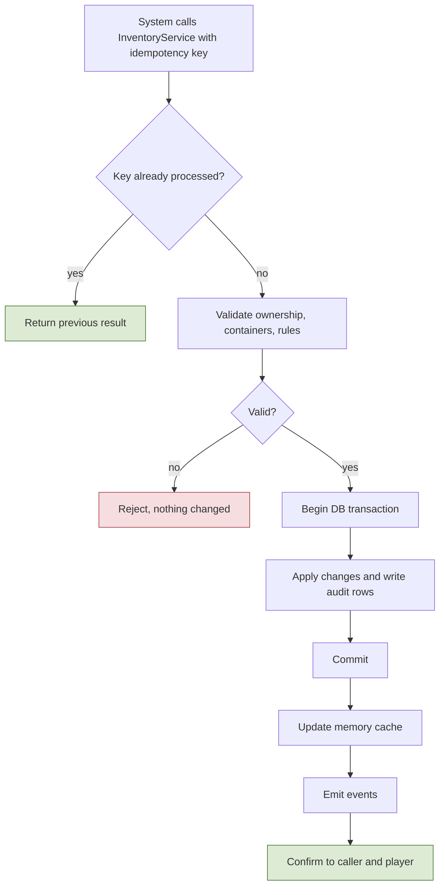
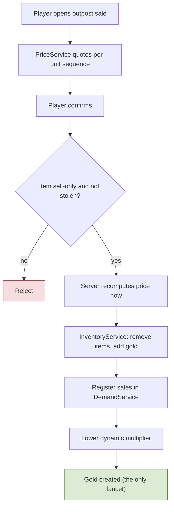
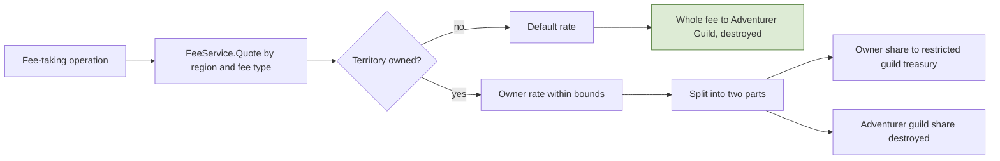
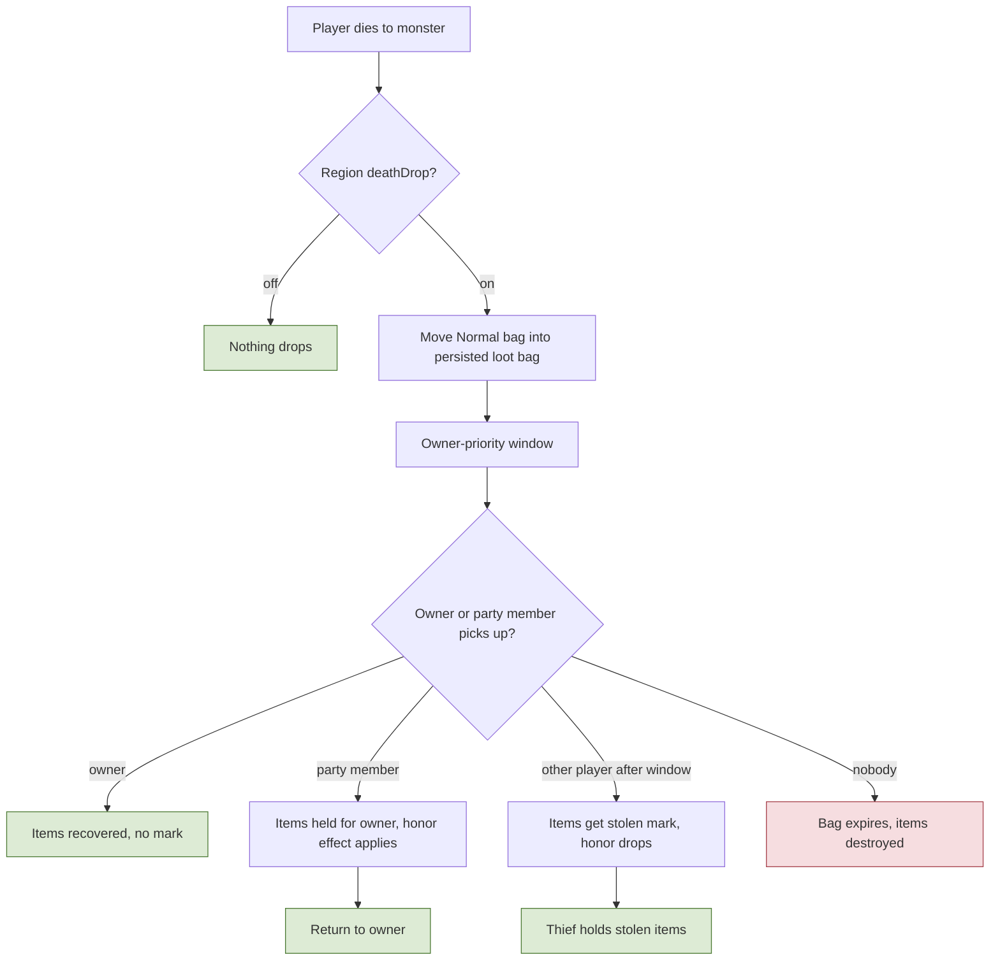
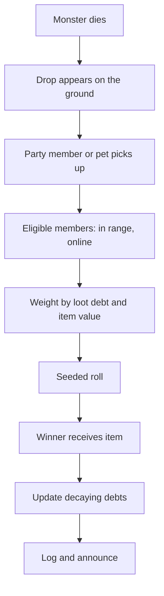
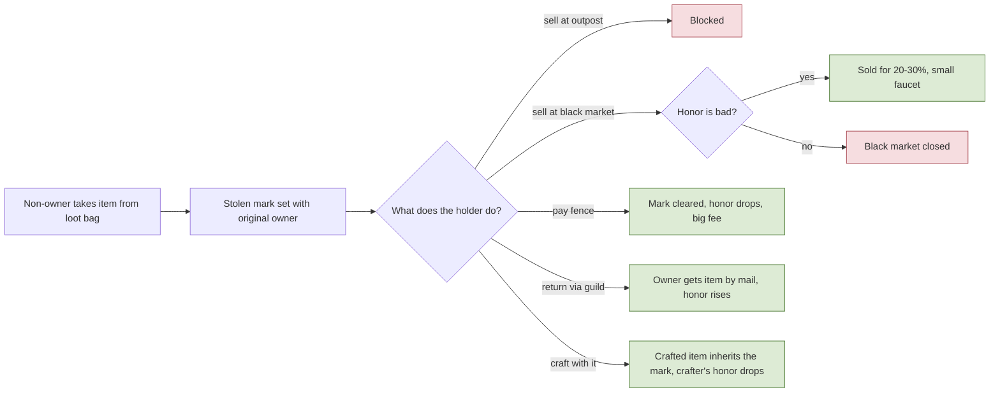
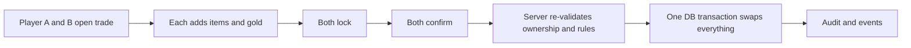

# 4. Items, Inventory, Economy, Loot

## 4.1 Items and inventory
**Rules**
- **R-4.1-01** **Item types:** (1) **sell-only drops**: from monsters, only for selling at outposts, **non-tradable**, value by rarity; (2) **craft materials**: monster drops and gathered resources (rarity, give stats to crafts; gems are materials); (3) **equipment**: rarity, gem slots, enchant +0 to +9, equipped gives stats; (4) **consumables**: boost or recover a stat/state, rarity and stats from the materials used, intoxication cost for potions, satiety for food; plus **molds and tools** (equipment area) and **quest items** (bound to the player, never dropped, non-tradable).
- **R-4.1-02** **Containers:** Equipped (never drops); **Safe bag, equipment area** (unequipped gear, molds, tools; never drops); **Safe bag, valuables area** (limited slots for materials and sell-only items; never drops); **Normal bag** (materials, sell-only items, consumables, gems; **drops on PvE death**); **Quest bag** (bound items). Slot counts are config.
- **R-4.1-03** No durability anywhere: tools and gear never wear out. Gathering tools only gate node type/tier and may add a yield bonus.
- **R-4.1-04** Stolen-tagged items and non-tradable items cannot enter trades, auctions, shops, or contracts.

**Implementation**
- Definitions in `ItemDef` (static); instances are rows with a unique ID: stackables as `(defId, rarity, stolenFlag) x count`; equipment and consumables as instances. Equipment stores rarity, crafted-stat snapshot, gem list, enchant level, owner history, stolen flag and original owner. **Consumable stack key = definition + identical stat profile.** Item data uses a versioned properties field so new attributes do not need risky migrations.
- Each item row has a `container` field. `InventoryService` enforces which categories each container accepts and capacities.
- **InventoryService is the only writer of items and gold.** API: `Transfer`, `Create`, `Destroy`, `Reserve`/`Release`, `Escrow`, `Move(container)`, all taking an idempotency key and writing an audit row in the same transaction. Online characters' inventories are cached in memory; the database commit happens before the player is told it succeeded.
- `Mail` is a persistent mailbox used for overflow, returns, contract outputs, and compensation.
- **M1 implementation (backlog G, WP14):**
  - Tables: `ItemDef` (`id`, `netId`, `category`, `maxStack`, `visualId`, `nameId`), `RarityDef` (`id`, `tier`), `ContainerDef` (`id`, `code`, `slots`, `accepts`). M1 has stackable categories only (sell-only, material, consumable; instances come with M2/M3) and the Normal bag only (`normalBag`, 30 slots, placeholder). TODO(open): the rarity tier list (one placeholder tier `common`).
  - `InventoryService` (`GameServer/Items`) runs on the world thread with an in-memory bag per online character. `TryAdd` (fills same-key stacks in slot order, then empty slots; takes what fits), `TryRemove`, `TryMove` (move, merge onto the same key, or swap); each takes an operation key, a reason and a source and records audit rows. A repeated key returns the first result. The shared, pure stacking rules are `Shared/Simulation/Items/Bag`.
  - Loot pickups and moves inside the own bag are save class 2 (R-7.1-01): a change marks the character dirty and rides on its next character save as an `InventoryBatch` (operation keys, audit rows, the final state of every touched slot), written in the same transaction as the version-checked `characters` row (spec 7.1). The player is told (`InventoryContents`, the bag as committed) and `ItemCreated`/`ItemDestroyed` are published only after that save commits. A crash loses at most the last batch, never duplicates (R-7.1-02).
  - A login reads the stacks after the ownership lock; a row the tables cannot represent (an unknown item) refuses the login with `CharacterUnavailable`.

**Talks to** called by Crafting, Quests, Contracts, Trade, Loot, Law, Guilds, Admin; emits `ItemCreated`, `ItemTransferred`, `ItemDestroyed`, `GoldChanged`.

**Flow: Atomic item or gold operation**

## 4.2 Economy: faucet, sinks, prices, demand, fees
**Rules**
- **R-4.2-01** **Gold sources:** one **main faucet**, **selling sell-only drops at outposts** (a synchronous class 1 operation), and one **small secondary faucet**, the **black market** (20-30%, bad honor only). Both are tracked in the economy metrics. All other systems only move or destroy gold. **NPC vendors** in cities sell low-tier potions, food, starter molds, and basic tools at fixed prices (a gold sink) and never buy items.
- **R-4.2-02** **Sell price** = base x rarity multiplier x dynamic multiplier. The dynamic multiplier falls as many players sell the same item and recovers over time. **Applied per unit sequentially**, so selling 100 at once equals selling one at a time. A **quote** shows the final price before confirming. Floor price and recovery rate in config; demand normalized by active players (so it works at 10-15 and at hundreds).
- **R-4.2-03** **Dynamic demand loop:** decayed kill counters per monster type (and per resource-node type) drive two outputs through a slow control loop (about once a minute): a **spawn multiplier** (heavily hunted types respawn slower, rarely hunted types a bit faster; rare monsters recover faster) and a **reward/price multiplier**. Multipliers are clamped and smoothed; spawns never reach zero (floor).
- **R-4.2-04** **Sinks:** fees on auction, shops, and contracts (adventurer-guild share destroyed), NPC vendor purchases, items delivered to outposts (item sink), failed conversions, enchant material loss, expired loot bags, laundering fees, restricted guild treasury spending, jail-related penalties. More sinks may be added later.
- **R-4.2-05** **Fees:** every fee goes through `FeeService`. In an **owned** territory the fee is split into two parts: one to the **owner guild's restricted treasury** and one to the **Adventurer Guild (destroyed)**; owners set rates within bounds (min/max in config). The **Merchant** job gets a discount on **auction and shop fees and sale taxes only** (a job modifier in `FeeService`). In an **unowned** territory the default rate applies and **the whole fee goes to the Adventurer Guild (destroyed); there is no split**.
- **R-4.2-06** Gold held in a restricted treasury never returns to circulation; its only exit is a guild-feature purchase that destroys it.
- **R-4.2-07** Telemetry: faucet and sink totals, prices, and multipliers are snapshotted regularly for tuning.

**Implementation**
- `DemandService`: `decayedCount` per `(type, region)`, updated on `Killed`/`Harvested` events; the control loop computes `ratio = decayedCount / expected(activePlayers)` and maps it through a config curve to multipliers, with min/max and max change per step. State persisted periodically.
- `SpawnController`: per spawn point; population caps or respawn delay scaled by the multiplier; spawns only near players (activation by cell). **M1 (backlog F):** `GameServer/World/SpawnController`, one monster per `SpawnPoints` row (`markerId` [a `monsterSpawn` marker of the exported world], `monsterId` [Ref `MonsterDef`]); tick phase 7 spawns every point whose monster is missing and whose respawn tick has come (all of them on the first tick), at the marker's position and facing with full meters; phase 8 removes monsters that died and starts the respawn delay (`StartingValuesM1.monsterRespawnMs`, or `bossRespawnMs` for a `MonsterDef.boss`, in whole ticks). Points go in marker id order. The marker is the monster's home for the monster AI's leash (3.1, "M1 implementation, monster AI"). The M1 rows: demons at `m1.spawn.combat.a` and `b`, aliens at `c` and `d`, the boss `m1.cyclopsBoss` at `m1.spawn.combat.boss` (3.1, WP10). No caps, activation or multiplier yet (TODO(F)); TODO(open): how long a dead monster stays before removal (death animation, loot), for now the phase 8 of the tick it died.
- `PriceService.Quote(item, qty)` returns per-unit sequence and total; `Sell` commits through `InventoryService` and registers sales into `DemandService`.
- `FeeService.Quote(regionId, feeType, amount)` → `(total, ownerShare, adventurerShare)` (for unowned territory `ownerShare` is 0 and the whole fee is destroyed); `FeeService.Apply` credits the owner's restricted ledger and destroys the other share in the caller's transaction. `SinkLedger` records every destruction by reason.
- `EconomySimulator` (Tools) runs Monte Carlo on sell prices, conversions, enchant odds, and fees before values are fixed.

**Talks to** consumes `Killed`, `Harvested`, `ItemSold`; emits `PriceChanged`, `DemandUpdated`, `FeeCharged`, `GoldDestroyed`; called by Quests, Trade, Contracts, Law, Guilds.

**Flow: Selling a sell-only item at an outpost**

**Flow: Demand control loop**

```mermaid
flowchart LR
    n0["Kill and harvest events"]
    n1["Decayed counters per type and region"]
    n2["Every minute: ratio vs expected for active players"]
    n3["Config curve"]
    n4["Clamp and smooth"]
    n5["Spawn multiplier and reward multiplier"]
    n6["SpawnController and quest/price boards"]
    n0 --> n1
    n1 --> n2
    n2 --> n3
    n3 --> n4
    n4 --> n5
    n5 --> n6
    classDef neg fill:#f6dde0,stroke:#a6414b;
    classDef pos fill:#ddebd5,stroke:#4c7a34;
```

**Flow: Fee computation and split**

## 4.3 Loot, death penalty, loot bags, pets
**Rules**
- **R-4.3-01** Monsters drop loot **on the ground** from per-monster loot tables with rarity weights, rolled on the server.
- **R-4.3-02** **Party loot:** a pickup (by a member, or by a member's pet) triggers a **weighted random roll** among eligible members (in range, online, participating). A decaying **loot debt** per member, scaled by item value, raises the odds of members who got less, so nobody gets everything or nothing. Stackable drops are handed out unit by unit with the same weighting. For a short window (30 s) the drop is **locked to the party**: other players cannot pick it up at all (no stolen mark, no honor loss); after the window anyone may take it freely. The stolen mark applies only to **death loot bags**. Full bag → mail.
- **R-4.3-03** **PvE death penalty (the only one):** the whole **Normal bag** drops into a persisted **loot bag** at the death location. A **small owner-priority window** applies; after it, anyone who passes may take items. Taking someone else's items marks them **stolen** (section 4.4). **Party members may collect** for the owner; taking lowers honor, **returning raises honor by more than taking lowered it**. Unclaimed bags **expire and the items are destroyed** (a sink). Region flag `deathDrop` can disable drops (cities) or switch to **confiscation** (NPC guard kills, section 6.3). Quest items and the safe areas never drop.
- **R-4.3-04** **Pets** (non-combat): a client-side visual plus a server rule: while summoned, the owner has an extended pickup range (auto-loot). A pet pickup counts as the owner's. Auto-loot never takes items that would count as theft. Pets are not targetable and need no server entity.
- **R-4.3-05** **Mounts:** speed modifier (section 2.2).

**Implementation**
- `LootService`: `LootTable` rows (monster type → entries with weight, rarity, count range); creates `LootDrop` entities with owner/party and `exclusiveUntil`. `LootBag` entity persisted with contents, owner, `ownerWindowUntil`, `expiresAt`, region.
- Death transaction: select Normal-bag items → remove from character → create persisted bag, in one DB transaction with audit. Bag survives restarts.
- `PartyRoll`: `LootDebt` map per party member (decaying, value-weighted), seeded RNG, logged seed, announce result.
- Honor and stolen mark are applied by the pickup handler (see 4.4 and 6.1) with per-pair cooldowns, diminishing returns, and caps to stop alt farming.
- **M1 implementation (backlog G, WP14; user decisions 2026-10-24):**
  - Tables: `LootTableDef` (one per monster type: `monsterId`, `rolls`, `nothingWeight`) and `LootTableEntry` (`tableId`, `itemId`, `rarityId`, `weight`, `countMin`/`countMax`; flat rows, weighed in file order); `LootSettings` (`pickupRangeCm` 300, `dropScatterCm` 60, `maxQueuedPickupRequests` 4, `maxDropsPerWorld` 2000; placeholders). Validator: every table has entries, each entry fits one stack and is a category the Normal bag takes. Placeholder items: demon horn and ash, alien carapace and gland, cyclops eye and hide; `nothingWeight` 0 in M1.
  - `LootService` consumes `Killed` (phase 11), idempotent per event ID. The roll (`Shared/Simulation/Items/LootRoll`, two draws per hit, one per empty roll) uses the world's loot generator: the world seed with its own stream, logged as `WorldRng`. Each rolled stack becomes a `LootDrop` entity (`EntityKind.LootDrop`, spawn definition id `ItemDef.netId`) where the monster died (`Killed` carries the position), spread on a small ring when there are several.
  - Lock: with no parties in M1 the party is the killer: only the killer may take the drop for `partyLootLockMs` (30 s), then anyone. Expiry: `bagExpiryMs` (15 min). Ground drops are volatile: lost at a restart or crash; only loot bags persist (M4).
  - Pickup: a reliable `PickupRequest` naming the drop, handled in phase 1 with players in entity ID order. Checks: alive, the drop exists and is visible (`IVisibilityQuery`), within `pickupRangeCm`, not locked. Take what fits; the rest stays on the ground as the same drop; nothing fits: `BagFull` (mail overflow is M4). Two players asking for one drop in the same tick: the lower entity ID takes it, the other gets `LootNotFound`. Operation key: the drop key (world run, kill event, index) plus the pickup number, so a pickup is never applied twice.
  - TODO(M4): player death loot bags (R-4.3-03), party rolls and loot debt (R-4.3-02), mail overflow, pets (R-4.3-04).

**Talks to** consumes `Died`, `Killed`; calls `InventoryService`, `Party`, `HonorService`; emits `LootDropped`, `LootRolled`, `LootBagCreated`, `LootBagPickedUp`, `LootBagExpired`.

**Flow: PvE death and loot bag**

**Flow: Party loot roll**

## 4.4 Stolen items, black market, laundering, return
**Rules**
- **R-4.4-01** A **stolen mark** is set when a non-owner takes items from a loot bag. It records the original owner and time.
- **R-4.4-02** Stolen items **cannot be sold at outposts**; they can be sold at the **black market for 20-30%** of value (same sales-volume decay and floor). The black market is **open only to bad-honor players** and is a small secondary gold faucet that must be counted in the economy budget.
- **R-4.4-03** Stolen items **can be used in crafts**, but any stolen input taints the crafted item (**"any" rule**, also for gems), and **crafting with stolen items lowers the crafter's honor** as well. Tainted/stolen items are **non-tradable**, but can be equipped, used, or sold at the black market. Stolen stacks do not merge with normal stacks.
- **R-4.4-04** **Removing the mark** (both methods): (a) pay a **fence NPC** a high laundering fee (at least about 70-80% of value, so it is never cheaper than the black market; it lowers honor); (b) **return the item to the original owner through the guild** (owner gets it by mail, mark cleared, the returner gains honor, with per-pair limits and caps).
- **R-4.4-05** Using stolen items lowers honor. Confiscated stolen items are returned by mail to the original owner (if that character no longer exists, destroy).

**Implementation**
- Item row fields: `stolen`, `originalOwnerId`, `stolenAt`. `StolenMark` service sets/clears and enforces rules via `InventoryService` validators (outpost sale, trade, contract, craft inheritance).
- `Fence` and `Return` are operations on `InventoryService` + `HonorService` with idempotency keys. `BlackMarket` is a sale operation gated by `honor <= threshold` and uses its own price curve.

**Talks to** emits `ItemStolen`, `ItemLaundered`, `ItemReturned`, `BlackMarketSale`; consumed by Honor, Achievements, Telemetry.

**Flow: Life of a stolen item**

## 4.5 Trade, auction house, player shops
**Rules**
- **R-4.5-01** Players can **trade directly** (window), use an **auction house**, and open **small shops in cities**. Fees (listing, sale tax) go through `FeeService` and are gold sinks. Sell-only drops, quest items, and stolen/tainted items cannot be traded or listed.
- **R-4.5-02** All channels only **move** gold; the only faucet remains outpost sales. Every transfer is logged; large one-way transfers between accounts are flagged.

**Implementation**
- **Trade window:** both players add items and gold, both confirm, the server re-validates ownership and executes one atomic transaction; cancel on disconnect; proximity required.
- **Listings** (auction and shops) share one model: the item leaves the seller and goes to escrow; the buyer pays; settlement is one transaction; unsold/expired items return by mail. Shops are `ShopStall` entities in the world (cap per city, and a cap on visible stalls), auction search uses database indexes with pagination.

**Talks to** calls `InventoryService`, `FeeService`, `Mail`; emits `TradeCompleted`, `ListingCreated`, `ListingSold`.

**Flow: Atomic trade**

