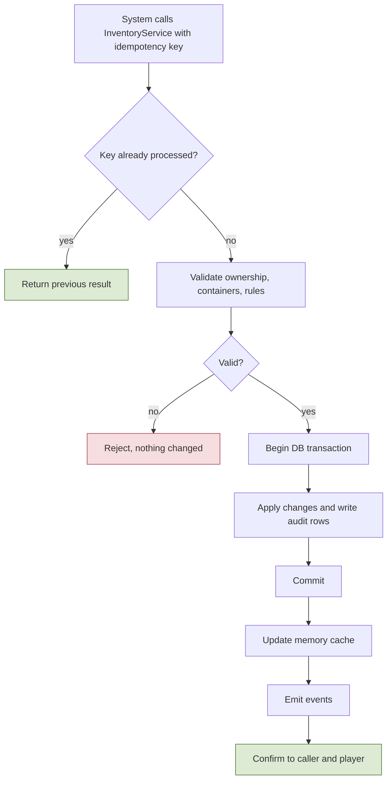
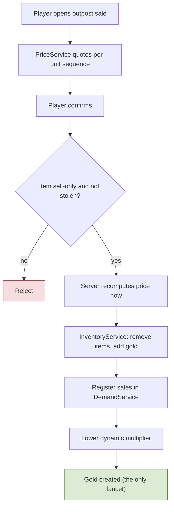
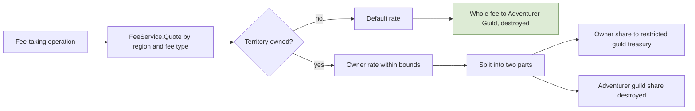
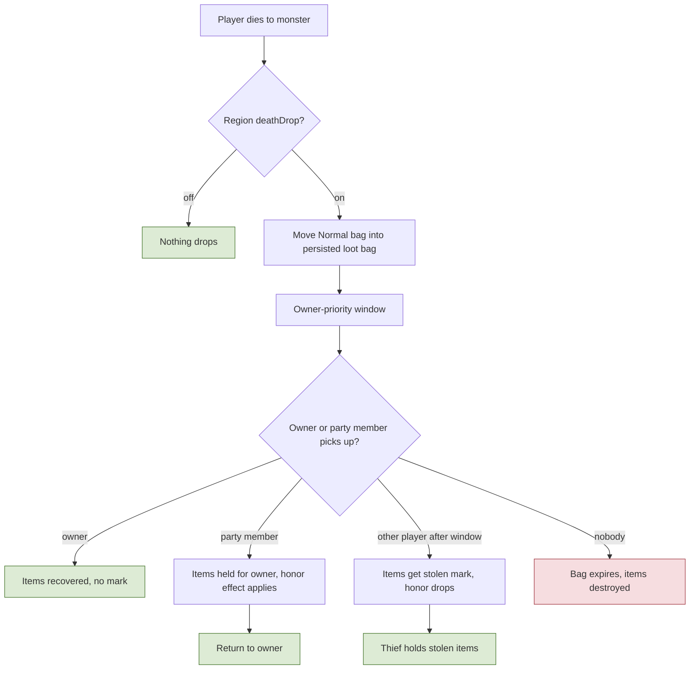
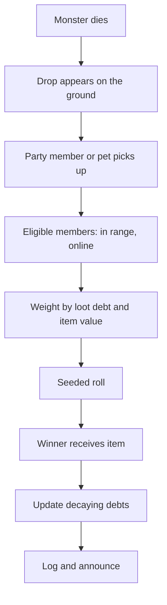
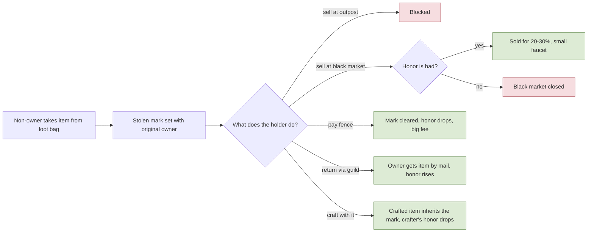
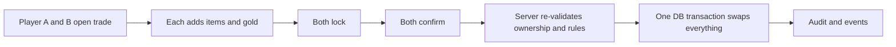

# 4. Items, Inventory, Economy, Loot

## 4.1 Items and inventory
**Rules**
- **R-4.1-01** **Item types:** (1) **sell-only drops**: from monsters, only for selling at outposts, **non-tradable**, value by rarity; (2) **craft materials**: monster drops and gathered resources (rarity, give stats to crafts; gems are materials); (3) **equipment**: rarity, gem slots, enchant +0 to +9, equipped gives stats; (4) **consumables**: boost or recover a stat/state, rarity and stats from the materials used, intoxication cost for potions, satiety for food; plus **molds and tools** (equipment area) and **quest items** (bound to the player, never dropped, non-tradable).
- **R-4.1-02** **Containers:** Equipped (never drops); **Safe bag, equipment area** (unequipped gear, molds, tools; never drops); **Safe bag, valuables area** (limited slots for materials and sell-only items; never drops); **Normal bag** (materials, sell-only items, consumables, gems; **drops on PvE death**); **Quest bag** (bound items). Slot counts are config.
- **R-4.1-03** No durability anywhere: tools and gear never wear out. Gathering tools only gate node type/tier and may add a yield bonus.
- **R-4.1-04** Stolen-tagged items and non-tradable items cannot enter trades, auctions, shops, or contracts.

**Implementation**
- Definitions in `ItemDef` (static); instances are rows with a unique ID: stackables as `(defId, rarity, stolenFlag) x count`; equipment and consumables as instances. Equipment stores rarity, crafted-stat snapshot, gem list, enchant level, owner history, stolen flag and original owner. **Consumable stack key = definition + identical stat profile.** Item data uses a versioned properties field so new attributes do not need risky migrations.
- Each item row has a `container` field. `InventoryService` enforces which categories each container accepts and capacities.
- **InventoryService is the only writer of items and gold.** API: `Transfer`, `Create`, `Destroy`, `Reserve`/`Release`, `Escrow`, `Move(container)`, all taking an idempotency key and writing an audit row in the same transaction. Online characters' inventories are cached in memory; the database commit happens before the player is told it succeeded.
- `Mail` is a persistent mailbox used for overflow, returns, contract outputs, and compensation.
- **M1 implementation (backlog G, WP14):**
  - Tables: `ItemDef` (`id`, `netId`, `category`, `maxStack`, `visualId`, `nameId`), `RarityDef` (`id`, `tier`), `ContainerDef` (`id`, `code`, `slots`, `accepts`). M1 has stackable categories only (sell-only, material, consumable; instances come with M2/M3) and the Normal bag only (`normalBag`, 30 slots, placeholder). The rarity tier list: M2 item model below (closed 2026-10-27).
  - `InventoryService` (`GameServer/Items`) runs on the world thread with an in-memory bag per online character. `TryAdd` (fills same-key stacks in slot order, then empty slots; takes what fits), `TryRemove`, `TryMove` (move, merge onto the same key, or swap); each takes an operation key, a reason and a source and records audit rows. A repeated key returns the first result. The shared, pure stacking rules are `Shared/Simulation/Items/Bag`.
  - Loot pickups and moves inside the own bag are save class 2 (R-7.1-01): a change marks the character dirty and rides on its next character save as an `InventoryBatch` (operation keys, audit rows, the final state of every touched slot), written in the same transaction as the version-checked `characters` row (spec 7.1). The player is told (`InventoryContents`, the bag as committed) and `ItemCreated`/`ItemDestroyed` are published only after that save commits. A crash loses at most the last batch, never duplicates (R-7.1-02).
  - Moves inside the bag (WP16, the inventory window of spec 9.13): a reliable `InventoryMoveRequest` names two slots; the server runs `TryMove` in phase 1 with the operation key `move:{worldRun}:{entityId}:{connection}:{requestId}` (unique for ever, the same for a repeated request) and reason `PlayerMove`. A refusal is answered at once with its reason code; an accepted move is confirmed only once the save holding it committed (rule 5), which the handler asks the read-only `InventoryService.IsCommitted`.
  - A login reads the stacks after the ownership lock; a row the tables cannot represent (an unknown item) refuses the login with `CharacterUnavailable`.
  - **Gold (WP-M2-4):** held by `InventoryService` next to the bag (`InventoryService.Gold.cs`: `TryAddGold`/`TryRemoveGold` with an operation key, reason and source; cap `EconomySettings.maxGold`), loaded with the character row (`characters.gold`) and written only by the batch of the save that carries it, with one `gold_ledger` row per change. Reasons (`InventoryReason`) `OutpostSale` (a faucet) and `VendorPurchase` (a sink). The client sees the committed balance (`GoldBalance`, protocol 17). The outpost sale and the vendor purchase are class 1 (spec 4.2, 7.1).
- **M2 item model (user decisions 2026-10-27, wave 0 of `docs/plans/m2-core-loop-plan.md`; implemented by WP-M2-1):**
  - **Rarity tiers** (closes the TODO(open) above): `common`, `uncommon`, `rare`, `epic`, `legendary` (`RarityDef.tier` 0 to 4). M2 drops use the first three; the forge (M3) reaches `epic` and `legendary`. Each tier carries one **stat percent** (`RarityDef.statPercent`, placeholders 100, 110, 125, 150, 200) that scales the stat bonuses of an equipment instance: an uncommon sword is the common sword's `ItemDef` row at 110%, never a second row.
  - **Equipment slots** are data, one row each (table name proposed: `EquipSlotDef`): `weaponMain`, `weaponSecondary` (the two weapon slots of R-3.5-07), `head`, `chest`, `legs`, `feet`, `ring`, `amulet`. A later slot is a row.
  - **Weapon types** are the config enum `WeaponType`, taken from the list of `docs/design/skill-trees.json` (sword, shield, rapier, dualSwords, bigSword, bigAxe, spear, bow, dualCrossbows, dagger, dualDaggers, scythe, pistol, dualPistols, staff, wand, book, harp, gloves, vajra, stick). A **"dual" weapon is one item that fills both weapon slots**; a skill's weapon requirement matches either slot and cannot name a slot in M2 (R-3.5-07).
  - **Gear stats without crafting:** an equipment `ItemDef` row carries a fixed list of stat bonuses (stat id, flat or percent; a primary attribute of R-3.4-01 or a derived stat) and a **minimum level**. Armor has no class gating; a weapon is usable when its type is in the character's class-line weapon list (R-3.5-07). Gem slots and the enchant level are instance fields that stay at zero and empty until M3 (inert).
  - **Where gear comes from in M2:** monster drops (loot tables with equipment entries) and one common root weapon equipped at character creation. NPC vendors sell potions and food only (R-4.2-01).
  - **Containers** (R-4.1-02, placeholders): Safe bag equipment area 20 slots, Safe bag valuables area 10, Quest bag 20, Normal bag stays 30, Equipped is the slot set above.
  - **Changing gear** (closes the Open point of R-3.5-07): equipping or unequipping any gear, weapons included, is allowed anywhere, only **out of combat** (the combat state of spec 12.7) and **not during an action**; refused with `InCombat`.
- **M2 implementation (WP-M2-1, backlog G):**
  - Tables: `ItemDef` v2 (`equipSlots`, `weaponType`, `minLevel` for equipment; instance categories `equipment` and `moldOrTool` hold one item per row, `maxStack` 1; a weapon slot needs a weapon type and a weapon type a weapon slot; a dual type fills both weapon slots and nothing else, any other weapon one slot), `RarityDef` v2 (`statPercent`, the five tiers), `ContainerDef` v2 (`kind` `bag`/`equipped`, `receivesNewItems`), new `EquipSlotDef` (`id`, `code` 0..n-1 = the slot index in Equipped, `isWeapon`), `ItemStatBonusDef` (flat rows `itemId`, `statId`, `flat`, `percent`: the fixed bonus list of an equipment row, as a common instance), `ClassGearDef` (one row per class: `weaponTypes` of its class line, `starterWeaponId`), the config enum `WeaponType`. Containers: `normalBag` 1 (30), `safeEquipment` 2 (20; equipment, molds, tools), `safeValuables` 3 (10; materials, sell-only), `questBag` 4 (20; quest), `equipped` 5 (8 slots). Quest items stack (bound: non-tradable by category, like sell-only items). Consumables stay stackables until crafted stat profiles exist (M3). Placeholder gear: a common weapon per root weapon type and a leather set, cap to amulet, dropped at low weights by the M1 loot tables.
  - **Routing:** a new item (pickup, grant) goes to the one container with `receivesNewItems` that accepts its category (validated: one per category): stackables to the Normal bag, equipment to the Safe bag equipment area (the Normal bag takes no equipment, R-4.1-02), quest items to the Quest bag. The valuables area fills by the player's moves only. A loot entry's category must have a receiver; an instance entry drops one item.
  - **Instances:** an instance is a slot holding one item with its own `instanceId = (creator characterId << 24) | seq`, made on the world thread without a database round trip; `seq` counts the instances that character created (`characters.item_instance_seq`), written in the same save transaction as the instances it numbered, so a crash rolls both back and no id is given twice. The id is part of the stack key (two instances never merge). Each instance carries rarity, the stolen flag and its own non-tradable flag (both inert until M4/M5) and the versioned properties `{"v":1,"enchant":0,"gems":[],"originalOwner":…,"ownerHistory":[]}` (inert until M3/M4).
  - **Operations:** `InventoryService.TryMove(from, to)` is `Move(container)`, equip and unequip in one (`TryEquip`/`TryUnequip` name the slot): the container and slot rules are the shared `Shared/Simulation/Items/Inventory` (the client's preview runs the same code): the target must take the category (a swap: both containers what they get); equipped gear sits at its lowest slot and every equipped item sharing a slot with the new one leaves, the first to the source slot, the others to the first free slots of the source container (none free: `BagFull`); unequipping onto gear that fits the slot equips that gear. The character's rules on top: a weapon type outside `ClassGearDef.weaponTypes` is `WeaponNotUsable`, below `minLevel` is `LevelTooLow` (`InventoryService.SetLevel` follows level-ups); into or out of Equipped while `Player.LastCombatAtMs + combatStateMs` is in the future or the action machine is not idle (dead included) is `InCombat` (`InventoryMoveHandler`). Each is one audited idempotent operation (operation key of the WP16 move request, audit kinds `Equip` and `Unequip`, audit rows with the instance id), save class 2 like bag moves (R-7.1-01), confirmed after the commit (rule 5).
  - **Starter weapon:** the Auth API creates characters without items (rule 4), so the session grants the class's `starterWeaponId` (common, equipped) at the first world entry through `InventoryService.GrantStarterGear`, under the key `starter:{characterId}`: applied once ever, and a login reads whether the key exists.
  - **Gear to stats (interface with WP-M2-2):** `GameServer/Items/IEquipmentStatSource` (implemented by `InventoryService`, keyed by character id) `GetEquippedBonuses` (one `ItemStatBonus {statId, flat, percent}` per equipped item and `ItemStatBonusDef` row, already scaled by `RarityDef.statPercent` / 100, integer, truncated toward zero) and `GetEquippedWeaponTypes` (main first, a dual weapon once), both from the **committed** equipped set; event `EquipmentChanged {characterId, slot}` after the save commits, one per equip slot whose occupant changed (spec 8.1). The stats read the source at spawn and rebuild on the event; `statId` may name any `StatDef` stat, the four attributes included (spec 3.4).
  - A login reads stacks and instances (`InventoryRepository.LoadInventoryAsync`); a row the tables cannot represent (unknown item or container, a category its container does not take, overlapping equipped items) refuses the login with `CharacterUnavailable`.
  - TODO(M4): which containers drop on PvE death (R-4.3-03), trade checks of the stolen and non-tradable flags (R-4.1-04), owner history. TODO(M2, WP-M2-5): weapon unlocks by tree nodes and the tier-1 class lines in `ClassGearDef`.

**Talks to** called by Crafting, Quests, Contracts, Trade, Loot, Law, Guilds, Admin; emits `ItemCreated`, `ItemTransferred`, `ItemDestroyed`, `GoldChanged`, `EquipmentChanged`.

**Flow: Atomic item or gold operation**

## 4.2 Economy: faucet, sinks, prices, demand, fees
**Rules**
- **R-4.2-01** **Gold sources:** one **main faucet**, **selling sell-only drops at outposts** (a synchronous class 1 operation), and one **small secondary faucet**, the **black market** (20-30%, bad honor only). Both are tracked in the economy metrics. All other systems only move or destroy gold. **NPC vendors** in cities sell low-tier potions, food, starter molds, and basic tools at fixed prices (a gold sink) and never buy items.
- **R-4.2-02** **Sell price** = base x rarity multiplier x dynamic multiplier. The dynamic multiplier falls as many players sell the same item and recovers over time. **Applied per unit sequentially**, so selling 100 at once equals selling one at a time. A **quote** shows the final price before confirming. Floor price and recovery rate in config; demand normalized by active players (so it works at 10-15 and at hundreds).
- **R-4.2-03** **Dynamic demand loop:** decayed kill counters per monster type (and per resource-node type) drive two outputs through a slow control loop (about once a minute): a **spawn multiplier** (heavily hunted types respawn slower, rarely hunted types a bit faster; rare monsters recover faster) and a **reward/price multiplier**. Multipliers are clamped and smoothed; spawns never reach zero (floor).
- **R-4.2-04** **Sinks:** fees on auction, shops, and contracts (adventurer-guild share destroyed), NPC vendor purchases, items delivered to outposts (item sink), failed conversions, enchant material loss, expired loot bags, laundering fees, restricted guild treasury spending, jail-related penalties. More sinks may be added later.
- **R-4.2-05** **Fees:** every fee goes through `FeeService`. In an **owned** territory the fee is split into two parts: one to the **owner guild's restricted treasury** and one to the **Adventurer Guild (destroyed)**; owners set rates within bounds (min/max in config). The **Merchant** job gets a discount on **auction and shop fees and sale taxes only** (a job modifier in `FeeService`). In an **unowned** territory the default rate applies and **the whole fee goes to the Adventurer Guild (destroyed); there is no split**.
- **R-4.2-06** Gold held in a restricted treasury never returns to circulation; its only exit is a guild-feature purchase that destroys it.
- **R-4.2-07** Telemetry: faucet and sink totals, prices, and multipliers are snapshotted regularly for tuning.

**Implementation**
- `DemandService`: `decayedCount` per `(type, region)`, updated on `Killed`/`Harvested` events; the control loop computes `ratio = decayedCount / expected(activePlayers)` and maps it through a config curve to multipliers, with min/max and max change per step. State persisted periodically.
- `SpawnController`: per spawn point; population caps or respawn delay scaled by the multiplier; spawns only near players (activation by cell). **M1 (backlog F):** `GameServer/World/SpawnController`, one monster per `SpawnPoints` row (`markerId` [a `monsterSpawn` marker of the exported world], `monsterId` [Ref `MonsterDef`]); tick phase 7 spawns every point whose monster is missing and whose respawn tick has come (all of them on the first tick), at the marker's position and facing with full meters; phase 8 removes monsters that died and starts the respawn delay (`StartingValuesM1.monsterRespawnMs`, or `bossRespawnMs` for a `MonsterDef.boss`, in whole ticks). Points go in marker id order. The marker is the monster's home for the monster AI's leash (3.1, "M1 implementation, monster AI"). The M1 rows: demons at `m1.spawn.combat.a` and `b`, aliens at `c` and `d`, the boss `m1.cyclopsBoss` at `m1.spawn.combat.boss` (3.1, WP10). No caps, activation or multiplier yet (TODO(F)); TODO(open): how long a dead monster stays before removal (death animation, loot), for now the phase 8 of the tick it died.
- `PriceService.Quote(item, qty)` returns per-unit sequence and total; `Sell` commits through `InventoryService` and registers sales into `DemandService`.
- `FeeService.Quote(regionId, feeType, amount)` → `(total, ownerShare, adventurerShare)` (for unowned territory `ownerShare` is 0 and the whole fee is destroyed); `FeeService.Apply` credits the owner's restricted ledger and destroys the other share in the caller's transaction. `SinkLedger` records every destruction by reason.
- `EconomySimulator` (Tools) runs Monte Carlo on sell prices, conversions, enchant odds, and fees before values are fixed.
- **M2 implementation (WP-M2-4; user decisions 2026-10-27 in the plan review):**
  - **NPCs:** exported `npc` markers whose `defId` names an `NpcDef` row (`netId`, `kind` outpost or vendor, `interactions` sell/buy/rankUp/quests, `visualId`, `nameId`, `interactRangeCm`; spec 11.6). At world start one `Npc` entity per marker (`EntityKind.Npc`, spawn definition id `NpcDef.netId`, protocol 17): in the snapshot like a ground drop, never a combatant (no hits, statuses, AI or body blocking) and never a lock target. The M1 sample world has `m1.npc.outpost` by the city gate and `m1.npc.vendor` by the shop.
  - **Interactions:** a reliable `OutpostInteractRequest {requestId, npcEntityId, kind}`; the gate in `Outposts/OutpostInteractions` checks the NPC exists and is visible (rule 9), offers the kind and has a registered handler, and the player is within `interactRangeCm` (reasons `NpcNotFound`, `InteractionUnavailable`, `OutOfRange`). Systems register one `IOutpostInteractionHandler` per kind at world build (sell and buy here, rankUp by exp and rank, quests by the quest board: `Quests/QuestService`, WP-M2-6, spec 5.5); a handler answers at once or later (after a commit). The first successful interaction with an outpost NPC in a visit (no interaction with it for `EconomySettings.visitGapMs`) publishes `OutpostVisited`.
  - **Selling (R-4.2-01/02):** `SellQuoteRequest` answers the total and the first and last unit's price at once; `SellRequest {slot, count, quotedTotal}` is a class 1 operation (spec 7.1): gate, then the stack must be sell-only and not stolen (`NotSellable`; the stolen flag is inert until M4) and hold the units (`NothingToSell`). The server recomputes the price; **a total below the confirmed quote is refused with `QuoteExpired`** (a higher one is accepted), so the player never gets less than they confirmed. Then `InventoryService` removes the units (`{op}:items`, reason `OutpostSale`) and adds the gold (`{op}:gold`, cap `EconomySettings.maxGold`, `GoldCapReached`) under the operation key `sell:{run}:{entity}:{connection}:{request}`, the sale is registered with the demand loop, and the player is answered once the save committed. Events after the commit: `ItemDestroyed`, `GoldChanged`, `ItemSold`.
  - **Price (`PriceService`, shared `PriceQuote`):** unit price = `PriceBase.baseGold` x `RarityMult.pricePercent` x the dynamic multiplier, rounded down per unit, **applied per unit sequentially** (unit i is priced after the i units before it, so 100 at once equals 100 single sales). **The dynamic multiplier follows sales only** (user decision 2026-10-27): the `price` `DemandCurve` at the item's decayed sales ratio, clamped to `PriceFloorRecovery.floorPercent`/`maxPercent`; it recovers as the counter decays by `salesRetentionPermille` each control step. The kill-driven multiplier feeds respawn delays and the reward multiplier, not the price.
  - **Demand loop (`DemandService`, R-4.2-03):** decayed counters in thousandths per (monster type, region of the death position) from `Killed` and per item from sales. Every `DemandSettings.controlIntervalMs` of world clock (phase 7, no timers): decay (`killRetentionPermille`), ratio = decayed / (max(active players, `minActivePlayers`) x `expectedKillsPerPlayerMilli`), the `spawnDelay` and `reward` curves, clamps (`spawnDelayMin/MaxPercent`, `rewardMin/MaxPercent`) and smoothing (`maxStepChangePercent` per step); the active player count of the step also normalizes prices until the next one. `SpawnController` scales each respawn delay by its type's spawn delay percent in the point's region, never below `minRespawnMs` when shortened; the clamp keeps spawns finite. The reward percent is exposed for outpost runs (`IDemandQuery.RewardPercent`). TODO(open): "rare monsters recover faster" needs a notion of rare monsters (per-type expected rates or retention).
  - **Demand state** is persisted in the realm table `demand_state` every `persistIntervalMs` (volatile class) by a background worker and read when the world starts; not rebuilt from telemetry, which drops records by design and lives in files on one host. A crash loses at most one interval of counters, which only shifts prices and respawn delays a little.
  - **Vendors (R-4.2-01):** `VendorBuyRequest {itemNetId, count, quotedTotal}`: gate (buy), an `NpcVendorStock` row of that NPC (`NotInStock`; count 1 to the item's `maxStack`), room in the bag (`BagFull`), the fixed price times the count equal to the confirmed total (`QuoteExpired`), the gold (`NotEnoughGold`); then gold destroyed and the item created (lowest rarity tier) through `InventoryService` (reason `VendorPurchase`), class 1. Unlimited stock. Events after the commit: `GoldChanged`, `GoldDestroyed`, `ItemCreated`. M2 stock: placeholder potion and food that do nothing yet (consumable use is M3). **M2 stock decided 2026-10-28 (user; placeholders):** a small HP potion, a small MP potion and bread at 25, 25 and 8 gold, the same rows at every vendor; final numbers in the balance phase after the economy simulator (WP-M2-12).
  - **Sinks and faucets:** `EconomyLedger` (the `SinkLedger` above, plus faucet totals) counts gold created and destroyed and items destroyed by reason from the events; every gold change is also a `gold_ledger` row (spec 7.1). Telemetry (spec 7.2): the events, and after each control step `EconomyTotals` and `EconomyByReason`; `BotClient report --kind economy` prints faucet and sink totals per hour.
  - **Tables:** `NpcDef`, `NpcVendorStock`, `PriceBase` (every sell-only item, only those), `RarityMult` (every rarity), `PriceFloorRecovery`, `DemandCurve` (`spawnDelay`, `reward`, `price`), `DemandSettings`, `EconomySettings`; all values are placeholders (spec 12.5). Fees are M4: no `FeeService` yet.

**Talks to** consumes `Killed`, `Harvested`, `ItemSold`; emits `PriceChanged`, `DemandUpdated`, `FeeCharged`, `GoldDestroyed`; called by Quests, Trade, Contracts, Law, Guilds.

**Flow: Selling a sell-only item at an outpost**

**Flow: Demand control loop**

```mermaid
flowchart LR
    n0["Kill and harvest events"]
    n1["Decayed counters per type and region"]
    n2["Every minute: ratio vs expected for active players"]
    n3["Config curve"]
    n4["Clamp and smooth"]
    n5["Spawn multiplier and reward multiplier"]
    n6["SpawnController and quest/price boards"]
    n0 --> n1
    n1 --> n2
    n2 --> n3
    n3 --> n4
    n4 --> n5
    n5 --> n6
    classDef neg fill:#f6dde0,stroke:#a6414b;
    classDef pos fill:#ddebd5,stroke:#4c7a34;
```

**Flow: Fee computation and split**

## 4.3 Loot, death penalty, loot bags, pets
**Rules**
- **R-4.3-01** Monsters drop loot **on the ground** from per-monster loot tables with rarity weights, rolled on the server.
- **R-4.3-02** **Party loot:** a pickup (by a member, or by a member's pet) triggers a **weighted random roll** among eligible members (in range, online, participating). A decaying **loot debt** per member, scaled by item value, raises the odds of members who got less, so nobody gets everything or nothing. Stackable drops are handed out unit by unit with the same weighting. For a short window (30 s) the drop is **locked to the party**: other players cannot pick it up at all (no stolen mark, no honor loss); after the window anyone may take it freely. The stolen mark applies only to **death loot bags**. Full bag → mail.
- **R-4.3-03** **PvE death penalty (the only one):** the whole **Normal bag** drops into a persisted **loot bag** at the death location. A **small owner-priority window** applies; after it, anyone who passes may take items. Taking someone else's items marks them **stolen** (section 4.4). **Party members may collect** for the owner; taking lowers honor, **returning raises honor by more than taking lowered it**. Unclaimed bags **expire and the items are destroyed** (a sink). Region flag `deathDrop` can disable drops (cities) or switch to **confiscation** (NPC guard kills, section 6.3). Quest items and the safe areas never drop.
- **R-4.3-04** **Pets** (non-combat): a client-side visual plus a server rule: while summoned, the owner has an extended pickup range (auto-loot). A pet pickup counts as the owner's. Auto-loot never takes items that would count as theft. Pets are not targetable and need no server entity.
- **R-4.3-05** **Mounts:** speed modifier (section 2.2).

**Implementation**
- `LootService`: `LootTable` rows (monster type → entries with weight, rarity, count range); creates `LootDrop` entities with owner/party and `exclusiveUntil`. `LootBag` entity persisted with contents, owner, `ownerWindowUntil`, `expiresAt`, region.
- Death transaction: select Normal-bag items → remove from character → create persisted bag, in one DB transaction with audit. Bag survives restarts.
- `PartyRoll`: `LootDebt` map per party member (decaying, value-weighted), seeded RNG, logged seed, announce result.
- Honor and stolen mark are applied by the pickup handler (see 4.4 and 6.1) with per-pair cooldowns, diminishing returns, and caps to stop alt farming.
- **M1 implementation (backlog G, WP14; user decisions 2026-10-24):**
  - Tables: `LootTableDef` (one per monster type: `monsterId`, `rolls`, `nothingWeight`) and `LootTableEntry` (`tableId`, `itemId`, `rarityId`, `weight`, `countMin`/`countMax`; flat rows, weighed in file order); `LootSettings` (`pickupRangeCm` 300, `dropScatterCm` 60, `maxQueuedPickupRequests` 4, `maxDropsPerWorld` 2000; placeholders). Validator: every table has entries, each entry fits one stack and is a category the Normal bag takes. Placeholder items: demon horn and ash, alien carapace and gland, cyclops eye and hide; `nothingWeight` 0 in M1.
  - `LootService` consumes `Killed` (phase 11), idempotent per event ID. The roll (`Shared/Simulation/Items/LootRoll`, two draws per hit, one per empty roll) uses the world's loot generator: the world seed with its own stream, logged as `WorldRng`. Each rolled stack becomes a `LootDrop` entity (`EntityKind.LootDrop`, spawn definition id `ItemDef.netId`) where the monster died (`Killed` carries the position), spread on a small ring when there are several.
  - Lock: with no parties in M1 the party is the killer: only the killer may take the drop for `partyLootLockMs` (30 s), then anyone. Expiry: `bagExpiryMs` (15 min). Ground drops are volatile: lost at a restart or crash; only loot bags persist (M4).
  - Pickup: a reliable `PickupRequest` naming the drop, handled in phase 1 with players in entity ID order. Checks: alive, the drop exists and is visible (`IVisibilityQuery`), within `pickupRangeCm`, not locked. Take what fits; the rest stays on the ground as the same drop; nothing fits: `BagFull` (mail overflow is M4). Two players asking for one drop in the same tick: the lower entity ID takes it, the other gets `LootNotFound`. Operation key: the drop key (world run, kill event, index) plus the pickup number, so a pickup is never applied twice.
  - TODO(M4): player death loot bags (R-4.3-03), party rolls and loot debt (R-4.3-02), mail overflow, pets (R-4.3-04).

**Talks to** consumes `Died`, `Killed`; calls `InventoryService`, `Party`, `HonorService`; emits `LootDropped`, `LootRolled`, `LootBagCreated`, `LootBagPickedUp`, `LootBagExpired`.

**Flow: PvE death and loot bag**

**Flow: Party loot roll**

## 4.4 Stolen items, black market, laundering, return
**Rules**
- **R-4.4-01** A **stolen mark** is set when a non-owner takes items from a loot bag. It records the original owner and time.
- **R-4.4-02** Stolen items **cannot be sold at outposts**; they can be sold at the **black market for 20-30%** of value (same sales-volume decay and floor). The black market is **open only to bad-honor players** and is a small secondary gold faucet that must be counted in the economy budget.
- **R-4.4-03** Stolen items **can be used in crafts**, but any stolen input taints the crafted item (**"any" rule**, also for gems), and **crafting with stolen items lowers the crafter's honor** as well. Tainted/stolen items are **non-tradable**, but can be equipped, used, or sold at the black market. Stolen stacks do not merge with normal stacks.
- **R-4.4-04** **Removing the mark** (both methods): (a) pay a **fence NPC** a high laundering fee (at least about 70-80% of value, so it is never cheaper than the black market; it lowers honor); (b) **return the item to the original owner through the guild** (owner gets it by mail, mark cleared, the returner gains honor, with per-pair limits and caps).
- **R-4.4-05** Using stolen items lowers honor. Confiscated stolen items are returned by mail to the original owner (if that character no longer exists, destroy).

**Implementation**
- Item row fields: `stolen`, `originalOwnerId`, `stolenAt`. `StolenMark` service sets/clears and enforces rules via `InventoryService` validators (outpost sale, trade, contract, craft inheritance).
- `Fence` and `Return` are operations on `InventoryService` + `HonorService` with idempotency keys. `BlackMarket` is a sale operation gated by `honor <= threshold` and uses its own price curve.

**Talks to** emits `ItemStolen`, `ItemLaundered`, `ItemReturned`, `BlackMarketSale`; consumed by Honor, Achievements, Telemetry.

**Flow: Life of a stolen item**

## 4.5 Trade, auction house, player shops
**Rules**
- **R-4.5-01** Players can **trade directly** (window), use an **auction house**, and open **small shops in cities**. Fees (listing, sale tax) go through `FeeService` and are gold sinks. Sell-only drops, quest items, and stolen/tainted items cannot be traded or listed.
- **R-4.5-02** All channels only **move** gold; the only faucet remains outpost sales. Every transfer is logged; large one-way transfers between accounts are flagged.

**Implementation**
- **Trade window:** both players add items and gold, both confirm, the server re-validates ownership and executes one atomic transaction; cancel on disconnect; proximity required.
- **Listings** (auction and shops) share one model: the item leaves the seller and goes to escrow; the buyer pays; settlement is one transaction; unsold/expired items return by mail. Shops are `ShopStall` entities in the world (cap per city, and a cap on visible stalls), auction search uses database indexes with pagination.

**Talks to** calls `InventoryService`, `FeeService`, `Mail`; emits `TradeCompleted`, `ListingCreated`, `ListingSold`.

**Flow: Atomic trade**

