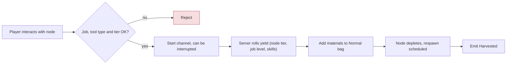
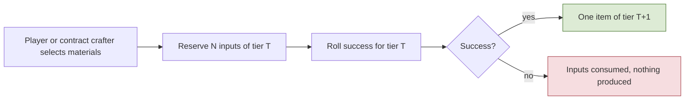
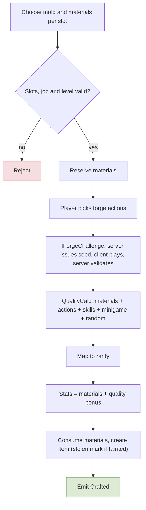
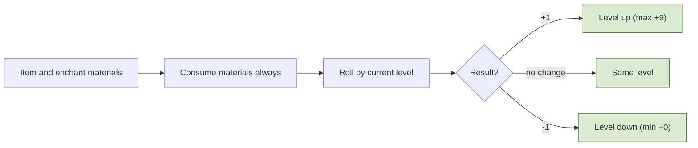
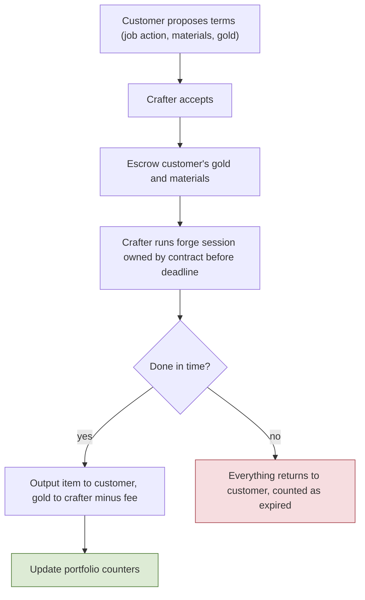
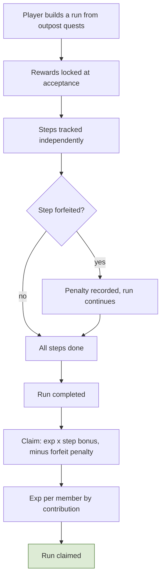

# 5. Jobs, Crafting, Contracts, Quests

## 5.1 Jobs
**Rules**
- **R-5.1-01** Jobs are separate from classes. A **job** is a progression that rises when the player performs job activities. A character is, for example, an Archer (class) with the Cooking activity of the Adventurer job.
- **R-5.1-02** Job list: **Blacksmith** (minerals from rocks; ore work; heavy weapons and armor; molds; enchanting), **Tailor** (light and magic armor/weapons; refines cloth), **Botanist** (herbs from plants; potions), **Adventurer** (fishing, cooking, adventure assistance), **Merchant** (built to **transport items in large quantities**: fast travel exists only between the 3 main cities, so moving goods around the map is done **on foot**; the Merchant **carries more items and pays less tax**), **Jeweler** (jewelry for weapons/armor; refines gems), **Guard** (a **PvP job in the open world** focused on law enforcement, with an **advantage against Bandits**; section 6.3), **Bandit** (a **PvP job in the open world** with benefits in combat and for stealing cargo and players). **Builder was removed** (no durability system); wood gathering and grip materials need a new home (Open).
- **R-5.1-03** Each character has **one main job and one secondary job with limited options** (which jobs may be secondary is data). **The secondary job's limits** (changed by the user on 2026-10-30, `docs/design/job-trees.md` decision 7): it has its own full skill tree with points from its own level, but **it needs more XP per level** (the job level curve times `JobSettings.secondaryXpPercent`, placeholder 150), **its level never passes the main job's level**, and while it is at the main job's level its XP is **banked up to one level's worth** (`secondaryBankLevels`, placeholder 1: its current level's need) and the rest is dropped; when the main job levels up, the banked XP applies at once.
- **R-5.1-04** Each job has its own **skill tree** giving a few craft bonuses. Job XP weights per activity (gather, refine, craft) are config, with diminishing XP for repeating the easiest recipe. Job skill-point **respec is free**; the XP split between gathering and crafting will be decided later to balance it.

**Implementation**
- `JobProgress` row per `(character, job)`: level, xp, points; the job tree's learned nodes in `job_nodes` (WP-M3-7). Slots (`main`, `secondary`) point to records and are written once: **decided 2026-10-30 (user): jobs cannot be changed once picked** (the per-job records stay; where and from which level the pick happens, whether both are picked together, the confirmation step and the starter molds are M3 plan decision 2).
- `JobService` consumes activity events (`Crafted`, `Harvested`, `Refined`, `Enchanted`, `Arrested`...) and applies XP with weights and difficulty-based diminishing returns. Skill-tree bonuses are computed when an activity starts and passed into the quality/odds formulas.
- **M3 decisions 8 and 9 (user, 2026-10-30):** the **job XP split** of R-5.1-04 stays the placeholder `JobXpWeights` rows of WP-M3-1 (per activity a base XP times a tier factor, diminishing returns for repeats of the same node or recipe in a sliding window) until the balance phase; nothing new is built for it. The **job skill trees** are designed in a short design talk with the user (a temporary design session writing `docs/design/` only, like the M2 skill talks) before WP-M3-7 builds them; without a design, 4 to 6 placeholder nodes per job (yield percent, quality bonus, enchant odds, socket odds, job XP), one point per job level, free respec.
- **M3 decisions (user, 2026-10-30; `docs/plans/m3-jobs-crafting-plan.md` section 5, decisions 1 and 2):**
  - **The two jobs of M3 are Blacksmith and Jeweler** (spec 12.2 "two jobs"): the Blacksmith mines minerals and makes weapons, armor and molds; the Jeweler refines gems, makes jewelry for the ring and amulet slots and sockets gems. Both may be main or secondary in M3 (`JobDef.allowedAsSecondary` is data). The other six jobs are later milestones.
  - **The pick** happens at a **job master NPC in the city** (a new `NpcInteraction` `jobs`, through the outpost gate and range), **from level 12** (`JobDef.minLevel`, spec 12.3), out of combat. The main and the secondary job are **picked separately**, each final when made (the permanence rule above), so a player may wait before choosing a second; the window asks for a **confirmation** before the request. The **starter molds** of R-5.3-01 are granted once per job in the same operation (`InventoryService.TryAdd`, key `jobStart:{character}:{job}:{n}`, idempotent).
  - **WP-M3-1 plan answers (user, 2026-10-30):** the **main job is picked before the secondary** (`JobMainFirst`); the secondary differs from the main (`JobSameAsMain`). When the starter items do not all fit (the Safe bag equipment area), **the pick is refused** with `BagFull` and nothing is written.
- **M3 implementation (WP-M3-1):**
  - **Tables** (every number a placeholder; balance is deferred): `JobDef` (`id`, `netId`, `nameId`, `allowedAsSecondary`, `minLevel` 12, `starterItemIds`: instance items each listed once; WP-M3-2's molds `m3.moldSword`, `m3.moldChest` for the Blacksmith and `m3.moldRing`, `m3.moldAmulet` for the Jeweler), `JobSettings` (singleton: `maxLevel` 20, `pointsPerLevel` 1, `recentOpKeys` 64), `JobLevelCurve` (`level`, `xpToNext`: one row per level below the cap, never decreasing; the name is the WP's, 8.5 named none), `JobXpWeights` (one row per activity: `baseXp`, `tierPercent[]` by tier, `repeatWindow`, `repeatStepPercent`, `repeatFloorPercent`; consumable use has none, so it pays no XP). The rules are `Shared/Simulation/Jobs/JobRules` (server, window and bots check a pick alike: `CheckPick`).
  - **Job XP** (`Shared/Simulation/Jobs/JobMath`, integer; the secondary job on its own curve, WP-M3-7 below): `xp = baseXp x tierPercent(tier) / 100 x repeatPercent / 100`, rounded down, where `repeatPercent = max(floor, 100 - repeats x step)` and `repeats` counts the same activity on the same subject (node or recipe net id) among the job's last `repeatWindow` activities. The window (`JobRecentWindow`) is saved with the job (`job_progress.recent`), so a relogin does not reset it. Level-ups take as many levels as the XP pays for; at `maxLevel` the rest is dropped; each level gives `pointsPerLevel` job points, and so does the pick (WP-M3-7 plan answer), spent by the job tree.
  - **`GameServer/Jobs/JobService`** is the only writer of job progress. The pick is checked (job known, the job master gate and range, `CheckPick`, out of combat and not during an action, room for the starter items), applied to the working records at once (so two picks in one tick have one winner), grants the starter items through `InventoryService.TryAdd` (`InventoryReason.JobStart`, key `jobStart:{character}:{job}:{n}`) and asks for a save at once (`SaveReason.JobPick`); the save carries the record, its `job_ops` audit row and the items in one transaction, and only after the commit does the job count (`IJobQuery`) and the player get `JobResult` and `JobState`. Job XP is class 2 (spec 7.1): applied from the activity events (phase 11), saved with the next batch; a repeated envelope (its watermark) or operation key (`Events/RecentOpKeys`) adds nothing.
  - **`IJobQuery`** (`HasJob`, `JobLevel`, `JobIn`; the committed view) is what harvesting, the forge, enchanting and gems read (`GameWorld.JobQuery`).
  - **The job master** is `NpcKind.JobMaster` with `NpcInteraction.Jobs` (`NpcDef` `m1.jobMaster`, npc marker `m1.npc.jobMaster` in the city at -22, 8 m, `SampleWorldBuilder`); its yes opens the Jobs window, and a pick (`JobRequest`) runs the outpost gate again. Persistence: realm migration `V0012__jobs` (`job_progress` with a unique slot per character, `job_ops` with one pick per slot). Protocol 28: reliable `JobState` (34), `JobRequest` (35), `JobResult` (36).
  - The activity event records (`Events/CraftingEvents.cs`, 8.1) are WP-M3-1's, so their producers (WP-M3-3 to -9) and their consumers build in parallel.
- **M3 job skill trees (user design talk 2026-10-30, `docs/design/job-trees.md` and `.json`; every number a placeholder, balance deferred):**
  1. **Size:** about 8 nodes per job (Blacksmith 9 nodes and 32 levels, Jeweler 9 and 35); most nodes max level 3 to 5, unlocks 1; **each level costs 1 point**, so a full tree holds about 1.5 times the budget of the job level cap.
  2. **Rows:** 4 rows opened at job level **1, 5, 10, 15**; a link is a **prerequisite** (a node to a level), as in the class trees (R-3.5-04).
  3. **No shared trunk:** each job has its own nodes; both follow one template (a "job XP +%" node in row 0, then one branch per activity).
  4. **The nodes** of the design file, each with one bonus kind and the activities it feeds; every bonus kind is **capped on the sum of its sources**, and the capped value is read when an activity starts.
  5. **Master Molds** (max level 1, row 3) unlocks **making** the job's T2 and T3 mold recipes, not using a mold (molds are tradable; using one needs only its job level).
  6. **Respec:** free, every point back at once, from the Jobs window anywhere, **refused in combat and during a harvest or forge session**, after a confirmation; it clears unlocks, and molds already made stay the player's.
  7. **The secondary job:** R-5.1-03 above.
  8. **The tree tab** in the Jobs window (9.13): rows with their level gates and links, each node's level, max and cost, the bonus now and at the next level, the unspent points, Learn and Respec (with its confirmation), and the job's active bonuses with their caps.
  9. **Deferred to M4:** contract bonuses, selling the job's services through contracts (R-5.3-05, 5.4), and any tree bonus to the minigame score.
  10. **Learning works any time** (no combat or session refusal); a running harvest or forge session keeps the bonuses it read at its start.
  11. **A respec resets one job's tree:** one Respec button per job.
  12. **Firm Hammer feeds craft only**, not refining; no Blacksmith node feeds refine.
  13. **`gemFindPercent`** is percentage points added to the gem chance; the harvest yield roll (WP-M3-5) maps it onto the yield table's gem entries.
  - **WP-M3-7 plan answers (user, 2026-10-30):** a job **starts with one level's job points at its pick** (`pointsPerLevel`; a budget of 20 at the cap, row 0 learnable at once); the secondary's bank **fills its current level** (when the main levels, the secondary reaches the main's new level at once); `jobXpPercent` is **read when the XP is applied** (the activity's event).
- **M3 implementation (WP-M3-7):**
  - **Tables** (placeholders): `JobTree` (one row per node, hand-written from `docs/design/job-trees.json`, which stays the source: `JobTreeDesignTests` fails when the two differ; `valuePerLevel` is the total at each level, `moldTiers` the tiers of an unlock), `JobTreeSettings` (`rowMinJobLevel` 1, 5, 10, 15), `JobBonusCap` (one cap per bonus kind; the enchant row is R-5.3-04's job-skill cap; a system with a source of its own, such as a tool's yield bonus or a `QualityCaps` entry, keeps its own bound), `JobSettings.secondaryXpPercent` 150 and `secondaryBankLevels` 1. Validator: one cost and one value per level, prerequisites of the same job in an earlier or the same row and within their max, no cycles, a row gate per row, one node per cell, a cap row for every kind used, unlocks with max level 1 and their tiers.
  - **Rules** (`Shared/Simulation/Jobs`, shared by the server, the window and the bots): `JobTreeRules` (`CheckLearn`: the node, the job held, the row gate, the prerequisites, the max level, the points, in that order; `CheckRespec`: something learned, the refund every learned level's current cost; `Bonus`: the capped sum of a job's learned nodes of one kind that feed one activity; `MoldTiers`), `JobTreeMath`, and decision 7 in `JobMath` (`ScaleCurve`, `AddSecondaryXp` capped at the main's level with `BankLimit`, called with 0 XP when the main levels up).
  - **`JobService`** stays the only writer: learn and respec (`JobTreeRequest`) are applied to the working record and saved at once with their `job_ops` row (op 2 learn, 3 respec), and answered only after the commit, like the pick (8.2). Learning has no combat refusal; a respec is refused with `InCombat` (combat or an action) and `JobActivityRunning` (any registered `IJobActivityGate`: the harvest and forge services add theirs to `GameWorld.JobActivityGates`). Refusals: `JobRequired`, `UnknownJobNode`, `JobRowLocked`, `JobNodeLocked`, `JobNodeMaxed`, `NotEnoughJobPoints`, `JobNothingToRespec`. The job state shows the committed nodes and the points they leave; a node the tables no longer have is dropped at login (TODO(open): give its points back, as the class tree). `jobXpPercent` multiplies an activity's job XP (rounded down).
  - **`IJobBonusQuery`** (`GameWorld.JobBonusQuery`): `Get(character, job, kind, activity)` (the capped value from the committed nodes; the activity matters: the Jeweler's Gem Cutter feeds refine and its Fine Setting craft) and `MoldTierUnlocked(character, job, tier)`. An activity reads it once at its start and keeps the value for the session.
  - **Persistence:** realm migration `V0014__job_trees` (`job_nodes`: one row per learned node, the whole set written with each save; `job_ops` op 1 to 3 with node, levels and points; the level-1 point for jobs picked before it). **Protocol 32:** reliable `JobTreeRequest` (47), `JobTreeResult` (48), the learned nodes appended to `JobEntry`, `JobCause.TreeChanged`; events `JobNodeLearned`, `JobTreeRespec` (8.1).
  - **Client and bots:** the tree tab of the Jobs window (9.13), `ClientJobs` (the nodes, `TreeRequest`, `JobTreeResult`), the bot step `learnJob` (11.5) and the smoke step `learn-job-node`.

**Talks to** consumes activity events; emits `JobChosen`, `JobLevelUp`, `JobXpGained`; read by Crafting and Gathering (`IJobQuery`).

**Flow: Job XP**

```mermaid
flowchart LR
    n0["Activity completes (craft, harvest, refine, enchant)"]
    n1["Event on bus"]
    n2["JobService: weight by activity and difficulty"]
    n3["Diminishing returns for repeats"]
    n4["Add XP, maybe level-up"]
    n5["Skill points to spend"]
    n6["Bonuses used in next activity"]
    n0 --> n1
    n1 --> n2
    n2 --> n3
    n3 --> n4
    n4 --> n5
    n5 --> n6
    classDef neg fill:#f6dde0,stroke:#a6414b;
    classDef pos fill:#ddebd5,stroke:#4c7a34;
    class n6 pos;
```

## 5.2 Gathering, refining, tier conversion
**Rules**
- **R-5.2-01** Gathering: Blacksmith **minerals from rocks**, Botanist **herbs from plants**, Adventurer **fishing**; refining: Jeweler **refines gems**, Tailor **refines cloth**. Gems also drop from monsters and may be found while mining. **Only players with the job** can gather its resources.
- **R-5.2-02** Gathering needs a **tool** (pickaxe, axe, fishing rod) of the right type and tier; tools never wear out. Tool tier gates node tier and may add a yield bonus.
- **R-5.2-03** Resource nodes deplete and respawn; demand uses the same counters as monsters (heavily harvested nodes respawn less, normalized by active players).
- **R-5.2-04** **Tier conversion:** lower-tier materials can be exchanged for higher tiers, never 100%. Incremental only (T to T+1), success chance falls as the tier rises, **failure consumes the inputs**. Tied to the job, and sellable to other players through contracts. Stolen-tag inheritance applies.

**Implementation**
- `ResourceNode` entity `{type, tier, state(available|depleted|respawning), respawnAt}` in the grid. Harvest is a **channeled action** (interruptible by damage/movement) validated for range, job, and tool; yield is a server roll using node tier, job level, skill-tree bonus, and randomness; materials are stackable items by (definition, rarity). Fishing has no entity: the server rolls the spot's table on cast completion.
- Anti-bot: server-validated channel, diminishing returns on repetitive harvesting, yield tied to job level, telemetry.
- `Conversion` is a recipe type in the forge engine: `{fromTier, count, successChance}` rows; roll with logged seed; arbitrage safety (daily cap, diminishing returns) available through config.
- **M3 resource nodes (user decision 2026-10-30, plan decision 5):** node types per ring and tier, ore T1 to T3 and one gem vein type (`NodeDef`, `GatherNodes` on the `resourceNode` markers of 11.6, the 12 existing plus the few the placement needs). **Nodes are visible to everyone** (they are not hidden entities, rule 9); only a player with the node's job gets the prompt, anyone else is refused with `JobRequired`. A node **depletes after one harvest** and respawns after `NodeDef.respawnMs` scaled by the demand loop of R-5.2-03 and R-4.2-03 (never to zero), from the world clock. The job-node markers of 9.3 show on the minimap for the player's own jobs. The harvest channel **breaks on damage, a movement input or a dodge** (`HarvestInterrupted`). Placement of the tiers: T1 in rings 1-2, T2 in ring 3, T3 in ring 4 (spec 4.1 "M3 item model").
- **M3 implementation, resource nodes in the world (WP-M3-4; user decision 5 of 2026-10-30; every number a placeholder):**
  - **Data.** `NodeDef` (`id`, `netId`, `jobId`, `toolType` (the `ToolType` enum `ToolDef` names, WP-M3-2: `pickaxe` in M3), `minToolTier`, `nodeTier`, `yieldTableId` (filled by harvesting, WP-M3-5), `respawnMs`, `reachCm` (the prompt and harvest range), `actionId` (WP-M3-5: the harvest action, whose channel is the harvest's length; table version 2 replaced `channelMs` with it), `visualId`, `depletedVisualId`), `GatherNodes` (resourceNode marker id to `NodeDef`, like `SpawnPoints`) and the singleton `GatherSettings` (`harvestRetentionPermille`, `expectedHarvestsPerPlayerMilli`, `minRespawnMs` for the demand loop). Validator: a job and a tool type per node, both tiers `MaterialTierDef` tiers, a `ToolDef` row of the node's tool type at `minToolTier` or above (a node no tool can harvest is refused), unique net ids, both looks in `EntityVisualDef`; the world checks `MissingNode` and `UnusedNode` (11.6). `jobId` is a `JobDef` reference (`ItemDef.jobId` too, optional). The T2 and T3 nodes need the placeholder `m3.pickaxeT2`/`m3.pickaxeT3` items and their `ToolDef` rows (tiers 2 and 3), which no vendor sells: TODO(open): source of higher-tier tools (forge recipe or vendor; decision 7, wave 1).
  - **Placement.** Ore T1 (`node.ore.t1`) on the six ring 1-2 markers, T2 on the three ring 3 markers, T3 on the three ring 4 markers, and **the gem vein** (`node.gemVein`) **on two new markers in ring 3** (`field1.node.ring3.gem1`/`gem2`, between the wolf and lurker camps), **node tier 2, mined by the Blacksmith with a pickaxe** (user answers in the WP-M3-4 plan, 2026-10-30; R-5.2-01 "gems may be found while mining"; the Jeweler refines them). All four node types belong to the Blacksmith in M3.
  - **Entity.** One `ResourceNode` entity per `GatherNodes` row (`GameServer/World/Nodes/NodeController`), created with the world after the NPCs in marker id order, never removed, in the grid and visible to everyone through `IVisibilityQuery` (not hidden, rule 9), never a combatant and never a lock target. Its state is `available` or `depleted`; the spec's "respawning" is the depleted state with `respawnAt` set (a node is never depleted without a scheduled respawn). Nodes live in memory: every node is available after a restart.
  - **Depletion and respawn.** One harvest depletes a node: `GameWorld.TryDepleteNode(entityId)`, the hook harvesting calls when it applies a harvest (WP-M3-5: on the world thread at the harvest's effect point, so of two harvesters in one tick the lower entity id wins; false for a depleted node or another entity). `respawnAt` = now + `RespawnMath.ScaledDelay(respawnMs, percent, minRespawnMs)` on the world clock (`GameWorld.NowMs`, from the server tick; no timers): the node type's spawn delay percent in the node's region, never below `minRespawnMs` (or `respawnMs` when that is shorter) and never zero. Phase 8 brings back every node whose time has come.
  - **Demand.** `DemandService` keeps harvest counters per (`NodeDef.netId`, region) from `Harvested` (idempotent per event id), decayed with `harvestRetentionPermille`, normalized by `expectedHarvestsPerPlayerMilli` per active player, through the `spawnDelay` curve with the `DemandSettings` clamp and smoothing of the kill counters (R-5.2-03 "the same counters as monsters"); saved in `demand_state` as key kind 2 (`Harvests`, `def_id` the `NodeDef.id`) with no migration; `NodeDemandUpdated` per counter and step. The counters consume WP-M3-1's `Harvested` record (`Events/CraftingEvents.cs`): the node type is its `NodeDefNetId`, the region the envelope's `RegionId`, which harvesting (WP-M3-5) sets to the node's region when it publishes.
  - **Protocol 27.** The snapshot spawn of a node carries kind 6 and the `NodeDef.netId`; every snapshot entity carries the node's state in the `Depleted` flag (spec 1.7).
  - **Client.** Greybox looks (`EntityVisualDef` rows `node.ore.t1..t3` on one rock prefab at 100, 120 and 140 %, `node.gemVein`, `node.depleted`; built by `EntityVisualPrefabBuilder.BuildNodeVisuals`); the view swaps to the depleted look and back with the flag. `ClientNodes.NearestNode` is the "in reach" hook (the nearest available node of an own job within `reachCm` of both the predicted and the confirmed position), exposed as `WorldClientFeed.NodeTarget` for the prompt of WP-M3-5. The own jobs come through `IOwnJobs`, which WP-M3-1's `ClientJobs` implements (`WorldClientFeed.Jobs`; no job, no node). The minimap job nodes are 9.12's.
- **M3 implementation, harvesting (WP-M3-5; user decision 5 of 2026-10-30; every number a placeholder):**
  - **Flow.** The interaction key (`Hotkeys` `interact`, T) on the node in reach (`ClientNodes.NearestNode`, `WorldClientFeed.NodeTarget`) sends `HarvestRequest {requestId, nodeEntityId}`; an NPC in reach keeps the key. Phase 1 (`World/Nodes/HarvestService`) checks, in this order (shared `Simulation/Gathering/HarvestRules`, also the client's and the bots' check): alive (`HarvestWhileDead`), a node (`NodeNotFound`), available (`NodeDepleted`), within `NodeDef.reachCm` of the server position (`OutOfRange`), the node's job through `IJobQuery` (`JobRequired`), the best tool of the node's `toolType` in the Safe bag's equipment area through `ItemRules.TryGetTool` (`ToolRequired`, then `ToolTierTooLow` below `minToolTier`), room for one unit of every item the node can yield at the job level (`BagFull`), and no action, use or harvest running (`ActionBusy`). The job tree's bonuses are read now (`IJobBonusQuery.Get`) and kept by the harvest (spec 5.1).
  - **The channel** is an action of kind `harvest` (`NodeDef.actionId`; one `ActionDef` row per node type, its `channelMs` the harvest's length, one `harvest` effect at the start of Active), started through `ActionInput.WithRequest` like an item use, so prediction plays it and the `cast_bar` (9.3) shows it. It breaks on a **movement input** (`ActionDef.cancelOnMove`: any move key in Startup or Channel ends it to Idle, in the shared machine), a **dodge** (`cancelableBy`), a flinch, a stagger, a stun or death, and on **damage** even without a flinch (the service hears `Damaged` and ends it with `ActionMachine.Break` in the next phase 3, before its effect), or when another harvester depleted the node (`NodeDepleted`). A broken channel is answered `HarvestInterrupted` and harvests nothing.
  - **The yield** is rolled at the harvest effect (`Simulation/Gathering/HarvestMath`, integer, pure): one entry of the node's `NodeYieldEntry` table by weight among those whose `minJobLevel` the job level reaches (the non-gem entries, then the gem entries: items tagged `roughGem` or `gem`; the job tree's gem-find bonus widens the gem group by its percentage points of the whole, decision 13), a base count evenly in its range, then times `(100 + bonus)` percent, where the bonus is `HarvestSettings.yieldPercentPerJobLevel` per job level above 1 plus the tool's `yieldBonusPercent` plus the job tree's yield bonus, capped by `maxBonusPercent`, times the repeat percent (`yieldRepeatStepPercent` off per harvest of the same node type among the job's last `yieldRepeatWindow` activities, never below `yieldRepeatFloorPercent`; the job's saved recent window through `IJobQuery.Repeats`, so a relogin does not reset it), rounded by chance and never below one unit. Each harvest draws a 64-bit seed from the world's harvest stream (seed and stream logged at start, `WorldRng`) and rolls on its own generator, so the seed alone reproduces the yield (rule 6). Gem finds and enchant stones are entries of the tables like the ore (rarely on ore nodes, mostly on the gem vein).
  - **The transaction** (8.2): a yield that does not fit the receiving bag is refused `BagFull` and the node stays available; otherwise `InventoryService.TryAdd` (reason `Harvest`, class 2, key `harvest:{run}:{entity}:{connection}:{requestId}`) and the node depletes at once on the world thread, so of two harvesters in one tick the lower entity id wins (phase 3 runs in entity id order) and the other is answered `NodeDepleted`. A crash before the commit loses the add with the node's state (nodes are memory only: all available after a restart). Once the save committed (`InventoryService.OpCommitted`), `Harvested` is published with the node's region on the envelope and the seed (job XP, demand, achievements, telemetry), whether or not the player is still connected, and the player gets `HarvestResult` (item, count) right before the `InventoryContents` that shows it. A repeated request id gets the first answer and harvests nothing more.
  - **Client and bots.** The prompt `node_prompt` ("Press T to mine", `UiStrings` `hud.node.prompt.<toolType>`) at the node, hidden during an action; refusal toasts from `ReasonCodeStrings`; the harvest toast `hud.toast.harvested` ("+{count} {item}"); engine-free `Entities/Core/ClientHarvest` (the check, the request, the answer) shared with the bots' `gather` step (11.5). QA smoke step `gather-ore`.
  - **Tables.** `NodeYieldEntry` (`id`, `tableId`, `itemId`, `rarityId`, `weight`, `countMin`, `countMax`, `minJobLevel`) and the singleton `HarvestSettings`; validator: every node has a yield table with an entry from job level 1, a table of at most `HarvestMath.MaxTableWeight` in all and a harvest action; entries name stackable items a receiving container takes within one stack and a table some node rolls; the yield window is within the job's saved window. Protocol 30 (`HarvestRequest` 39, `HarvestResult` 40). Higher-tier tools stay TODO(open) with decision 7 (WP-M3-6), so T2 and T3 nodes cannot be harvested yet with vendor tools.

**Talks to** calls `InventoryService`, `DemandService`; emits `Harvested`, `Refined`, `Converted`.

**Flow: Harvesting a resource node**

**Flow: Tier conversion**

## 5.3 Forge engine, molds, enchanting, gems
**Rules**
- **R-5.3-01** All crafting jobs share one engine. A **mold** is required; it defines material slots (e.g. normal sword: 2 materials for the blade, 1 for the grip) and allowed forge actions (smelt, hit, cool...). **Each job creates its own molds** (Blacksmith makes weapon molds); starter molds are given at job start; higher-tier molds unlock with job level or skill tree. **Molds are reusable.**
- **R-5.3-02** The player starts the forge and chooses actions; they produce numbers. **Quality = material numbers + action numbers + skill-tree bonuses + minigame result + server randomness + a small bounded random term** (a minor extra layer of randomness with little impact), mapped to rarity by config thresholds. **Item stats = materials used + a quality bonus.** The minigame is one source of randomness; its contribution is **capped**.
- **R-5.3-03** Some randomness always applies so no single action sequence is optimal. Materials are **reserved at start and consumed at the end**. Stolen-tagged inputs taint the result.
- **R-5.3-04** **Enchanting +0 to +9** is done by the item's job. Materials are **always consumed**. Result is **+1, no change, or -1**; the item is **never destroyed**. Chances per level are config (never below +0 or above +9); job skill adjusts odds within caps.
- **R-5.3-05** **Gems** are materials socketed into equipment slots by the **Jeweler** (socketing, success rates, and gem removal are Jeweler services, and can be sold through contracts); a stolen gem taints the equipment.
- **R-5.3-06** Jeweler refines gems; Tailor refines cloth (recipe type "refine").

**Implementation**
- `MoldDef`, `RecipeDef` (slot filters, allowed actions, output item type, job), `ForgeSession` state machine `Created → MaterialsReserved → Running → Finished|Cancelled`. `QualityCalc` is a pure function with each component bounded by config, so adding the second random term is one new entry.
- `IForgeChallenge`: the server generates the challenge parameters and the random seed; the client plays the minigame and sends timestamped inputs; the server validates them against its own timeline with a latency tolerance and computes a bounded score. Each job can plug in its own challenge.
- Output is a **stats snapshot** on the item instance; enchant bonus is read from the enchant table at stat time. The seed of every forge, enchant, and conversion is logged.
- The session reads inputs from reserved/escrowed items, so a contract crafter never holds the customer's materials.
- **M3 decisions 6 and 7 (user, 2026-10-30; `docs/plans/m3-jobs-crafting-plan.md` section 5; built by WP-M3-6):**
  - **Grip materials** (closes the grip half of R-5.1-02's Open point): in M3 a mold's grip slot accepts **monster-drop craft materials** (hide, bone, sinew from the field zone's beasts and the cyclops), as loot rows plus `materialTags` on existing drops (R-4.1-01 already makes monster drops craft materials). Wood stays Open until a Botanist or Adventurer job lands.
  - **Where crafting happens:** at **stations**, NPC markers with new `NpcInteraction` kinds (a forge and a jeweler's bench) in the city and at the mid-zone outpost, out of combat and through the outpost gate and range. These are public stations; **a player-owned place to forge (an own shop) comes later** (user note; TODO(open): milestone and rules, with the shops of 4.2).
  - **Forge actions** (smelt, hit, cool...) are `ForgeActionDef` rows, each adding a bounded number to the quality, up to a placeholder count per session. Every quality component is bounded in `QualityCaps`, the small extra random term of R-5.3-02 as one more entry; `QualityThresholds` maps the quality to common up to legendary (the forge reaches epic and legendary, spec 4.1).
  - **Conversion** (R-5.2-04) is a recipe type with placeholder success odds per tier and a daily cap per character.
  - **Higher-tier tools** (`m3.pickaxeT2`/`T3` exist as data since WP-M3-4, sold by no vendor): their source is a WP-M3-6 plan question for the user (the orchestrator's recommendation: Blacksmith forge recipes through a tool mold, not vendor stock).

**Talks to** calls `InventoryService`, `StatBlock` (job bonuses), `StolenMark`; emits `Crafted`, `Enchanted`, `GemSocketed`; consumed by Jobs, Achievements, Portfolio.

**Flow: Forge session**

**Flow: Enchant attempt**

## 5.4 Contracts and portfolio
**Rules**
- **R-5.4-01** A player can **contract another player for any job action** (forge, refine, enchant, conversion, mold). The customer sets gold payment and which materials are used (either side may supply materials, as terms). Both accept the terms; the crafter then has a **timer**.
- **R-5.4-02** The **crafter never holds** the customer's materials or the finished item: the item goes straight to the customer and the gold to the crafter (minus guild fee, through `FeeService`). **Quality risk belongs to the customer**; there is no refund for low quality.
- **R-5.4-03** Stolen/tainted and non-tradable items cannot be put in contracts. Cancelling after work started is restricted or costs something. The crafter must be online to run the forge; deadlines run in real time (offline counts); on timeout everything returns to the customer.
- **R-5.4-04** **Portfolio:** automatic counters (by job, mold category, rarity, crafts, enchant results, contracts completed/expired/cancelled) plus a **curated showcase** of pinned item snapshots (read-only, survive item loss). A hide flag exists. Reputation farming with alts is limited by minimum contract value and per-pair caps.

**Implementation**
- `Contract` state machine: `Proposed → Accepted → InProgress → Completed|Expired|Cancelled|Failed`. On acceptance the customer's gold and materials move to escrow via `EscrowService`; the forge session's owner is the contract and its output recipient is the customer.
- `Portfolio` is updated from `Crafted`/`Enchanted`/`Contract*` events (counters per crafter, category, rarity); showcase entries store a snapshot row.

**Talks to** calls `InventoryService`, `EscrowService`, `FeeService`, `ForgeEngine`; emits `ContractCompleted`, `ContractExpired`.

**Flow: Crafting contract**

## 5.5 Quests and runs (server-generated, exp only)
**Rules**
- **R-5.5-01** **No premade quests and no player-posted quests.** Players build quests at Adventurer Guild outposts from **server-generated** activities (kill X monster, return a quest item, ...; never a sell-only drop, user decision 2026-10-30). The outpost shows which monsters and items are needed, adjusted dynamically by demand.
- **R-5.5-02** **Quests pay exp only** (never gold or items); rewards are scaled by the demand multiplier and **locked at acceptance**. Items delivered to the outpost are consumed (an item sink).
- **R-5.5-03** Quests are bundled into a **run** (for example: kill a monster, return quest items, kill another monster nearby). Steps are tracked independently but **all rewards are paid only after every step is done**, in one claim. **More steps = bigger bonus.** A player may **forfeit or delete a step with a reward penalty** (less exp). Party runs belong to the party; exp is calculated per member at claim, with partial participants (left or joined mid-run) rewarded by contribution. The number of active quests is capped; quest items are bound.
- **R-5.5-04** Player-posted quests paid in gold were **removed** (decision of 2026-10-15): players who need items use trade, the auction house, shops, or crafting contracts.

**Implementation**
- `Run` `{owner(character|party), steps[], state(Active|Completed|Claimed|Abandoned), startedAt}`; `RunStep` `{questRef, progress, forfeited}`. `OutpostQuests` consumes gameplay events (`Killed`, `ItemObtained`, `ItemDelivered`) to advance steps. `Run.Claim` computes the step bonus and forfeit penalty and grants exp per member (contribution recorded per member per step).
- Saving: step progress and claims are single-player or party exp gains (class 2, batched); item deliveries remove items through `InventoryService` with an idempotency key.
- The board is a cached snapshot (refreshed on a slow timer) with current demand multipliers, sent on request.
- **M2 parameters (user decision 2026-10-27, WP-M2-6; placeholders):** step bonus **+10 % per step beyond the first, capped at +50 %** (`RunBonus`); a **forfeited step pays nothing and the whole run loses 20 %** (`ForfeitPenalty`); **one active run per character, up to 5 steps** (`QuestCaps`; party runs are M4); the board offers **kill X** (5 to 20, demand-scaled) and **return a quest item** (user decision 2026-10-30: no "deliver X drops" kind; sell-only drops are not quest items and stay the outpost sale's faucet, R-4.2-01) that the named type drops at 100 % into the Quest bag while the step is active; **six offers, refreshed every 10 minutes** (`OutpostQuestDef`, the board snapshot).
- **M2 implementation (WP-M2-6, protocol 22; every number a placeholder in a table):**
  - **Tables:** `QuestCaps` (`maxActiveRuns` 1, its range allows only 1 until runs get an id on the wire; `maxStepsPerRun` 5; `maxQueuedRequests`), `QuestBoardSettings` (`offersPerBoard` 6, `refreshMs` 600 000, `radiusCm` 10 000, `includeBosses` false), `RunBonus` (`perStepPercent` 10, `capPercent` 50), `ForfeitPenalty` (`perForfeitPercent` 20, `capPercent` 100), `OutpostQuestDef` (at most one row per kind: `kind` kill/deliver/returnItem, committed rows kill and returnItem only, user decision 2026-10-30; `weight`, `countMin`/`countMax`, `expPercentPerUnit` of the monster's base exp, `demandScaled`), `QuestItemDrop` (`monsterId` -> quest `itemId`; M1 rows `m2.questDemonSigil`, `m2.questAlienCore`). Validator rules: one row per kind and some kind with a weight, `countMin <= countMax`, a returnItem count fits one stack of every quest item, a quest drop is a quest item a receiving container takes and is once per monster, `maxStepsPerRun <= offersPerBoard`, and the protocol bounds (`QuestMessages`: 16 offers, 8 steps).
  - **Board (`Quests/QuestBoards`, `QuestBoardGenerator`):** every outpost NPC whose `NpcDef` offers `quests` has a zone, the (monster type, region) pairs of the `SpawnPoints` within `radiusCm` of it (bosses only with `includeBosses`), so it follows whatever monsters a world places. Its board belongs to the epoch `world clock / refreshMs` and is generated by the first request of the epoch, then cached (no timers): per slot a kind by weight among the kinds some candidate can offer, then a candidate weighted by its demand reward percent (`IDemandQuery.RewardPercent`, R-4.2-03), for deliver an item of its loot table (stackable, not a quest item; the kind stays on the wire and in the generator but has no committed row, so no board offers it), for return its `QuestItemDrop`; the count is drawn in the kind's range and, when `demandScaled`, multiplied by the reward percent and clamped; the locked reward is base exp x `expPercentPerUnit` x count x reward percent (`Shared/Simulation/Quests/RunMath`, integer, rounded down). The generator's stream is seeded from the world seed (logged at start), the outpost's marker id and the epoch, so a board can be reproduced.
  - **Requests:** the board opens with the interaction kind `quests` on the `OutpostInteractions` registry (its gate: NPC visible, offers it, within `interactRangeCm`, else `NpcNotFound`/`InteractionUnavailable`/`OutOfRange`), and the server sends `QuestBoard` after the yes. `QuestRunRequest {requestId, npcEntityId, action, epoch, stepIndex, slots[]}` passes the same gate. **Accept** names the board's epoch and 1 to `maxStepsPerRun` distinct offer slots in run order (`BoardExpired` with the new board, `TooManySteps`, `OfferNotFound`, `RunAlreadyActive`) and locks the offers' rewards into the steps. **Deliver** hands in a return step's items (or a deliver step's, a kind with no committed row) from the container that receives their category, in slot order, at most what the step misses, through `InventoryService` (keys `{op}:items:{slot}`, reason `QuestDelivery`, destroyed: an item sink), and advances the step in the same call, so the removal and the progress ride one save (`StepNotActive` for a kill step or a closed one, `NothingToDeliver`); the delivery then publishes `ItemDelivered` as the fact. A separate `ItemDelivered` consumer could advance the step in a later save than the removal when phase 11 carries events over, so the event is not what advances it. **Forfeit** closes an active step: it pays nothing and each forfeited step takes `perForfeitPercent` off the run, up to `capPercent` (user answer 2026-10-27: per forfeited step); a run whose last active step is forfeited is completed, or abandoned (closed, nothing to claim) when no step is done. **Claim** needs a completed run (`NoActiveRun`, `RunNotComplete`) and pays `floor(sum of the done steps' rewards x (100 + bonus) % x (100 - penalty) %)`, the bonus counting done steps only (+10 % per done step beyond the first, cap +50 %), through `ExpService.Grant`; `AchievementService.Record(RunsClaimed, runId)` counts it in the same call. Operation keys `quest:{world run}:{entity}:{connection}:{request}`; a repeated request on one connection gets the first answer.
  - **Progress:** `QuestService` consumes `Killed` (phase 11, its own watermark): **one kill counts once**, for the killer's first active kill step of that monster type in run order (two "kill 5 demons" steps need ten kills), and while a return step of that type is active the kill puts one quest item straight into the Quest bag (100 %, `InventoryService.TryAdd`, key `qdrop:{world run}:{run}:{step}:{event}`, reason `QuestDrop`, bound by category) until the bag holds what the return steps of that item still need. "ItemObtained" is spec 8.1's `ItemCreated`; the client reads what it carries from its bag, so no step consumes it.
  - **Saving:** `Quests/RunStore` is the only writer of run state. Every change is class 2: the next character save carries a `QuestBatch` (the changed runs whole, as absolute rows, and the audit rows of accepts, deliveries, forfeits and claims) in the transaction of the version-checked row, its exp and the inventory batch (realm migration V0010: `quest_runs`, `quest_run_steps`, `quest_run_audit` with `op_key` as the idempotency key; a run is claimed once ever, `quest_run_audit_one_claim`; at most one open run per character, `quest_runs_one_open_per_character`). Accept, deliver and forfeit are answered at once; a **claim asks for a save at once (`SaveReason.RunClaim`) and is answered only once it committed** (rule 5, the rank-up pattern). Open runs load with the character; `RunStatus` (state, steps with progress, bonus, penalty, what a claim would pay) goes to the client at enter world and whenever the run changes.
  - **Client:** the outpost sale window's Quests button opens the quest board and run builder v1 (`UI/Menus/Quests`, layout row `quest_board`): offers with their locked exp, picks in run order up to the cap with a preview after the step bonus, accept and clear; with a run, its steps with hand-in and forfeit and the claim button. The run tracker is spec 9.3 `run_tracker`; while a return (or deliver) step is open it shows how many of the step's item the player holds next to the delivered progress (user decision 2026-10-30), read from the client's committed inventory in the container a hand-in takes from, so it needs no protocol change. Refusals toast their `ReasonCodeStrings` text; a committed claim toasts `hud.toast.runClaimed`.
  - **Events:** `QuestStepDone`, `QuestForfeited`, `RunClaimed`, `ItemDelivered` (`GameServer/Events/QuestEvents.cs`).
  - TODO(M4): party runs (`owner_party_id` stays null; exp per member by contribution).

**Talks to** consumes `Killed`; calls `InventoryService`, `ExpService`, `AchievementService`, `Party` (M4); emits `QuestStepDone`, `RunClaimed`, `QuestForfeited`, `ItemDelivered`.

**Flow: Run lifecycle**

