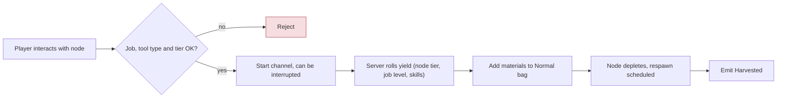
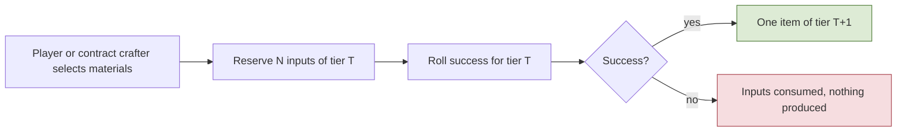
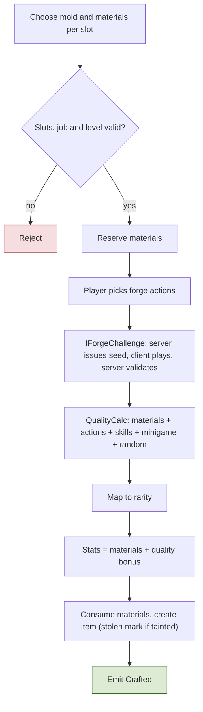
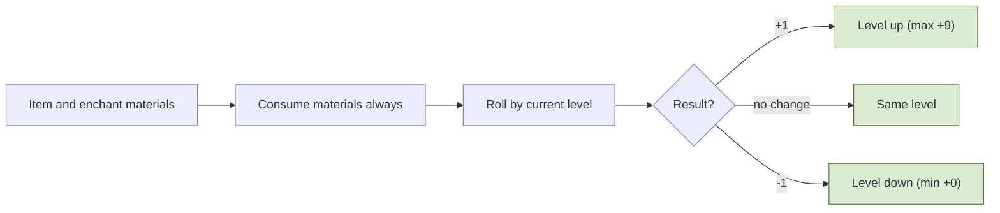
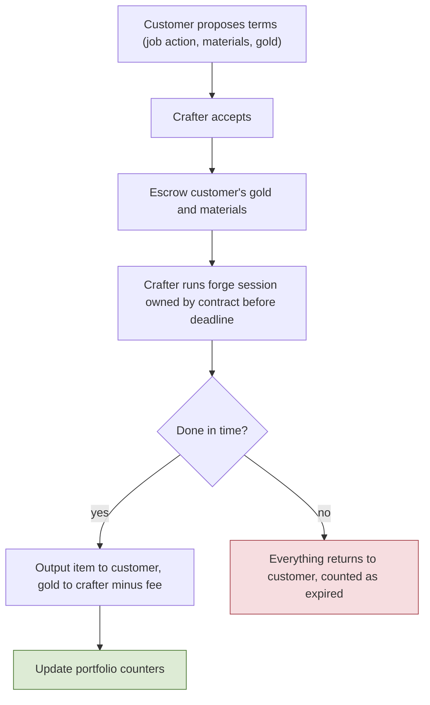
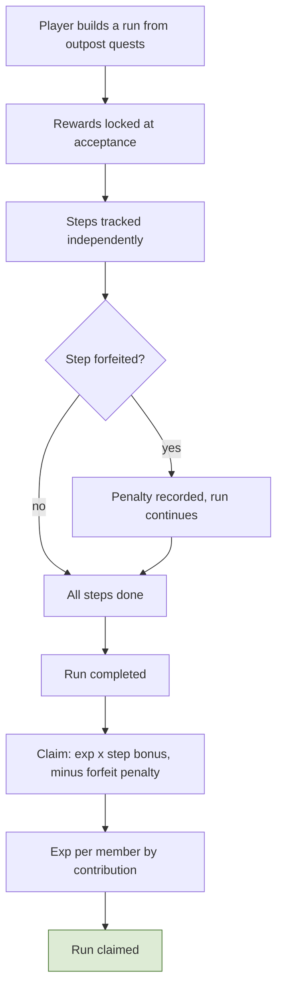

# 5. Jobs, Crafting, Contracts, Quests

## 5.1 Jobs
**Rules**
- **R-5.1-01** Jobs are separate from classes. A **job** is a progression that rises when the player performs job activities. A character is, for example, an Archer (class) with the Cooking activity of the Adventurer job.
- **R-5.1-02** Job list: **Blacksmith** (minerals from rocks; ore work; heavy weapons and armor; molds; enchanting), **Tailor** (light and magic armor/weapons; refines cloth), **Botanist** (herbs from plants; potions), **Adventurer** (fishing, cooking, adventure assistance), **Merchant** (built to **transport items in large quantities**: fast travel exists only between the 3 main cities, so moving goods around the map is done **on foot**; the Merchant **carries more items and pays less tax**), **Jeweler** (jewelry for weapons/armor; refines gems), **Guard** (a **PvP job in the open world** focused on law enforcement, with an **advantage against Bandits**; section 6.3), **Bandit** (a **PvP job in the open world** with benefits in combat and for stealing cargo and players). **Builder was removed** (no durability system); wood gathering and grip materials need a new home (Open).
- **R-5.1-03** Each character has **one main job and one secondary job with limited options** (which jobs may be secondary is data).
- **R-5.1-04** Each job has its own **skill tree** giving a few craft bonuses. Job XP weights per activity (gather, refine, craft) are config, with diminishing XP for repeating the easiest recipe. Job skill-point **respec is free**; the XP split between gathering and crafting will be decided later to balance it.

**Implementation**
- `JobProgress` row per `(character, job)`: level, xp, points, unlocked nodes. Slots (`main`, `secondary`) point to records and are written once: **decided 2026-10-30 (user): jobs cannot be changed once picked** (the per-job records stay; where and from which level the pick happens, whether both are picked together, the confirmation step and the starter molds are M3 plan decision 2).
- `JobService` consumes activity events (`Crafted`, `Harvested`, `Refined`, `Enchanted`, `Arrested`...) and applies XP with weights and difficulty-based diminishing returns. Skill-tree bonuses are computed when an activity starts and passed into the quality/odds formulas.

**Talks to** consumes activity events; emits `JobLevelUp`; read by Crafting and Gathering.

**Flow: Job XP**

```mermaid
flowchart LR
    n0["Activity completes (craft, harvest, refine, enchant)"]
    n1["Event on bus"]
    n2["JobService: weight by activity and difficulty"]
    n3["Diminishing returns for repeats"]
    n4["Add XP, maybe level-up"]
    n5["Skill points to spend"]
    n6["Bonuses used in next activity"]
    n0 --> n1
    n1 --> n2
    n2 --> n3
    n3 --> n4
    n4 --> n5
    n5 --> n6
    classDef neg fill:#f6dde0,stroke:#a6414b;
    classDef pos fill:#ddebd5,stroke:#4c7a34;
    class n6 pos;
```

## 5.2 Gathering, refining, tier conversion
**Rules**
- **R-5.2-01** Gathering: Blacksmith **minerals from rocks**, Botanist **herbs from plants**, Adventurer **fishing**; refining: Jeweler **refines gems**, Tailor **refines cloth**. Gems also drop from monsters and may be found while mining. **Only players with the job** can gather its resources.
- **R-5.2-02** Gathering needs a **tool** (pickaxe, axe, fishing rod) of the right type and tier; tools never wear out. Tool tier gates node tier and may add a yield bonus.
- **R-5.2-03** Resource nodes deplete and respawn; demand uses the same counters as monsters (heavily harvested nodes respawn less, normalized by active players).
- **R-5.2-04** **Tier conversion:** lower-tier materials can be exchanged for higher tiers, never 100%. Incremental only (T to T+1), success chance falls as the tier rises, **failure consumes the inputs**. Tied to the job, and sellable to other players through contracts. Stolen-tag inheritance applies.

**Implementation**
- `ResourceNode` entity `{type, tier, state(available|depleted|respawning), respawnAt}` in the grid. Harvest is a **channeled action** (interruptible by damage/movement) validated for range, job, and tool; yield is a server roll using node tier, job level, skill-tree bonus, and randomness; materials are stackable items by (definition, rarity). Fishing has no entity: the server rolls the spot's table on cast completion.
- Anti-bot: server-validated channel, diminishing returns on repetitive harvesting, yield tied to job level, telemetry.
- `Conversion` is a recipe type in the forge engine: `{fromTier, count, successChance}` rows; roll with logged seed; arbitrage safety (daily cap, diminishing returns) available through config.

**Talks to** calls `InventoryService`, `DemandService`; emits `Harvested`, `Refined`, `Converted`.

**Flow: Harvesting a resource node**

**Flow: Tier conversion**

## 5.3 Forge engine, molds, enchanting, gems
**Rules**
- **R-5.3-01** All crafting jobs share one engine. A **mold** is required; it defines material slots (e.g. normal sword: 2 materials for the blade, 1 for the grip) and allowed forge actions (smelt, hit, cool...). **Each job creates its own molds** (Blacksmith makes weapon molds); starter molds are given at job start; higher-tier molds unlock with job level or skill tree. **Molds are reusable.**
- **R-5.3-02** The player starts the forge and chooses actions; they produce numbers. **Quality = material numbers + action numbers + skill-tree bonuses + minigame result + server randomness + a small bounded random term** (a minor extra layer of randomness with little impact), mapped to rarity by config thresholds. **Item stats = materials used + a quality bonus.** The minigame is one source of randomness; its contribution is **capped**.
- **R-5.3-03** Some randomness always applies so no single action sequence is optimal. Materials are **reserved at start and consumed at the end**. Stolen-tagged inputs taint the result.
- **R-5.3-04** **Enchanting +0 to +9** is done by the item's job. Materials are **always consumed**. Result is **+1, no change, or -1**; the item is **never destroyed**. Chances per level are config (never below +0 or above +9); job skill adjusts odds within caps.
- **R-5.3-05** **Gems** are materials socketed into equipment slots by the **Jeweler** (socketing, success rates, and gem removal are Jeweler services, and can be sold through contracts); a stolen gem taints the equipment.
- **R-5.3-06** Jeweler refines gems; Tailor refines cloth (recipe type "refine").

**Implementation**
- `MoldDef`, `RecipeDef` (slot filters, allowed actions, output item type, job), `ForgeSession` state machine `Created → MaterialsReserved → Running → Finished|Cancelled`. `QualityCalc` is a pure function with each component bounded by config, so adding the second random term is one new entry.
- `IForgeChallenge`: the server generates the challenge parameters and the random seed; the client plays the minigame and sends timestamped inputs; the server validates them against its own timeline with a latency tolerance and computes a bounded score. Each job can plug in its own challenge.
- Output is a **stats snapshot** on the item instance; enchant bonus is read from the enchant table at stat time. The seed of every forge, enchant, and conversion is logged.
- The session reads inputs from reserved/escrowed items, so a contract crafter never holds the customer's materials.

**Talks to** calls `InventoryService`, `StatBlock` (job bonuses), `StolenMark`; emits `Crafted`, `Enchanted`, `GemSocketed`; consumed by Jobs, Achievements, Portfolio.

**Flow: Forge session**

**Flow: Enchant attempt**

## 5.4 Contracts and portfolio
**Rules**
- **R-5.4-01** A player can **contract another player for any job action** (forge, refine, enchant, conversion, mold). The customer sets gold payment and which materials are used (either side may supply materials, as terms). Both accept the terms; the crafter then has a **timer**.
- **R-5.4-02** The **crafter never holds** the customer's materials or the finished item: the item goes straight to the customer and the gold to the crafter (minus guild fee, through `FeeService`). **Quality risk belongs to the customer**; there is no refund for low quality.
- **R-5.4-03** Stolen/tainted and non-tradable items cannot be put in contracts. Cancelling after work started is restricted or costs something. The crafter must be online to run the forge; deadlines run in real time (offline counts); on timeout everything returns to the customer.
- **R-5.4-04** **Portfolio:** automatic counters (by job, mold category, rarity, crafts, enchant results, contracts completed/expired/cancelled) plus a **curated showcase** of pinned item snapshots (read-only, survive item loss). A hide flag exists. Reputation farming with alts is limited by minimum contract value and per-pair caps.

**Implementation**
- `Contract` state machine: `Proposed → Accepted → InProgress → Completed|Expired|Cancelled|Failed`. On acceptance the customer's gold and materials move to escrow via `EscrowService`; the forge session's owner is the contract and its output recipient is the customer.
- `Portfolio` is updated from `Crafted`/`Enchanted`/`Contract*` events (counters per crafter, category, rarity); showcase entries store a snapshot row.

**Talks to** calls `InventoryService`, `EscrowService`, `FeeService`, `ForgeEngine`; emits `ContractCompleted`, `ContractExpired`.

**Flow: Crafting contract**

## 5.5 Quests and runs (server-generated, exp only)
**Rules**
- **R-5.5-01** **No premade quests and no player-posted quests.** Players build quests at Adventurer Guild outposts from **server-generated** activities (kill X monster, deliver X items, return a quest item, ...). The outpost shows which monsters and items are needed, adjusted dynamically by demand.
- **R-5.5-02** **Quests pay exp only** (never gold or items); rewards are scaled by the demand multiplier and **locked at acceptance**. Items delivered to the outpost are consumed (an item sink).
- **R-5.5-03** Quests are bundled into a **run** (for example: kill a monster, deliver materials, kill another monster nearby, return a quest item). Steps are tracked independently but **all rewards are paid only after every step is done**, in one claim. **More steps = bigger bonus.** A player may **forfeit or delete a step with a reward penalty** (less exp). Party runs belong to the party; exp is calculated per member at claim, with partial participants (left or joined mid-run) rewarded by contribution. The number of active quests is capped; quest items are bound.
- **R-5.5-04** Player-posted quests paid in gold were **removed** (decision of 2026-10-15): players who need items use trade, the auction house, shops, or crafting contracts.

**Implementation**
- `Run` `{owner(character|party), steps[], state(Active|Completed|Claimed|Abandoned), startedAt}`; `RunStep` `{questRef, progress, forfeited}`. `OutpostQuests` consumes gameplay events (`Killed`, `ItemObtained`, `ItemDelivered`) to advance steps. `Run.Claim` computes the step bonus and forfeit penalty and grants exp per member (contribution recorded per member per step).
- Saving: step progress and claims are single-player or party exp gains (class 2, batched); item deliveries remove items through `InventoryService` with an idempotency key.
- The board is a cached snapshot (refreshed on a slow timer) with current demand multipliers, sent on request.
- **M2 parameters (user decision 2026-10-27, WP-M2-6; placeholders):** step bonus **+10 % per step beyond the first, capped at +50 %** (`RunBonus`); a **forfeited step pays nothing and the whole run loses 20 %** (`ForfeitPenalty`); **one active run per character, up to 5 steps** (`QuestCaps`; party runs are M4); the board offers **kill X** (5 to 20, demand-scaled), **deliver X** drops of the zone's monsters, and **return a quest item** that the named type drops at 100 % into the Quest bag while the step is active; **six offers, refreshed every 10 minutes** (`OutpostQuestDef`, the board snapshot).
- **M2 implementation (WP-M2-6, protocol 22; every number a placeholder in a table):**
  - **Tables:** `QuestCaps` (`maxActiveRuns` 1, its range allows only 1 until runs get an id on the wire; `maxStepsPerRun` 5; `maxQueuedRequests`), `QuestBoardSettings` (`offersPerBoard` 6, `refreshMs` 600 000, `radiusCm` 10 000, `includeBosses` false), `RunBonus` (`perStepPercent` 10, `capPercent` 50), `ForfeitPenalty` (`perForfeitPercent` 20, `capPercent` 100), `OutpostQuestDef` (one row per kind: `kind` kill/deliver/returnItem, `weight`, `countMin`/`countMax`, `expPercentPerUnit` of the monster's base exp, `demandScaled`), `QuestItemDrop` (`monsterId` -> quest `itemId`; M1 rows `m2.questDemonSigil`, `m2.questAlienCore`). Validator rules: one row per kind and some kind with a weight, `countMin <= countMax`, a returnItem count fits one stack of every quest item, a quest drop is a quest item a receiving container takes and is once per monster, `maxStepsPerRun <= offersPerBoard`, and the protocol bounds (`QuestMessages`: 16 offers, 8 steps).
  - **Board (`Quests/QuestBoards`, `QuestBoardGenerator`):** every outpost NPC whose `NpcDef` offers `quests` has a zone, the (monster type, region) pairs of the `SpawnPoints` within `radiusCm` of it (bosses only with `includeBosses`), so it follows whatever monsters a world places. Its board belongs to the epoch `world clock / refreshMs` and is generated by the first request of the epoch, then cached (no timers): per slot a kind by weight among the kinds some candidate can offer, then a candidate weighted by its demand reward percent (`IDemandQuery.RewardPercent`, R-4.2-03), for deliver an item of its loot table (stackable, not a quest item), for return its `QuestItemDrop`; the count is drawn in the kind's range and, when `demandScaled`, multiplied by the reward percent and clamped; the locked reward is base exp x `expPercentPerUnit` x count x reward percent (`Shared/Simulation/Quests/RunMath`, integer, rounded down). The generator's stream is seeded from the world seed (logged at start), the outpost's marker id and the epoch, so a board can be reproduced.
  - **Requests:** the board opens with the interaction kind `quests` on the `OutpostInteractions` registry (its gate: NPC visible, offers it, within `interactRangeCm`, else `NpcNotFound`/`InteractionUnavailable`/`OutOfRange`), and the server sends `QuestBoard` after the yes. `QuestRunRequest {requestId, npcEntityId, action, epoch, stepIndex, slots[]}` passes the same gate. **Accept** names the board's epoch and 1 to `maxStepsPerRun` distinct offer slots in run order (`BoardExpired` with the new board, `TooManySteps`, `OfferNotFound`, `RunAlreadyActive`) and locks the offers' rewards into the steps. **Deliver** hands in a deliver or return step's items from the container that receives their category, in slot order, at most what the step misses, through `InventoryService` (keys `{op}:items:{slot}`, reason `QuestDelivery`, destroyed: an item sink), and advances the step in the same call, so the removal and the progress ride one save (`StepNotActive` for a kill step or a closed one, `NothingToDeliver`); the delivery then publishes `ItemDelivered` as the fact. A separate `ItemDelivered` consumer could advance the step in a later save than the removal when phase 11 carries events over, so the event is not what advances it. **Forfeit** closes an active step: it pays nothing and each forfeited step takes `perForfeitPercent` off the run, up to `capPercent` (user answer 2026-10-27: per forfeited step); a run whose last active step is forfeited is completed, or abandoned (closed, nothing to claim) when no step is done. **Claim** needs a completed run (`NoActiveRun`, `RunNotComplete`) and pays `floor(sum of the done steps' rewards x (100 + bonus) % x (100 - penalty) %)`, the bonus counting done steps only (+10 % per done step beyond the first, cap +50 %), through `ExpService.Grant`; `AchievementService.Record(RunsClaimed, runId)` counts it in the same call. Operation keys `quest:{world run}:{entity}:{connection}:{request}`; a repeated request on one connection gets the first answer.
  - **Progress:** `QuestService` consumes `Killed` (phase 11, its own watermark): **one kill counts once**, for the killer's first active kill step of that monster type in run order (two "kill 5 demons" steps need ten kills), and while a return step of that type is active the kill puts one quest item straight into the Quest bag (100 %, `InventoryService.TryAdd`, key `qdrop:{world run}:{run}:{step}:{event}`, reason `QuestDrop`, bound by category) until the bag holds what the return steps of that item still need. "ItemObtained" is spec 8.1's `ItemCreated`; the client reads what it carries from its bag, so no step consumes it.
  - **Saving:** `Quests/RunStore` is the only writer of run state. Every change is class 2: the next character save carries a `QuestBatch` (the changed runs whole, as absolute rows, and the audit rows of accepts, deliveries, forfeits and claims) in the transaction of the version-checked row, its exp and the inventory batch (realm migration V0010: `quest_runs`, `quest_run_steps`, `quest_run_audit` with `op_key` as the idempotency key; a run is claimed once ever, `quest_run_audit_one_claim`; at most one open run per character, `quest_runs_one_open_per_character`). Accept, deliver and forfeit are answered at once; a **claim asks for a save at once (`SaveReason.RunClaim`) and is answered only once it committed** (rule 5, the rank-up pattern). Open runs load with the character; `RunStatus` (state, steps with progress, bonus, penalty, what a claim would pay) goes to the client at enter world and whenever the run changes.
  - **Client:** the outpost sale window's Quests button opens the quest board and run builder v1 (`UI/Menus/Quests`, layout row `quest_board`): offers with their locked exp, picks in run order up to the cap with a preview after the step bonus, accept and clear; with a run, its steps with hand-in and forfeit and the claim button. The run tracker is spec 9.3 `run_tracker`. Refusals toast their `ReasonCodeStrings` text; a committed claim toasts `hud.toast.runClaimed`.
  - **Events:** `QuestStepDone`, `QuestForfeited`, `RunClaimed`, `ItemDelivered` (`GameServer/Events/QuestEvents.cs`).
  - TODO(M4): party runs (`owner_party_id` stays null; exp per member by contribution).

**Talks to** consumes `Killed`; calls `InventoryService`, `ExpService`, `AchievementService`, `Party` (M4); emits `QuestStepDone`, `RunClaimed`, `QuestForfeited`, `ItemDelivered`.

**Flow: Run lifecycle**

