# 6. PK, Law, Guilds, Social

## 6.1 PvP, flag, honor
**Rules**
- **R-6.1-01** **PvP is on by default after the first class change.** To damage another player the attacker must have an **armed** hotbar skill active (prevents accidental hits). **Party and guild members cannot attack each other.** Region flag `pvpMode`: normal cities off; the **lawless city** always on (armed requirement skipped; party/guild immunity still applies); guilds at war are valid targets without flagging or honor loss. After a party/guild membership change a short lockout prevents leave-then-attack abuse.
- **R-6.1-02** **Red-name flag:** attacking a non-flagged player flags you (name turns red, timed, refreshed by attacks). **Attacking a flagged player does not flag you.** Killing a flagged player has **no honor cost** (self-defense); killing a **bad-honor** player **raises honor**. Killing a non-flagged, non-bad-honor player lowers honor.
- **R-6.1-03** **Honor** goes **up** for helping players, capturing bandits, returning stolen items (more than the loss from taking), and **down** for killing players, stealing items, using stolen items, **crafting with stolen items**, laundering items, and similar crimes. Weights are config; gains use verifiable events with per-pair cooldowns, diminishing returns, caps, and value scaling (anti-farm).
- **R-6.1-04** Honor tiers: good, neutral, **bad** (threshold = the black-market threshold). Black market is for bad honor only. Optional decay toward neutral is Open.

**Implementation**
- `PvpRules.CanDamage(attacker, target, region)`: both past first class change, attacker armed (unless region says always-on), not same party/guild, not blocked by region; war relation lookup for guilds. `FlagService` stores `flaggedUntil` per player (one timestamp compare per hit). Client gets the armed and red-name bits in snapshots. **M1:** `GameServer/Law/PvpRules.CanDamage` refuses every player-vs-player hit, since no player is past the first class change yet (it comes at level 30, spec 12.3); the other conditions come with the class change and PvP (TODO).
- `HonorService` consumes events (`Killed`, `ItemStolen`, `ItemReturned`, `ItemLaundered`, `ArrestCompleted`...) and applies weights from a config table. Aggressor tracking remembers who attacked whom first within a window so justified kills are not penalized.

**Talks to** consumes `Killed`, `ItemStolen`, `ItemReturned`; emits `HonorChanged`, `Flagged`; read by Law, Guilds, black market, guards.

**Flow: Player-versus-player hit and kill**

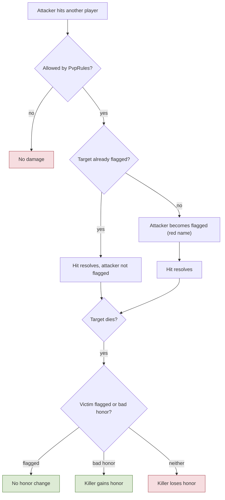

## 6.2 Disguise robe
**Rules**
- **R-6.2-01** Every player has a skill that puts on a **robe** that **hides name, honor, and the red-name flag** from observers. It applies to **all players**.
- **R-6.2-02** A **bad-honor** player needs it to enter a normal city (it is the only way). A **good-honor** player may also wear it to stay hidden for their own reasons; using it does not change honor (config).
- **R-6.2-03** The robe gives Sense. **Any observer can see through it by passing the Sense vs Detect check**: NPC guards, Guard-job players, and **ordinary players passing by**. When an observer's Detect (with the distance factor) is high enough they see the real name and honor; otherwise they see a generic hooded figure. The result is per observer and target pair.
- **R-6.2-04** It **cannot be activated while red-named (flagged) or in combat**, and **attacking removes it**. **Party and guild members always see the real identity.** It also expires (config). A region flag can disable the robe in places such as sieges or instances (Open).

**Implementation**
- `DisguiseService` sets the `disguised` state with a Sense modifier. All identity displays (snapshots, chat, party invites, trade window, auction/shop listings, mail, inspect, portfolio) go through **one function** `DisplayIdentity(entity, observer)`. It asks `VisibilityService` for the cached Sense vs Detect result for that pair (with hysteresis) and returns the real identity if the observer passes, otherwise a generic name and no honor or red flag. A single leak defeats the system, so no other code path may read raw names for display. **M1 (backlog I):** `GameServer/Social/DisplayIdentity.For(entity, observer)` exists and returns the character name (no disguise yet, TODO(M2)); the name plates get it through the `EntityIdentity` message (spec 9.12), and the local chat will use it too.
- Robed entities are in the region's **flagged set**, so checks stay on for them even in cities. Since good-honor players can now wear it too, the flagged set is bad-honor players plus robed players; keep the per-tick check budget and the pair cache.

**Talks to** reads `StatBlock`, `VisibilityService`; emits `Disguised`, `DisguiseBroken`.

**Flow: Robe versus any observer**

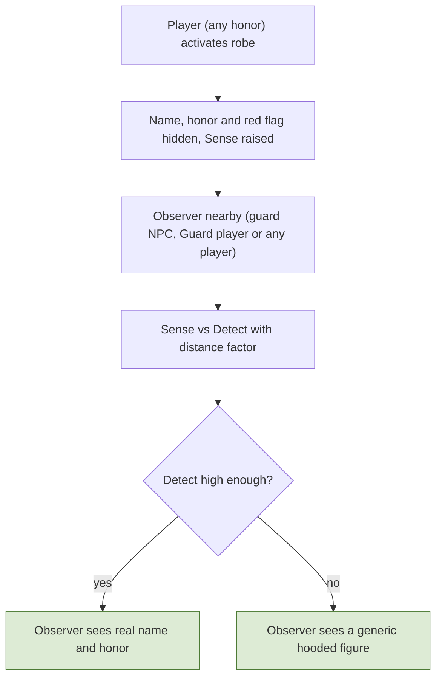

**Flow: Bad-honor player entering a normal city**

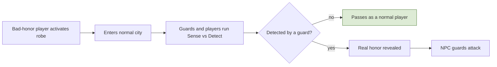

## 6.3 Law: guards, arrest, jail, sentencing
**Rules**
- **R-6.3-01** **Normal cities:** PvP disabled; bad-honor players are **unwelcome: NPC guards attack them**. **Lawless city:** PvP always on, **kills do not change honor, death drops apply, and taking someone's loot still adds the stolen mark** (with no honor loss); open to everyone including good-honor players, bad-honor players safe from guards.
- **R-6.3-02** **Arrest (Guard job):** a Guard can arrest a **dead bad-honor player within a time window** after they lose all HP. It is a **channeled, interruptible action** (interrupted by damage, movement, stun/poise break, window expiry, resurrection). Honor is checked at start and completion.
- **R-6.3-03** A dead **bad-honor** player **cannot self-respawn** during the window (others can resurrect them, which cancels the arrest). Good-honor players are never locked. Logging out while dead is not allowed; a disconnected dead bad-honor player stays for at least the window (and a pending arrest applies on next login).
- **R-6.3-04** **Sentence:** penalty is **jail time** based on how bad the honor is, then **honor is reset to the black-market threshold** (inclusive check, so access is kept; they must do good deeds to rise). Jail is **real time, offline counts**. The jail is a small fixed instance.
- **R-6.3-05** **NPC guard kill** in a normal city: same outcome (jail + honor reset), and the items that would drop are **confiscated** by the server and **returned after the sentence**; stolen-tagged items go back to the **original owner by mail** instead of the thief (destroyed if the owner no longer exists).
- **R-6.3-06** Guard rewards are **honor and exp, never gold**; fines (if any) are destroyed.

**Implementation**
- `SentencingService.Sentence(character, source)` is the **single transaction** used by Guard arrests and NPC guard kills: compute jail time from honor, set honor to threshold, move confiscated items into a `Confiscation` record with `releaseAt`, set `jailedUntil`, teleport to the jail instance, write one audit entry. It is idempotent (already jailed or pending → ignored). Release at login or by a scheduler returns items (stolen ones to the original owner).
- `ArrestService` handles the channel state machine and checks; `JailService` stores `jailedUntil` (UTC) and places the character at login. `GuardNpcAi` evaluates only the region's flagged set at low rate with a short alert delay before attacking.
- Guard arrests between alts are limited by per-pair caps on honor/exp rewards.

**Talks to** consumes `Died`, `Detected`; calls `InventoryService`, `HonorService`, `WorldManager`; emits `ArrestStarted`, `ArrestCompleted`, `Sentenced`, `Released`.

**Flow: Guard arrest**

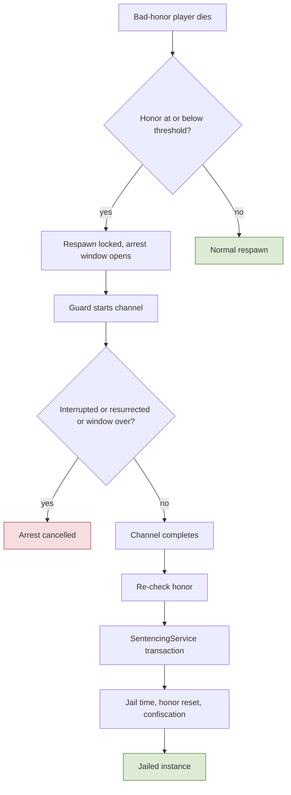

**Flow: Sentencing transaction**

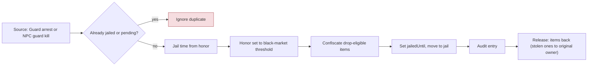

## 6.4 Guilds, territories, taxes, sieges
**Rules**
- **R-6.4-01** **Player guilds** (distinct from the Adventurer Guild) with the standard MMO features: create (gold cost, a sink), invite/join, ranks and permissions, roster, guild chat, notice, **guild bank**, disband/leadership transfer. Guild/party members cannot attack each other. **Guild vs Guild** war relations exist. Guild features to spend restricted gold on are Open.
- **R-6.4-02** The map is divided into **territories**. A territory has a nullable owner guild and per-fee-type rates (owner sets within bounds). In an **owned** territory taxes/fees are **split in two**: owner guild share and Adventurer Guild share (destroyed). The owner share goes into a **restricted treasury** usable **only for guild features**; **no gold returns to circulation**. **Unowned territory** follows the default rates and **all of the fee goes to the Adventurer Guild (destroyed), with no split**.
- **R-6.4-03** **Alignment:** guilds are good or **PK guilds** (for bad-honor players). Rules for joining and for members whose honor crosses the line are Open.
- **R-6.4-04** **Sieges** are **scheduled events in a dedicated GvG instance**: a guild declares an attack, the defender must defend, and the time is **agreed by both**; if they do not agree, or the defender never answers, the **system picks a default slot from the allowed windows** (with a minimum notice period). Player caps per side; declaration limits and cooldowns after a siege; minimum guild size/age to hold territory.
- **R-6.4-05** **Good guilds take territory.** **PK guilds raid instead**: on success they **steal a capped percentage from the owner's restricted treasury** (defender keeps a floor), and the stolen gold goes into the **PK guild's own restricted treasury**.
- **R-6.4-06** **Order:** crimes by bad-honor players inside a good guild's territory **reduce the owner's reputation**; at the minimum the **territory resets to default** and the guild loses it. Recovery over time and through arrests inside the territory; limits (diminishing returns per criminal account, daily cap, only members of PK guilds count) stop cheap sabotage.
- **R-6.4-07** Owners can spend treasury to **hire NPC guards** (better guard costs more, defends better; time-limited hire or one-off is config) that patrol the territory and use the same hostility rule as city guards.

**Implementation**
- `Guild`, `GuildMember`, `GuildBank` (free, member deposits/withdrawals by permission, logged) and `RestrictedTreasury` (separate ledger; only `PurchaseGuildFeature` spends it and destroys gold). `Territory` rows reference region volumes (`ownerGuildId`, `reputation`, rates). `FeeService` credits the owner's restricted ledger.
- `SiegeService` state machine `Declared → TimeNegotiation → Scheduled → Active → Resolved` with persisted UTC schedule; `Workers/ScheduleRunner` starts instances at the time, picks default slots, and re-registers due sieges after restarts. The instance is created by `WorldManager` from a siege template; entry/exit are atomic transfers; resolution is an idempotent transaction (ownership change or treasury transfer); a crashed siege resolves to a defined outcome (reschedule or no change).
- `Reputation` consumes crime events by territory; `GuardHire` creates persisted hire records and spawns patrol NPCs (waypoint data), simulated only when players are near.

**Talks to** consumes `FeeCharged`, `Killed`, `ItemStolen`, region events; emits `SiegeScheduled`, `SiegeResolved`, `TerritoryChanged`, `ReputationChanged`.

**Flow: Siege (territory or PK raid)**

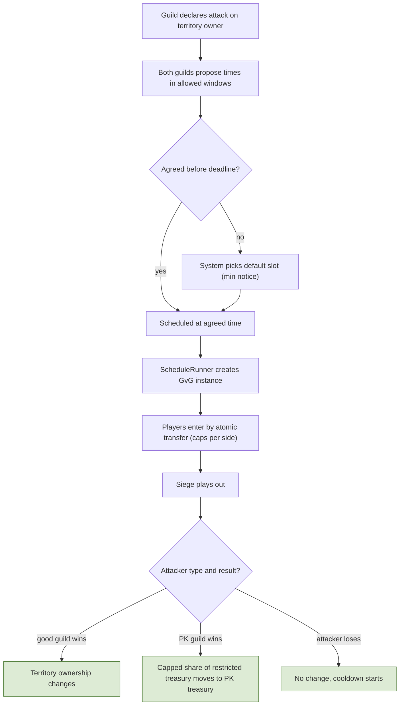

**Flow: Territory reputation and loss**

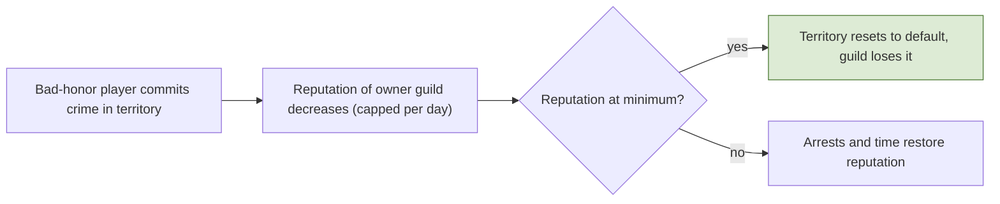

## 6.5 Social and world services
**Rules**
- **R-6.5-01** Standard MMO behavior for **chat** (local, party, guild, whisper, global; rate limits, filter, mute/block), **friends**, **party** (loot, quests, immunity), **onboarding** (tutorial path, starter area, protection until the first class change), **dungeons/raids** (entry rules, lockouts, difficulty scaling). **Regular dungeons:** no death drops, no honor effects, PvP off.
- **R-6.5-02** **Party finder** for dungeons, raids, and instances (listings with requirements) plus **matchmaking** (queue by role: tank, DPS, support; ready check before an instance is created). Leaving after the ready check carries a short penalty.
- **R-6.5-03** Mounts and pets as described in 2.2 and 4.3. Steam friends/overlay may help social features.

**Implementation**
- `Chat` routes by channel with per-channel rate limits, using `DisplayIdentity` for names (disguise). M1 (backlog I follow-up, spec 9.12): local chat only, in `GameServer/Social/ChatService` (phase 1: a per-character token bucket from `ChatSettings`, then the shared `ChatText` rule) and `Net/ChatSender` (phase 10: to every connected player whose interest holds the sender, which already applies `IVisibilityQuery`, plus the sender's echo; the name from `DisplayIdentity.For(sender, recipient)` per recipient). The word filter is Open; mute, block and the other channels are M2. `Party` holds members, loot rules, immunity, and quest ownership. `PartyFinder` listings live in Redis with expiry; `Matchmaking` queues by role and asks `WorldManager` to create the instance after the ready check. Lockouts are rows keyed by (character, activity).

**Talks to** calls `WorldManager`, `Party`, `Mail`; emits `PartyChanged`, `GroupFormed`.

**Flow: Matchmaking to instance**

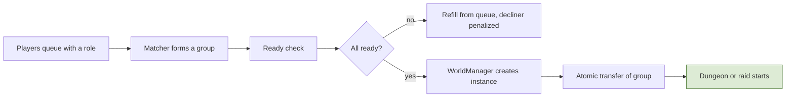

## 6.6 Ranked PvP arena
**Rules**
- **R-6.6-01** Modes **1v1, 2v2, 3v3**, ranked. Players queue **only from cities** (region flag `arenaQueue`); the queue entry is cancelled if the player leaves the city or enters combat. **Queues:** solo, duo, and team of three. A solo player in 2v2/3v3 is matched with random teammates. **Groups only face groups** (solo queue players are matched among themselves).
- **R-6.6-02** When a match is found: ready check, then **all players are teleported to the arena**. Each team stands on one side of the field and, after **30 seconds of preparation**, the fight starts.
- **R-6.6-03** **Round:** it ends when all players of one team are dead **and the team's lives are consumed**. Each team has a **pool of 3 lives** (a team pool, not per player; configurable per mode). When a player dies, **one life is removed from the team's pool and the player revives with full health** on their side of the field. At zero lives, deaths are permanent.
- **R-6.6-04** **Match:** always **3 rounds**; the team that wins **2 rounds** wins. At each round start HP, MP, stamina, cooldowns, parry/dodge stacks are reset and status effects cleared.
- **R-6.6-05** **Normalized stats:** everyone fights with a fixed per-class stat template; gear, food, potion, gem, enchant, and job sources are masked; the damage formula's rank factor is neutral; normalization also covers **Sense and Detect, stamina, the charge pools, and movement speed**. **Consumables are not allowed.** There is **no standard loadout**: the player freely adjusts skills using a **predefined pool of skill points**, and can only use **skills already unlocked** on their character. The build is a snapshot locked when the match is found (normal respec does not apply).
- **R-6.6-06** Arena rules by region flags: PvP always on between the two teams, teammates immune; **no honor changes, no red-name flag, no death drops, no stolen marks, no arrest**; robe, mounts, and pets disabled; **Sense/Detect hiding works inside the arena**; **10 seconds of spawn protection** after a revive; **Sense/Detect hiding works inside the arena**; **10 seconds of spawn protection** after a revive; no logout inside (a disconnect leaves the character in the match; everyone returns to the saved location when it ends).
- **R-6.6-07** **Rewards:** ranked **PvP rank** (visible tiers over a hidden rating) and **skins at the end of the PvP season**. No gold (the single-faucet rule holds). A season-close job grants them idempotently through the generic unlock table; skins are cosmetic only.
- **R-6.6-08** **Abuse rules:** queue dodging and leaving a ready check or match gets a short queue ban that grows with repeats; AFK in preparation or a round drains that player's lives; a disconnect has a reconnect window before the same happens; repeated opponents give diminishing rating (per-pair limits) and telemetry flags win trading, lopsided repeated pairs, and linked accounts; smurfing is limited by a minimum level, first class change before ranked, and faster placement for new accounts; banned accounts (and the Steam owner) cannot queue.

**Implementation**
- New module `Arena` (in `Social/` or its own folder): `ArenaQueue` (per mode and pool, in Redis), `MatchStateMachine` `Queued -> MatchFound -> ReadyCheck -> Teleported -> Preparation -> RoundActive -> RoundOver -> (next round | MatchOver) -> Returned`, `ArenaRuleset` (region flags plus stat normalization), `RatingService` (Elo/Glicko-style rating per mode and season), `SeasonService`.
- The arena is an **instance** from an arena template created by `WorldManager`. Entry saves the return location; entry and exit are atomic transfers (same as the jail and sieges).
- **Stat normalization** is a layer in `StatBlock`: for entities in an arena world it masks modifier sources by type and applies a per-class template; `DamageCalc` receives a ruleset flag that makes the rank factor 1.
- Team lives: a `teamLives` counter per team; a death decrements it atomically and respawns the player; deaths are processed in the fixed tick order so two deaths in the same tick cannot spend the last life twice.
- A crashed match resolves to a defined outcome (void, everyone returned, no rating change). Every match result, rating change, and penalty is logged to telemetry.
- Tables: `pvp_seasons`, `pvp_ratings`, `pvp_matches`, `queue_penalties`, `season_rewards`.

**Talks to** calls `WorldManager`, `Party`, `StatBlock`, unlock table; emits `ArenaQueued`, `MatchFound`, `RoundEnded`, `MatchEnded`, `SeasonClosed`; consumed by Telemetry and the bot/abuse scoring.

**Flow: Arena match lifecycle**

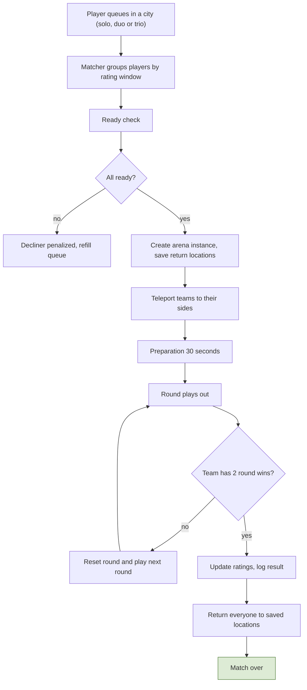

**Flow: Round and team lives**

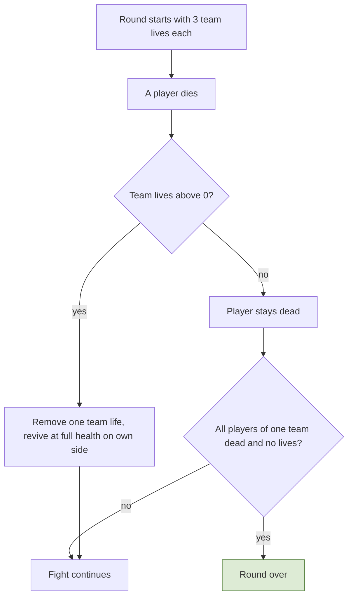

## 6.7 Raids
**Rules**
- **R-6.7-01** A raid party has **6 players**. Raids are chosen in a **dedicated raid window** opened from the collapsible shortcut row (button RD). The player picks the raid and then chooses **Start with the party now** or **Queue to find other players**.
- **R-6.7-02** Raids can be started **only in cities** (region flag `raidStart`).
- **R-6.7-03** Inside a raid: **no item drops on death**, and the **honor system does not apply** (no red-name flag, no honor changes, no stolen marks); PvP between players is off.
- **R-6.7-04** **Difficulty is based on the adventurer rank.** The party **picks a difficulty tier**, and **every member must meet that tier's rank and minimum level**.
- **R-6.7-05** **Loot is personal:** the server rolls each player's drops and shows them only to that player. There is no party roll and no ground drop in raids.
- **R-6.7-06** Raid bosses and map bosses are separate boss types but use **generic boss and monster AI** for now.

**Implementation**
- `RaidDef` (raid id, instance template, boss list, party size 6) and `RaidScaling` (stats by rank tier). `RaidService` state machine: `Selected -> StartNow | Queued -> GroupFormed -> ReadyCheck -> InstanceCreated -> Running -> Completed | Failed -> Returned`.
- The queue reuses `PartyFinder` and `Matchmaking` (6 players by role). **Start now** requires a party of up to 6 members standing in a city. `WorldManager` creates the raid instance from its template with a cap of 6; entry and exit are atomic transfers.
- Instance flags: `deathDrop=off`, `honorEffects=off`, `pvpMode=off`. Boss and monster stats come from `RaidScaling[rankTier]`.
- `PersonalLoot.Roll(player, boss)` runs per player with a logged seed and delivers to the player's inventory (or mail if full). A crashed raid resolves to a defined outcome (everyone returned, partial credit rules are Open).

**Talks to** calls `WorldManager`, `Party`, `Matchmaking`, `LootService`, `InventoryService`; emits `RaidQueued`, `RaidStarted`, `RaidCompleted`.

**Flow: Raid selection and start**

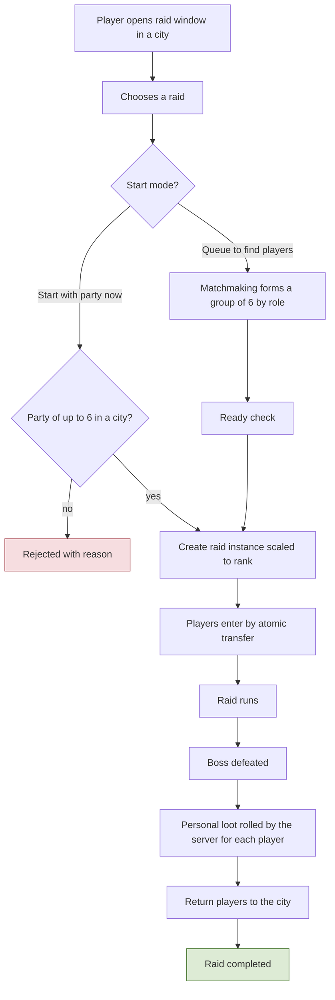
