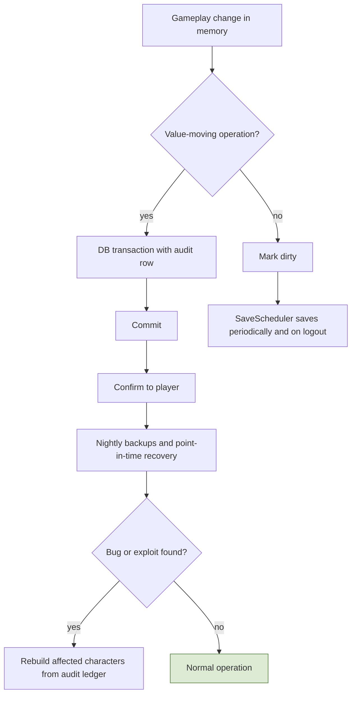
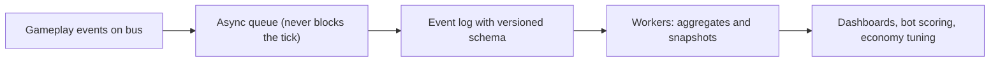
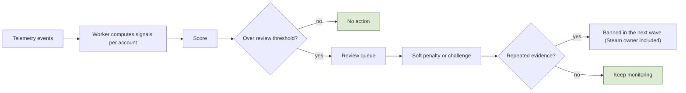

# 7. Operations and Platform

## 7.1 Persistence and data model
**Rules**
- **R-7.1-01** **Save classes.** (1) **Synchronous:** transfers between players or with shared state (trade, auction and shops, contracts, escrow, mail, fees, guild treasury, sentencing and confiscation, season rewards, **outpost sales**, NPC vendor purchases) commit in one transaction before the player is told it succeeded; the items involved are locked in memory while in flight. (2) **Batched every 1 second:** single-player gains and changes (loot pickup, harvesting, craft and enchant results, consumable use, exp, job XP, quest progress, run claims, outpost item deliveries, moves between own bags). (3) **Every 10 seconds:** volatile state (position, HP, MP, stamina, cooldowns, active effects), plus on logout, zone change, and death.
- **R-7.1-02** **Ordering barrier:** before any class 1 operation, the character's pending class 2 changes are saved first, so an item cannot be traded before it exists in the database. **One writer per character** (the world that owns it). A crash can roll back at most 1 second of class 2 gains and 10 seconds of volatile state, never duplicate anything. The tick never waits on the database.
- **R-7.1-03** **Global and realm databases:** accounts (SteamID), bans, the realm directory, and character counts per realm live in the **global database**; everything else lives in the **realm database**. Early on, realm databases can be separate databases on the same server.
- **R-7.1-04** PostgreSQL on RDS with **automated backups and point-in-time recovery** (multi-AZ once there is a real population); restores are tested regularly. Schema changes only through **migrations** (versioned SQL files with Flyway naming `V0001__name.sql`, applied by our `MigrationRunner` with a checksummed `schema_migrations` journal), never by hand. **Optimistic concurrency** (version column) on character rows. Redis only for sessions, ownership locks, queues, listings, cache; anything that must survive lives in PostgreSQL.
- **R-7.1-05** Saves: periodic, on key events (trade, craft, level-up, death), on logout, via dirty flags. Critical value moves commit before confirmation.
- **R-7.1-06** With the audit ledger, a character's items and gold can be reconstructed and repaired after a bug.

**Implementation (schema v1, Milestone 1)**
- `src/GameServer/Persistence`: Npgsql + Dapper with explicit SQL. Migrations are embedded per database kind (`Migrations/Global`, `Migrations/Realm`) and applied by `MigrationRunner`: an advisory lock serializes runners, each script runs in one transaction with its journal row, and an edited or unknown applied script stops the run. `dotnet run --project src/Tools/DbMigrate -- --dev` migrates the local docker-compose server.
- Dev and test use **two databases on one PostgreSQL** (`mmorpg_global`, `mmorpg_realm_1`), not two schemas in one database, so nothing can join or reference across them (R-7.1-03). So `characters.account_id` has no foreign key. Integration tests create and drop their own `mmorpg_test_*` databases.
- `characters` v1: realm, account, slot, name, class, level, exp, world and position (integer cm), facing, HP, MP, stamina, `version`, `last_save_id`, `create_request_id`, soft-delete fields (`deleted_at`, `purge_after`). Names are unique per realm ignoring case; name and slot stay reserved while a character is pending deletion.
- `CharacterRepository.SaveAsync` writes only when `version` matches and returns a typed `VersionConflict` otherwise; a retry with the same save ID after an unknown outcome is recognised as saved. Create is idempotent on its request ID.
- `SaveScheduler` (world thread) keeps dirty flags, saves class 2 every `SaveClass2IntervalMs` and volatile state every `VolatileSaveIntervalMs` (`StartingValuesM1`), handles event saves and the ordering barrier, and keeps one save in flight per character. `SessionManager` marks volatile state dirty when the position, the facing or the HP, MP and stamina meters changed (so regeneration while standing still is saved); cooldowns and active effects have no column in schema v1 and are not saved yet. `PersistenceWorker` runs the saves and returns results through a completion queue (section 1.6). In v1 every save writes the whole character row.
- **Items (schema v2, backlog G):** realm migration `V0002__items` adds `item_stacks` (one row per occupied slot: container code, slot, `def_id`, rarity tier, stolen, count, `properties` JSONB with a schema version `v`), `inventory_ops` (operation key as primary key: an operation is applied once, ever) and `audit_log` (one row per slot an operation changed: kind, item, delta, count after, save ID). A class 2 save carries the character's pending `InventoryBatch`; `SaveAsync` writes the row, the keys, the final slot states and the audit rows in one transaction (rule 5), so a double submit or a retry after an unknown outcome is recognised by the save ID and applies nothing twice, a stale version writes nothing (`VersionConflict`), and a key applied before fails the whole save (`DuplicateOperation`, the character is faulted like another writer). `item_instances`, `gold_ledger` and the other item tables come with their systems.
- **Gold, economy and the class 1 path (schema v6, WP-M2-4; V0004 and V0005 belong to parallel M2 work, `MigrationRunner` applies every known unapplied version in ascending order, so a gap is fine):** realm migration `V0006__gold_economy` adds `characters.gold` (written only by an inventory batch's gold part, never by the whole-row update, rule 4), `gold_ledger` (one row per gold change: operation key from `inventory_ops`, delta, balance after, flow faucet/sink/move, reason, source, save ID) and `demand_state` (the demand loop's counters, volatile class, spec 4.2). **Class 1 operations** (outpost sale, NPC vendor purchase) are applied to the world's in-memory state at once (so the sold units are locked: they are gone from the bag) and then ask `SaveScheduler.RequestSave(SaveReason.Class1)`: the save is issued in the next tick (or right after the one in flight, one per character), and its batch carries the character's pending class 2 changes too, in the same transaction as the class 1 operation. That is the **ordering barrier by inclusion** (R-7.1-02): a picked-up item can never commit after it was sold. The player is answered only when the save committed (`InventoryService.IsCommitted`, rule 5); a failed save is retried as the identical job (same save ID), and a fault drops the character, so an unconfirmed sale is never in the database. The four transaction tests (double submit, retry, crash in the middle, concurrent writers) cover the sale and the purchase.
- **Admin actions (schema v3, backlog J):** realm migration `V0003__admin_actions` adds `admin_actions`, the admin action log of section 7.4 (one row per action, keyed by its request ID) and, for commands, their state and outcome.
- **Item instances (schema v4, WP-M2-1):** realm migration `V0004__item_instances` adds `item_instances` (one row per instance with its id for life: owner, container and slot, def id, rarity, stolen, non-tradable, versioned `properties`; the slot key is deferred to the commit so swaps write in any order), `characters.item_instance_seq` (the creator's instance counter, written with the instances it numbered) and `audit_log.instance_id`. The class 2 batch carries the final state of every touched instance (moved, created or removed) and the counter, in the same transaction as the character row. `MigrationRunner` applies every known version not yet applied in ascending order and checks only duplicates: gaps between versions and a lower version merged after a higher one are applied (WP-M2-3 takes V0005, WP-M2-4 V0006 in wave 0).

**Key tables (grouped)**
| Group | Tables |
|---|---|
| Identity | `accounts` (SteamID, owner SteamID, bans), `characters` (slots, name, class, level, exp, rank, honor, flaggedUntil, jailedUntil, worldId, position, version), `sessions` |
| Items and money | `item_stacks`, `item_instances` (rarity, stats snapshot, gems, enchant, stolen, originalOwner, container), `gold_ledger`, `audit_log`, `mail`, `escrow`, `confiscations`, `loot_bags` |
| Progression | `skills_learned`, `hotbar`, `job_progress`, `achievements`, `rank_history`, `class_state` |
| Economy | `demand_counters`, `price_state`, `faucet_sink_snapshots`, `listings`, `shops` |
| Quests and contracts | `runs`, `run_steps`, `contracts`, `portfolio_counters`, `portfolio_showcase` |
| Law and guilds | `sentences`, `guilds`, `guild_members`, `guild_bank`, `restricted_treasury`, `territories`, `sieges`, `guild_guard_hires`, `reputation` |
| Social | `friends`, `blocks`, `party_history`, `lockouts` |
| Raids | `raid_runs`, `raid_lockouts`, `personal_loot_log` |
| Arena | `pvp_seasons`, `pvp_ratings`, `pvp_matches`, `queue_penalties`, `season_rewards` |
| Ops | `config_versions`, `admin_actions` |

**Flow: Save and recovery**

## 7.2 Telemetry and analytics
**Rules**
- **R-7.2-01** **Built early** (first phase). It feeds economy balancing, bot scoring, exploit investigation, and the portfolio/reliability counters.
- **R-7.2-02** Record gameplay events (kills, drops, harvests, crafts, conversions, quests, deaths, arrests, trades) with timestamps, character/account IDs, region, relevant values; all transactions with both sides; sessions; periodic **economy snapshots** (demand counters, price multipliers, gold in circulation, faucet and sink totals by reason).

**Implementation**
- Events go to an append-only queue/log **asynchronously, outside the tick**; if full, telemetry drops before the game blocks. One compact versioned schema; raw events kept for a configured retention, long-term aggregates kept. Analysis runs offline in `Workers` (Analytics, EconomySnapshots), landing in S3/analytics storage; never on the game server.
- **Implementation (M1, telemetry v1):** one process-wide bounded queue and one writer thread per game server; each world's bus feeds it through a telemetry consumer in phase 11, and phase 12 only signals the writer. Besides bus events, the server records its own health as telemetry kinds (not bus events): `TickStats` (last and max tick time per interval, overruns, start lateness) and `WorldCounters` (malformed inputs, stale input frames: late or reordered frames that were never queued, not the redundant copies of spec 12.7; truncated snapshots, event consumer failures), `RequestCounters` (malformed reliable requests, chat lines dropped by the per-session queue), `SendCounters` (unreliable messages the transport dropped as over a peer's datagram limit, with the last one's peer, size and limit; spec 1.7) and, with chat on, `ChatCounters` (lines accepted, deliveries including echoes, refusals, rate-limit refusals; never the text) every `TelemetrySettings.StatsIntervalMs`, `TickTiming` (one record per tick: tick, duration, start lateness; the per-tick timing log of backlog J, on while `TelemetrySettings.tickTimingLog` is set, about 5 MB per world per hour; the bot load test's tick p99, spec 11.5), plus `WorldCrashed`, `SaveFailed`, `SpeedViolation` (spec 2.2 speed check), `Security` (R-2.5-06), and the writer's own `QueueDropped`. Dev tools only (spec 11.7, a DevTools build with `MMORPG_DEV_TOOLS=1`): `ConfigReload` (a table hot reload: the tick it swapped at, result, table hash, error count) and the strike trace `StrikePlaced` (attacker, action and effect, tick, Q24.8 origin, locked facing) and `StrikeTested` (attacker, target, tick, the position tested, body radius), which the dev scene reads back. On shutdown the world stops first, open sessions end with `ServerShutdown`, and the writer drains last. M1 writes JSON lines to `MMORPG_TELEMETRY_DIR` (default `./telemetry`, git-ignored). TODO(open): storing IP addresses in telemetry, and their retention.
- **Economy telemetry (M2, WP-M2-4; R-4.2-07, R-7.2-02):** bus events `OutpostVisited` (npc entity and def), `ItemSold` (item, rarity, count, gold, npc def), `GoldChanged` (delta, balance, reason; a positive delta is a faucet, a negative one a sink), `GoldDestroyed` (amount, reason), `DemandUpdated` (per kill counter and control step: monster def, region in the envelope, decayed count, ratio, spawn delay and reward percents) and `PriceChanged` (per item and control step: decayed sales, price percent). After each demand control step the world records the economy snapshot: `EconomyTotals` (gold created and destroyed since the world started, the gold online characters hold, the active players) and `EconomyByReason` (subject the `InventoryReason`: gold created, gold destroyed, items destroyed). `BotClient report --telemetry <dir> --kind economy` prints the faucet and sink totals per UTC hour and by reason, the units sold and the newest price percent per item.

**Flow: Telemetry pipeline**

## 7.3 Bot control
**Rules and layers**
1. **Design:** botting must not pay: the faucet's sell price falls per unit sold, diminishing returns on repetitive harvesting, node scarcity from the demand loop, soft caps.
2. **Server authority:** validate movement speed, action timing, range, every harvest channel; the client never reports results.
3. **Behavioral scoring** (offline): unnaturally consistent timing, 24/7 play, repeated identical routes, perfect minigame scores, no social activity. **Scores, not instant bans**: review queue, soft penalties (reduced yields, verification challenge), escalation, **ban in waves**.
4. **Verification challenges**, used sparingly and only when suspicious.
5. **Economic friction:** limits on trading, mail, auction, and gold transfers for new/flagged accounts; graph analysis of gold/item funnels (also catches gold sellers).
6. **Client-side protection** (obfuscation, commercial anti-cheat) only when population justifies it.
7. **Human layer:** player report button, admin tools, ban waves.

**Flow: Bot scoring and response**

## 7.4 Admin and support tools
**Rules:** needed from the start. A web panel (ASP.NET Core) with **roles**; every admin action is logged with who did it.
**Features:** search accounts and characters; view inventory, gold ledger, audit trail; ban/mute/kick (including Steam owner); restore items from the audit log; send compensation by mail; edit and **reload config tables**; maintenance toggles; economy and telemetry dashboards; review queue for bot scores; siege and guild inspection.

**Implementation (M1, admin panel v0, backlog J):** `src/AdminPanel` (ASP.NET Core minimal API and one static page, no extra packages; README there), on `http://127.0.0.1:5090`. It searches characters, kicks, and shows server logs and telemetry; it never writes items or gold and never reads world state.
- **Reads:** characters from the realm database and SteamIDs from the global one (no join across them, R-7.1-03); who holds a character from its Redis ownership lock, whose token `{serverId}:{n}` names the game server process; telemetry from the game server's JSON lines files (filter by character, account, kind); server log lines from `*.log` files in one folder (in docker compose the GameServer and the Auth API write there). Search: name prefix ignoring case, and/or account as `dev:<n>`, a SteamID or `id:<accountId>`.
- **Commands (kick):** the panel never calls the game server. It writes the command as a row of `admin_actions` (realm database), keyed by a request ID the page makes per kick (idempotency key: a double submit or a retry returns the same row; the same ID for another action or target is refused with `RequestConflict`), addressed to the server that holds the character. A character nobody holds is recorded finished as `NotOnline`. Each game server's `AdminCommandWorker` (a background loop, never the world thread) polls every `AdminSettings.commandPollMs`, claims the rows addressed to it (`FOR UPDATE SKIP LOCKED`: one claim per row), posts each to the world inbox, and writes back the outcome the world reports. The world runs the kick in tick phase 1 through `SessionManager` (spec 2.1): `Kicked`, or `NotConnected` for a lingering character, `NotOnline` when this world no longer holds it. Commands no server finished within `commandExpiryMs` are closed as `Expired`; a late real outcome still replaces `Expired`. The page follows the action by its request ID.
- **Audit:** every admin action is one row (who, when, what, target, detail): sign-in, search, character view, log view, telemetry view, kick. Reads are recorded finished (`Done`); reading the action log itself is not recorded.
- **Admin auth (M1, dev only):** `MMORPG_ADMIN_IDENTITY=dev`, compiled only with the dev login flag (`DevLogin`, Debug): any name signs in without a password and is recorded as `dev:<name>`; a cookie (HttpOnly, SameSite strict, `AdminSettings.sessionLifetimeMs`) keeps the sign-in, and every change also needs the header `X-Admin-Request: 1`. Plain HTTP on loopback only (spec 2.5 implementation). The default identity `none` refuses every sign-in (`SignInUnavailable`), which is all a Release build has. TODO(open): production admin auth, the roles of this section, and how the VPN or IP allowlist of R-2.5-05 is set up.
- **Refusals** carry an `AdminReasonCode` (`NotSignedIn`, `RequestInvalid`, `CharacterNotFound`, `RequestConflict`, `ServerUnavailable`, `SignInUnavailable`, `ActionNotFound`); the page shows a text for each. Settings in the `AdminSettings` table.

**Flow: Restore lost items**

## 7.5 Steam and release
**Rules**
- **R-7.5-01** Release on **Steam only**; Steam handles login. Steam features beyond login are optional (friends/overlay, achievements as extras, microtransactions if ever needed); the core economy and items stay in your own database (no Steam inventory service).
- **R-7.5-02** Steam Direct: a per-app fee, recoupable after a revenue threshold, a waiting period before release, and a revenue share (verify current terms). Steamworks.NET is the C# wrapper to consider.

## 7.6 Security and anti-duplication
- One **inventory service** for all item movement; **idempotency keys**; audit log; transactions; no client-trusted values; optimistic concurrency; ownership lock per character (never loaded twice).
- Region and rule checks live on the server. Identity display is centralized (`DisplayIdentity`). Rate limits on chat (M1: `ChatSettings`, a per-character token bucket), trade, listings, mail. Large gold transfers between accounts flagged. Admin actions logged.
- Duplication defenses are tested with bot clients and concurrency tests (double trade, double claim, disconnect mid-operation).
