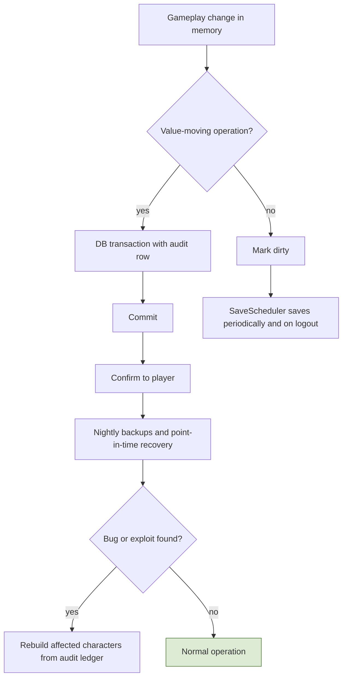
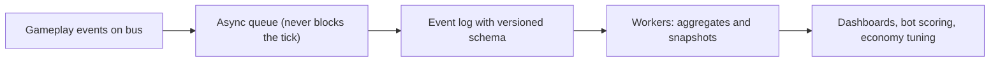
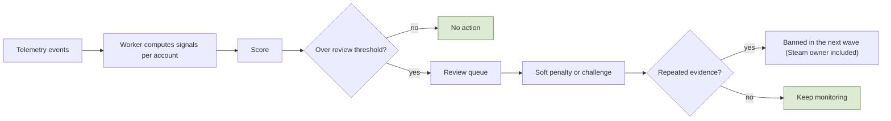

# 7. Operations and Platform

## 7.1 Persistence and data model
**Rules**
- **R-7.1-01** **Save classes.** (1) **Synchronous:** transfers between players or with shared state (trade, auction and shops, contracts, escrow, mail, fees, guild treasury, sentencing and confiscation, season rewards, **outpost sales**, NPC vendor purchases) commit in one transaction before the player is told it succeeded; the items involved are locked in memory while in flight. (2) **Batched every 1 second:** single-player gains and changes (loot pickup, harvesting, craft and enchant results, consumable use, exp, job XP, quest progress, run claims, outpost item deliveries, moves between own bags). (3) **Every 10 seconds:** volatile state (position, HP, MP, stamina, cooldowns, active effects), plus on logout, zone change, and death.
- **R-7.1-02** **Ordering barrier:** before any class 1 operation, the character's pending class 2 changes are saved first, so an item cannot be traded before it exists in the database. **One writer per character** (the world that owns it). A crash can roll back at most 1 second of class 2 gains and 10 seconds of volatile state, never duplicate anything. The tick never waits on the database.
- **R-7.1-03** **Global and realm databases:** accounts (SteamID), bans, the realm directory, and character counts per realm live in the **global database**; everything else lives in the **realm database**. Early on, realm databases can be separate databases on the same server.
- **R-7.1-04** PostgreSQL on RDS with **automated backups and point-in-time recovery** (multi-AZ once there is a real population); restores are tested regularly. Schema changes only through **migrations** (versioned SQL files with Flyway naming `V0001__name.sql`, applied by our `MigrationRunner` with a checksummed `schema_migrations` journal), never by hand. **Optimistic concurrency** (version column) on character rows. Redis only for sessions, ownership locks, queues, listings, cache; anything that must survive lives in PostgreSQL.
- **R-7.1-05** Saves: periodic, on key events (trade, craft, level-up, death), on logout, via dirty flags. Critical value moves commit before confirmation.
- **R-7.1-06** With the audit ledger, a character's items and gold can be reconstructed and repaired after a bug.

**Implementation (schema v1, Milestone 1)**
- `src/GameServer/Persistence`: Npgsql + Dapper with explicit SQL. Migrations are embedded per database kind (`Migrations/Global`, `Migrations/Realm`) and applied by `MigrationRunner`: an advisory lock serializes runners, each script runs in one transaction with its journal row, and an edited or unknown applied script stops the run. `dotnet run --project src/Tools/DbMigrate -- --dev` migrates the local docker-compose server.
- Dev and test use **two databases on one PostgreSQL** (`mmorpg_global`, `mmorpg_realm_1`), not two schemas in one database, so nothing can join or reference across them (R-7.1-03). So `characters.account_id` has no foreign key. Integration tests create and drop their own `mmorpg_test_*` databases.
- `characters` v1: realm, account, slot, name, class, level, exp, world and position (integer cm), facing, HP, MP, stamina, `version`, `last_save_id`, `create_request_id`, soft-delete fields (`deleted_at`, `purge_after`). Names are unique per realm ignoring case; name and slot stay reserved while a character is pending deletion.
- `CharacterRepository.SaveAsync` writes only when `version` matches and returns a typed `VersionConflict` otherwise; a retry with the same save ID after an unknown outcome is recognised as saved. Create is idempotent on its request ID.
- `SaveScheduler` (world thread) keeps dirty flags, saves class 2 every `SaveClass2IntervalMs` and volatile state every `VolatileSaveIntervalMs` (`StartingValuesM1`), handles event saves and the ordering barrier, and keeps one save in flight per character. `PersistenceWorker` runs the saves and returns results through a completion queue (section 1.6). In v1 every save writes the whole character row.

**Key tables (grouped)**
| Group | Tables |
|---|---|
| Identity | `accounts` (SteamID, owner SteamID, bans), `characters` (slots, name, class, level, exp, rank, honor, flaggedUntil, jailedUntil, worldId, position, version), `sessions` |
| Items and money | `item_stacks`, `item_instances` (rarity, stats snapshot, gems, enchant, stolen, originalOwner, container), `gold_ledger`, `audit_log`, `mail`, `escrow`, `confiscations`, `loot_bags` |
| Progression | `skills_learned`, `hotbar`, `job_progress`, `achievements`, `rank_history`, `class_state` |
| Economy | `demand_counters`, `price_state`, `faucet_sink_snapshots`, `listings`, `shops` |
| Quests and contracts | `runs`, `run_steps`, `contracts`, `portfolio_counters`, `portfolio_showcase` |
| Law and guilds | `sentences`, `guilds`, `guild_members`, `guild_bank`, `restricted_treasury`, `territories`, `sieges`, `guild_guard_hires`, `reputation` |
| Social | `friends`, `blocks`, `party_history`, `lockouts` |
| Raids | `raid_runs`, `raid_lockouts`, `personal_loot_log` |
| Arena | `pvp_seasons`, `pvp_ratings`, `pvp_matches`, `queue_penalties`, `season_rewards` |
| Ops | `config_versions`, `admin_actions` |

**Flow: Save and recovery**

## 7.2 Telemetry and analytics
**Rules**
- **R-7.2-01** **Built early** (first phase). It feeds economy balancing, bot scoring, exploit investigation, and the portfolio/reliability counters.
- **R-7.2-02** Record gameplay events (kills, drops, harvests, crafts, conversions, quests, deaths, arrests, trades) with timestamps, character/account IDs, region, relevant values; all transactions with both sides; sessions; periodic **economy snapshots** (demand counters, price multipliers, gold in circulation, faucet and sink totals by reason).

**Implementation**
- Events go to an append-only queue/log **asynchronously, outside the tick**; if full, telemetry drops before the game blocks. One compact versioned schema; raw events kept for a configured retention, long-term aggregates kept. Analysis runs offline in `Workers` (Analytics, EconomySnapshots), landing in S3/analytics storage; never on the game server.
- **Implementation (M1, telemetry v1):** one process-wide bounded queue and one writer thread per game server; each world's bus feeds it through a telemetry consumer in phase 11, and phase 12 only signals the writer. Besides bus events, the server records its own health as telemetry kinds (not bus events): `TickStats` (last and max tick time per interval, overruns, start lateness) and `WorldCounters` (malformed inputs, stale input frames: late or reordered frames that were never queued, not the redundant copies of spec 12.7; truncated snapshots, event consumer failures), `RequestCounters` (malformed reliable messages, client requests dropped by the per-peer budget, chat requests from peers with no player) and, with chat on, `ChatCounters` (lines accepted, deliveries including echoes, refusals, rate-limit refusals; never the text) every `TelemetrySettings.StatsIntervalMs`, plus `WorldCrashed`, `SaveFailed`, `SpeedViolation` (spec 2.2 speed check), `Security` (R-2.5-06), and the writer's own `QueueDropped`. On shutdown the world stops first, open sessions end with `ServerShutdown`, and the writer drains last. M1 writes JSON lines to `MMORPG_TELEMETRY_DIR` (default `./telemetry`, git-ignored). TODO(open): storing IP addresses in telemetry, and their retention.

**Flow: Telemetry pipeline**

## 7.3 Bot control
**Rules and layers**
1. **Design:** botting must not pay: the faucet's sell price falls per unit sold, diminishing returns on repetitive harvesting, node scarcity from the demand loop, soft caps.
2. **Server authority:** validate movement speed, action timing, range, every harvest channel; the client never reports results.
3. **Behavioral scoring** (offline): unnaturally consistent timing, 24/7 play, repeated identical routes, perfect minigame scores, no social activity. **Scores, not instant bans**: review queue, soft penalties (reduced yields, verification challenge), escalation, **ban in waves**.
4. **Verification challenges**, used sparingly and only when suspicious.
5. **Economic friction:** limits on trading, mail, auction, and gold transfers for new/flagged accounts; graph analysis of gold/item funnels (also catches gold sellers).
6. **Client-side protection** (obfuscation, commercial anti-cheat) only when population justifies it.
7. **Human layer:** player report button, admin tools, ban waves.

**Flow: Bot scoring and response**

## 7.4 Admin and support tools
**Rules:** needed from the start. A web panel (ASP.NET Core) with **roles**; every admin action is logged with who did it.
**Features:** search accounts and characters; view inventory, gold ledger, audit trail; ban/mute/kick (including Steam owner); restore items from the audit log; send compensation by mail; edit and **reload config tables**; maintenance toggles; economy and telemetry dashboards; review queue for bot scores; siege and guild inspection.

**Flow: Restore lost items**

## 7.5 Steam and release
**Rules**
- **R-7.5-01** Release on **Steam only**; Steam handles login. Steam features beyond login are optional (friends/overlay, achievements as extras, microtransactions if ever needed); the core economy and items stay in your own database (no Steam inventory service).
- **R-7.5-02** Steam Direct: a per-app fee, recoupable after a revenue threshold, a waiting period before release, and a revenue share (verify current terms). Steamworks.NET is the C# wrapper to consider.

## 7.6 Security and anti-duplication
- One **inventory service** for all item movement; **idempotency keys**; audit log; transactions; no client-trusted values; optimistic concurrency; ownership lock per character (never loaded twice).
- Region and rule checks live on the server. Identity display is centralized (`DisplayIdentity`). Rate limits on chat (M1: `ChatSettings`, a per-character token bucket), trade, listings, mail. Large gold transfers between accounts flagged. Admin actions logged.
- Duplication defenses are tested with bot clients and concurrency tests (double trade, double claim, disconnect mid-operation).
