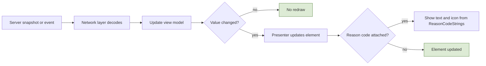
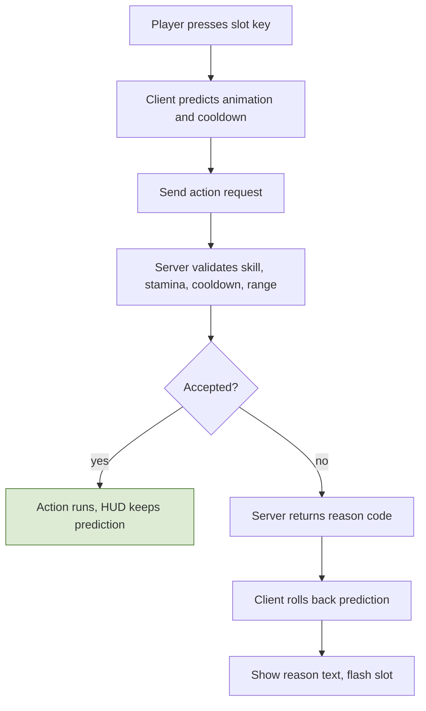
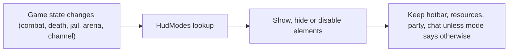
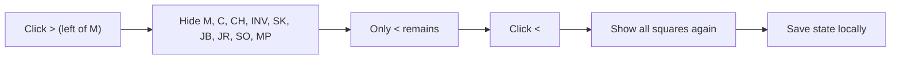
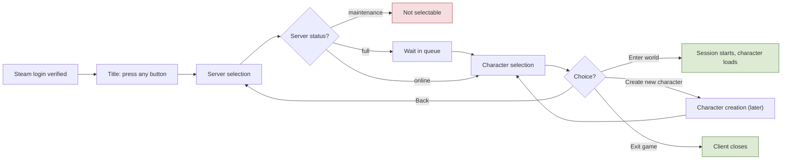
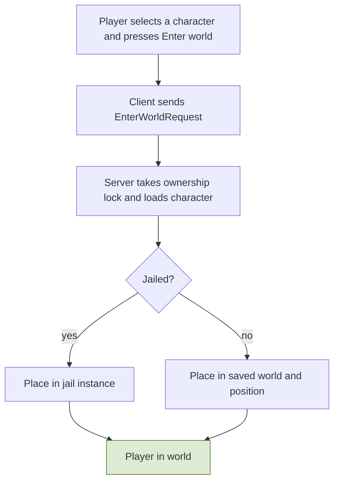

# 9. Client UI and HUD

## 9.1 Principles
- The HUD **only displays what the server reports**. It contains no gameplay rules: it binds to view models filled from server messages and the shared data tables.
- **Every failure has a reason.** The server returns reason codes (parry failed, logout blocked, craft refused...); the UI maps each to text and an icon from `ReasonCodeStrings`.
- **Layout, colors, modes, and hotkeys are config** (section 9.7), so the layout can change without code.
- Anything important is shown with **shape or text as well as color** (parry telegraphs, buff vs debuff, red name).

## 9.2 Approved main HUD layout
Reference resolution is **1280 x 720**; coordinates below are in that space. The mockup is the visual reference; this map shows every element where it sits.


**Zones**
- **Top left:** resource panel, with the party frame below it.
- **Top center:** boss bar (only while engaged).
- **Top right:** region header, **minimap**, and the **run tracker directly below the minimap**.
- **Bottom left:** chat.
- **Bottom center:** buff/debuff row, then the hotbar: two rows per side with the class gauge in the middle (left side keys 1 2 3 / 4 5 6, right side Q E R / F Z and one slot whose key is not decided), parry and dodge stack squares to its left, exp bar underneath.
- **Bottom right:** shortcut row with a collapse arrow.
- **World overlays:** name plates, damage numbers, ground telegraphs, cast bar (centered above the hotbar area).
- **Siege information is not in the HUD**: it will have its own page (not decided yet).

## 9.3 Element registry
| Element id | Position (x, y, w x h) | Contents | Data source | Visible when |
|---|---|---|---|---|
| `resource_panel` | 8, 10, 330x112 | Bars: HP, MP, ST (stamina), TOX (toxicity), SAT (satiety) | `StatBlock` resource meters | always |
| `party_frame` | 16, 162, 230xauto | member name, role, HP bar | `Party` snapshot | in a party |
| `boss_bar` | 440, 16, 400x44 | boss name, rank, HP bar (no color text) | target/engaged boss entity | while a boss is engaged |
| `region_header` | 1024, 16, 240x34 | region name, rule tag (PvP mode, lawless warning) | `EnteredRegion`, `RegionDef` | always |
| `minimap` | 1024, 56, 240x184 | map, player, party, job nodes, territory colors | world data + snapshot | always |
| `run_tracker` | 1024, 248, 240x196 | run name, step n of N, bonus, step list, claim note | `Run` state | when a run is active |
| `chat` | 7, 587, 330x126 | channel tabs (Local, Party, Guild...), messages, loot roll results | `Chat` | always |
| `cast_bar` | 490, 479, 300x30 | channel name and time left (harvest, forge, arrest) | action state (channel) | during a channel |
| `buff_row` | 560, 556, 160x26 | buff and debuff icons (green vs red border): armed, mounted, pet, status effects | stat modifiers, flags | when any exists |
| `parry_dodge` | 380, 598, 52x76 | **one square each** with the stack count: P (teal), D (amber) | `ChargeMeter` | always |
| `hotbar_left` | 440, 590, 140x92 | slots 1 2 3 / 4 5 6, cooldown overlay | `Hotbar` + cooldowns | always |
| `gauge` | 590, 590, 100x92 | class gauge, 12 segments: 6 minus side (blue), 6 plus side (amber), center marker; one-sided gauges fill one side | `ClassGauge` | always; **locked and greyed until level 100** |
| `hotbar_right` | 700, 590, 140x92 | slots Q E R / F Z + one unassigned (dashed) | `Hotbar` + cooldowns | always |
| `exp_bar` | 440, 702, 400x6 | exp progress | `ExpService` | always |
| `exp_note` | 440, 685 | exp multiplier note when penalized ("Exp x0.4, above rank range") | exp multiplier | when multiplier below 1 |
| `shortcut_row` | 927, 676, up to 344x32 | arrow (`>` expanded / `<` collapsed), **M** mail, **C** contracts (both with unread badges), CH, INV, SK, JB, JR, SO, MP, **RD** (raids window) | counts from Mail/Contracts | always |
| `buildup_meters` | own: next to the resource panel | small bars for Blood loss, Burn, Cold, Poison, Lightning (shown only when above 0); **only your own meters are ever shown**: build-ups of other players (including PvP), monsters, and bosses are never shown | `BuildupMeters` | when any of your meters is above 0 |
| `monster_hp_bar` | world: **below each normal monster** | small HP bar (bosses use the boss bar instead) | monster snapshot (HP bucket) | while the monster is damaged or targeted |
| `ping_indicator` | next to the minimap | current ping, with a warning above the 200 ms compensation cap | network layer | always |
| `nameplate` | above each character | name, guild tag, red-name, armed icon; disguised = generic name | `DisplayIdentity` | in interest |
| `telegraph` | ground (world) | colored area plus a shape/icon, shown **only while the monster performs the attack**: red, yellow, blue | action start event | during that attack |
| `damage_numbers` | world | floating numbers, crit style | hit events | on hit |

**Shortcut row behavior**
- The arrow sits to the **left of M**. Expanded: `>` then M, C, CH, INV, SK, JB, JR, SO, MP. Clicking `>` **hides every square including M**, and only `<` remains; clicking `<` shows them again. The state is a client setting (default expanded) saved locally.
- Buttons: **M** Mail, **C** Contracts, **CH** Character, **INV** Inventory, **SK** Skills (class and skill tree), **JB** Jobs, **JR** Journal, **SO** Social (friends, party, guild), **MP** Map, **RD** Raids (the raid window opens from this collapsible row; position of the row is as in the mockup).

## 9.4 Data bindings (server to HUD)
| Server message / event | Updates | Notes |
|---|---|---|
| Snapshot (own entity) | HP, MP, stamina bars, buff row (statuses: net id, stacks, ticks left; protocol 7), buff flags (armed, mounted, pet), position | exact values and maxima in the header (protocol 3); others get a 6-bit HP bucket and no statuses (spec 1.7, 3.7) |
| `StatsChanged` | derived values, TOX, SAT | sent on change, not per tick |
| `ChargeMeterUpdate` | P and D numbers | send on change; client recomputes recharge from timestamps |
| `ClassGaugeUpdate` | gauge segments | bipolar or one-sided per class |
| `ActionResult` (reason code) | cooldown overlay, parry result text, failure toast | all messages carry a reason code |
| `ActionStarted` (monster) | telegraph shape and color | includes `parryClass` for that attack only |
| `PartyChanged` | party frame | per-member HP updates in snapshots |
| `RunState` | run tracker | pushed on change |
| `RegionChanged` | region header rule tag, region-based hiding | |
| `ChatMessage` | chat | channel and identity via `DisplayIdentity` |
| `MailCount`, `ContractCount` | M and C badges | |
| `ExpMultiplier` | exp note | |
| `ChannelStarted/Ended` | cast bar | duration from the action table |
| `BossEngaged/Left` | boss bar | |

## 9.5 State-driven modes
| Mode | Trigger | HUD changes |
|---|---|---|
| In combat | `lastCombatAt` window | hide non-essential panels, keep hotbar, resources, party, chat |
| Dead (bad honor) | death with honor at or below threshold | arrest-window countdown and resurrection prompt; logout disabled |
| Dead (normal) | PvE death | respawn prompt, loot bag marker on the minimap |
| Jailed | `jailedUntil` in the future | time remaining and confiscated items; most panels disabled |
| Arena | arena instance | team life pool, round score, preparation countdown; mail, contracts, chat limited |
| Channeling | channel active | cast bar visible; movement-related prompts hidden |
| Mounted / disguised / armed | flags | buff row icons (AR, MT, PT as placeholders for real icons); **pets and mounts show only while switched on** |
| Raid | raid instance | party frames for 6 players, boss bar, no honor/flag indicators |
| Disconnected (linger) | connection lost | reconnect banner |

## 9.6 Hotbar, hotkeys, and settings
- Hotbar: **10 filled slots + 1 unassigned slot**, laid out as two rows per side of the gauge. Left: keys 1 2 3 / 4 5 6. Right: Q E R / F Z / (undecided). Slot count and keys are configurable (`Hotkeys`). Layouts are stored server-side per character; the server validates that a skill is learned and on the bar. M1 has no per-character layout: each class has one fixed layout (its normal attack, dodge, parry and 5 kit skills on Q E R F and 1; `ActionBindings` per class). A skill whose weapon is not equipped stays on the bar greyed (R-3.5-07).
- Rebinding is supported; defaults: attack left click, dodge Ctrl, defend/parry right click, WASD move, mouse facing.
- Client settings (local): shortcut row collapsed state, UI scale, opacity, chat tabs, colorblind palette.

## 9.7 HUD configuration
`HudLayout` (JSON, loaded by the client; can be hot-reloaded in development):
```
{
  "referenceResolution": [1280, 720],
  "scaling": "fit-height",          // scales with screen height, anchors stay on their corner
  "elements": [
    { "id": "resource_panel", "anchor": "top-left",     "offset": [8, 10],    "size": [330, 112], "modes": ["all"] },
    { "id": "party_frame",    "anchor": "top-left",     "offset": [16, 162],  "size": [230, 0],   "visibleIf": "inParty" },
    { "id": "boss_bar",       "anchor": "top-center",   "offset": [0, 16],    "size": [400, 44],  "visibleIf": "bossEngaged" },
    { "id": "region_header",  "anchor": "top-right",    "offset": [16, 16],   "size": [240, 34] },
    { "id": "minimap",        "anchor": "top-right",    "offset": [16, 56],   "size": [240, 184] },
    { "id": "run_tracker",    "anchor": "top-right",    "offset": [16, 248],  "size": [240, 196], "visibleIf": "runActive" },
    { "id": "chat",           "anchor": "bottom-left",  "offset": [7, 7],     "size": [330, 126] },
    { "id": "buff_row",       "anchor": "bottom-center","offset": [0, 142],   "size": [160, 26] },
    { "id": "parry_dodge",    "anchor": "bottom-center","offset": [-260, 22], "size": [52, 76] },
    { "id": "hotbar_left",    "anchor": "bottom-center","offset": [-200, 28], "size": [140, 92], "slots": ["1","2","3","4","5","6"] },
    { "id": "gauge",          "anchor": "bottom-center","offset": [-50, 28],  "size": [100, 92] },
    { "id": "hotbar_right",   "anchor": "bottom-center","offset": [60, 28],   "size": [140, 92], "slots": ["Q","E","R","F","Z",null] },
    { "id": "exp_bar",        "anchor": "bottom-center","offset": [0, 6],     "size": [400, 6] },
    { "id": "shortcut_row",   "anchor": "bottom-right", "offset": [9, 4],     "collapsible": true, "collapsedDefault": false }
  ]
}
```
Offsets are measured from the anchor corner or center; the table in 9.3 gives the same elements in absolute reference coordinates. Other tables:
- `HudThemeTokens`: panel `rgba(14,18,26,0.86)`, border `#3a4658`, text `#c9d3e0`, accent `#e0a43a`, HP `#c8453c`, MP `#3b7fd6`, stamina `#4aa85a`, toxicity `#b5c93a`, satiety `#d98f4e`, parry `#2fb7a7`, dodge `#e0a43a`, gauge minus `#5b8def`, gauge plus `#e0a43a`, buff border `#4aa85a`, debuff border `#c8453c`; font Barlow Semi Condensed, sizes 12 body, 11 slot labels, 16 stack numbers.
- `HudModes`: per mode, which element ids are shown, hidden, or disabled (section 9.5).
- `BuffIconRegistry`: status id to icon, kind (buff or debuff), sort order, max icons shown (Open). M1 (backlog D6): a config table (`data/tables/BuffIconRegistry.json`), one row per `StatusEffectDef` with `iconAddress` (Addressables; empty while a placeholder, the HUD then shows the status name) and `sortOrder`; the kind comes from the status. Swapping icons is data only.
- `ReasonCodeStrings`: reason code to message and icon (examples below).
- `Hotkeys`: default key map and the slot-to-key table.

**Reason codes** (the server returns the code, the client shows the text): `ParrySuccess`, `ParryReduced`, `ParryFailedRed`, `ParryFailedArmor`, `ParryFailedTiming`, `ParryNoCharge`, `DodgeNoCharge`, `NoStamina`, `NoMp`, `OnCooldown`, `SkillNotLearned`, `WrongWeapon`, `OutOfRange`, `LogoutBlockedCombat`, `LogoutBlockedArrestWindow`, `CraftRefusedStolenInput`, `ContractItemNotTradable`, `PvpNotArmed`, `RegionPvpOff`, `RespecBlockedCombat`, `QueueBlockedCombat`, `QueueBannedRecentLeave`.

## 9.8 Accessibility and readability
- Telegraphs use **color plus shape/icon** (red, yellow, blue each have a distinct shape), buffs and debuffs differ by **border and icon**, red name has an icon as well.
- Text at least 12 px in the reference resolution, contrast 4.5:1 for body text; UI scale and opacity options; a colorblind palette option; every icon-only control has a text label for screen readers.

## 9.9 Unity structure and performance
```
Assets/Game/UI/
  HUD/          HudRoot, per-element prefabs (ResourcePanel, PartyFrame, BossBar, Minimap, RunTracker,
                Chat, CastBar, BuffRow, ParryDodge, Hotbar, Gauge, ExpBar, ShortcutRow)
  ViewModels/   one view model per element, filled from network messages (no gameplay logic)
  Menus/        Character, Inventory, SkillTree, Jobs, Progress, Journal, Social, Map, Arena, SiegePage (TBD)
  Overlays/     NamePlates, DamageNumbers, Telegraphs, Toasts
  Tooltips/     shared item/skill tooltips from the data tables
  Config/       HudLayout, Theme tokens, Hotkeys, ReasonCodeStrings
```
- Presenters bind to view models by **events, not polling**; pool name plates and damage numbers; update bars only when values change; cooldowns and recharge are computed locally from timestamps.
- Panels for menus (character, inventory with Normal/Safe/Quest bag tabs and icons for stolen and non-tradable items, class and skill tree with advancement and respec, jobs and portfolio, progress with rank and honor, journal with runs and contracts, social with guild treasury, territories and arena rating, map with territories and job markers) are opened by the shortcut row and hotkeys.

**Flow: Server update to HUD**



**Flow: Hotbar press and feedback**



**Flow: HUD mode switching**



**Flow: Shortcut row collapse**



## 9.10 Login flow screens
Screens after the Steam login, in order. Reference resolution 1280 x 720, same layout rules and tokens as the HUD (`LoginLayout` uses the same schema as `HudLayout`).

| Screen | Shows | Actions | Goes to |
|---|---|---|---|
| **Title** | game image (key art), game title, "Press any button to continue", signed-in Steam name, client and protocol version | any key or click | Server selection |
| **Server selection** | list of servers: name, region, population, ping, your character count, status; detail panel for the selected server | select a row, **Enter server** | Character selection |
| **Character selection** | character slots, 3D preview of the selected character, detail panel (class, level, rank, jobs, honor, location, last played), slot counter | **Enter world**, **Create new character**, **Back to server selection**, **Exit game** | World, Character creation, Server selection, desktop |
| **Character creation** | **designed later**; the screen id and contract exist now (below) | create, cancel | Character selection |

**Rules**
- **R-9.10-01** The title screen appears after the Auth API has verified the Steam ticket. If the client and protocol versions do not match, it shows an "update required" state and does not continue.
- **R-9.10-02** **Server list:** each entry has a name, region, population label, ping (measured by the client), and status: online, **full (login queue with estimated wait)**, or maintenance (not selectable). Population labels come from thresholds in config (defaults: Low under 40% of the cap, Medium 40-75%, High 75-100%, Full at the cap). The "yours" column is the account's character count per server.
- **R-9.10-03** **Enter server** connects to that server's gateway with the session ticket. If the server is full the player waits in the queue (reconnecting players skip it, as in 2.1); the screen shows the position.
- **R-9.10-04** **Character slots:** **4 per realm** (config), shown with a counter. Each card shows name, class, level, rank, and state: **in jail** (time left; the character can still enter and appears in the jail instance) or **pending deletion** (days left in the grace period; whether it can be restored is Open).
- **R-9.10-05** **Enter world** loads the selected character through the normal session start (ownership lock, saved world and position). **Back to server selection** disconnects from the server gateway but keeps the Steam session. **Exit game** closes the client.
- **R-9.10-06** **Create new character** opens the creation screen. Only the contract and rules below exist now.

**Character creation: basic contract (screen is designed later)**
- Request `CreateCharacterRequest { requestId, name, initialClass, appearance }` (`requestId` is a client-generated idempotency key: resending it returns the same character; `appearance` is an opaque, versioned blob until the screen is designed). The server validates a free slot, the name (length, allowed characters, filter, uniqueness), that the initial class is allowed, and that the appearance matches its schema; it replies `CreateCharacterResult { ok | reasonCode, characterId }`. The server picks the lowest free slot.
- Reason codes: `NameTaken`, `NameInvalid`, `NoFreeSlot`, `ClassNotAllowed`, `AppearanceInvalid`, `ServerUnavailable`.
- `CharacterCreationConfig` holds the slot count, name rules, the list of allowed initial classes, and the appearance options. The initial class list (the 4 roots, or something else) and the appearance options are **Open**.
- Until the screen exists, the **Create new character** button opens a placeholder with a back button, so the navigation is already in place.

**Messages and config**
| Message | Direction | Purpose |
|---|---|---|
| `ServerListRequest` / `ServerListResponse` | client to Auth API and back | servers, status, population, character counts |
| `SelectServer` / `ConnectResult { ok, queuePosition?, reason }` | client and gateway | connect or queue |
| `CharacterListRequest` / `CharacterListResponse` | client and server | slots and card data |
| `EnterWorldRequest` / `EnterWorldResult` | client and server | start the session |
| `CreateCharacterRequest` / `CreateCharacterResult` | client and server | creation contract above |
| `DeleteCharacterRequest` | client to server | soft delete with a grace period |

Config tables: `LoginLayout`, `LoginScreens` (art, music, order), `ServerDirectory` (entries and population thresholds), `CharacterSlots`, `CharacterCreationConfig`, `LoginReasonCodes` (for example `VersionMismatch`, `ServerFull`, `ServerMaintenance`, `SessionReplaced`, `NoFreeSlot`, `InvalidTicket`, `TicketExpired`, `TooManyAttempts`, `ServerUnavailable` (a backing service failed; retry), `CharacterUnavailable` (no playable character in the ticket's slot, or it is loaded on another server)). The server sends the same codes when it kicks an accepted session (`SessionReplaced`, `ServerMaintenance`, `CharacterUnavailable`), in the disconnect data.

**Auth API v0 (implementation, `src/AuthApi`).** Character list, creation, deletion and the enter-world ticket are Auth API calls (JSON over HTTPS); the game server only validates the ticket and starts the session. Contract types are in `src/Shared/Protocol/Auth`. Every response carries `ok` and `reasonCode` (`AuthReasonCode`); calls after login send `Authorization: Bearer <accessToken>`.
- `POST /v1/login { ticket }` → access token (stateless, signed, short-lived: `AuthApiLimits.AccessTokenLifetimeMs`, no refresh) and the character list.
- `GET /v1/realms/{realmId}/characters` → cards (slot, name, class, level, pending deletion and `purgeAfterUtcMs`) plus `slotsPerRealm` and server time.
- `POST /v1/realms/{realmId}/characters` → the creation contract above. `DELETE /v1/realms/{realmId}/characters/{id}` → soft delete; repeating it is not an error.
- `POST /v1/realms/{realmId}/characters/{id}/enter` → the single-use session ticket for the character's slot and the session key (R-2.5-01, R-2.5-02).
- Extra reason codes: `RequestInvalid` (malformed request), `AuthTokenInvalid`, `AuthTokenExpired` (log in again), `RealmUnknown`, `CharacterNotFound`, `CharacterPendingDeletion` (cannot enter the world).
- `CharacterSlots`: `slotsPerRealm`, `deleteGraceMs`. `CharacterCreationConfig`: name length, allowed characters, blocked words (substring, ignoring case), allowed initial classes, appearance version and size, and the new character's starting state. The allowed characters, blocked words, grace period, initial classes and appearance are placeholders until decided (Open). Until characters store an appearance, only an empty version 0 blob is accepted.

| Screen | Elements (ids) |
|---|---|
| Title | `title_art`, `title_logo`, `press_any_button`, `title_message`, `steam_badge`, `version_label` |
| Server selection | `server_header`, `server_table` (rows `server_row`), `server_detail`, `enter_server_button`, `server_message`, `steam_badge` |
| Character selection | `server_label`, `slot_counter`, `slot_list` (cards and an empty slot), `character_preview`, `character_detail`, `char_message`, `btn_back_server`, `btn_exit`, `btn_create`, `btn_delete`, `delete_confirm`, `btn_enter` |
| Character creation (placeholder) | `create_header`, `create_note`, `create_name`, `create_class_list`, `create_message`, `btn_create_cancel`, `btn_create_confirm` |

The `*_message` elements show the reason text of the last refusal (spec 9.1). `btn_delete` opens `delete_confirm`, and the soft delete is sent only after the player confirms (R-2.1-05).

**Client v0 (implementation, backlog B5, `unity/Assets/Game/UI`).** UI Toolkit (built-in, no package). The elements are built in code and placed from `LoginLayout`. `LoginSettings` holds the root fields of the layout schema (`referenceResolution`, `scaling`), which the table format cannot nest, and also the Auth API address, the request timeout and the world scene. Other tables: `LoginScreens`, `ServerDirectory` (one dev server: realm, game host and port, status), `ReasonCodeStrings` and `UiStrings` (all fixed UI text). The `DataValidator` checks that every reason code enum (`AuthReasonCode`, `ConnectRejectReason`, `ClientReasonCode` for failures the client detects itself) has a `ReasonCodeStrings` row. A code without a row shows the `UnknownReason` row.
- The view models hold state only and raise `Changed`; presenters redraw on it. `LoginFlow` does the navigation and the Auth API calls; every rule stays on the server.
- An expired or invalid access token sends the player back to the title to sign in again.
- **Enter server** only lists the characters. v0 has no gateway step, so the game connection opens at **Enter world**: Auth API ticket and session key, then `ClientConnection`. The key is cleared after connecting.
- Once the server accepts the connection, it is handed to the world scene (`WorldHandoff`).
- The client calls only `https://` or loopback `http://`. The dev login (`dev:<n>`) is compiled in the editor and with `MMORPG_DEV_LOGIN`; otherwise a Steam stub reports `SteamUnavailable`.
- Not yet:
  - population, ping and the login queue (they need `ServerListResponse`, TODO(B5-serverlist))
  - the "update required" state on the title (the Auth API does not report the server protocol yet; `VersionMismatch` appears when the game server refuses the connection)
  - the 3D character preview
  - rank, jail, jobs, honor, location and last played on the cards

**Flow: Login screen flow**



**Flow: Enter world from character selection**



## 9.11 Raid window
- Opened by the **RD** button in the collapsible shortcut row. Elements: `raid_window`, `raid_list` (name, difficulty tier by adventurer rank, party size 6, status), `raid_detail`, `btn_start_party` ("Start with party now"), `btn_queue` ("Queue to find other players"), `queue_status`.
- `btn_start_party` is enabled only for a party in a city; `btn_queue` shows the queue state and can be cancelled. Both are disabled outside cities and in combat.
- Messages: `RaidListRequest/Response`, `RaidStartRequest { raidId, mode: party | queue }`, `RaidQueueStatus`, `RaidReady`. Extra reason codes: `RaidNotInCity`, `RaidPartyTooLarge`, `RaidInCombat`, `RaidAlreadyQueued`.
- Inside a raid the HUD shows frames for the 6 party members and the boss bar, and hides honor and red-name indicators.
