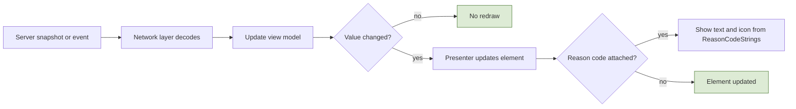
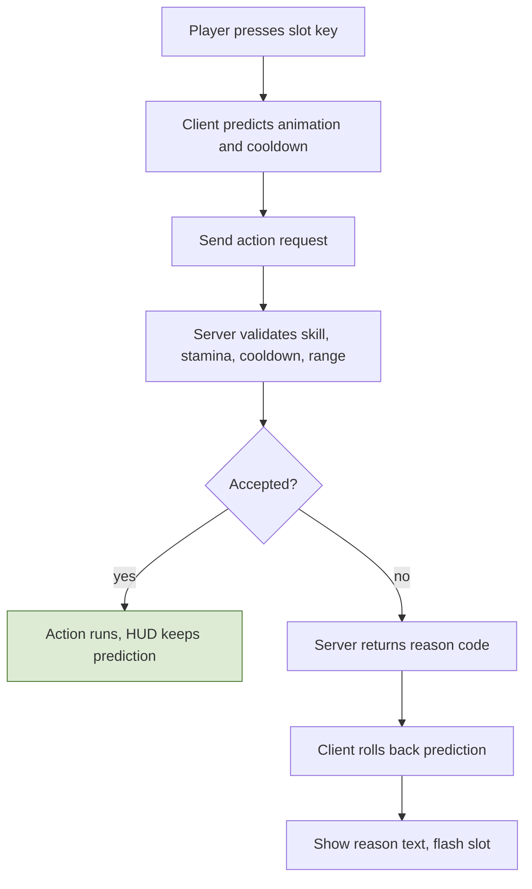
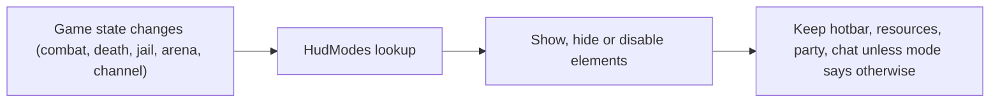
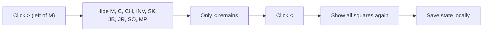
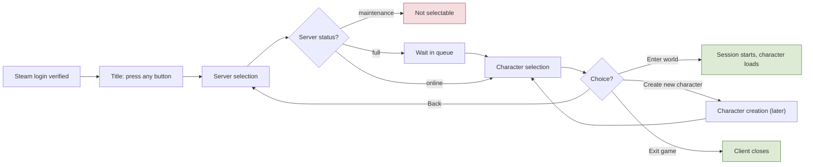
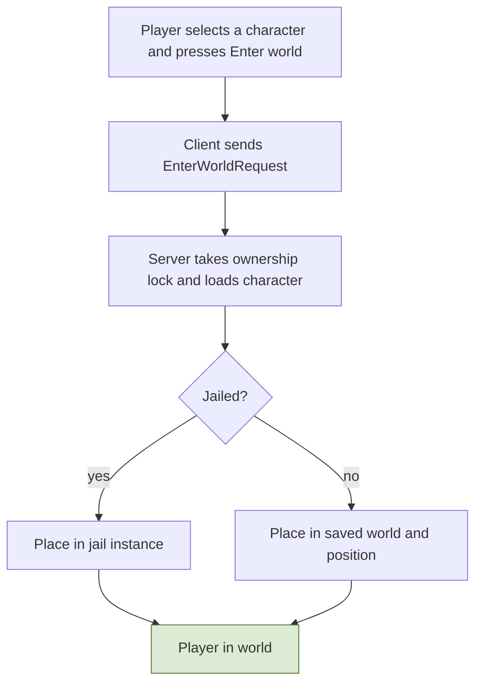

# 9. Client UI and HUD

## 9.1 Principles
- The HUD **only displays what the server reports**. It contains no gameplay rules: it binds to view models filled from server messages and the shared data tables.
- **Every failure has a reason.** The server returns reason codes (parry failed, logout blocked, craft refused...); the UI maps each to text and an icon from `ReasonCodeStrings`.
- **Layout, colors, modes, and hotkeys are config** (section 9.7), so the layout can change without code.
- Anything important is shown with **shape or text as well as color** (parry telegraphs, buff vs debuff, red name).

## 9.2 Approved main HUD layout
Reference resolution is **1280 x 720**; coordinates below are in that space. The mockup is the visual reference; this map shows every element where it sits.


**Zones**
- **Top left:** resource panel, with the party frame below it.
- **Top center:** boss bar (only while engaged).
- **Top right:** region header, **minimap**, and the **run tracker directly below the minimap**.
- **Bottom left:** chat.
- **Bottom center:** buff/debuff row, then the hotbar: two rows per side with the class gauge in the middle (left side keys 1 2 3 / 4 5 6, right side Q E R / F Z and one slot whose key is not decided), parry and dodge stack squares to its left, exp bar underneath.
- **Bottom right:** shortcut row with a collapse arrow.
- **World overlays:** name plates, damage numbers, ground telegraphs, cast bar (centered above the hotbar area).
- **Siege information is not in the HUD**: it will have its own page (not decided yet).

## 9.3 Element registry
| Element id | Position (x, y, w x h) | Contents | Data source | Visible when |
|---|---|---|---|---|
| `resource_panel` | 8, 10, 330x112 | Bars: HP, MP, ST (stamina), TOX (toxicity), SAT (satiety); TOX and SAT share the fourth row, half width each (WP-M2-2); hovering the panel shows the stats readout (Atk, Matk, Def, MDef; STR, DEX, STA, INT) | `StatBlock` resource meters; TOX, SAT and the readout from `OwnStats` | always |
| `party_frame` | 16, 162, 230xauto | member name, role, HP bar | `Party` snapshot | in a party |
| `boss_bar` | 440, 16, 400x44 | boss name, rank, HP bar (no color text) | target/engaged boss entity | while a boss is engaged (M1 rule in 9.12) |
| `region_header` | 1024, 16, 240x34 | region name, rule tag (PvP mode, lawless warning) | `EnteredRegion`, `RegionDef` | always |
| `minimap` | 1024, 56, 240x184 | map (the exported grid, region tint per ring), the player arrow with facing, party, outposts and vendors, passes and the tutorial gate, the death spot, the active run's camp hints (M2 v0 set below 9.7), the job nodes of the own jobs (M3, WP-M3-4, 9.12; territory colors later) | world data (grid, markers) + snapshot + `RunStatus` (WP-M2-10b, 9.12) | always (M2: from level 10 by the `UnlockSchedule`, spec 12.3, once the `HudLayout` level hook exists) |
| `run_tracker` | 1024, 248, 240x196 | run name, step n of N, bonus, step list, claim note (M2, WP-M2-6: "Run: 1 of 2 done", "Bonus +10%  Penalty -0%", each step with its progress, "Claim 330 exp at an outpost" once every step is done or forfeited; `hud.run.*`; an open return (or deliver) step also shows the units of its item the player holds, "Return 3 Imp Talisman (Imp): 1 held, 0/3" (`quest.step.held`), counted from the client's committed `InventoryContents` in the container that receives the item's category, the one a hand-in takes from; user decision 2026-10-30) | `Run` state (`RunStatus`, protocol 22); the held count from `InventoryContents` (no protocol change) | when a run is active or completed |
| `chat` | 7, 587, 330x126 | channel tabs (Local, Party, Guild...), messages, loot roll results | `Chat` | always |
| `cast_bar` | 490, 479, 300x30 | channel name and time left (harvest, forge, arrest) | action state (channel) | during a channel |
| `action_toast` | 440, 440, 400x30 | reason text of the last refused action or parry result | `ActionResult` | for `HudSettings.toastMs` after a result |
| `buff_row` | 560, 556, 160x26 | buff and debuff icons (green vs red border): armed, mounted, pet, status effects. WP-M2-11: square icons at the row's height, centered on its place, at most `StatusSettings.buffRowMaxIcons` (10, spec 3.7 "M2 status list", the one source): the flag chips first, then the statuses by `BuffIconRegistry.sortOrder`; more stay active but are not shown (10 icons overflow the 160 px box evenly, still inside the hotbar's width). The icon is the `iconAddress` texture, or the status name's initials while it is a placeholder; the stack count in the corner; hovering an icon shows "Burn x2, 3 s left" (`hud.buff.tooltip*`) | stat modifiers, flags | when any exists; an icon leaves when the snapshot stops carrying its status |
| `parry_dodge` | 380, 598, 52x76 | **one square each** with the stack count: P (teal), D (amber) | `ChargeMeter` | always |
| `hotbar_left` | 440, 590, 140x92 | slots 1 2 3 / 4 5 6, cooldown overlay | `Hotbar` + cooldowns | always |
| `gauge` | 590, 590, 100x92 | class gauge, 12 segments: 6 minus side (blue), 6 plus side (amber), center marker; one-sided gauges fill one side | `ClassGauge` | always; **locked and greyed until level 100** |
| `hotbar_right` | 700, 590, 140x92 | slots Q E R / F Z + one unassigned (dashed) | `Hotbar` + cooldowns | always |
| `quick_item` | 848, 598, 52x76 (placeholder; WP-M3-3, mirrors `parry_dodge`) | the quick-item slot (spec 3.4 consumable use, 9.13): the bound consumable's icon, the count held, its key (`Hotkeys` `quickItem`, X placeholder) and a cooldown sweep; empty, "Drag a potion here". The hotbar stays skills | `InventoryContents`, `UseItemResult` (protocol 29), the client-only binding | always |
| `exp_bar` | 440, 702, 400x6 | exp progress | `ExpService` | always |
| `exp_note` | 440, 685 | exp multiplier note when penalized ("Exp x0.4, above rank range") | exp multiplier | when multiplier below 1 |

M2 (WP-M2-3, user decision 2026-10-27): `exp_bar` and `exp_note` stay where this table puts them (the note's box is 400x14, a placeholder, since the table gives only its position); the bar fills with the exp into the level against the level's need (full at the level cap), in the `exp` theme token; the note is `UiStrings` `hud.exp.note` with the band modifier of R-3.6-03 ("Exp x0.36, above rank range") while it is below x1.0. Until the character panel shows the rank (WP-M2-11), `resource_panel` has a level and rank line above its bars (`hud.progress.line`, "Lv 5   Rank E"). A level-up and a committed rank-up show `action_toast` with `hud.toast.levelUp` and `hud.toast.rankUp` and an accent border (news, not a refusal). WP-M2-11 (user decision 2026-10-28): `exp_label` shares the note's box (440, 685, 400x14), left-aligned, with the level, rank and whole percent of the level's exp ("Lv 12   Rank E   41%", `hud.exp.label`; the note keeps the right of the box); hovering it or the bar shows "1240 / 3000 exp" (`hud.exp.tooltip`, "Highest level" at the cap). The resource panel keeps its level and rank line, because the exp rows show only from level 10 (spec 12.3, user decision 10: `exp_label` is in the `UnlockSchedule` row `leave` with `exp_bar` and `exp_note`); the character sheet shows both as well.
| `shortcut_row` | 927, 676, up to 344x32 | arrow (`>` expanded / `<` collapsed), **M** mail, **C** contracts (both with unread badges), CH, INV, SK, JB, JR, SO, MP, **RD** (raids window) | counts from Mail/Contracts | always |
| `buildup_meters` | own: next to the resource panel | small bars for Blood loss, Burn, Cold, Poison, Lightning (shown only when above 0); **only your own meters are ever shown**: build-ups of other players (including PvP), monsters, and bosses are never shown | `BuildupMeters` (own meters in the snapshot header, protocol 9, spec 3.8) | when any of your meters is above 0 |
| `monster_hp_bar` | world: **below each normal monster** | small HP bar (bosses use the boss bar instead) | monster snapshot (HP bucket) | while the monster is damaged or targeted (M1: held by the target lock, R-2.2-06) |
| `ping_indicator` | next to the minimap | current ping, with a warning above the 200 ms compensation cap | network layer | always |
| `nameplate` | above each **other** character (never the observer's own; user decision 2026-10-26) | name, guild tag, red-name, armed icon; disguised = generic name; the **target lock marker** above the name of the locked target (R-2.2-06) | `DisplayIdentity`; the lock from the client | in interest |
| `telegraph` | ground (world) | colored area plus a shape/icon, shown **only while the monster performs the attack**: red, yellow, blue, green. Uncolored attacks (the monsters' default attacks, R-3.3-04) have **no telegraph** in the final game; M1 placeholder: a faint uncolored area until the real monster animations land (user decision 2026-10-26) | action start event | during that attack |
| `damage_numbers` | world | floating numbers, crit style | hit events | on hit |
| `inventory_window` | 716, 150, 300x420 (placeholder; 8 px left of the minimap and run tracker column, QA M2 wave 2 D3) | a tab per bag container and the active one as a grid (`InventoryWindowSettings.columns` per row, slot count from `ContainerDef`), the equipment strip (one slot per `EquipSlotDef`, WP-M2-1), item icons (`ItemIconRegistry`), stack counts, tooltip (name, rarity, category, count, minimum level, stolen; WP-M2-11: the item's stats at its rarity, weapon type, equipment slots, "Bound"; WP-M3-2: a crafted item's stats snapshot instead, its quality, "Crafted", "Tainted", "In use by a craft"; reserved slots dimmed), the split bar in the header while a split is set up (WP-M2-11) | `InventoryContents` + `InventoryMoveResult` (spec 9.13) | while opened with its key (`Hotkeys` `toggleInventory`, I placeholder) or the INV shortcut (WP-M2-11) |
| `pickup_prompt` | world: centered over the ground drop the pickup key takes, 150x22, bottom 24 px above it (`HudLayout` row measured from the drop's projected point; placeholder) | "Press G to pick up" (`UiStrings` `hud.pickup.prompt`; the key name comes from the pickup binding, so a rebind changes it) | the nearest drop within `LootSettings.pickupRangeCm` (the server's range) of both the predicted and the last server-confirmed own position, the same rule as the pickup press; own HP | while such a drop exists and the player is alive (backlog G) |
| `stagger_marker` | world: centered over a monster's or boss's name plate, 96x20, bottom 32 px above the plate's point (`HudLayout` row measured from that point; placeholder) | an eight-point burst icon and "Staggered" (`UiStrings` `hud.plate.staggered`) in the `staggered` token color: shape and text, not color alone (9.8). Monsters and bosses only, never players or the own character (user request 2026-10-26); the HP bar and the lock chevron keep their own rules | the snapshot's `Staggered` state with its start (tick minus state age) and length (state duration): the poise break of R-3.3-01, no new message | for exactly the stagger on the render clock, like the stagger animation; gone when it ends, when the monster dies (cut at the death's tick) or leaves interest |
| `gold` | 8, 126, 160x24 (under the resource panel; placeholder) | "125 gold" (`UiStrings` `hud.gold`) | `GoldBalance` (protocol 17), the committed balance | from the first balance on (WP-M2-4) |
| `stats_readout` | 8, 156, sized by its lines (under the gold; placeholder) | the resource panel's stats readout: "Stats", Atk, Matk, Def, MDef and STR, DEX, STA, INT (`hud.stats.*`); its own row since the play finding of 2026-10-28 (opened 6 px below the panel it covered the gold) | `OwnStats` | while the pointer is on `resource_panel` and the own stats arrived |
| `npc_prompt` | world: centered over the NPC in reach, 180x22, bottom 24 px above its head point (`HudLayout` row measured from that point; placeholder) | "Press T to trade" (outpost) or "Press T to buy" (vendor) (`UiStrings` `hud.npc.prompt.<kind>`; the key name comes from the `Hotkeys` row `interact`, T placeholder) | the nearest NPC within its `NpcDef.interactRangeCm` (the server's range) of both the predicted and the last server-confirmed own position, the pickup prompt's rule (`ClientOutposts.NearestNpc`) | while such an NPC exists and none of its windows is open (WP-M2-4) |
| `outpost_window` | 16, 190, 320x340 (left edge, placeholder) | the outpost sale window (spec 9.13 M2) | `InventoryContents`, `OutpostInteractResult`, `SellQuoteResult`, `SellResult` | opened by the interaction key at an outpost, closed by its button or when the NPC leaves reach |
| `vendor_window` | 16, 230, 320x260 (left edge, placeholder) | the NPC vendor window (spec 9.13 M2) | `NpcVendorStock` (client tables), `OutpostInteractResult`, `VendorBuyResult` | opened by the interaction key at a vendor, closed by its button or when the NPC leaves reach |
| `skill_tree_window` | centered, 30 px above the middle, 620x430 (placeholder) | the skill tree window (spec 9.13 "M2: skill tree window", WP-M2-5) | `SkillTreeState`, `ProgressionState` (level, points), `SkillTreeResult` | while opened with its key (`Hotkeys` `toggleSkillTree`, K placeholder), closed by its button or the key |
| `book_window` | 346, 160, 360x400 (vertically centered, 114 px left of the middle: clear of the left-edge NPC windows and the inventory; placeholder) | the Bystial book window (spec 14.2, 9.13 M2): the slots the rank opens, the selected card's bonus with a take-out button, the collection with tier, counter and placeholder card art (`BystialCardArt`) | `BookState`, `BookChangeResult` (protocol 21) | while opened with its key (`Hotkeys` `toggleBook`, B placeholder) or the BK shortcut (WP-M2-11) |
| `jobs_window` | 16, 170, 340x380 (left edge like the NPC windows, since the job master opens it too; placeholder) | the Jobs window (spec 5.1, 9.13; WP-M3-1): the main and the secondary slot, each with its job, job level, XP bar and job points; at the job master the pick section (one row per `JobDef` with its level requirement and a pick button per slot, the rules' reason when disabled) and the confirmation step | `JobState`, `JobResult` (protocol 28) | while opened with its key (`Hotkeys` `toggleJobs`, O placeholder), the JB shortcut, or the job master's yes |
| `quest_board` | 16, 150, 360x420 (left edge, placeholder; WP-M2-6) | the outpost quest board and run builder v1 (spec 9.13 M2) | `QuestBoard`, `QuestRunResult`, `RunStatus` (protocol 22) | opened by the outpost sale window's Quests button (the quests interaction's yes), closed by its button or when the NPC leaves reach |
| `character_sheet` | 16, 150, 300x420 (left edge, placeholder; WP-M2-11) | the character sheet (spec 9.13 M2): class, level and rank, exp of the level's need, unspent skill points and unspent attribute points (WP-M2-13), then every stat of `OwnStats` by section in its unit (`CharacterSheetStats`), in a scroll view | `OwnStats`, `ProgressionState`, the class of `SkillTreeState` | while opened with its key (`Hotkeys` `toggleCharacter`, P placeholder: C turns the camera) or the CH shortcut |
| `tutorial_prompt` | 420, 70, 440x44 (top center under the boss bar, clear of the character; placeholder; WP-M2-10) | one tutorial prompt (`UiStrings` `tutorial.prompt.*`, accent border) with a dismiss hint and a close button, or the level gate's refusal (`RegionLevelTooLow`, refusal border, no dismiss); the panel lets clicks through, only its close button takes them | `UnlockSchedule`, `ProgressionState`, the prediction's gate stop | while a scheduled prompt is due (R-12.3-02, R-12.3-03) or the player pushes into a level gate (R-12.3-01) |

**Shortcut row behavior**
- The arrow sits to the **left of M**. Expanded: `>` then M, C, CH, INV, SK, JB, JR, SO, MP. Clicking `>` **hides every square including M**, and only `<` remains; clicking `<` shows them again. The state is a client setting (default expanded) saved locally.
- Buttons: **M** Mail, **C** Contracts, **CH** Character, **INV** Inventory, **SK** Skills (class and skill tree), **JB** Jobs, **JR** Journal, **SO** Social (friends, party, guild), **MP** Map, **RD** Raids (the raid window opens from this collapsible row; position of the row is as in the mockup).
- **M2 (WP-M2-11):** the `HudLayout` row `shortcut_row` (bottomRight, 927, 676, 344x32, `collapsible`) lists its buttons in `buttons`, each one of `HudLayout.ShortcutButtonIds`; a button joins the list once its window exists (M2: INV, SK, **BK** the Bystial book after SK, JR; CH with the character sheet; M3: **JB** the Jobs window after SK, WP-M3-1), the rest of the list above joins with its windows. Labels `hud.shortcut.<id>`, the hover text with the key `hud.shortcut.<id>.name` ("Inventory (I)"); an open window's button has the accent border; a click toggles the window like its key. While the pointer is on the row, the mouse buttons are not attack or parry. The collapsed state is kept in `PlayerPrefs` (`ILocalSettings`, the first local client setting).
- **JR Journal (user decision 2026-10-28):** the quest board window opened anywhere in a read-only run view (title "Journal", the run's steps and progress, or "No active run"); every run action needs the outpost in reach (spec 5.5), so the journal shows no hand-in, forfeit or claim button and a note says so. Opening the board at an outpost replaces the journal; the JR button or the `Hotkeys` key `toggleJournal` (J, placeholder) closes the window whatever it shows.

## 9.4 Data bindings (server to HUD)
| Server message / event | Updates | Notes |
|---|---|---|
| Snapshot (own entity) | HP, MP, stamina bars, buff row (statuses: net id, stacks, ticks left; protocol 7), buff flags (armed, mounted, pet), position | exact values and maxima in the header (protocol 3); others get a 6-bit HP bucket and no statuses (spec 1.7, 3.7) |
| `OwnStats` (protocol 19, reliable id 21, sent on `StatsChanged`) | TOX and SAT bars, the stats readout (derived values) | every final stat in `StatDef` row order, the stat block version, toxicity and satiety in thousandths; sent on a change and to a new connection, not per tick; the client decays the meters between messages at the `ConsumptionMeterSettings` rates (WP-M2-2) |
| `ChargeMeterUpdate` | P and D numbers | send on change; client recomputes recharge from timestamps |
| `ClassGaugeUpdate` | gauge segments | bipolar or one-sided per class |
| `ActionResult` (reason code) | cooldown overlay, parry result text, failure toast | all messages carry a reason code |
| `ActionStarted` (monster) | telegraph shape and color | includes `parryClass` for that attack only |
| `PartyChanged` | party frame | per-member HP updates in snapshots |
| `RunState` | run tracker | pushed on change |
| `RegionChanged` | region header rule tag, region-based hiding | |
| `ChatMessage` / `ChatRefused` (protocol 12) | chat | the sender's name already through `DisplayIdentity`, the text; a refusal carries its `ChatReason` (M1: local only, no channel field yet) |
| `MailCount`, `ContractCount` | M and C badges | |
| `ProgressionState` (protocol 18, WP-M2-3) | exp bar, exp note, level and rank line, level-up and rank-up toasts | own level, exp, exp to next, rank, unspent skill points, band multiplier in percent and the cause (initial, exp, level-up, rank-up, skill points, attribute points); sent at enter world and on every change; a rank-up only after its save commits (rule 5). Protocol 25 (WP-M2-13, R-3.4-08) appends the unspent free attribute points and the points placed on STR, DEX, STA and INT (committed values). Replaces the `ExpMultiplier` row: the multiplier rides in it |
| `AttributeSpendResult` (protocol 25, reliable id 33, WP-M2-13) | character sheet: the plus buttons wait for it; a refusal toasts its reason | the answer to `AttributeSpendRequest` (id 32, client to server: request id and attribute, `ReliableMessageCaps` 7 bytes): a refusal (`AttributeReason`: `AttributeUnavailable`, `UnknownAttribute`, `AttributeBlockedCombat`, `NoAttributePoints`, `AttributeAtMax`) at once, a placement only after its save commits (rule 5), right before the `ProgressionState` that shows it |
| `ChannelStarted/Ended` | cast bar | duration from the action table |
| `BossEngaged/Left` | boss bar | not sent in M1: the client rule of 9.12 replaces it |
| `EntityIdentity` (protocol 10) | name plates | a player's display name, already through `DisplayIdentity`, when it enters the observer's interest |
| `InventoryContents` (protocol 11) | inventory window slots | the Normal bag as committed to the database (rule 5), at enter world and after every save that changed it; protocol 26 (WP-M3-2): per slot the reserved flag (sent again when a reservation changes) and an instance's typed properties |
| `InventoryMoveResult` (protocol 13) | inventory window preview, failure toast | a refusal at once with its reason code; an accepted move only once its save committed, right before the `InventoryContents` that shows it (spec 9.13) |
| `UseItemResult` (protocol 29, WP-M3-3) | failure toast, quick-item cooldown | a refusal or an interruption (`UseInterrupted`) at once with its `UseItemReason`; a used item only once its save committed, right before the `InventoryContents` that shows it (spec 3.4 consumable use, 9.13) |
| `GoldBalance` (protocol 17) | `gold` | the committed gold, at enter world and with every `InventoryContents` (WP-M2-4) |
| `OutpostInteractResult`, `SellQuoteResult`, `SellResult`, `VendorBuyResult` (protocol 17) | outpost and vendor windows, failure toast | a refusal at once with its `OutpostReason`; an accepted sale or purchase only once its save committed, right before the `InventoryContents` that shows it (spec 9.13 M2) |
| `BookState`, `BookChangeResult` (protocol 21, reliable ids 25 and 27, WP-M2-8) | `book_window`, news and failure toasts | the own book: every carded monster type with a kill or a card (net id, committed tier, slot, kill count, kills for the next tier) and the slots open at the rank; sent at enter world, on a kill toward a card, on a rank-up and after every save that changed the book (rule 5); a change's refusal at once with its `BookReason`, an accepted change once its save committed, right before the state that shows it. A new card reaches the client this way, never through a hot message |
| `JobState`, `JobResult` (protocol 28, reliable ids 34 and 36, WP-M3-1) | `jobs_window`, news and failure toasts | the own jobs (job net id, slot, job level, XP into the level, XP to the next, unspent job points); sent at enter world, after the job master's yes, after a committed pick (right after its `JobResult`) and when job XP changed (class 2); a pick's refusal at once with its `JobReason`, an accepted pick only once its save committed |
| `QuestBoard`, `QuestRunResult`, `RunStatus` (protocol 22) | quest board, run tracker, failure toast | the board after the quests interaction's yes (and with a `BoardExpired` refusal); accept, deliver and forfeit answered at once with their `OutpostReason`; a claim only once its save committed; the run at enter world and whenever it changes (spec 9.13 M2, WP-M2-6) |

## 9.5 State-driven modes
| Mode | Trigger | HUD changes |
|---|---|---|
| In combat | `lastCombatAt` window | hide non-essential panels, keep hotbar, resources, party, chat |
| Dead (bad honor) | death with honor at or below threshold | arrest-window countdown and resurrection prompt; logout disabled |
| Dead (normal) | PvE death | respawn prompt, loot bag marker on the minimap (M2: the death spot, where the character fell, until player loot bags exist in M4; 9.12) |
| Jailed | `jailedUntil` in the future | time remaining and confiscated items; most panels disabled |
| Arena | arena instance | team life pool, round score, preparation countdown; mail, contracts, chat limited |
| Channeling | channel active | cast bar visible; movement-related prompts hidden |
| Mounted / disguised / armed | flags | buff row icons (AR, MT, PT as placeholders for real icons); **pets and mounts show only while switched on** |
| Raid | raid instance | party frames for 6 players, boss bar, no honor/flag indicators |
| Disconnected (linger) | connection lost | reconnect banner |

## 9.6 Hotbar, hotkeys, and settings
- Hotbar: **10 filled slots + 1 unassigned slot**, laid out as two rows per side of the gauge. Left: keys 1 2 3 / 4 5 6. Right: Q E R / F Z / (undecided). Slot count and keys are configurable (`Hotkeys`). Layouts are stored server-side per character; the server validates that a skill is learned and on the bar. M1 has no per-character layout: each class has one fixed layout (its normal attack, dodge, parry and 5 kit skills on Q E R F and 1; `ActionBindings` per class). A skill whose weapon is not equipped stays on the bar greyed (R-3.5-07). **M2 (WP-M2-5):** the layout is per character and saved (`characters.hotbar`, save class 2): the learned actives and buffs the player placed (dragged from the skill tree window onto a slot of 1 to `SkillTreeSettings.hotbarSlots`, or taken off with the window's Remove from bar); a newly learned skill lands on its `ActionBindings` slot (the default layout) when free, else on the first free slot no kit skill keeps; an evolution takes its base's slot. The bar shows the committed loadout the predictor runs (`LoadoutBuilder`); a slot whose skill needs a weapon type the equipped set does not have is drawn greyed (`hud-slot--unusable`) and its press is refused with `WrongWeapon`. TODO(9.6): dragging a skill from one slot to another and off the bar.
- Rebinding is supported; defaults: attack left click, dodge Ctrl, defend/parry right click, WASD move, mouse facing, target lock Tab (R-2.2-06; `Hotkeys` row `targetLock`).
- Client settings (local): shortcut row collapsed state, UI scale, opacity, chat tabs, colorblind palette.

## 9.7 HUD configuration
`HudLayout` (`data/tables/HudLayout.json`, loaded by the client): one row per element with `id` (the 9.3 element id), `anchor` (`topLeft` ... `bottomRight`), `offset` and `size`, plus `slots` on the hotbar elements. The root fields `referenceResolution` (1280 x 720) and `scaling` (fit-height: scales with screen height, anchors stay on their corner) live in `HudSettings`, because tables cannot nest objects (as `LoginSettings` does for `LoginLayout`).
- Offsets point into the screen from the anchor corner; on a centered axis the offset places the element's **center** (x right, y down), the same rule as `LoginLayout`. The rows reproduce the absolute reference coordinates of the table in 9.3; an EditMode test checks every row against them.
- `slots` lists, in reading order, the `ActionBindings` skill slot shown at each position (1-6 are keys 1-6, 7 Q, 8 E, 9 R, 10 F, 11 Z; 0 is the unassigned slot). M1: `hotbar_left` `[1, 2, 3, 4, 5, 6]`, `hotbar_right` `[7, 8, 9, 10, 11, 0]`. A skill slot appears at most once (validator).
- Later rows (party frame, region header, minimap, mode visibility `visibleIf`/`modes`) are added with their elements. WP-M2-11 adds `[Optional] collapsible` (the element collapses to its arrow; the state is a local client setting) and `[Optional] buttons` (a collapsible row's menu buttons, each one of `HudLayout.ShortcutButtonIds`, unique; validated), used by `shortcut_row`, and the `exp_label` row.
- **Minimap v0 marker set (user decision 2026-10-28, M2, WP-M2-10b; a `MinimapMarkerDef` table, icons from a registry
  like `ItemIconRegistry`):** the player arrow with facing; party members (data ready, parties are M4); outpost NPC and
  vendor icons; the ridge passes and the tutorial gate (12.3); the region tint per ring; the loot bag on death (9.5); a
  hint ring on the camps of the active run's kill or return step (placed by the client from the exported spawn markers
  and `SpawnPoints`). Not in v0: job nodes (added in M3 by WP-M3-4, 9.12), territory colors (guilds), other players (the law rules of section 6
  decide), bosses unless engaged. The map image is the exported grid (walkable, regions) rendered by the client, no
  authored art in M2. **WP-M2-10b answers (user, 2026-10-28):** player death loot bags are M4 (R-4.3-03), so the loot bag
  marker is a **death spot** the client keeps where the own character fell (`MinimapSettings.deathSpotMs`, or until the
  next death) until the M4 bag entity replaces its source; the icons are **placeholder shapes drawn in code**
  (`iconAddress` empty), like `ItemIconRegistry`. Built as 9.12 "Minimap v0".

Other tables:
- `HudThemeTokens` (colors `#RRGGBB` or `#RRGGBBAA`, validated): panel `rgba(14,18,26,0.86)` (`#0e121adb`), border `#3a4658`, text `#c9d3e0`, accent `#e0a43a`, HP `#c8453c`, MP `#3b7fd6`, stamina `#4aa85a`, toxicity `#b5c93a`, satiety `#d98f4e`, parry `#2fb7a7`, dodge `#e0a43a`, gauge minus `#5b8def`, gauge plus `#e0a43a`, buff border `#4aa85a`, exp bar `#9b7fe6` (`exp`, WP-M2-3, placeholder), debuff border `#c8453c`; HUD v1 adds locked `#5a6270`, damage text `#f2f2f2`, crit text `#ffcc4d`, heal text `#6fd27f`, and the telegraph areas red `#e0402f59`, yellow `#f2c23a5c`, blue `#3b8bf261`, green `#4ac26a61`, uncolored `#d8d8d82f` (alphas tuned for the Linear color space: over the M1 ground they look like 50% and 30% blended in sRGB; translucent colors are tuned under Linear, QA wave 5 V3), and staggered `#c39bff` (the stagger marker, 9.3); font Barlow Semi Condensed, sizes 12 body, 11 slot labels, 16 stack numbers, 18 damage numbers, 26 crits. (9.8 asks for text of at least 12 px; the 11 px slot labels follow these tokens until that is settled.)
- `HudSettings`: the layout root fields, toast and slot flash times, damage number pool, lifetime, start height and rise, name plate pool and fallback height, monster HP bar height, the boss bar engagement timeout (9.12), telegraph ground offset and icon height.
- `HudModes`: per mode, which element ids are shown, hidden, or disabled (section 9.5).
- `BuffIconRegistry`: status id to icon, kind (buff or debuff), sort order. The row shows at most `StatusSettings.buffRowMaxIcons` icons (10, user decision 2026-10-27, spec 3.7; more statuses stay active but are not shown; the cap is applied by the buff row of WP-M2-11). M1 (backlog D6): a config table (`data/tables/BuffIconRegistry.json`), one row per `StatusEffectDef` with `iconAddress` (Addressables; empty while a placeholder, the HUD then shows the status name) and `sortOrder`; the kind comes from the status. Swapping icons is data only.
- `ReasonCodeStrings`: reason code to message and icon (examples below).
- `Hotkeys`: default key map and the slot-to-key table. WP16 (`data/tables/Hotkeys.json`, client-only): one row per command with an Input System control path (`id`, `binding`); the first row is `toggleInventory` → `<Keyboard>/i` (spec 9 assigns no inventory key: placeholder); `targetLock` → `<Keyboard>/tab` (R-2.2-06); `toggleJournal` → `<Keyboard>/j` (the JR journal, WP-M2-11, placeholder); `toggleCharacter` → `<Keyboard>/p` (the character sheet, WP-M2-11, placeholder: C turns the camera in `GameInput`). The movement, action and hotbar keys are still bound in code (`GameInput`) until rebinding moves them here.
- `TargetLockSettings` (client-only, R-2.2-06): `doublePressWindowMs`, `acquireRangeCm`, `breakRangeCm`, `cycleOrder` (spec 2.2 Implementation); its set rule checks the `targetLock` row and that the break range lies between the acquire range and the interest radius.
- `ItemIconRegistry` (WP16, client-only): one row per `ItemDef` with `iconAddress` (an Addressables texture; empty while a placeholder) and the placeholder's `placeholderShape` (circle, square, diamond, triangle, hexagon) and `placeholderColor` (`#RRGGBB`). Swapping icons is data only. The validator checks a row per item.
- `InventoryWindowSettings` (WP16, client-only): `columns`, `slotSizePx`, `slotGapPx`, `dragThresholdPx`, `movePreviewTimeoutMs` (placeholders); its set rule checks the `toggleInventory` row and an icon row for every item. The server's `InventorySettings` holds `maxQueuedMoveRequests`.
- `CharacterSheetStats` (WP-M2-11, client-only): one row per `StatDef` row (`id`), its `section` (attributes, offence, defence, resources, resistances, other) and `order` on the character sheet and its `unit` (points, percent, perSecond: "124", "5%", "3/s"); the set rule checks a row for every stat and the `toggleCharacter` row. Stat names are `UiStrings` `stat.<id>`, which `UiStringCoverage` requires for every `StatDef` row (the sheet and the item tooltips), so a new stat adds both rows.
- Minimap (WP-M2-10b, client-only, placeholders; rules R-9.12-01 to R-9.12-04 in 9.12): `MinimapSettings` (`cmPerPx` 100, `cellsPerTexel` 2, `walkableColor`, `blockedColor`, `campMergeRadiusCm` 1500, `deathSpotMs` 600000); `MinimapMarkerDef` (one row per marker kind: `source` ownEntity, partyMember, npc, regionPass, runCamp or deathSpot, `iconId`, `color`, `sizePx`, `drawOrder`, `visibleFromLevel`, and per source `npcKinds`, `regions` (two `RegionDef` ids) or `questKinds`); `MinimapIconRegistry` (`iconAddress`, empty while a placeholder, and `placeholderShape`: arrow, circle, square, diamond, triangle, ring, bag); `MinimapRegionTint` (a ground color per `RegionDef`).

**Reason codes** (the server returns the code, the client shows the text): `ParrySuccess`, `ParryReduced`, `ParryFailedRed`, `ParryFailedArmor`, `ParryFailedEarly`, `ParryFailedLate` (protocol 15; `ParryFailedTiming` before), `ParryNoCharge`, `DodgeNoCharge`, `NoStamina`, `NoMp`, `OnCooldown`, `SkillNotLearned`, `WrongWeapon`, `OutOfRange`, `LootNotFound`, `LootLocked`, `BagFull`, `PickupWhileDead` (M1: the `PickupReason` enum, backlog G), `ItemSlotInvalid`, `ItemSlotEmpty`, `ItemStackFull`, `InventoryUnavailable` (the `InventoryMoveReason` enum, WP16), `InCombat`, `ItemNotAccepted`, `LevelTooLow`, `WeaponNotUsable`, `BagFull` (equip, unequip and moves between containers, protocol 16, WP-M2-1), `ItemReserved` (units a craft reserved: the `InventoryMoveReason` and `OutpostReason` enums, protocol 26, WP-M3-2), `ItemDropUnavailable` (client-detected: an item dragged out of the inventory window, spec 9.13), `LogoutBlockedCombat`, `LogoutBlockedArrestWindow`, `CraftRefusedStolenInput`, `ContractItemNotTradable`, `PvpNotArmed`, `RegionPvpOff`, `RespecBlockedCombat`, `QueueBlockedCombat`, `QueueBannedRecentLeave`. Chat (M1): `ChatEmpty`, `ChatTooLong`, `ChatInvalidText`, `ChatRateLimited`. Outposts and vendors (M2, the `OutpostReason` enum, WP-M2-4): `NpcNotFound`, `OutOfRange`, `InteractionUnavailable`, `NotSellable`, `NothingToSell`, `QuoteExpired`, `NotEnoughGold`, `NotInStock`, `BagFull`, `GoldCapReached`, `InventoryUnavailable`; the rank-up interaction (R-3.6-04, WP-M2-3, protocol 18) adds `RankRequirementsNotMet` and `RankMaxed`.

## 9.8 Accessibility and readability
- Telegraphs use **color plus shape/icon** (red, yellow, blue each have a distinct shape), buffs and debuffs differ by **border and icon**, red name has an icon as well.
- Text at least 12 px in the reference resolution, contrast 4.5:1 for body text; UI scale and opacity options; a colorblind palette option; every icon-only control has a text label for screen readers.

## 9.9 Unity structure and performance
```
Assets/Game/UI/
  HUD/          HudRoot, per-element prefabs (ResourcePanel, PartyFrame, BossBar, Minimap, RunTracker,
                Chat, CastBar, BuffRow, ParryDodge, Hotbar, Gauge, ExpBar, ShortcutRow)
  ViewModels/   one view model per element, filled from network messages (no gameplay logic)
  Menus/        Character, Inventory, SkillTree, Jobs, Progress, Journal, Social, Map, Arena, SiegePage (TBD)
  Overlays/     NamePlates, DamageNumbers, Telegraphs, Toasts
  Tooltips/     shared item/skill tooltips from the data tables (a skill tooltip lists its three arts with their
                conditions and marks the active ones, R-3.5-09; M6)
  Config/       HudLayout, Theme tokens, Hotkeys, ReasonCodeStrings
```
- Presenters bind to view models by **events, not polling**; pool name plates and damage numbers; update bars only when values change; cooldowns and recharge are computed locally from timestamps.
- Panels for menus (character, inventory with Normal/Safe/Quest bag tabs and icons for stolen and non-tradable items, class and skill tree with advancement and respec, jobs and portfolio, progress with rank and honor, journal with runs and contracts, social with guild treasury, territories and arena rating, map with territories and job markers) are opened by the shortcut row and hotkeys.

**Flow: Server update to HUD**



**Flow: Hotbar press and feedback**



**Flow: HUD mode switching**



**Flow: Shortcut row collapse**



## 9.10 Login flow screens
Screens after the Steam login, in order. Reference resolution 1280 x 720, same layout rules and tokens as the HUD (`LoginLayout` uses the same schema as `HudLayout`).

| Screen | Shows | Actions | Goes to |
|---|---|---|---|
| **Title** | game image (key art), game title, "Press any button to continue", signed-in Steam name, client and protocol version | any key or click | Server selection |
| **Server selection** | list of servers: name, region, population, ping, your character count, status; detail panel for the selected server | select a row, **Enter server** | Character selection |
| **Character selection** | character slots, 3D preview of the selected character, detail panel (class, level, rank, jobs, honor, location, last played), slot counter | **Enter world**, **Create new character**, **Back to server selection**, **Exit game** | World, Character creation, Server selection, desktop |
| **Character creation** | **designed later**; the screen id and contract exist now (below) | create, cancel | Character selection |

**Rules**
- **R-9.10-01** The title screen appears after the Auth API has verified the Steam ticket. If the client and protocol versions do not match, it shows an "update required" state and does not continue.
- **R-9.10-02** **Server list:** each entry has a name, region, population label, ping (measured by the client), and status: online, **full (login queue with estimated wait)**, or maintenance (not selectable). Population labels come from thresholds in config (defaults: Low under 40% of the cap, Medium 40-75%, High 75-100%, Full at the cap). The "yours" column is the account's character count per server.
- **R-9.10-03** **Enter server** connects to that server's gateway with the session ticket. If the server is full the player waits in the queue (reconnecting players skip it, as in 2.1); the screen shows the position.
- **R-9.10-04** **Character slots:** **4 per realm** (config), shown with a counter. Each card shows name, class, level, rank, and state: **in jail** (time left; the character can still enter and appears in the jail instance) or **pending deletion** (days left in the grace period; whether it can be restored is Open).
- **R-9.10-05** **Enter world** loads the selected character through the normal session start (ownership lock, saved world and position). **Back to server selection** disconnects from the server gateway but keeps the Steam session. **Exit game** closes the client.
- **R-9.10-06** **Create new character** opens the creation screen. Only the contract and rules below exist now.

**Character creation: basic contract (screen is designed later)**
- Request `CreateCharacterRequest { requestId, name, initialClass, appearance }` (`requestId` is a client-generated idempotency key: resending it returns the same character; `appearance` is an opaque, versioned blob until the screen is designed). The server validates a free slot, the name (length, allowed characters, filter, uniqueness), that the initial class is allowed, and that the appearance matches its schema; it replies `CreateCharacterResult { ok | reasonCode, characterId }`. The server picks the lowest free slot.
- Reason codes: `NameTaken`, `NameInvalid`, `NoFreeSlot`, `ClassNotAllowed`, `AppearanceInvalid`, `ServerUnavailable`.
- `CharacterCreationConfig` holds the slot count, name rules, the list of allowed initial classes, and the appearance options. The initial class list is **the four root classes** and the appearance stays an **opaque versioned blob (version 0, zero bytes)** until the screen is designed with the avatar art pipeline (user decision 2026-10-28: the placeholder screen, name and root class, stays through M2).
- Until the screen exists, the **Create new character** button opens a placeholder with a back button, so the navigation is already in place.

**Messages and config**
| Message | Direction | Purpose |
|---|---|---|
| `ServerListRequest` / `ServerListResponse` | client to Auth API and back | servers, status, population, character counts |
| `SelectServer` / `ConnectResult { ok, queuePosition?, reason }` | client and gateway | connect or queue |
| `CharacterListRequest` / `CharacterListResponse` | client and server | slots and card data |
| `EnterWorldRequest` / `EnterWorldResult` | client and server | start the session |
| `CreateCharacterRequest` / `CreateCharacterResult` | client and server | creation contract above |
| `DeleteCharacterRequest` | client to server | soft delete with a grace period |

Config tables: `LoginLayout`, `LoginScreens` (art, music, order), `ServerDirectory` (entries and population thresholds), `CharacterSlots`, `CharacterCreationConfig`, `LoginReasonCodes` (for example `VersionMismatch`, `ServerFull`, `ServerMaintenance`, `SessionReplaced`, `NoFreeSlot`, `InvalidTicket`, `TicketExpired`, `TooManyAttempts`, `ServerUnavailable` (a backing service failed; retry), `CharacterUnavailable` (no playable character in the ticket's slot, or it is loaded on another server)). The server sends the same codes when it kicks an accepted session (`SessionReplaced`, `ServerMaintenance`, `CharacterUnavailable`, and `Kicked` when an admin kicked it, spec 7.4; protocol 14), in the disconnect data. The client reads that data on any close by the server as it does on a refusal (data that does not have the `ConnectReject` layout is no reason code, R-2.5-04) and shows the code's `ReasonCodeStrings` text: on the login screens' status line when the kick comes before the world scene takes the connection, and in the HUD toast in the world, where it stays until the next snapshot. A close by the server without a code shows `ConnectionLost`.

**Auth API v0 (implementation, `src/AuthApi`).** Character list, creation, deletion and the enter-world ticket are Auth API calls (JSON over HTTPS); the game server only validates the ticket and starts the session. Contract types are in `src/Shared/Protocol/Auth`. Every response carries `ok` and `reasonCode` (`AuthReasonCode`); calls after login send `Authorization: Bearer <accessToken>`.
- `POST /v1/login { ticket }` → access token (stateless, signed, short-lived: `AuthApiLimits.AccessTokenLifetimeMs`, no refresh) and the character list.
- `GET /v1/realms/{realmId}/characters` → cards (slot, name, class, level, pending deletion and `purgeAfterUtcMs`) plus `slotsPerRealm` and server time.
- `POST /v1/realms/{realmId}/characters` → the creation contract above. `DELETE /v1/realms/{realmId}/characters/{id}` → soft delete; repeating it is not an error.
- `POST /v1/realms/{realmId}/characters/{id}/enter` → the single-use session ticket for the character's slot and the session key (R-2.5-01, R-2.5-02).
- Extra reason codes: `RequestInvalid` (malformed request), `AuthTokenInvalid`, `AuthTokenExpired` (log in again), `RealmUnknown`, `CharacterNotFound`, `CharacterPendingDeletion` (cannot enter the world).
- `CharacterSlots`: `slotsPerRealm`, `deleteGraceMs`. `CharacterCreationConfig`: name length, allowed characters, blocked words (substring, ignoring case), allowed initial classes, appearance version and size, and the new character's starting state. The allowed characters, blocked words, grace period, initial classes and appearance are placeholders until decided (Open). Until characters store an appearance, only an empty version 0 blob is accepted.

| Screen | Elements (ids) |
|---|---|
| Title | `title_art`, `title_logo`, `press_any_button`, `title_message`, `steam_badge`, `version_label` |
| Server selection | `server_header`, `server_table` (rows `server_row`), `server_detail`, `enter_server_button`, `server_message`, `steam_badge` |
| Character selection | `server_label`, `slot_counter`, `slot_list` (cards and an empty slot), `character_preview`, `character_detail`, `char_message`, `btn_back_server`, `btn_exit`, `btn_create`, `btn_delete`, `delete_confirm`, `btn_enter` |
| Character creation (placeholder) | `create_header`, `create_note`, `create_name`, `create_class_list`, `create_message`, `btn_create_cancel`, `btn_create_confirm` |

The `*_message` elements show the reason text of the last refusal (spec 9.1). `btn_delete` opens `delete_confirm`, and the soft delete is sent only after the player confirms (R-2.1-05).

**Client v0 (implementation, backlog B5, `unity/Assets/Game/UI`).** UI Toolkit (built-in, no package). The elements are built in code and placed from `LoginLayout`. `LoginSettings` holds the root fields of the layout schema (`referenceResolution`, `scaling`), which the table format cannot nest, and also the Auth API address, the request timeout and the world scene. Other tables: `LoginScreens`, `ServerDirectory` (one dev server: realm, game host and port, status), `ReasonCodeStrings` and `UiStrings` (all fixed UI text). The `DataValidator` checks that every reason code enum (`AuthReasonCode`, `ConnectRejectReason`, `ClientReasonCode` for failures the client detects itself) has a `ReasonCodeStrings` row. A code without a row shows the `UnknownReason` row.
- The view models hold state only and raise `Changed`; presenters redraw on it. `LoginFlow` does the navigation and the Auth API calls; every rule stays on the server.
- An expired or invalid access token sends the player back to the title to sign in again.
- **Enter server** only lists the characters. v0 has no gateway step, so the game connection opens at **Enter world**: Auth API ticket and session key, then `ClientConnection`. The key is cleared after connecting.
- Once the server accepts the connection, it is handed to the world scene (`WorldHandoff`).
- The client calls only `https://` or loopback `http://`. The dev login (`dev:<n>`) is compiled in the editor and with `MMORPG_DEV_LOGIN`; otherwise a Steam stub reports `SteamUnavailable`.
- Not yet:
  - population, ping and the login queue (they need `ServerListResponse`, TODO(B5-serverlist))
  - the "update required" state on the title (the Auth API does not report the server protocol yet; `VersionMismatch` appears when the game server refuses the connection)
  - the 3D character preview
  - rank, jail, jobs, honor, location and last played on the cards

**Flow: Login screen flow**



**Flow: Enter world from character selection**



## 9.11 Raid window
- Opened by the **RD** button in the collapsible shortcut row. Elements: `raid_window`, `raid_list` (name, difficulty tier by adventurer rank, party size 6, status), `raid_detail`, `btn_start_party` ("Start with party now"), `btn_queue` ("Queue to find other players"), `queue_status`.
- `btn_start_party` is enabled only for a party in a city; `btn_queue` shows the queue state and can be cancelled. Both are disabled outside cities and in combat.
- Messages: `RaidListRequest/Response`, `RaidStartRequest { raidId, mode: party | queue }`, `RaidQueueStatus`, `RaidReady`. Extra reason codes: `RaidNotInCity`, `RaidPartyTooLarge`, `RaidInCombat`, `RaidAlreadyQueued`.
- Inside a raid the HUD shows frames for the 6 party members and the boss bar, and hides honor and red-name indicators.

## 9.12 HUD v1 (implementation, backlog I, WP13)
`unity/Assets/Game/UI` (`HUD/`, `ViewModels/Hud/`, `Overlays/`, `Config/HudConfig.cs`), UI Toolkit built in code like the login screens; tables `HudLayout`, `HudSettings`, `HudThemeTokens`, text from `UiStrings` and `ReasonCodeStrings`.
- **Data path.** The world client raises a `WorldClientFeed` (snapshot applied, hits, `ActionResult`, `EntityIdentity`, chat lines and refusals, predicted tick, disconnect with the reason code to show, spec 9.10); the chat is the one way back: the HUD sends a line through the feed, and sets the feed's typing flag. `HudFeedBinder` copies it into one view model per element; the view models raise `Changed` only on a real change and presenters redraw on it. Cooldown overlays, recharge fills and the cast bar animate from stored end times on the display clock (9.9). The HUD decides nothing about the game.
- **Elements:** `resource_panel` (HP, MP, ST from the snapshot header; WP-M2-2: TOX and SAT side by side on a fourth row, from `OwnStats` through the client core's `ClientStats` and the feed's `StatsReceived`, decayed each frame on the display clock; on hover a tooltip below the panel with `UiStrings` `hud.stats.combat` and `hud.stats.attributes`; the full character sheet is WP-M2-11), `hotbar_left`/`hotbar_right` (the class's `ActionBindings`; names from `UiStrings` `action.<id>` until hotbar icons exist; predicted cooldowns; a refused press flashes its slot), `gauge` (locked frame and tooltip, design §3), `parry_dodge` (predicted `ChargeMeter`s, keys right click and Ctrl), `buff_row` (own statuses by `BuffIconRegistry.sortOrder`, buff/debuff border, the status name while the icon is a placeholder, AR/MT/PT chips from the own flags), `boss_bar`, `cast_bar` (own channels), `action_toast`, `chat` (below), world overlays below.
- **Boss bar engagement (user decision 2026-10-24):** a display rule built from server facts, no message: the bar shows when the player hit the boss or the boss hit the player within `HudSettings.bossEngageTimeoutMs` (placeholder 10 s), and hides when that time passes, the boss dies, or it leaves interest. A server-side `BossEngaged/Left` (target lists, parties, raids) can replace it later.
- **Name plates:** the observer's own character has none (user decision 2026-10-26; its name is in the resource panel); remote players show the name of `EntityIdentity` (reliable, protocol 10: sent when a player enters the observer's interest and to a player for itself, name from the server's `DisplayIdentity`, which returns the character name in M1); monsters show `UiStrings` `monster.<id>`; red-name and armed icons from the snapshot flags; guild tag with guilds (M2). Normal monsters show `monster_hp_bar` at their feet while damaged or locked. Bosses show their name only.
- **Target lock marker (R-2.2-06, user decision 2026-10-26):** the locked target's name plate shows a chevron pointing down at it above the name, in the `accent` token with a dark outline (its accessible label `UiStrings` `hud.plate.locked`); a chevron, because the telegraph icons above a monster already use the triangle, diamond, circle and square (9.8). A locked normal monster also shows its HP bar at full HP. The feed's `LockedTargetChanged` moves the marker (`NamePlateSet.SetLocked`); the lock itself is client state, the HUD decides nothing.
- **Stagger marker (R-3.3-01, user request 2026-10-26):** `RemoteEntity.InterruptStartTick` and `InterruptTicks` keep the snapshot's flinch or stagger start and length; `HudFeedBinder` gives a monster's stagger to `NamePlateSet.SetStagger` (a newer snapshot without it cuts it at that tick, `EndStaggerAt`), and `UpdateStaggers(renderTick)` each frame shows the marker while the render clock is inside the stagger, so it starts and ends with the stagger animation. `NamePlateOverlay` draws it (an eight-point burst, a shape the telegraph icons and the lock chevron do not use).
- **Damage numbers:** only hits the player dealt or took; crits bigger in the crit color, heals `+n` in the heal color, dodged and parried as words; pooled, the oldest reused when the pool is full.
- **Telegraphs:** monster attacks only, from the attack's start until its Active phase ends on the render clock (cut short when the monster's state changes), anchored on the attacker. Ground area: one mesh per `HitShapeDef` row of the action's strikes and a lane (range x 2 hit radius) per projectile, in the parry color or the uncolored token; colored attacks also get an icon above the monster: red triangle, yellow diamond, blue circle, green square (9.8). The uncolored token is an **M1 placeholder** (user decision 2026-10-26): uncolored attacks are the monsters' default attacks and are not telegraphed once the real monster animations exist; drawing them is to be switched off by data then (TODO(M-art): a `HudSettings` flag or the `telegraph` row), the colored ones stay. WP11 ground areas come later.
- **Chat (local chat WP, protocol 12; user decisions 2026-10-24 and 2026-10-25):** the Local tab only. Enter opens a text field, Enter sends, Escape or clicking away closes it and keeps the draft; while it is open the gameplay keys are suspended (`GameInput.Suspended`, through the feed's typing flag). The client checks the line with the shared `ChatText` rule (trimmed, at most `ChatSettings.maxChars` characters, no control characters) and shows a refusal at once; the server checks again, applies the per-character rate limit (`ChatSettings`: burst, then `messagesPerPeriod` per `periodMs`) and sends the line to every connected player who has the sender in interest, plus the echo, with the sender's name through `DisplayIdentity` per recipient. A line shows only when the server sends it (the own line is its echo), as "Name: text" in plain text (rich text off); refusals show their `ReasonCodeStrings` text, a line that could not be sent shows `ConnectionLost`. The panel keeps `ChatSettings.historyLines` lines, newest at the bottom. The word filter is Open; mute, block, other channels and scrolling back are M2.
- **HUD v2 (WP-M2-11):** `exp_label` and the exp bar's hover (9.3 WP-M2-3 paragraph), the buff row's icons, capacity and hover (9.3 `buff_row`), the shortcut row with the JR journal (`HUD/ShortcutRowPresenter`, `ViewModels/Hud/ShortcutRowViewModel`, `Config/LocalSettings`; 9.3 "Shortcut row behavior"). The run tracker of WP-M2-6 already has what 9.3 asks.
- **Minimap v0 (WP-M2-10b; marker set and answers in 9.7):** `HUD/MinimapPresenter`, `ViewModels/Hud/MinimapModel` and `MinimapTexture`, `Config/MinimapConfig`; tables `MinimapSettings`, `MinimapMarkerDef`, `MinimapIconRegistry`, `MinimapRegionTint` (9.7). Client only: no server or protocol change (the M3 job-node source of WP-M3-4 reads the world's markers and the `GatherNodes` and `NodeDef` tables, also client side).
  - **Map.** When the world client's feed names its world (`WorldClientFeed.WorldId`), the client reads that world's regions and markers through the shared `WorldPackage.TryLoadIndex` (the manifest and hash checks of the grid) and draws the grid the prediction already loaded into a texture: one texel per `cellsPerTexel` squared cells, the region's `MinimapRegionTint` (else `walkableColor`) where most of its cells are walkable, `blockedColor` elsewhere. North-up, centered on the predicted own position, `cmPerPx` world centimeters per reference pixel; markers whose box lies outside the frame are hidden, the rest are clipped by it. The arrow turns with the own facing (0 north, clockwise).
  - **Sources** (one `MinimapMarkerDef` row per kind): `ownEntity` the arrow; `npc` every `npc` marker of the world whose `NpcDef` kind the row lists, at any distance (static, public places); `regionPass` every connected crossing where walkable cells of the row's two regions touch (on m1: the seven ring 1 to ring 2 crossings marked as the tutorial gate of 12.3, three passes each between rings 2, 3 and 4); `runCamp` while the run is active, a ring on every camp of each active step of the row's kinds (kill, returnItem: the step's monster type, its `SpawnPoints` markers joined into camps within `campMergeRadiusCm`; the run's outpost is not on the wire and kills count anywhere, so every camp of the type is hinted); `deathSpot` the predicted own position when the own HP turns from above 0 to 0, for `deathSpotMs` or until the next death (entering the world dead shows none; TODO(M4): the own loot bag entity, R-4.3-03); `partyMember` a list M4 parties fill; `jobNode` (M3, WP-M3-4, the job nodes of 9.3) every `resourceNode` marker whose `GatherNodes` row places one of the row's `nodeIds`, at any distance, shown only when the node type's `jobId` is one of the own jobs (`IOwnJobs`, the client's `ClientJobs`, WP-M3-1), again when the job list changes. A row shows from its `visibleFromLevel`.
  - **Rules.** **R-9.12-01** a `MinimapMarkerDef` row sets `npcKinds` exactly when its source is npc, `regions` (two different `RegionDef` ids) exactly when regionPass, `questKinds` (kill and returnItem only, no repeats) exactly when runCamp, `nodeIds` (`NodeDef` ids, no repeats; `[Optional]`) exactly when jobNode. **R-9.12-02** exactly one ownEntity row, at most one deathSpot row, no region pair marked twice (either order). **R-9.12-03** colors `#RRGGBB(AA)`, `sizePx` 4 to 32, `visibleFromLevel` at most `ProgressionSettings.maxLevel`. **R-9.12-04** a `MinimapIconRegistry` row has a known shape and a clean address and is used by a marker row.
  - **Visible from level 1** (user decision 2026-10-28 after play; spec 12.3): no `UnlockSchedule` row lists it. A row with `hudElements: ["minimap"]` would hide it below that row's level through the HUD-by-level hook below.
- **HUD by level (WP-M2-10, spec 12.3 R-12.3-02):** `UnlockSchedule` is the only place a HUD element's level lives: only an element a row lists in `hudElements` is hidden below that row's level, an element no row lists is always shown. At M2's start none waits: the exp bar and the minimap show from level 1 (user decision 2026-10-28 after play), the hotbar is listed at 1. `HudView.Place` keeps the elements it places by their `HudLayout` id and `HudRoot` (through `TutorialBinder`) calls `HudView.ApplyLevel` with each `ProgressionState`; a locked element gets `style.visibility = Hidden`, so a presenter's own `display` rule stays its own (an element shows only when both allow it; presenters never set `visibility`). A package whose element waits for a level places it through `HudView.Place` and adds its own `UnlockSchedule` row (the minimap at 10, WP-M2-10b). World overlays (`pickup_prompt`, `npc_prompt`) are not placed by `HudView` and are never locked.
- **Tutorial prompt (WP-M2-10, spec 12.3):** `HUD/TutorialPromptPresenter`, `HUD/TutorialBinder`, `ViewModels/Hud/TutorialPromptViewModel`, the engine-free schedule `Entities/Core/ClientTutorial` (also compiled into the bots, unused there), the seen store `HUD/TutorialSeenStore`; the binder feeds the schedule the own level, the drop in pickup reach, the kind of the NPC in reach and committed sales, and shows `LocalPlayerPredictor.GateStopLevel` (the level a gate needed in the newest predicted frame) as the gate's refusal.
- Not yet: party frame, region header, ping, build-up meters, `HudModes`, hotbar icons and real buff icon art (`BuffIconRegistry.iconAddress`), rebinding the menu keys (the `WrongWeapon` grey-out landed with WP-M2-5). On the minimap: territory colors (guilds), other players (section 6), bosses while engaged, the M4 loot bag as the death marker's source, real icon art (`MinimapIconRegistry.iconAddress`), the level-10 visibility (WP-M2-10's hook), a full map window (the MP shortcut).
- **Dev overlays are not HUD (WP17, spec 11.7):** the hitbox gizmos, the action timeline and the tick panel (F4, F5, F6 from `Hotkeys` dev rows, like the world view F3) live on the dev scene's own `Dev Tools` object, never under `HudRoot`, compiled only with the dev client (editor and `MMORPG_DEV_LOGIN` builds), hidden at start. Their text is developer diagnostics in English (IMGUI, like the dev status line), not player text, so it does not come from `UiStrings`. The HUD's one link to them: on a dev hot reload the feed's `ConfigReloaded` rebuilds the telegraph shapes and the name and status lookups from the reloaded tables.

## 9.13 Inventory window v1 (backlog G client part, WP16)
`unity/Assets/Game/UI/Menus/Inventory` (`InventoryWindowPresenter`, `InventoryWindowBinder`), `ViewModels/Inventory/InventoryWindowViewModel`, `Config/InventoryConfig`; built in code on the HUD panel like 9.12, placed by the `HudLayout` row `inventory_window`; tables `InventoryWindowSettings`, `ItemIconRegistry`, `Hotkeys`; text from `UiStrings` (`inv.*`, `rarity.<id>`, `itemCategory.<category>`, checked by `UiStringCoverage`) and `ReasonCodeStrings`.
- **Window:** the Normal bag only (M1, spec 4.1): a grid of its `ContainerDef` slots, `columns` per row. Each slot shows the item's icon (the `ItemIconRegistry` texture, or the placeholder shape in its color), the stack count above 1, the accent border when selected. Hovering a stack shows a tooltip to the left of the window: name (`ItemDef.nameId`), rarity, category, count of max stack, and "Stolen" when flagged. A header with the title and a close button (text label for screen readers, 9.8). **Place (QA M2 wave 2 D3):** vertically centered on the right, 8 px left of the top-right column (`minimap` and `run_tracker`, 9.3): at 420 px the window cannot fit under that column, and right-aligned it covered the window's header, tabs and top bag row. No window opens over the minimap or the run tracker (an EditMode test on a 1280 x 720 panel); the centered skill tree window still overlaps the inventory when both are open. Opened and closed with the `Hotkeys` row `toggleInventory` (I, placeholder); the INV shortcut of the shortcut row opens it too (WP-M2-11). While the pointer is on the window (or drags from it) the mouse buttons are not attack or parry.
- **Containers and equipment (WP-M2-1, protocol 16):** a tab row (one button per bag container of `ContainerDef`, in code order, `inv.container.<id>`) picks the container the grid shows; below the grid the equipment strip shows the Equipped container, one slot per `EquipSlotDef` row with its name (`inv.equipSlot.<id>`) on an empty slot; a dual weapon sits in the main weapon slot and draws the second one dimmed (covered). A move between any two slots (grid to grid of the same tab, grid to strip to equip, strip to grid to unequip; click-to-move keeps its selection across tabs, so it also moves between bag containers) is the same `InventoryMoveRequest` with `fromContainer` and `toContainer` (`ContainerDef.code`, 0 the Normal bag; capped at 10 bytes). The preview runs the shared `Inventory` rules (categories per container, equip displacement); the class, level and combat rules are the server's, and their refusals (`WeaponNotUsable`, `LevelTooLow`, `InCombat`) revert the preview with a toast. `InventoryContents` carries the Normal bag in its M1 fields and every other container in `containers`, with instance ids and the non-tradable flag. WP-M2-11 keeps these tabs (Bag, Safe: gear, Safe: valuables, Quest: the two areas of the Safe bag, R-4.1-02, as two tabs, since the window has no height for both grids on one tab) and adds the item stats to the tooltip: one line per `ItemStatBonusDef` row of the item scaled by its rarity's `RarityDef.statPercent` with the shared `ItemStatBonus.Scale` (the numbers the server's gear stat source applies; "Atk +12", "Def +5%", names `stat.<id>`), the weapon type, the equipment slots it is worn on, and "Bound: cannot be traded" for a non-tradable stack (R-4.1-01/04).
- **Moving stacks:** click a stack, then another slot (click-to-move; a second click on the same stack deselects), or drag it there (past `dragThresholdPx`). The client sends a reliable `InventoryMoveRequest { requestId, fromSlot, toSlot }` (protocol 13; capped by its `ReliableMessageCaps` row, 12 bytes since protocol 24, and checked by the guarded reader, R-2.5-07); `requestId` counts per connection. The server applies it in phase 1 through `InventoryService.TryMove` (move into an empty slot, merge onto the same stack key up to `maxStack`, swap otherwise; reason `PlayerMove`, save class 2, R-7.1-01) and answers `InventoryMoveResult { requestId, reason | outcome }`.
  - Operation key `move:{worldRun}:{entityId}:{connection}:{requestId}`: a repeated request on one connection gets the first answer and changes nothing (double submit), and a client whose counter restarts after a reconnect never repeats a key (the database keeps every key, rule 5).
  - Refusals (`ItemSlotInvalid`, `ItemSlotEmpty`, `ItemStackFull`, `InventoryUnavailable`) are answered in the same tick. An accepted move is answered only once the save holding it committed (rule 5: commit before confirming; `InventoryService.IsCommitted`, read-only), right before the `InventoryContents` that shows it. Several moves of one player in one tick run in arrival order on one bag.
  - Moving while dead is allowed: the spec has no rule against it.
- **Splitting a stack (WP-M2-11, protocol 24; user decision 2026-10-28):** Shift+click on a stack of 2 or more (not an instance) selects it with half its units (rounded down) and shows the split bar in the header in the title's place ("Split 2 of 5", minus, plus, cancel; `inv.split*`); the next click on a free slot, or on a stack of the same item with room for all of them, sends the same `InventoryMoveRequest` with `count` (appended `ushort`, 0 = the whole stack); a drag, a click on the same stack or the cancel drops the split. The server applies it through `InventoryService.TryMove(..., count, ...)`, the shared `Inventory.TryMove` with a count: the units go into an empty slot as a new stack (`Moved`) or onto the same key when they all fit (`Merged`), the rest stays; refused with `ItemSlotInvalid` (more units than the stack, another item, an instance, the Equipped container), `ItemStackFull` (not all fit), `ItemNotAccepted` (the target container does not take the category). Same operation key, answers, preview and save class as a move.
- **Item model v3 (WP-M3-2, protocol 26; spec 4.1 M3 implementation):** each slot of `InventoryContents` carries its reserved flag and an instance's typed properties.
  - **Tooltip.**
    - A crafted instance's stats snapshot replaces the item's `ItemStatBonusDef` lines. The stat indexes are in `StatDef` file order, mapped by `InventoryConfig.CraftedBonuses`.
    - Then "Quality {quality}" when it has one, and "Crafted" when it has a crafter. The crafter's name waits until it can travel as an `EntityIdentity` through `DisplayIdentity` (rule 8); the raw id is never shown.
    - Then "Tainted: made with stolen materials" and "In use by a craft" (`inv.tooltip.quality`, `.crafted`, `.tainted`, `.reserved`).
  - **Reserved slots** draw dimmed like a preview (class `inv-slot--reserved`). The server refuses their moves with `ItemReserved`, which reverts the preview with a toast. Enchant level and gem lines in the tooltip are WP-M3-8, -9 and -11.
- **Preview:** the window shows the confirmed bag (`InventoryContents`) with the moves not yet answered applied on top, through the shared `Bag.TryMove` rules, and draws those slots dimmed. A refusal drops the move (the slots revert) and shows its reason text in the HUD toast; an accepted move stays until the contents that include it; a move with no answer is dropped after `movePreviewTimeoutMs`. The client never holds the truth.
- **Dropping to the ground** is not in M1 (loot bags are M4): a stack dragged out of the window is not sent, and the toast shows `ItemDropUnavailable`.
- **Using a consumable (M3, WP-M3-3; spec 3.4 consumable use, protocol 29):** a right-click or a double-click on a stack of the grid sends `UseItemRequest { requestId, container, slot }` through the feed's `IUseItemRequests` (one counter per connection, the engine-free `Entities/Core/ClientConsumables`, also compiled into the bots); the tooltip of a consumable says "Right-click to use" (`inv.tooltip.use`). The client first checks what the server would surely refuse (not a consumable, a use still waiting, its cooldown as the client estimates it: the use action's startup plus `cooldownMs` from the request, the meters through the shared `ConsumableRules`) and shows that reason in the toast without sending; otherwise the use action plays at once in prediction like a skill (`LocalPlayerPredictor.RequestAction`, the frame the request goes with). A slot still previewing a move, an empty slot and the equipment strip use nothing; a selection or split is dropped. Refusals and `UseInterrupted` show their `ReasonCodeStrings` text in the toast; a used item shows in the next `InventoryContents`.
- **Quick item (M3, WP-M3-3):** one quick-item slot right of the hotbar (`HudLayout` `quick_item`; `UI/HUD/QuickItemPresenter`, `QuickItemBinder`, `ViewModels/Hud/QuickItemViewModel`). A consumable dragged from the window onto it binds it (toast "Small Health Potion is on the quick-item key", `hud.toast.quickItemBound`); any other item dropped there is refused as a drop outside the window. The binding is **client only, per character on this machine** (`UI/HUD/QuickItemStore`: `<persistentDataPath>/quickItem/<characterKey>.txt`, one `ItemDef` id; a QA smoke run keeps it under its run folder), read once the character and its bag are known. The `Hotkeys` key `quickItem` (X, placeholder: G is pickup) uses the lowest Normal bag stack of the bound item, the same request as a right-click (ignored while the chat input has focus); with none left the slot shows the item greyed with 0 and the key shows `ItemSlotEmpty`. The slot shows the icon (`ItemIconRegistry`), the count held, the key and a cooldown sweep; empty, "Drag a potion here".
- Not yet: both Safe bag areas on one tab, a paper-doll equipment layout, comparing an item with the equipped one, typing a split count, stolen and non-tradable icons on the slots (9.9; the tooltip says "Stolen"), real icon art (`ItemIconRegistry.iconAddress`), rebinding the toggle key.

**M2: character sheet (WP-M2-11).** Same pattern: `unity/Assets/Game/UI/Menus/Character` (`CharacterSheetPresenter`, `CharacterSheetBinder`), `ViewModels/Character/CharacterSheetViewModel`, `Config/CharacterSheetConfig`; `HudLayout` row `character_sheet`; `Hotkeys` row `toggleCharacter` and the CH shortcut; text from `UiStrings` (`charSheet.*`, `stat.<id>`, `class.<id>`, `rank.*`). It shows the class (from the committed skill tree), "Level 12   Rank E", "Exp 1240 / 3000" ("Highest level" at the cap) and the unspent skill points from `ProgressionState`, then every final stat of `OwnStats` (`ClientStats`) in the sections and order of `CharacterSheetStats`, each value in its unit, in a scroll view; "Waiting for the server..." before the first `OwnStats`. It decides nothing (spec 9.1). While the pointer is on it, the mouse buttons are not attack or parry. Not yet: the equipment on the sheet (a paper doll), stat breakdowns by source, tooltips explaining each stat.

**M2: free attribute points on the character sheet (WP-M2-13, R-3.4-08).** The sheet shows "Attribute points: 3" (`charSheet.attributePoints`) under the skill points, and on each attribute row (STR, DEX, STA, INT) the points placed on it after the value ("24 (+5)", `charSheet.placed`, accent color) and a "+" button (`charSheet.plus`, hover text `charSheet.plusLabel`, spec 9.8) while points are unspent. A click sends one `AttributeSpendRequest` through the feed's `IAttributeRequests` (`ClientProgression.Request`, the next request id of the connection) and turns every "+" off until its answer (`CharacterSheetViewModel.Pending`, the skill tree window's pattern); a refusal shows its `ReasonCodeStrings` text as a toast (`AttributeReason`); an accepted point shows no toast: the answer comes after the commit, right before the `ProgressionState` and `OwnStats` that show the new numbers. The client never adds the point itself (spec 9.1). Placing is refused in combat and during an action (user decision 2026-10-29); a skill respec gives every placed point back (R-3.4-08).

**M2: skill tree window (WP-M2-5; spec 3.5).** Same pattern: `unity/Assets/Game/UI/Menus/Skills` (`SkillTreeWindowPresenter`, `SkillTreeBinder`), `ViewModels/Skills/SkillTreeWindowViewModel`, `Config/SkillTreeConfig`; `HudLayout` row `skill_tree_window`; text from `UiStrings` (`skill.*`, `class.<id>`, `skillNode.<id>`, `skill.kind.*`, `skill.weapon.*`, checked by an EditMode test and the DataValidator) and `ReasonCodeStrings` (`SkillTreeReason`). The engine-free `Entities/Core/ClientSkillTree` (also compiled into the bots) holds the committed state, the request ids and the answers.
- **Window:** a tab per tree of the class line (root first; a class advance opens the new tree), the active tree's nodes on the design file's grid (its rows, and its columns in their order with the unused ones dropped; the cells sized from the window) with their level of max and a state from the committed state, the level and the points through the shared `SkillTreeRules` (available, upgradable, learned, locked, not available yet), the points left in the header. Clicking a node shows its kind, level, minimum level, requirements, the skill it evolves, its weapons (or the weapons it unlocks), its slot and what is missing, with Learn, Upgrade or Evolve when allowed and Remove from bar when it is on one. Reset skills at the bottom; at the class's children's unlock level an Advance row with one "Become <class>" button each (permanent, R-3.5-01). While the pointer is on the window the mouse buttons are not attack or parry.
- **Requests:** one at a time: a button sends `SkillTreeRequest` and the window waits for its `SkillTreeResult`; a refusal shows its reason in the HUD toast, a committed learn, evolve, advance or reset a `UiStrings` toast, and the next `SkillTreeState` shows the change. A learned active or buff dragged (past `InventoryWindowSettings.dragThresholdPx`) onto a hotbar slot sends `AssignSlot`.
- Not yet: icons, tooltips with numbers per level, a confirmation for the class advance and the reset, rebinding the toggle key, the skill arts panel (R-3.5-09, M6).

**M2: outpost and vendor windows (WP-M2-4; spec 4.2).** Same pattern as the inventory window: `unity/Assets/Game/UI/Menus/Outpost` (`OutpostWindowPresenter`, `VendorWindowPresenter`, `OutpostBinder`), `ViewModels/Outpost` (`OutpostWindowViewModel`, `VendorWindowViewModel`, `GoldViewModel`, `NpcPromptViewModel`), `Config/OutpostConfig`, `HUD/GoldPresenter`, `Overlays/NpcPromptOverlay`; `HudLayout` rows `gold`, `outpost_window`, `vendor_window`, `npc_prompt`; text from `UiStrings` (`outpost.*`, `vendor.*`, `hud.gold`, `hud.npc.prompt.*`, checked by an EditMode test) and `ReasonCodeStrings`. The engine-free `Entities/Core/ClientOutposts` (also compiled into the bots) holds the NPC definitions, the request ids (one counter per connection) and the answers.

**M2: quest board, run builder and run tracker (WP-M2-6; spec 5.5).** Same pattern: `UI/Menus/Quests` (`QuestBoardPresenter`, `QuestBinder`), `ViewModels/Quests` (`QuestBoardViewModel`, `RunTrackerViewModel`), `Config/QuestConfig` (the caps, `RunBonus` and `ForfeitPenalty` for the builder's preview through the shared `RunMath`, monster and item names for the task lines), `HUD/RunTrackerPresenter`; `HudLayout` rows `quest_board`, `run_tracker`; text from `UiStrings` (`quest.*`, `hud.run.*`, `hud.toast.runClaimed`, checked by an EditMode test) and `ReasonCodeStrings` (`BoardExpired` to `RunNotComplete`). The outpost sale window has a Quests button that asks for the quests interaction of the same NPC; its yes closes the sale window and opens the board, which shows the server's offers ("Kill 7 Demon: 140 exp", the locked reward), lets the player pick up to `QuestCaps.maxStepsPerRun` offers in run order (the pick number before each, a line "Run: 2 of 5 quests, 330 exp with the bonus"), and accepts them with the board's epoch. With a run the board shows its steps with their progress, a Hand in button for an active deliver or return step, a Forfeit button for every active step, and the Claim button ("Claim 330 exp") once the run is completed. The NPC prompt hides while the board of its NPC is open. Every number comes from the server; refusals toast their reason, a committed claim toasts "Run claimed: +330 exp". The engine-free `Entities/Core/ClientQuests` (also compiled into the bots) keeps the last board, the run and the run request ids.
- **Interaction:** the world client names the NPC in reach every frame (`ClientOutposts.NearestNpc`: within `NpcDef.interactRangeCm` of both the predicted and the confirmed position, like the pickup prompt); the HUD shows "Press T to trade" or "Press T to buy" there. The `Hotkeys` row `interact` (T, placeholder: F is a hotbar key) sends `OutpostInteractRequest` with the NPC's first interaction (`NpcDef.interactions`); the server's yes opens the window of that kind (sell or buy), a refusal (`OutOfRange`, ...) shows in the toast. A window closes with its button or when its NPC is no longer the one in reach. While the pointer is on a window, the mouse buttons are not attack or parry.
- **Sale window:** the committed bag's sell-only, non-stolen stacks (name and count). Selecting one takes the whole stack and asks for a quote (`SellQuoteRequest`); less, more and all change the count and ask again; only the last quote asked counts. The quote line shows the count, the total and the first and last unit's price (R-4.2-02: the price falls inside one sale). Sell is enabled only with a quote for the current selection and sends `SellRequest` with the quoted total; the answer comes once the sale committed ("Sold 20 for 196 gold"), a `QuoteExpired` refusal asks for a new quote at once, other refusals show in the toast.
- **Vendor window:** the vendor's `NpcVendorStock` rows from the client tables (name and fixed price), the selected row's count (1 to one stack) and total; Buy sends `VendorBuyRequest` with that total; the answer comes once the purchase committed.
- **Gold:** the `gold` row shows the committed balance (`GoldBalance`), from the first message on; cleared on disconnect.
- **Journal (WP-M2-11, user decision 2026-10-28):** the JR shortcut or the `toggleJournal` key opens this window anywhere as the read-only run view (9.3 "Shortcut row behavior"): `QuestBoardViewModel.Journal`, no offers, no run action; at an outpost the quests interaction's yes turns it into the board.
- Not yet: item icons in the rows, selling several stacks at once, a confirmation step for large sales, rebinding the interaction key, the rank-up and quest board tabs of the outpost (WP-M2-3, WP-M2-6).

**M2: the Bystial book window (WP-M2-8; spec 14.2).** Same pattern: `unity/Assets/Game/UI/Menus/Book` (`BookWindowPresenter`, `BookWindowBinder`), `ViewModels/Book/BookWindowViewModel`, `Config/BookConfig`; `HudLayout` row `book_window`; `Hotkeys` row `toggleBook` (B, placeholder); text from `UiStrings` (`book.*`: the window's ids in `BookTextIds`, checked by an EditMode test; the tier, stat, effect, element and family names every Bystial row needs, checked by `UiStringCoverage`) and `ReasonCodeStrings` (`BookReason`). The engine-free `Entities/Core/ClientBook` (also compiled into the bots) holds the last `BookState`, the change request ids (one counter per connection) and the answers; the world client offers `IBookRequests` beside `IWorldRequests`.

**M3: the Jobs window (WP-M3-1; spec 5.1).** Same pattern: `unity/Assets/Game/UI/Menus/Jobs` (`JobsWindowPresenter`, `JobsBinder`), `ViewModels/Jobs/JobsWindowViewModel`, `Config/JobsConfig` (the shared `JobRules`, so the window checks a pick like the server); `HudLayout` row `jobs_window`; `Hotkeys` row `toggleJobs` (O, placeholder); the JB shortcut; text from `UiStrings` (`job.*` in `JobsTextIds`, the job names `JobDef.nameId`, the job master's prompt `hud.npc.prompt.jobMaster`, checked by an EditMode test) and `ReasonCodeStrings` (`JobReason`). Opened by its key it lists the held jobs; the job master's yes (`NpcInteraction.Jobs`) opens it with the pick section, which closes when the player leaves the master's reach. A pick is two clicks: the row's "Pick as main" or "Pick as secondary" opens the **confirmation step** ("This choice is permanent"), and Confirm sends one `JobRequest`; one pick waits at a time; a refusal shows its reason in the toast, a committed pick and a job level-up a news toast. While the pointer is on the window the mouse buttons are not attack or parry. The engine-free `Entities/Core/ClientJobs` (also compiled into the bots) holds the last `JobState`, the pick request ids (one counter per connection) and the last answer; the world client offers `IJobRequests` beside `IWorldRequests`.
- **Slots:** the slots the rank opens (`BystialSlots`), four per line, each showing its card or "Empty". Select a card in the collection, then click a slot: an empty slot places it, an occupied one swaps (its card goes back to the collection). The selected placed card shows Take out.
- **Collection:** one row per carded monster type with a kill or a card, in the server's order: the placeholder card art (`BystialCardArt` color; an Addressables address replaces it later), "Demon (Normal)", the counter "100 / 500 kills" (or "top tier"), and "in slot n". The selected card's line shows its tier's stat bonus and effect from the client tables ("Max HP +10, Fire resistance +5%").
- **One change at a time:** a change waits for its answer (the window never runs ahead of the server). A refusal (`InCombat`, `CardNotEarned`, `AlreadyPlaced`, `NoFreeBookSlot`, `CardNotPlaced`, `BookUnavailable`) shows its text in the toast; an accepted change shows when the next `BookState` arrives. A new or evolved card shows a news toast ("New card: Demon (Normal)").
- Not yet: real card art, drag and drop, sorting and filtering the collection, the family set bonus shown in the window.
