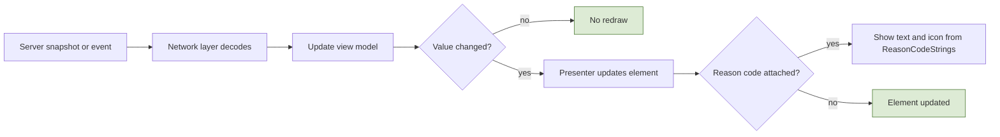
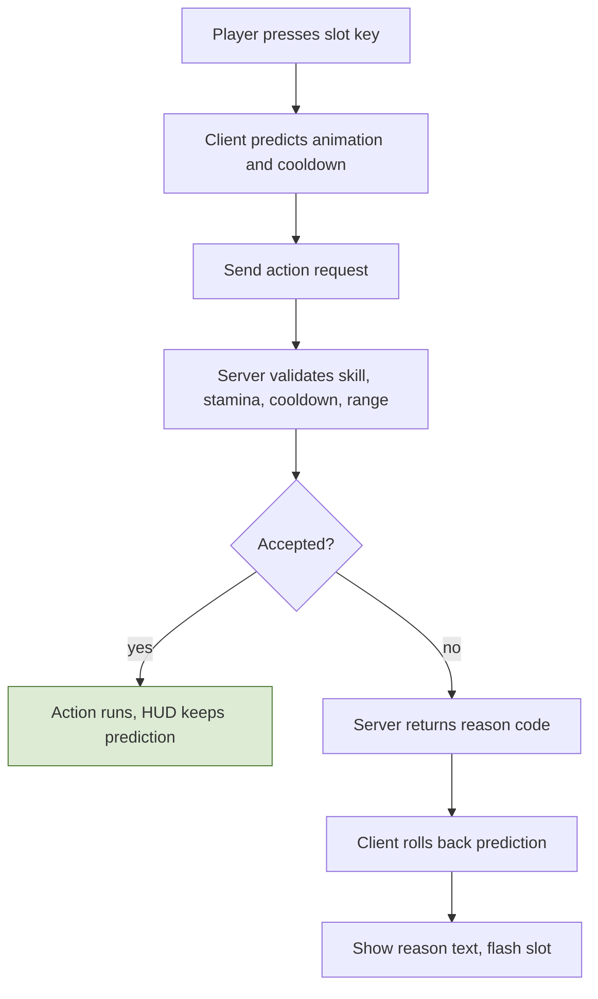
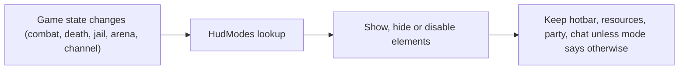
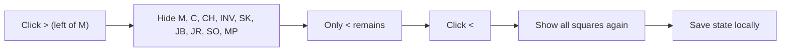
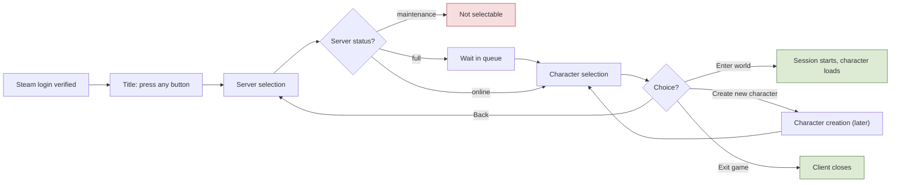
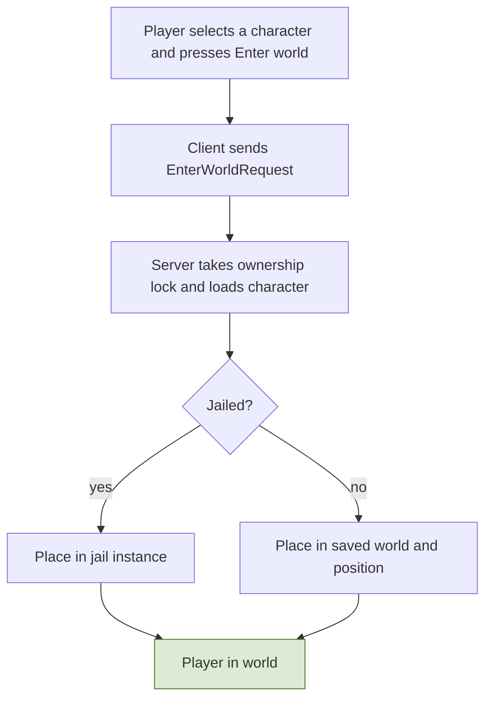

# 9. Client UI and HUD

## 9.1 Principles
- The HUD **only displays what the server reports**. It contains no gameplay rules: it binds to view models filled from server messages and the shared data tables.
- **Every failure has a reason.** The server returns reason codes (parry failed, logout blocked, craft refused...); the UI maps each to text and an icon from `ReasonCodeStrings`.
- **Layout, colors, modes, and hotkeys are config** (section 9.7), so the layout can change without code.
- Anything important is shown with **shape or text as well as color** (parry telegraphs, buff vs debuff, red name).

## 9.2 Approved main HUD layout
Reference resolution is **1280 x 720**; coordinates below are in that space. The mockup is the visual reference; this map shows every element where it sits.


**Zones**
- **Top left:** resource panel, with the party frame below it.
- **Top center:** boss bar (only while engaged).
- **Top right:** region header, **minimap**, and the **run tracker directly below the minimap**.
- **Bottom left:** chat.
- **Bottom center:** buff/debuff row, then the hotbar: two rows per side with the class gauge in the middle (left side keys 1 2 3 / 4 5 6, right side Q E R / F Z and one slot whose key is not decided), parry and dodge stack squares to its left, exp bar underneath.
- **Bottom right:** shortcut row with a collapse arrow.
- **World overlays:** name plates, damage numbers, ground telegraphs, cast bar (centered above the hotbar area).
- **Siege information is not in the HUD**: it will have its own page (not decided yet).

## 9.3 Element registry
| Element id | Position (x, y, w x h) | Contents | Data source | Visible when |
|---|---|---|---|---|
| `resource_panel` | 8, 10, 330x112 | Bars: HP, MP, ST (stamina), TOX (toxicity), SAT (satiety) | `StatBlock` resource meters | always |
| `party_frame` | 16, 162, 230xauto | member name, role, HP bar | `Party` snapshot | in a party |
| `boss_bar` | 440, 16, 400x44 | boss name, rank, HP bar (no color text) | target/engaged boss entity | while a boss is engaged (M1 rule in 9.12) |
| `region_header` | 1024, 16, 240x34 | region name, rule tag (PvP mode, lawless warning) | `EnteredRegion`, `RegionDef` | always |
| `minimap` | 1024, 56, 240x184 | map, player, party, job nodes, territory colors | world data + snapshot | always |
| `run_tracker` | 1024, 248, 240x196 | run name, step n of N, bonus, step list, claim note | `Run` state | when a run is active |
| `chat` | 7, 587, 330x126 | channel tabs (Local, Party, Guild...), messages, loot roll results | `Chat` | always |
| `cast_bar` | 490, 479, 300x30 | channel name and time left (harvest, forge, arrest) | action state (channel) | during a channel |
| `action_toast` | 440, 440, 400x30 | reason text of the last refused action or parry result | `ActionResult` | for `HudSettings.toastMs` after a result |
| `buff_row` | 560, 556, 160x26 | buff and debuff icons (green vs red border): armed, mounted, pet, status effects | stat modifiers, flags | when any exists |
| `parry_dodge` | 380, 598, 52x76 | **one square each** with the stack count: P (teal), D (amber) | `ChargeMeter` | always |
| `hotbar_left` | 440, 590, 140x92 | slots 1 2 3 / 4 5 6, cooldown overlay | `Hotbar` + cooldowns | always |
| `gauge` | 590, 590, 100x92 | class gauge, 12 segments: 6 minus side (blue), 6 plus side (amber), center marker; one-sided gauges fill one side | `ClassGauge` | always; **locked and greyed until level 100** |
| `hotbar_right` | 700, 590, 140x92 | slots Q E R / F Z + one unassigned (dashed) | `Hotbar` + cooldowns | always |
| `exp_bar` | 440, 702, 400x6 | exp progress | `ExpService` | always |
| `exp_note` | 440, 685 | exp multiplier note when penalized ("Exp x0.4, above rank range") | exp multiplier | when multiplier below 1 |
| `shortcut_row` | 927, 676, up to 344x32 | arrow (`>` expanded / `<` collapsed), **M** mail, **C** contracts (both with unread badges), CH, INV, SK, JB, JR, SO, MP, **RD** (raids window) | counts from Mail/Contracts | always |
| `buildup_meters` | own: next to the resource panel | small bars for Blood loss, Burn, Cold, Poison, Lightning (shown only when above 0); **only your own meters are ever shown**: build-ups of other players (including PvP), monsters, and bosses are never shown | `BuildupMeters` (own meters in the snapshot header, protocol 9, spec 3.8) | when any of your meters is above 0 |
| `monster_hp_bar` | world: **below each normal monster** | small HP bar (bosses use the boss bar instead) | monster snapshot (HP bucket) | while the monster is damaged or targeted (M1: held by the target lock, R-2.2-06) |
| `ping_indicator` | next to the minimap | current ping, with a warning above the 200 ms compensation cap | network layer | always |
| `nameplate` | above each **other** character (never the observer's own; user decision 2026-10-26) | name, guild tag, red-name, armed icon; disguised = generic name; the **target lock marker** above the name of the locked target (R-2.2-06) | `DisplayIdentity`; the lock from the client | in interest |
| `telegraph` | ground (world) | colored area plus a shape/icon, shown **only while the monster performs the attack**: red, yellow, blue, green. Uncolored attacks (the monsters' default attacks, R-3.3-04) have **no telegraph** in the final game; M1 placeholder: a faint uncolored area until the real monster animations land (user decision 2026-10-26) | action start event | during that attack |
| `damage_numbers` | world | floating numbers, crit style | hit events | on hit |
| `inventory_window` | 964, 140, 300x440 (placeholder) | a tab per bag container and the active one as a grid (`InventoryWindowSettings.columns` per row, slot count from `ContainerDef`), the equipment strip (one slot per `EquipSlotDef`, WP-M2-1), item icons (`ItemIconRegistry`), stack counts, tooltip (name, rarity, category, count, minimum level, stolen) | `InventoryContents` + `InventoryMoveResult` (spec 9.13) | while opened with its key (`Hotkeys` `toggleInventory`, I placeholder) or the INV shortcut (later) |
| `pickup_prompt` | world: centered over the ground drop the pickup key takes, 150x22, bottom 24 px above it (`HudLayout` row measured from the drop's projected point; placeholder) | "Press G to pick up" (`UiStrings` `hud.pickup.prompt`; the key name comes from the pickup binding, so a rebind changes it) | the nearest drop within `LootSettings.pickupRangeCm` (the server's range) of both the predicted and the last server-confirmed own position, the same rule as the pickup press; own HP | while such a drop exists and the player is alive (backlog G) |
| `stagger_marker` | world: centered over a monster's or boss's name plate, 96x20, bottom 32 px above the plate's point (`HudLayout` row measured from that point; placeholder) | an eight-point burst icon and "Staggered" (`UiStrings` `hud.plate.staggered`) in the `staggered` token color: shape and text, not color alone (9.8). Monsters and bosses only, never players or the own character (user request 2026-10-26); the HP bar and the lock chevron keep their own rules | the snapshot's `Staggered` state with its start (tick minus state age) and length (state duration): the poise break of R-3.3-01, no new message | for exactly the stagger on the render clock, like the stagger animation; gone when it ends, when the monster dies (cut at the death's tick) or leaves interest |

**Shortcut row behavior**
- The arrow sits to the **left of M**. Expanded: `>` then M, C, CH, INV, SK, JB, JR, SO, MP. Clicking `>` **hides every square including M**, and only `<` remains; clicking `<` shows them again. The state is a client setting (default expanded) saved locally.
- Buttons: **M** Mail, **C** Contracts, **CH** Character, **INV** Inventory, **SK** Skills (class and skill tree), **JB** Jobs, **JR** Journal, **SO** Social (friends, party, guild), **MP** Map, **RD** Raids (the raid window opens from this collapsible row; position of the row is as in the mockup).

## 9.4 Data bindings (server to HUD)
| Server message / event | Updates | Notes |
|---|---|---|
| Snapshot (own entity) | HP, MP, stamina bars, buff row (statuses: net id, stacks, ticks left; protocol 7), buff flags (armed, mounted, pet), position | exact values and maxima in the header (protocol 3); others get a 6-bit HP bucket and no statuses (spec 1.7, 3.7) |
| `StatsChanged` | derived values, TOX, SAT | sent on change, not per tick |
| `ChargeMeterUpdate` | P and D numbers | send on change; client recomputes recharge from timestamps |
| `ClassGaugeUpdate` | gauge segments | bipolar or one-sided per class |
| `ActionResult` (reason code) | cooldown overlay, parry result text, failure toast | all messages carry a reason code |
| `ActionStarted` (monster) | telegraph shape and color | includes `parryClass` for that attack only |
| `PartyChanged` | party frame | per-member HP updates in snapshots |
| `RunState` | run tracker | pushed on change |
| `RegionChanged` | region header rule tag, region-based hiding | |
| `ChatMessage` / `ChatRefused` (protocol 12) | chat | the sender's name already through `DisplayIdentity`, the text; a refusal carries its `ChatReason` (M1: local only, no channel field yet) |
| `MailCount`, `ContractCount` | M and C badges | |
| `ExpMultiplier` | exp note | |
| `ChannelStarted/Ended` | cast bar | duration from the action table |
| `BossEngaged/Left` | boss bar | not sent in M1: the client rule of 9.12 replaces it |
| `EntityIdentity` (protocol 10) | name plates | a player's display name, already through `DisplayIdentity`, when it enters the observer's interest |
| `InventoryContents` (protocol 11) | inventory window slots | the Normal bag as committed to the database (rule 5), at enter world and after every save that changed it |
| `InventoryMoveResult` (protocol 13) | inventory window preview, failure toast | a refusal at once with its reason code; an accepted move only once its save committed, right before the `InventoryContents` that shows it (spec 9.13) |

## 9.5 State-driven modes
| Mode | Trigger | HUD changes |
|---|---|---|
| In combat | `lastCombatAt` window | hide non-essential panels, keep hotbar, resources, party, chat |
| Dead (bad honor) | death with honor at or below threshold | arrest-window countdown and resurrection prompt; logout disabled |
| Dead (normal) | PvE death | respawn prompt, loot bag marker on the minimap |
| Jailed | `jailedUntil` in the future | time remaining and confiscated items; most panels disabled |
| Arena | arena instance | team life pool, round score, preparation countdown; mail, contracts, chat limited |
| Channeling | channel active | cast bar visible; movement-related prompts hidden |
| Mounted / disguised / armed | flags | buff row icons (AR, MT, PT as placeholders for real icons); **pets and mounts show only while switched on** |
| Raid | raid instance | party frames for 6 players, boss bar, no honor/flag indicators |
| Disconnected (linger) | connection lost | reconnect banner |

## 9.6 Hotbar, hotkeys, and settings
- Hotbar: **10 filled slots + 1 unassigned slot**, laid out as two rows per side of the gauge. Left: keys 1 2 3 / 4 5 6. Right: Q E R / F Z / (undecided). Slot count and keys are configurable (`Hotkeys`). Layouts are stored server-side per character; the server validates that a skill is learned and on the bar. M1 has no per-character layout: each class has one fixed layout (its normal attack, dodge, parry and 5 kit skills on Q E R F and 1; `ActionBindings` per class). A skill whose weapon is not equipped stays on the bar greyed (R-3.5-07).
- Rebinding is supported; defaults: attack left click, dodge Ctrl, defend/parry right click, WASD move, mouse facing, target lock Tab (R-2.2-06; `Hotkeys` row `targetLock`).
- Client settings (local): shortcut row collapsed state, UI scale, opacity, chat tabs, colorblind palette.

## 9.7 HUD configuration
`HudLayout` (`data/tables/HudLayout.json`, loaded by the client): one row per element with `id` (the 9.3 element id), `anchor` (`topLeft` ... `bottomRight`), `offset` and `size`, plus `slots` on the hotbar elements. The root fields `referenceResolution` (1280 x 720) and `scaling` (fit-height: scales with screen height, anchors stay on their corner) live in `HudSettings`, because tables cannot nest objects (as `LoginSettings` does for `LoginLayout`).
- Offsets point into the screen from the anchor corner; on a centered axis the offset places the element's **center** (x right, y down), the same rule as `LoginLayout`. The rows reproduce the absolute reference coordinates of the table in 9.3; an EditMode test checks every row against them.
- `slots` lists, in reading order, the `ActionBindings` skill slot shown at each position (1-6 are keys 1-6, 7 Q, 8 E, 9 R, 10 F, 11 Z; 0 is the unassigned slot). M1: `hotbar_left` `[1, 2, 3, 4, 5, 6]`, `hotbar_right` `[7, 8, 9, 10, 11, 0]`. A skill slot appears at most once (validator).
- Later rows (party frame, region header, minimap, run tracker, exp bar, shortcut row with `collapsible`, mode visibility `visibleIf`/`modes`) are added with their elements.

Other tables:
- `HudThemeTokens` (colors `#RRGGBB` or `#RRGGBBAA`, validated): panel `rgba(14,18,26,0.86)` (`#0e121adb`), border `#3a4658`, text `#c9d3e0`, accent `#e0a43a`, HP `#c8453c`, MP `#3b7fd6`, stamina `#4aa85a`, toxicity `#b5c93a`, satiety `#d98f4e`, parry `#2fb7a7`, dodge `#e0a43a`, gauge minus `#5b8def`, gauge plus `#e0a43a`, buff border `#4aa85a`, debuff border `#c8453c`; HUD v1 adds locked `#5a6270`, damage text `#f2f2f2`, crit text `#ffcc4d`, heal text `#6fd27f`, and the telegraph areas red `#e0402f59`, yellow `#f2c23a5c`, blue `#3b8bf261`, green `#4ac26a61`, uncolored `#d8d8d82f` (alphas tuned for the Linear color space: over the M1 ground they look like 50% and 30% blended in sRGB; translucent colors are tuned under Linear, QA wave 5 V3), and staggered `#c39bff` (the stagger marker, 9.3); font Barlow Semi Condensed, sizes 12 body, 11 slot labels, 16 stack numbers, 18 damage numbers, 26 crits. (9.8 asks for text of at least 12 px; the 11 px slot labels follow these tokens until that is settled.)
- `HudSettings`: the layout root fields, toast and slot flash times, damage number pool, lifetime, start height and rise, name plate pool and fallback height, monster HP bar height, the boss bar engagement timeout (9.12), telegraph ground offset and icon height.
- `HudModes`: per mode, which element ids are shown, hidden, or disabled (section 9.5).
- `BuffIconRegistry`: status id to icon, kind (buff or debuff), sort order, max icons shown (Open). M1 (backlog D6): a config table (`data/tables/BuffIconRegistry.json`), one row per `StatusEffectDef` with `iconAddress` (Addressables; empty while a placeholder, the HUD then shows the status name) and `sortOrder`; the kind comes from the status. Swapping icons is data only.
- `ReasonCodeStrings`: reason code to message and icon (examples below).
- `Hotkeys`: default key map and the slot-to-key table. WP16 (`data/tables/Hotkeys.json`, client-only): one row per command with an Input System control path (`id`, `binding`); the first row is `toggleInventory` → `<Keyboard>/i` (spec 9 assigns no inventory key: placeholder); `targetLock` → `<Keyboard>/tab` (R-2.2-06). The movement, action and hotbar keys are still bound in code (`GameInput`) until rebinding moves them here.
- `TargetLockSettings` (client-only, R-2.2-06): `doublePressWindowMs`, `acquireRangeCm`, `breakRangeCm`, `cycleOrder` (spec 2.2 Implementation); its set rule checks the `targetLock` row and that the break range lies between the acquire range and the interest radius.
- `ItemIconRegistry` (WP16, client-only): one row per `ItemDef` with `iconAddress` (an Addressables texture; empty while a placeholder) and the placeholder's `placeholderShape` (circle, square, diamond, triangle, hexagon) and `placeholderColor` (`#RRGGBB`). Swapping icons is data only. The validator checks a row per item.
- `InventoryWindowSettings` (WP16, client-only): `columns`, `slotSizePx`, `slotGapPx`, `dragThresholdPx`, `movePreviewTimeoutMs` (placeholders); its set rule checks the `toggleInventory` row and an icon row for every item. The server's `InventorySettings` holds `maxQueuedMoveRequests`.

**Reason codes** (the server returns the code, the client shows the text): `ParrySuccess`, `ParryReduced`, `ParryFailedRed`, `ParryFailedArmor`, `ParryFailedEarly`, `ParryFailedLate` (protocol 15; `ParryFailedTiming` before), `ParryNoCharge`, `DodgeNoCharge`, `NoStamina`, `NoMp`, `OnCooldown`, `SkillNotLearned`, `WrongWeapon`, `OutOfRange`, `LootNotFound`, `LootLocked`, `BagFull`, `PickupWhileDead` (M1: the `PickupReason` enum, backlog G), `ItemSlotInvalid`, `ItemSlotEmpty`, `ItemStackFull`, `InventoryUnavailable` (the `InventoryMoveReason` enum, WP16), `InCombat`, `ItemNotAccepted`, `LevelTooLow`, `WeaponNotUsable`, `BagFull` (equip, unequip and moves between containers, protocol 16, WP-M2-1), `ItemDropUnavailable` (client-detected: an item dragged out of the inventory window, spec 9.13), `LogoutBlockedCombat`, `LogoutBlockedArrestWindow`, `CraftRefusedStolenInput`, `ContractItemNotTradable`, `PvpNotArmed`, `RegionPvpOff`, `RespecBlockedCombat`, `QueueBlockedCombat`, `QueueBannedRecentLeave`. Chat (M1): `ChatEmpty`, `ChatTooLong`, `ChatInvalidText`, `ChatRateLimited`.

## 9.8 Accessibility and readability
- Telegraphs use **color plus shape/icon** (red, yellow, blue each have a distinct shape), buffs and debuffs differ by **border and icon**, red name has an icon as well.
- Text at least 12 px in the reference resolution, contrast 4.5:1 for body text; UI scale and opacity options; a colorblind palette option; every icon-only control has a text label for screen readers.

## 9.9 Unity structure and performance
```
Assets/Game/UI/
  HUD/          HudRoot, per-element prefabs (ResourcePanel, PartyFrame, BossBar, Minimap, RunTracker,
                Chat, CastBar, BuffRow, ParryDodge, Hotbar, Gauge, ExpBar, ShortcutRow)
  ViewModels/   one view model per element, filled from network messages (no gameplay logic)
  Menus/        Character, Inventory, SkillTree, Jobs, Progress, Journal, Social, Map, Arena, SiegePage (TBD)
  Overlays/     NamePlates, DamageNumbers, Telegraphs, Toasts
  Tooltips/     shared item/skill tooltips from the data tables (a skill tooltip lists its three arts with their
                conditions and marks the active ones, R-3.5-09; M6)
  Config/       HudLayout, Theme tokens, Hotkeys, ReasonCodeStrings
```
- Presenters bind to view models by **events, not polling**; pool name plates and damage numbers; update bars only when values change; cooldowns and recharge are computed locally from timestamps.
- Panels for menus (character, inventory with Normal/Safe/Quest bag tabs and icons for stolen and non-tradable items, class and skill tree with advancement and respec, jobs and portfolio, progress with rank and honor, journal with runs and contracts, social with guild treasury, territories and arena rating, map with territories and job markers) are opened by the shortcut row and hotkeys.

**Flow: Server update to HUD**



**Flow: Hotbar press and feedback**



**Flow: HUD mode switching**



**Flow: Shortcut row collapse**



## 9.10 Login flow screens
Screens after the Steam login, in order. Reference resolution 1280 x 720, same layout rules and tokens as the HUD (`LoginLayout` uses the same schema as `HudLayout`).

| Screen | Shows | Actions | Goes to |
|---|---|---|---|
| **Title** | game image (key art), game title, "Press any button to continue", signed-in Steam name, client and protocol version | any key or click | Server selection |
| **Server selection** | list of servers: name, region, population, ping, your character count, status; detail panel for the selected server | select a row, **Enter server** | Character selection |
| **Character selection** | character slots, 3D preview of the selected character, detail panel (class, level, rank, jobs, honor, location, last played), slot counter | **Enter world**, **Create new character**, **Back to server selection**, **Exit game** | World, Character creation, Server selection, desktop |
| **Character creation** | **designed later**; the screen id and contract exist now (below) | create, cancel | Character selection |

**Rules**
- **R-9.10-01** The title screen appears after the Auth API has verified the Steam ticket. If the client and protocol versions do not match, it shows an "update required" state and does not continue.
- **R-9.10-02** **Server list:** each entry has a name, region, population label, ping (measured by the client), and status: online, **full (login queue with estimated wait)**, or maintenance (not selectable). Population labels come from thresholds in config (defaults: Low under 40% of the cap, Medium 40-75%, High 75-100%, Full at the cap). The "yours" column is the account's character count per server.
- **R-9.10-03** **Enter server** connects to that server's gateway with the session ticket. If the server is full the player waits in the queue (reconnecting players skip it, as in 2.1); the screen shows the position.
- **R-9.10-04** **Character slots:** **4 per realm** (config), shown with a counter. Each card shows name, class, level, rank, and state: **in jail** (time left; the character can still enter and appears in the jail instance) or **pending deletion** (days left in the grace period; whether it can be restored is Open).
- **R-9.10-05** **Enter world** loads the selected character through the normal session start (ownership lock, saved world and position). **Back to server selection** disconnects from the server gateway but keeps the Steam session. **Exit game** closes the client.
- **R-9.10-06** **Create new character** opens the creation screen. Only the contract and rules below exist now.

**Character creation: basic contract (screen is designed later)**
- Request `CreateCharacterRequest { requestId, name, initialClass, appearance }` (`requestId` is a client-generated idempotency key: resending it returns the same character; `appearance` is an opaque, versioned blob until the screen is designed). The server validates a free slot, the name (length, allowed characters, filter, uniqueness), that the initial class is allowed, and that the appearance matches its schema; it replies `CreateCharacterResult { ok | reasonCode, characterId }`. The server picks the lowest free slot.
- Reason codes: `NameTaken`, `NameInvalid`, `NoFreeSlot`, `ClassNotAllowed`, `AppearanceInvalid`, `ServerUnavailable`.
- `CharacterCreationConfig` holds the slot count, name rules, the list of allowed initial classes, and the appearance options. The initial class list (the 4 roots, or something else) and the appearance options are **Open**.
- Until the screen exists, the **Create new character** button opens a placeholder with a back button, so the navigation is already in place.

**Messages and config**
| Message | Direction | Purpose |
|---|---|---|
| `ServerListRequest` / `ServerListResponse` | client to Auth API and back | servers, status, population, character counts |
| `SelectServer` / `ConnectResult { ok, queuePosition?, reason }` | client and gateway | connect or queue |
| `CharacterListRequest` / `CharacterListResponse` | client and server | slots and card data |
| `EnterWorldRequest` / `EnterWorldResult` | client and server | start the session |
| `CreateCharacterRequest` / `CreateCharacterResult` | client and server | creation contract above |
| `DeleteCharacterRequest` | client to server | soft delete with a grace period |

Config tables: `LoginLayout`, `LoginScreens` (art, music, order), `ServerDirectory` (entries and population thresholds), `CharacterSlots`, `CharacterCreationConfig`, `LoginReasonCodes` (for example `VersionMismatch`, `ServerFull`, `ServerMaintenance`, `SessionReplaced`, `NoFreeSlot`, `InvalidTicket`, `TicketExpired`, `TooManyAttempts`, `ServerUnavailable` (a backing service failed; retry), `CharacterUnavailable` (no playable character in the ticket's slot, or it is loaded on another server)). The server sends the same codes when it kicks an accepted session (`SessionReplaced`, `ServerMaintenance`, `CharacterUnavailable`, and `Kicked` when an admin kicked it, spec 7.4; protocol 14), in the disconnect data. The client reads that data on any close by the server as it does on a refusal (data that does not have the `ConnectReject` layout is no reason code, R-2.5-04) and shows the code's `ReasonCodeStrings` text: on the login screens' status line when the kick comes before the world scene takes the connection, and in the HUD toast in the world, where it stays until the next snapshot. A close by the server without a code shows `ConnectionLost`.

**Auth API v0 (implementation, `src/AuthApi`).** Character list, creation, deletion and the enter-world ticket are Auth API calls (JSON over HTTPS); the game server only validates the ticket and starts the session. Contract types are in `src/Shared/Protocol/Auth`. Every response carries `ok` and `reasonCode` (`AuthReasonCode`); calls after login send `Authorization: Bearer <accessToken>`.
- `POST /v1/login { ticket }` → access token (stateless, signed, short-lived: `AuthApiLimits.AccessTokenLifetimeMs`, no refresh) and the character list.
- `GET /v1/realms/{realmId}/characters` → cards (slot, name, class, level, pending deletion and `purgeAfterUtcMs`) plus `slotsPerRealm` and server time.
- `POST /v1/realms/{realmId}/characters` → the creation contract above. `DELETE /v1/realms/{realmId}/characters/{id}` → soft delete; repeating it is not an error.
- `POST /v1/realms/{realmId}/characters/{id}/enter` → the single-use session ticket for the character's slot and the session key (R-2.5-01, R-2.5-02).
- Extra reason codes: `RequestInvalid` (malformed request), `AuthTokenInvalid`, `AuthTokenExpired` (log in again), `RealmUnknown`, `CharacterNotFound`, `CharacterPendingDeletion` (cannot enter the world).
- `CharacterSlots`: `slotsPerRealm`, `deleteGraceMs`. `CharacterCreationConfig`: name length, allowed characters, blocked words (substring, ignoring case), allowed initial classes, appearance version and size, and the new character's starting state. The allowed characters, blocked words, grace period, initial classes and appearance are placeholders until decided (Open). Until characters store an appearance, only an empty version 0 blob is accepted.

| Screen | Elements (ids) |
|---|---|
| Title | `title_art`, `title_logo`, `press_any_button`, `title_message`, `steam_badge`, `version_label` |
| Server selection | `server_header`, `server_table` (rows `server_row`), `server_detail`, `enter_server_button`, `server_message`, `steam_badge` |
| Character selection | `server_label`, `slot_counter`, `slot_list` (cards and an empty slot), `character_preview`, `character_detail`, `char_message`, `btn_back_server`, `btn_exit`, `btn_create`, `btn_delete`, `delete_confirm`, `btn_enter` |
| Character creation (placeholder) | `create_header`, `create_note`, `create_name`, `create_class_list`, `create_message`, `btn_create_cancel`, `btn_create_confirm` |

The `*_message` elements show the reason text of the last refusal (spec 9.1). `btn_delete` opens `delete_confirm`, and the soft delete is sent only after the player confirms (R-2.1-05).

**Client v0 (implementation, backlog B5, `unity/Assets/Game/UI`).** UI Toolkit (built-in, no package). The elements are built in code and placed from `LoginLayout`. `LoginSettings` holds the root fields of the layout schema (`referenceResolution`, `scaling`), which the table format cannot nest, and also the Auth API address, the request timeout and the world scene. Other tables: `LoginScreens`, `ServerDirectory` (one dev server: realm, game host and port, status), `ReasonCodeStrings` and `UiStrings` (all fixed UI text). The `DataValidator` checks that every reason code enum (`AuthReasonCode`, `ConnectRejectReason`, `ClientReasonCode` for failures the client detects itself) has a `ReasonCodeStrings` row. A code without a row shows the `UnknownReason` row.
- The view models hold state only and raise `Changed`; presenters redraw on it. `LoginFlow` does the navigation and the Auth API calls; every rule stays on the server.
- An expired or invalid access token sends the player back to the title to sign in again.
- **Enter server** only lists the characters. v0 has no gateway step, so the game connection opens at **Enter world**: Auth API ticket and session key, then `ClientConnection`. The key is cleared after connecting.
- Once the server accepts the connection, it is handed to the world scene (`WorldHandoff`).
- The client calls only `https://` or loopback `http://`. The dev login (`dev:<n>`) is compiled in the editor and with `MMORPG_DEV_LOGIN`; otherwise a Steam stub reports `SteamUnavailable`.
- Not yet:
  - population, ping and the login queue (they need `ServerListResponse`, TODO(B5-serverlist))
  - the "update required" state on the title (the Auth API does not report the server protocol yet; `VersionMismatch` appears when the game server refuses the connection)
  - the 3D character preview
  - rank, jail, jobs, honor, location and last played on the cards

**Flow: Login screen flow**



**Flow: Enter world from character selection**



## 9.11 Raid window
- Opened by the **RD** button in the collapsible shortcut row. Elements: `raid_window`, `raid_list` (name, difficulty tier by adventurer rank, party size 6, status), `raid_detail`, `btn_start_party` ("Start with party now"), `btn_queue` ("Queue to find other players"), `queue_status`.
- `btn_start_party` is enabled only for a party in a city; `btn_queue` shows the queue state and can be cancelled. Both are disabled outside cities and in combat.
- Messages: `RaidListRequest/Response`, `RaidStartRequest { raidId, mode: party | queue }`, `RaidQueueStatus`, `RaidReady`. Extra reason codes: `RaidNotInCity`, `RaidPartyTooLarge`, `RaidInCombat`, `RaidAlreadyQueued`.
- Inside a raid the HUD shows frames for the 6 party members and the boss bar, and hides honor and red-name indicators.

## 9.12 HUD v1 (implementation, backlog I, WP13)
`unity/Assets/Game/UI` (`HUD/`, `ViewModels/Hud/`, `Overlays/`, `Config/HudConfig.cs`), UI Toolkit built in code like the login screens; tables `HudLayout`, `HudSettings`, `HudThemeTokens`, text from `UiStrings` and `ReasonCodeStrings`.
- **Data path.** The world client raises a `WorldClientFeed` (snapshot applied, hits, `ActionResult`, `EntityIdentity`, chat lines and refusals, predicted tick, disconnect with the reason code to show, spec 9.10); the chat is the one way back: the HUD sends a line through the feed, and sets the feed's typing flag. `HudFeedBinder` copies it into one view model per element; the view models raise `Changed` only on a real change and presenters redraw on it. Cooldown overlays, recharge fills and the cast bar animate from stored end times on the display clock (9.9). The HUD decides nothing about the game.
- **Elements:** `resource_panel` (HP, MP, ST; TOX and SAT come with `StatsChanged`, M2), `hotbar_left`/`hotbar_right` (the class's `ActionBindings`; names from `UiStrings` `action.<id>` until hotbar icons exist; predicted cooldowns; a refused press flashes its slot), `gauge` (locked frame and tooltip, design §3), `parry_dodge` (predicted `ChargeMeter`s, keys right click and Ctrl), `buff_row` (own statuses by `BuffIconRegistry.sortOrder`, buff/debuff border, the status name while the icon is a placeholder, AR/MT/PT chips from the own flags), `boss_bar`, `cast_bar` (own channels), `action_toast`, `chat` (below), world overlays below.
- **Boss bar engagement (user decision 2026-10-24):** a display rule built from server facts, no message: the bar shows when the player hit the boss or the boss hit the player within `HudSettings.bossEngageTimeoutMs` (placeholder 10 s), and hides when that time passes, the boss dies, or it leaves interest. A server-side `BossEngaged/Left` (target lists, parties, raids) can replace it later.
- **Name plates:** the observer's own character has none (user decision 2026-10-26; its name is in the resource panel); remote players show the name of `EntityIdentity` (reliable, protocol 10: sent when a player enters the observer's interest and to a player for itself, name from the server's `DisplayIdentity`, which returns the character name in M1); monsters show `UiStrings` `monster.<id>`; red-name and armed icons from the snapshot flags; guild tag with guilds (M2). Normal monsters show `monster_hp_bar` at their feet while damaged or locked. Bosses show their name only.
- **Target lock marker (R-2.2-06, user decision 2026-10-26):** the locked target's name plate shows a chevron pointing down at it above the name, in the `accent` token with a dark outline (its accessible label `UiStrings` `hud.plate.locked`); a chevron, because the telegraph icons above a monster already use the triangle, diamond, circle and square (9.8). A locked normal monster also shows its HP bar at full HP. The feed's `LockedTargetChanged` moves the marker (`NamePlateSet.SetLocked`); the lock itself is client state, the HUD decides nothing.
- **Stagger marker (R-3.3-01, user request 2026-10-26):** `RemoteEntity.InterruptStartTick` and `InterruptTicks` keep the snapshot's flinch or stagger start and length; `HudFeedBinder` gives a monster's stagger to `NamePlateSet.SetStagger` (a newer snapshot without it cuts it at that tick, `EndStaggerAt`), and `UpdateStaggers(renderTick)` each frame shows the marker while the render clock is inside the stagger, so it starts and ends with the stagger animation. `NamePlateOverlay` draws it (an eight-point burst, a shape the telegraph icons and the lock chevron do not use).
- **Damage numbers:** only hits the player dealt or took; crits bigger in the crit color, heals `+n` in the heal color, dodged and parried as words; pooled, the oldest reused when the pool is full.
- **Telegraphs:** monster attacks only, from the attack's start until its Active phase ends on the render clock (cut short when the monster's state changes), anchored on the attacker. Ground area: one mesh per `HitShapeDef` row of the action's strikes and a lane (range x 2 hit radius) per projectile, in the parry color or the uncolored token; colored attacks also get an icon above the monster: red triangle, yellow diamond, blue circle, green square (9.8). The uncolored token is an **M1 placeholder** (user decision 2026-10-26): uncolored attacks are the monsters' default attacks and are not telegraphed once the real monster animations exist; drawing them is to be switched off by data then (TODO(M-art): a `HudSettings` flag or the `telegraph` row), the colored ones stay. WP11 ground areas come later.
- **Chat (local chat WP, protocol 12; user decisions 2026-10-24 and 2026-10-25):** the Local tab only. Enter opens a text field, Enter sends, Escape or clicking away closes it and keeps the draft; while it is open the gameplay keys are suspended (`GameInput.Suspended`, through the feed's typing flag). The client checks the line with the shared `ChatText` rule (trimmed, at most `ChatSettings.maxChars` characters, no control characters) and shows a refusal at once; the server checks again, applies the per-character rate limit (`ChatSettings`: burst, then `messagesPerPeriod` per `periodMs`) and sends the line to every connected player who has the sender in interest, plus the echo, with the sender's name through `DisplayIdentity` per recipient. A line shows only when the server sends it (the own line is its echo), as "Name: text" in plain text (rich text off); refusals show their `ReasonCodeStrings` text, a line that could not be sent shows `ConnectionLost`. The panel keeps `ChatSettings.historyLines` lines, newest at the bottom. The word filter is Open; mute, block, other channels and scrolling back are M2.
- Not yet: party frame, region header, minimap, run tracker, exp bar and note, shortcut row, ping, build-up meters, `HudModes`, the `WrongWeapon` grey-out, hotbar and buff icons, the maximum buff icons shown (Open).
- **Dev overlays are not HUD (WP17, spec 11.7):** the hitbox gizmos, the action timeline and the tick panel (F4, F5, F6 from `Hotkeys` dev rows, like the world view F3) live on the dev scene's own `Dev Tools` object, never under `HudRoot`, compiled only with the dev client (editor and `MMORPG_DEV_LOGIN` builds), hidden at start. Their text is developer diagnostics in English (IMGUI, like the dev status line), not player text, so it does not come from `UiStrings`. The HUD's one link to them: on a dev hot reload the feed's `ConfigReloaded` rebuilds the telegraph shapes and the name and status lookups from the reloaded tables.

## 9.13 Inventory window v1 (backlog G client part, WP16)
`unity/Assets/Game/UI/Menus/Inventory` (`InventoryWindowPresenter`, `InventoryWindowBinder`), `ViewModels/Inventory/InventoryWindowViewModel`, `Config/InventoryConfig`; built in code on the HUD panel like 9.12, placed by the `HudLayout` row `inventory_window`; tables `InventoryWindowSettings`, `ItemIconRegistry`, `Hotkeys`; text from `UiStrings` (`inv.*`, `rarity.<id>`, `itemCategory.<category>`, checked by `UiStringCoverage`) and `ReasonCodeStrings`.
- **Window:** the Normal bag only (M1, spec 4.1): a grid of its `ContainerDef` slots, `columns` per row. Each slot shows the item's icon (the `ItemIconRegistry` texture, or the placeholder shape in its color), the stack count above 1, the accent border when selected. Hovering a stack shows a tooltip to the left of the window: name (`ItemDef.nameId`), rarity, category, count of max stack, and "Stolen" when flagged. A header with the title and a close button (text label for screen readers, 9.8). Opened and closed with the `Hotkeys` row `toggleInventory` (I, placeholder); the INV shortcut opens it once the shortcut row exists. While the pointer is on the window (or drags from it) the mouse buttons are not attack or parry.
- **Containers and equipment (WP-M2-1, protocol 16):** a tab row (one button per bag container of `ContainerDef`, in code order, `inv.container.<id>`) picks the container the grid shows; below the grid the equipment strip shows the Equipped container, one slot per `EquipSlotDef` row with its name (`inv.equipSlot.<id>`) on an empty slot; a dual weapon sits in the main weapon slot and draws the second one dimmed (covered). A move between any two slots (grid to grid of the same tab, grid to strip to equip, strip to grid to unequip; click-to-move keeps its selection across tabs, so it also moves between bag containers) is the same `InventoryMoveRequest` with `fromContainer` and `toContainer` (`ContainerDef.code`, 0 the Normal bag; capped at 10 bytes). The preview runs the shared `Inventory` rules (categories per container, equip displacement); the class, level and combat rules are the server's, and their refusals (`WeaponNotUsable`, `LevelTooLow`, `InCombat`) revert the preview with a toast. `InventoryContents` carries the Normal bag in its M1 fields and every other container in `containers`, with instance ids and the non-tradable flag. The full tabs, the character sheet and item stats in tooltips are WP-M2-11.
- **Moving stacks:** click a stack, then another slot (click-to-move; a second click on the same stack deselects), or drag it there (past `dragThresholdPx`). The client sends a reliable `InventoryMoveRequest { requestId, fromSlot, toSlot }` (protocol 13; capped at 8 bytes by its `ReliableMessageCaps` row and checked by the guarded reader, R-2.5-07); `requestId` counts per connection. The server applies it in phase 1 through `InventoryService.TryMove` (move into an empty slot, merge onto the same stack key up to `maxStack`, swap otherwise; reason `PlayerMove`, save class 2, R-7.1-01) and answers `InventoryMoveResult { requestId, reason | outcome }`.
  - Operation key `move:{worldRun}:{entityId}:{connection}:{requestId}`: a repeated request on one connection gets the first answer and changes nothing (double submit), and a client whose counter restarts after a reconnect never repeats a key (the database keeps every key, rule 5).
  - Refusals (`ItemSlotInvalid`, `ItemSlotEmpty`, `ItemStackFull`, `InventoryUnavailable`) are answered in the same tick. An accepted move is answered only once the save holding it committed (rule 5: commit before confirming; `InventoryService.IsCommitted`, read-only), right before the `InventoryContents` that shows it. Several moves of one player in one tick run in arrival order on one bag.
  - Moving while dead is allowed: the spec has no rule against it.
- **Preview:** the window shows the confirmed bag (`InventoryContents`) with the moves not yet answered applied on top, through the shared `Bag.TryMove` rules, and draws those slots dimmed. A refusal drops the move (the slots revert) and shows its reason text in the HUD toast; an accepted move stays until the contents that include it; a move with no answer is dropped after `movePreviewTimeoutMs`. The client never holds the truth.
- **Dropping to the ground** is not in M1 (loot bags are M4): a stack dragged out of the window is not sent, and the toast shows `ItemDropUnavailable`.
- Not yet: the full Safe and Quest bag tabs and equipment area of WP-M2-11 (character sheet, item stats in tooltips), splitting a stack, the INV shortcut button (with the shortcut row), stolen and non-tradable icons on the slots (9.9; the tooltip says "Stolen"), real icon art (`ItemIconRegistry.iconAddress`), rebinding the toggle key.
