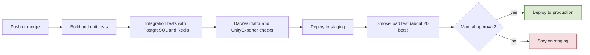
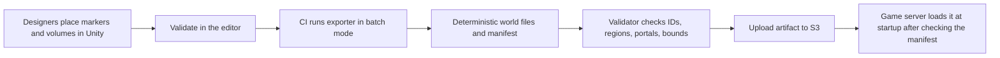

# 11. Technical Setup and Delivery

## 11.1 Unity version and project structure
- **Unity 6.3 LTS**, supported until December 2027 (Unity 6.0 LTS support ends in October 2026). The version is pinned in the project and for the whole team.
- **One repository**: `src/` (server projects), `unity/` (client project), `data/` (config tables, generated world data is not stored here), `tests/`, `infra/` (infrastructure as code), `docs/`.
- **Shared code lives once** in `src/Shared`, with an assembly definition so Unity references it as a **local package**; the server project compiles the same source files. There are no copied DLLs.
- Unity assembly definitions: `Game.Shared`, `Game.Net`, `Game.Gameplay`, `Game.UI`; no circular references.
- Team practices: Git LFS for binary assets, text serialization with visible `.meta` files, Unity's YAML merge tool, small additive scenes, Addressables for content.

## 11.2 Networking and serialization
- **LiteNetLib** (decided) behind `ITransport`. Channels: unreliable/sequenced for inputs, snapshots, projectile spawns; reliable-ordered for everything else.
- **Hot messages** (inputs, snapshots, projectile spawns): hand-written bit-packed writers using LiteNetLib's reader/writer; quantized positions and angles; no allocation per packet.
- **Reliable messages** (inventory, trade, chat, quests, login, guild): **MemoryPack** (source-generator based; needs Unity 2022.3.12f1 or higher, installed through NuGetForUnity; limited schema evolution by default). Rule: only append fields at the end and keep the protocol version check.
- **Database:** item instance properties and other flexible data are stored as **versioned JSON (PostgreSQL JSONB)**, which is readable and queryable.

## 11.3 Environments, CI, delivery
| Environment | Purpose | Setup |
|---|---|---|
| **Dev** | each developer, local | `docker-compose` with PostgreSQL, Redis, game server, auth API, admin panel; dev login instead of Steam; no cloud cost |
| **Staging** | integration tests, load tests, Steam beta branch | same infrastructure code as production, small, **stopped outside working hours** (scheduled start/stop) |
| **Production** | live game | smallest setup that works, scaled with population |

- **Infrastructure as code** (AWS CDK in C#, or Terraform) in `infra/`; the same definitions create staging and production with different sizes.
- **CI/CD (GitHub Actions):** build, unit tests, integration tests with real PostgreSQL and Redis in containers, `DataValidator`, UnityExporter in batch mode, deploy to staging on merge, **manual approval** for production. Secrets live in a parameter store, never in the repo.

**Flow: CI/CD pipeline**

## 11.4 AWS cost plan (keep it minimal)
- **Account:** new accounts (since July 15, 2025) get **$100 in credits at signup and up to $100 more** by completing onboarding activities, on a free plan that lasts up to 6 months or until credits run out; EC2 and RDS usage draws from that balance. Choose the **paid plan** to avoid the free plan closing the account, keep the credits (valid up to 12 months from signup), and set **AWS Budgets alerts from day one**. Verify current terms in the AWS console.
- **Early alpha:** one **ARM (Graviton, t4g)** EC2 instance running the game server, auth API, admin panel, a reverse proxy, and Redis in containers. PostgreSQL either on the same instance (daily dumps to S3) or on **RDS** (the free plan covers db.t3.micro and db.t4g.micro for PostgreSQL).
- **Later:** RDS with point-in-time recovery and a separate Redis once there are several processes and real players.
- **Savings:** Graviton instances, staging stopped when idle, load tests on short-lived **spot** instances, one region chosen by player location (price and latency). Outbound data transfer and public IPv4 addresses are billed: estimate them in the AWS pricing calculator. UDP game traffic per player is small.

## 11.5 Load-test plan
- **Tool:** a headless `BotClient` (console app using `Shared` and LiteNetLib) that logs in with dev tickets and runs scripted behaviors: move, fight, loot, sell, trade, craft, queue for the arena or a raid.
- **Scenarios:** (1) crowded city (interest management and visibility), (2) field combat with monsters, (3) siege-size instance (100-200 players), (4) transaction concurrency (double trade, double claim, disconnect mid-operation), (5) login storm with the queue, (6) 24-hour soak.
- **Ramp:** 10, 50, 100, 300, 500 bots; first locally, then on staging from a separate machine, with simulated latency and packet loss.
- **Proposed pass criteria:** tick time p99 below half the tick budget at 300 players; bandwidth per client under a set target; no GC pauses that break ticks; **zero duplicated items**; no database deadlocks. A small smoke test (about 20 bots, 5 minutes) runs in CI on every merge.

## 11.6 UnityExporter specification
- **Authoring in Unity:** marker components `ServerBlocker` (walls, buildings, big rocks), `RegionVolume` (with the region flags), `ServerMarker` (spawn points, resource nodes, portals, outposts, shop spots, guard posts), plus the terrain.
- **Outputs** (generated into `data/world/` or CI artifacts): chunked **heightmap**; simplified **blocker shapes** with a grid index; a **walkability grid** (A* pathfinding and line of sight run on it); the **per-cell region array**; a markers file; templates for instances (dungeons, arenas, jail, raids, sieges); a **manifest** (version, bounds, cell size, source hashes, tool version). Start with heightmap, blockers, and the walkability grid; add a navmesh export only if monsters need it.
- **Batch mode:** the exporter runs headless in CI with deterministic, sorted output. The validator checks marker IDs against the config tables, region conflicts, portal pairs, bounds, and size limits, and fails the build with a JSON report.
- **Storage and versioning:** scenes stay in Git; generated world data is a CI artifact stored in S3. The server verifies the manifest version at startup and loads chunks lazily.

**Flow: UnityExporter pipeline**

