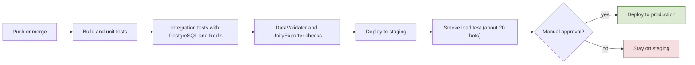
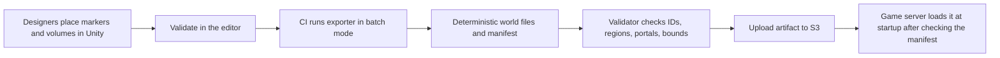

# 11. Technical Setup and Delivery

## 11.1 Unity version and project structure
- **Unity 6.3 LTS**, supported until December 2027 (Unity 6.0 LTS support ends in October 2026). The version is pinned in the project and for the whole team.
- **One repository**: `src/` (server projects), `unity/` (client project), `data/` (config tables, generated world data is not stored here), `tests/`, `infra/` (infrastructure as code), `docs/`.
- **Shared code lives once** in `src/Shared`, with an assembly definition so Unity references it as a **local package**; the server project compiles the same source files. There are no copied DLLs.
- Unity assembly definitions: `Game.Shared`, `Game.Net`, `Game.Gameplay`, `Game.UI`; no circular references.
- Team practices: Git LFS for binary assets, text serialization with visible `.meta` files, Unity's YAML merge tool, small additive scenes, Addressables for content.

## 11.2 Networking and serialization
- **LiteNetLib** (decided) behind `ITransport`. Channels: unreliable/sequenced for inputs, snapshots, projectile spawns; reliable-ordered for everything else. Unreliable messages are never fragmented: they stay within the peer's datagram limit (spec 1.7 "Size"), checked against `NetSecurity.maxUnreliableMessageBytes` at startup. Unity gets it through NuGetForUnity (`unity/Assets/packages.config`), pinned to the server's version; the restored DLL is committed (Git LFS) so batch mode and CI need no restore.
- **Hot messages** (inputs, snapshots, projectile spawns): hand-written bit-packed writers in `Shared` (our own bit reader/writer, because `Shared` cannot depend on LiteNetLib); quantized positions and angles; no allocation per packet.
- **Reliable messages** (inventory, trade, chat, quests, login, guild): **MemoryPack** (source-generator based; needs Unity 2022.3.12f1 or higher, installed through NuGetForUnity; limited schema evolution by default). Rule: only append fields at the end and keep the protocol version check. M1 (backlog G, user decision 2026-10-24): MemoryPack's generated code differs on .NET 7+, so `Shared` multi-targets **netstandard2.1** (C# 9, what Unity compiles) and **net10.0** (the server's build; C# 11 only for the generated code). In Unity, `MemoryPack.Core` with `System.Collections.Immutable` and `System.Runtime.CompilerServices.Unsafe` is committed under `unity/Assets/Packages` like LiteNetLib, and the generator DLL sits in `src/Shared/Analyzers` next to `Game.Shared.asmdef` (labelled `RoslynAnalyzer`), because Unity runs an analyzer on a package assembly only from that assembly's folder. Framing: one `ReliableMessageId` byte, then the MemoryPack body; decoders pick the type from the id and return false on anything malformed (`Shared/Protocol/LootMessages.cs`, `ReliableMessages`).
  - Hostile input (local chat, 2026-10-25): MemoryPack does not validate its string headers. Fuzzing a chat message found a UTF-8 string header that made it read past the buffer: an access violation that crashes the process and no `catch` can stop (the header `0x80000000` claims `int.MaxValue` bytes and overflows MemoryPack's bounds check; `MemoryPackCrashReproductionTests` shows it in a child process). Rule (R-2.5-07): **every MemoryPack payload is guarded before deserialization**, whatever it carries. `Shared/Protocol/ReliableMessageReader` is the only caller of MemoryPack's deserializer: for every id it checks the size cap (the caller's, then the protocol bound), walks the body with `MemoryPackGuard` against the id's `MemoryPackLayout` (exact member counts, bounded strict UTF-8 strings with the exact UTF-16 length, bools 0 or 1, bounded array counts the body can hold, the whole body consumed), and only then deserializes the one type registered for the id. The guard allocates nothing, never throws, and is linear in the message size. A message's layout lists its members in order and grows with them (append fields to both); a new id gets a spec there, a fuzz sample in `ReliableMessageSamples`, and, when clients send it, a `ReliableMessageCaps` row and an `InputRouter` route. Golden-byte tests on both sides (`ChatMessageGoldenTests`, Unity `ChatMessageTests`) prove the two builds of `Shared` write the same bytes.
- **Database:** item instance properties and other flexible data are stored as **versioned JSON (PostgreSQL JSONB)**, which is readable and queryable.

## 11.3 Environments, CI, delivery
| Environment | Purpose | Setup |
|---|---|---|
| **Dev** | each developer, local | `docker-compose` with PostgreSQL, Redis, game server, auth API, admin panel; dev login instead of Steam; no cloud cost |
| **Staging** | integration tests, load tests, Steam beta branch | same infrastructure code as production, small, **stopped outside working hours** (scheduled start/stop) |
| **Production** | live game | smallest setup that works, scaled with population |

- **Dev environment, implementation (M1, backlog A, WP18):** `docker compose up -d --wait` starts the whole stack with no other step.
  - **Services:** `postgres`, `redis`, the one-shot `dev-secrets` and `dbmigrate`, then `authapi` (dev login), `gameserver` and `adminpanel`. `docker compose up -d --wait postgres redis` starts only the databases, for servers started by hand, the QA smoke run and the bot load test, which start their own servers.
  - **Images:** `docker/Dockerfile` builds Debug images of the four .NET projects in one build stage, on `mcr.microsoft.com/dotnet/sdk:10.0` and `aspnet:10.0`. They are dev images only: the dev login exists only in Debug builds.
  - **Secrets:** `dev-secrets` creates the ticket secret and the access-token secret once in a volume. A git-ignored `.env` can set them, and override the ports and `MMORPG_DB_SUFFIX`; `.env.example` lists them.
  - **Own databases:** `MMORPG_DB_SUFFIX` points the stack at its own databases and Redis keys, as `DbMigrate --db-suffix` does.
  - **Shared files:** `docker/dev-entrypoint.sh` builds the connection strings and tees the server output to the `logs` volume. The admin panel reads that volume and the `telemetry` volume. `data/` is mounted read-only, so a table edit needs only a restart.
  - **Ports:** every published port is on the host's 127.0.0.1: 5432, 6379, Auth API 5080, game UDP 7777 (`ServerDirectory`), admin panel 5090. Plain HTTP inside the containers is the dev opt-in of spec 2.5 implementation.
  - **Health checks:** the Auth API answers TCP, the game server has bound its UDP port, and the panel answers `/healthz`.
  - **CI:** job `compose-stack` builds the images, starts the stack and runs `tools/compose/Test-ComposeStack.ps1`. That script does a BotClient dev login end to end, then an admin panel search, kick, audit, telemetry and log check. The Unity `LoginEndToEndTests` need a Unity license, so they run locally against the same stack.
- **Infrastructure as code** (AWS CDK in C#, or Terraform) in `infra/`; the same definitions create staging and production with different sizes.
- **CI/CD (GitHub Actions):** build, unit tests, integration tests with real PostgreSQL and Redis in containers, `DataValidator`, UnityExporter in batch mode, deploy to staging on merge, **manual approval** for production. Secrets live in a parameter store, never in the repo.

**Flow: CI/CD pipeline**

## 11.4 AWS cost plan (keep it minimal)
- **Account:** new accounts (since July 15, 2025) get **$100 in credits at signup and up to $100 more** by completing onboarding activities, on a free plan that lasts up to 6 months or until credits run out; EC2 and RDS usage draws from that balance. Choose the **paid plan** to avoid the free plan closing the account, keep the credits (valid up to 12 months from signup), and set **AWS Budgets alerts from day one**. Verify current terms in the AWS console.
- **Early alpha:** one **ARM (Graviton, t4g)** EC2 instance running the game server, auth API, admin panel, a reverse proxy, and Redis in containers. PostgreSQL either on the same instance (daily dumps to S3) or on **RDS** (the free plan covers db.t3.micro and db.t4g.micro for PostgreSQL).
- **Later:** RDS with point-in-time recovery and a separate Redis once there are several processes and real players.
- **Savings:** Graviton instances, staging stopped when idle, load tests on short-lived **spot** instances, one region chosen by player location (price and latency). Outbound data transfer and public IPv4 addresses are billed: estimate them in the AWS pricing calculator. UDP game traffic per player is small.

## 11.5 Load-test plan
- **Tool:** a headless `BotClient` (console app using `Shared` and LiteNetLib) that logs in with dev tickets and runs scripted behaviors: move, fight, loot, sell, trade, craft, queue for the arena or a raid.
- **Scenarios:** (1) crowded city (interest management and visibility), (2) field combat with monsters, (3) siege-size instance (100-200 players), (4) transaction concurrency (double trade, double claim, disconnect mid-operation), (5) login storm with the queue, (6) 24-hour soak.
- **Ramp:** 10, 50, 100, 300, 500 bots; first locally, then on staging from a separate machine, with simulated latency and packet loss.
- **Proposed pass criteria:** tick time p99 below half the tick budget at 300 players; bandwidth per client under a set target; no GC pauses that break ticks; **zero duplicated items**; no database deadlocks. A small smoke test (about 20 bots, 5 minutes) runs in CI on every merge.
- **Implementation (M1, backlog J, WP15):** `src/Tools/BotClient` (README there).
  - **The bot is the Unity client.** It runs the client's engine-free sources (connection, prediction, entity cores, Auth client), compiled for .NET in `src/Tools/ClientCore`, never server code. It logs in through the Auth API dev login, so the server sees only what a real client sends.
  - **Behaviour** (`BotBehaviour`, scenario 2 "field combat"): walk to a home spawn point, fight the nearest monster with the class kit (`ActionBindings`, the QA kill step's rule), dodge some attacks, loot its own kills, respawn and repeat. Random choices are seeded and the seed is logged.
    - **Back-off recovery (the QA kill step's rule, `QaFightPlan.Recovered`):** below `BotBehaviour.backOffBelowPercent` with no heal ready a bot backs off for at least `backOffMs`, then stays out until HP is back to `reengageAbovePercent` or a self-heal is usable, for `backOffRecoverMs` at most, and starts no new fight below `reengageAbovePercent` (same wait). Placeholders 40 % and 30 s, as QA's.
    - **Attack chain (R-3.1-10, WP-M2-12):** bots press through the 4-hit normal attack: during a hit with a next hit they press the attack once its chain window opens (`chainFromMs`) and again for the link tick (`chainLinkMs`; the window's first tick alone was lost when input catch-up put the server's machine behind the prediction), per hit, when the snapshot stamina pays the next hit, and start the normal attack only when the stamina pays the whole chain, as the QA kill step does (`BotBehaviour.pressAttackChain`, default on; the row `field-combat-hit1` keeps the M1 hit-1-only bot for comparisons).
  - **The M2 loop (WP-M2-12, M2 exit criterion of 12.2):** a behaviour with `loopSteps` plays steps in order, round after round: `fight` (until `loopKillsPerRound` own kills), `pickup` (its own drops), `sell`, `buy`, `run`, `learn`, `rankUp`, `equip`. Each step is one file in the BotClient behind a small contract (README "The M2 loop"): it reads the world only through the client's engine-free state, kept from the first message on (the bag, gold and progression sent at enter world included), acts by the tick's inputs or a reliable request, and reports counters. Steps whose protocol has not landed return "not available" (logged once per run) and the loop goes on; each M2 WP makes its step real in its own file (sell and buy WP-M2-4, run WP-M2-6, learn WP-M2-5, equip WP-M2-1, rankUp WP-M2-3). A step that has nothing to do (nothing to sell, no gold, no NPC, no better gear) is done with a counter, never "not available". The `learn` step (WP-M2-5) spends the points one `SkillTreeRequest` at a time: a plain node it can learn now, kit skills first (the keys the brain presses), else one more level of the lowest learned hotbar skill; no evolutions; bots build their loadout from their committed `SkillTreeState`, so a kit skill they have not learned is never pressed. A step running past `loopStepTimeoutMs` is ended and counted. The `run` step (WP-M2-6) reads the run from the kept `RunStatus`: without one it opens the nearest outpost's quest board and accepts `BotBehaviour.loopRunSteps` kill offers (the fewest kills first, at most `QuestCaps.maxStepsPerRun`), which the next rounds' fights complete (one kill counts for one step); with a completed run it claims it; with an active run it is done at once (counters `run.accepted`, `run.claimed`, `run.exp`, `run.active`).
    - **What the playing steps do** (QA M2 wave 0 F2): `sell` walks to the nearest outpost NPC (its map marker first, the NPC entity once in interest), opens the sale (`OutpostInteractRequest`, which counts the visit), quotes each sell-only stack and sells it for the quoted total, quoting again after `QuoteExpired` up to `loopSellQuoteRetries` times; `buy` tops `loopBuyItemId` (a potion) up to `loopBuyKeep` units at a vendor as far as the committed gold pays; `equip` moves a usable piece (its `minLevel` reached, a weapon type of the class line, R-3.5-07) from the bag to its lowest `EquipSlotDef` slot when that slot is empty or holds a lower rarity tier, out of combat and not during an action; `rankUp` asks at the outpost (R-3.6-04) once per rank and again only after a level-up since the last `RankRequirementsNotMet` (the requirements are server-side counters, not in `ProgressionState`), so bots leave rank F's band before the dead zone of R-3.6-03.
    - **Loop efficiency (WP-M2-12, behaviour `m2-exit`):**
      - **Rounds of 12 kills.** One kill per round (`m2-loop`) walked to an outpost after every kill. A round's walk share is W / (N × t + W), where W is the camp-to-outpost round trip (about 30 s for demons, 110 s for hellhounds at 4 m/s) and t the kill time (about 20 s, QA wave 1). With `loopKillsPerRound` 12 the walk is near 30 % in ring 4 and 15 % for imps, against 60 to 85 % with one kill per round. The Normal bag holds 12 kills' drops in 2 or 3 slots. `loopStepTimeoutMs` is 10 min, so the kills fit the fight step.
      - **The fight step loots each kill as it goes** (the brain's `All` mode: its own kill's drop first, R-4.3-02), so a long round leaves nothing behind once the killer's lock ends; the pickup step takes the last kill's drops.
      - **Planned back-off legs** (`BotBehaviour.planBackOffLegs`, `backOffLeashMarginCm` 400, `avoidAggroMarginCm` 300; the QA kill step's `QaNavigation.TryBackOffTarget`):
        - A leg ends within the threat's `leashRangeCm` less the margin of its spawn point (the nearest `SpawnPoints` marker of its type), on a clear straight walk, and outside every other spawn point's `aggroRangeCm` plus the margin.
        - Else it ends inside the leash only; else straight away, as before.
        - The summary counts the legs of each kind.
        - QA's no-entry (city) check is not ported.
        - A set rule keeps the margin below every home monster's leash.
      - `m2-loop` keeps one kill per round and straight legs: it is the quick every-step check, the CI loop test's row and the before baseline (`Run-M2Exit.ps1 -Behaviour m2-loop`).
    - **`m2-exit`** (`tools/load/Run-M2Exit.ps1`): 5 new characters play the loop until all reach `BotScenario.targetLevel` 30 (the run then ends) or the time limit (4 h, a placeholder from the 3.6 placeholder curve; revisit with the measured kill rate. User decision 2026-10-27 after the wave 0 cut, 1.2 kills per bot-minute on the M1 field: the criterion stays and is validated with the field zone's level 1 to 30 monsters, WP-M2-7). The report gives each bot's level every `levelSampleMs`, when each reached 30, and the tick p99 as for `m1-exit`; the script also prints each bot's class, level, kills, deaths and loop rounds, and the back-off legs (WP-M2-12). The own level and exp are read from the client's own state, the reliable `ProgressionState` (protocol 18, WP-M2-3; `OwnProgressReader`).
  - **Simulated latency and loss** (`BotLinkProfile`): a UDP relay delays and drops whole datagrams below LiteNetLib, so LiteNetLib's ping, which caps the view lag a client may claim (R-3.1-03), sees the simulated link. Latency figures in this spec are **round trip** (user decision 2026-10-26): 100 ms is 50 ms each way.
    - The relay gives each client its own loopback source address. The per-IP connect limit (R-2.5-03) stays as configured.
    - The Unity editor uses it with `BotClient relay`.
  - **Load test** (`BotScenario`): `BotClient loadtest` starts the GameServer and the Auth API with generated secrets, plays the scenario, and reads the tick p99 from the per-tick `TickTiming` telemetry (spec 7.2). The tick budget is one tick period (20 Hz: 50 ms).
    - Pass criteria: every bot entered; at least the scenario's percent of bots reached combat (the server ran one of their attacks with a living monster in reach; CI 100%, `m1-exit` 90% because 50 bots share the 5 monsters); no disconnects; tick p99 within the scenario's percent of the period; no crash, security event, dropped telemetry, malformed input, unreliable message refused as too large (`SendCounters`, spec 7.2) or server error line.
    - CI (`bot-smoke` job, parallel to build and test): `ci-smoke`, 20 bots for 2 minutes at `rtt100` with p99 ≤ 50%, on every push and pull request; `ci-merge`, the 5 minutes, on pushes to main (user decision 2026-10-26).
    - Locally: `tools/load/Run-BotLoad.ps1` runs `m1-exit`: 50 bots, 5 minutes, p99 within 100% (spec 12.4); `-Link rtt100|rtt200` for the latency runs. `-Scenario m2-zone` (WP-M2-7): 50 bots spread over the 28 camps of the field zone (behaviour `field-zone`), p99 within 100%, at least 50% in combat (bots walk up to 400 m and new characters die in the far rings).
    - **Homes by level** (`BotBehaviour.homesByLevel`, WP-M2-7): a bot's home is one of its homes whose monster's recommended range holds its own level (else those recommended for the highest levels below it), spread by bot index and chosen again at each level-up, so the `m2-exit` bots (behaviour `m2-loop`: the M1 points and one point per zone camp) move from band to band. A set rule checks that the homes cover every level from 1 to their highest recommended level. `tools/load/Run-M2Exit.ps1` runs `m2-exit`; the loop itself runs in CI as a scenario test in `dotnet test`, not in `bot-smoke`.
  - **Limits:**
    - Each bot owns a LiteNetLib manager, which is fine for tens of bots. TODO(J): a shared manager for the 100-500 ramp; `NetSecurity.maxPeers` is 100.
    - TODO(7.3): behavioural bot scoring is an offline worker (spec 7.3 layer 3), not part of the BotClient.

## 11.6 UnityExporter specification
- **Authoring in Unity:** marker components `ServerBlocker` (walls, buildings, big rocks), `RegionVolume` (with the region flags), `ServerMarker` (spawn points, resource nodes, portals, outposts, shop spots, guard posts), plus the terrain.
- **Outputs** (generated into `data/world/` or CI artifacts): chunked **heightmap**; simplified **blocker shapes** with a grid index; a **walkability grid** (A* pathfinding and line of sight run on it); the **per-cell region array**; a markers file; templates for instances (dungeons, arenas, jail, raids, sieges); a **manifest** (version, bounds, cell size, source hashes, tool version). Start with heightmap, blockers, and the walkability grid; add a navmesh export only if monsters need it.
- **Batch mode:** the exporter runs headless in CI with deterministic, sorted output. The validator checks marker IDs against the config tables, region conflicts, portal pairs, bounds, and size limits, and fails the build with a JSON report.
- **Storage and versioning:** scenes stay in Git; generated world data is a CI artifact stored in S3. The server verifies the manifest version at startup and loads chunks lazily.
- **M1 (v0):** authoring components and the editor-only exporter live in `unity/Assets/Game/WorldAuthoring` (asmdefs `Game.WorldAuthoring`, `Game.WorldAuthoring.Editor`); `WorldExportSettings` in the scene holds the cell size and agent radius (recorded in the manifest). Outputs: `manifest.json`, `grid.bin` (walkability, region index and height per cell, one chunk), `regions.json`, `markers.json`, `blockers.json`; file formats in `Shared/World/WorldFiles`. M1 blockers and region volumes are boxes turned only in 90-degree steps around the vertical axis. The small sample world `data/world/m1` (scene `Assets/Scenes/M1Sample.unity`) is committed until worlds move to CI artifacts; an EditMode test fails when it is stale. Batch export: `Unity.exe -batchmode -quit -projectPath unity -executeMethod Game.WorldAuthoring.Editor.WorldExporterBatch.Export` (report in `unity/Logs/world-export-report.json`). The exporter validates what the scene alone can tell (region overlaps, walkable cells without a region, marker ids and positions, shapes, size limits); `DataValidator` (`--world`, default `data/world/m1`) and the server check the files against the config tables (manifest version, hashes, `RegionDef` ids, the `ServerLoop.PlayerSpawnMarkerId` player spawn, and a `monsterSpawn` marker for every `SpawnPoints` row: `WorldLoader.CheckConfigMarkers`). Portals, instance templates and navmesh are not exported yet.
- **NPC markers (M2, WP-M2-4; the contract for the world authors, WP-M2-7):** a `ServerMarker` of kind `npc` (`MarkerKind.Npc` = 3) places one NPC; its `defId` names the `NpcDef` row (kind outpost or vendor, interactions, model, name, interaction range) and is required for npc markers and refused on the other kinds (exporter codes `MissingMarkerDef`, `UnexpectedMarkerDef`; `markers.json` writes `defId` only for npc markers, manifest format version 2). The marker's position and facing are the NPC's; it must be walkable like any marker; keep it outside the reach of monster leashes. `DataValidator --world` and the server check every npc marker's `defId` against `NpcDef` (`WorldLoader.CheckNpcMarkers`). A vendor's stock is `NpcVendorStock` rows of its `NpcDef` id; several markers may name one `NpcDef` (two outposts of the field zone can share `m1.outpost`'s row or have their own). The M1 sample world has `m1.npc.outpost` (`m1.outpost`, by the city gate) and `m1.npc.vendor` (`m1.vendor`, by the shop), built by `SampleWorldBuilder`. The field zone's mid-zone pair (`field1.npc.outpost.mid`, `field1.npc.vendor.mid`) names the same two rows (WP-M2-7), so a quest board added to `m1.outpost` serves both outposts. `DataValidator --world` and the server refuse an npc marker within `MonsterDef.leashRangeCm` of a spawn point of that monster (`NpcInLeash`).
- **Exporter v1 (M2, WP-M2-7, the first field zone; tool `unity-exporter 0.2.0`, manifest format version 3):** several regions of many volumes each (rasterized per volume's cell range); `grid.bin` **v2, run-length** (`length u32, flags u8, region u8, height i16` per run; `Shared/World/WorldGridFormat`; v1 still read), because the zone's 704,000 cells would be 2.8 MB raw and are about 80 KB as runs; markers of kind `resourceNode` (`MarkerKind.ResourceNode` = 4, no `defId`: **data only**, the server loads and ignores them; gathering in M3 maps them to node types with a table, as `SpawnPoints` does for monsters); the report counts walkable cells per region and markers per kind. Every `monsterSpawn` marker needs a `SpawnPoints` row (`UnusedSpawn`). The greybox is built by `FieldZoneGreybox` (called by `SampleWorldBuilder`; materials in `Assets/Scenes/Greybox`); once art lands the scene is edited by hand and the builder retires. **The client shows the authored scene:** the play scene `PredictionDev.unity` loads `M1Sample.unity` additively (`Streaming/WorldSceneLoader`, scene in the build settings; it brings the light), and the dev ground plane and reference blocks are gone; the F3 view still draws the server's walls and region borders over it. Art replaces the greybox objects in that scene; colliders of art must not become ground by accident (TODO(art): a ground layer or tag for the exporter's ray, decided with the art pass).

**Flow: UnityExporter pipeline**

## 11.7 Dev tools (backlog J and A, WP17)
The tools the tuning loop (backlog K) runs with: hitbox gizmos, an action timeline, the server's tick timing, and hot-reloaded tuning tables. How to use them: `unity/Assets/Game/Dev/README.md`.
- **Dev only.**
  - **Server:** the MSBuild property `DevTools` (`src/GameServer/DevTools.props`, true in Debug only) defines `DEV_TOOLS`. Only such a build starts the table watcher and the strike trace, and only with `MMORPG_DEV_TOOLS=1`. A build without it refuses to start with the variable on. The code in `GameServer/Dev` compiles in every configuration so CI runs its tests; it is never switched on outside a DevTools build.
  - **Client:** the views are compiled with the dev client (editor and `MMORPG_DEV_LOGIN` builds). They sit on their own `Dev Tools` object in the dev scene, made by `DevSceneBuilder`, never under the HUD (spec 9), and are hidden at start.
  - **Settings:** the `DevTools` table holds the reload debounce, strike trace, telemetry poll, tick window, timeline length, gizmo hold time and gizmo colors. Its keys are `Hotkeys` rows, checked by its set rule: `devWorldGeometry` F3, `devHitboxes` F4, `devTimeline` F5, `devTickTiming` F6.
- **Channel: the local server's telemetry.** The dev client follows the newest JSON lines file of the server on the same machine (`MMORPG_TELEMETRY_DIR`, else `<repo>/telemetry`) on a background thread. No protocol message carries dev data. It reads:
  - `TickTiming` and `TickStats`: the per-tick timing of spec 7.2, the same source as the load test;
  - `StrikePlaced` and `StrikeTested`: the strike trace;
  - `ConfigReload`: the reload result.
- **Hitbox gizmos** (`HitboxGizmoView`, F4): ground lines from the same `HitShapeDef` rows and caster frame the server tests. `Shared/Simulation/Combat/HitShapeOutline` uses the `FixedTrig` frame and the cone rounding of `HitShape.Overlaps`; a test proves that a point inside the drawn outline is a point `Overlaps` hits, within the chord tolerance.
  - Predicted color: the local player's strikes on their fire tick, and remote strikes at the render tick (interpolated position, 10-bit facing).
  - Server color: the strike trace, which is exact (Q24.8 origin, locked facing, every target circle as tested, rewound when lag-compensated). Touched circles use the hit color, judged on the client with `HitShape.Overlaps`.
  - Also drawn: ground areas, projectiles (path and hit circle), and every body circle.
- **Action timeline** (`ActionTimelineView`, F5): bars for startup, channel, active and recovery in ticks, with effect fire ticks and an age cursor, for the predicted action and the action the server acknowledged in its last snapshot of the player. It also shows strips of the last `timelineTicks` samples of each row, marking the samples that reconciliation found different, and a row for the target: the entity last hit or hit by, else the nearest monster, at the render tick.
- **Tick timing** (`TickTimingView`, F6): over `tickWindowMs`, p50, p99 and worst tick time (the nearest-rank percentile of `BotClient report`), ticks over the tick budget, worst start lateness, overruns, and the last reload on both sides. Offline: `BotClient report --telemetry <dir>`.
- **Table hot reload** (backlog A). `TableWatcher` waits for `hotReloadDebounceMs` of quiet after a change to `data/tables` (or `MMORPG_DATA_DIR`), then `TableReloader` works on that thread, never the tick thread.
  - **Checks:** every file is read and runs `ConfigChecks`, the same checks as `DataValidator` and the server start: loader and `TableValidator`, the coverage rules, `CombatRules.TryBuild` (with `CombatConfig.TryBuild`), and the world's markers.
  - **Diff and reload classes:** the rows are compared with the running tables, and each changed table's class in `Shared/Data/TableReloadPolicy` decides:
    - **Hot:** action, effect, shape, projectile, binding, damage, rank, element, regen, class, monster, monster AI, status, status modifier and build-up tables.
    - **Restart:** pools, tick rate, network, sessions, stats, spawn points, items and loot, ground area and projectile settings, chat, `DevTools`.
    - **NotServer:** client, Auth API and tool tables.
  - **All or nothing:** any error, a Restart change, or a FixedRows table (`ActionDef`, `StatusEffectDef`, `BuildUpDef`, `MonsterDef`, `ClassDef`) whose row ids, order or netIds changed rejects the whole reload. The world keeps its tables, the console lists every reason, and a `ConfigReload` record is written.
  - **Swap:** otherwise the action catalog and the combat, projectile and monster AI rules are built on that thread and posted to the world's one-slot `RetuneMailbox`. `GameWorld` takes the plan at the top of its next tick, before phase 1, so no tick mixes rules; without a plan this costs one volatile read. It swaps by reference, with no I/O and no parsing, and the tick is logged in `ConfigReload`.
- **Live state at the swap** (`GameWorld.ApplyRetune`, decided in WP17):
  - **Running actions** of players and monsters end like a cancel to Idle (`ActionMachine.Retune`): unfired effects are dropped and the buffered press is cleared. One action's phases and fire ticks come from one timing, and a mix would match neither table. Flinch, stagger and death run on.
  - **Cooldowns** keep counting down, clamped to the new cooldown. The charge pools are unchanged (their sizes are Restart).
  - **Statuses** keep their remaining time, stacks and next periodic tick. They move to their new row by id: stat modifiers are re-applied, and periodic amounts come from the new row.
  - **Already in the world:** projectiles in flight, ground areas, pending strikes and pending hits finish with the rows they were made with.
  - **`ClassDef` and `MonsterDef` base stats** (HP, poise, radius, speed) apply to combatants built after the swap: a login, a monster spawn. Monsters move to their new row at once, so AI ranges and attacks apply from the next think, and they drop their requested attack.
- **Client in step with the server:**
  - The server's `ConfigReload` carries a 64-bit FNV-1a hash of the Hot table files it read (`Shared/Data/TableHash`).
  - The dev client (`DevTableReload`, `ClientTableReload`) applies only an accepted reload. It reads the same files off the main thread, and only when they hash the same does it swap them in between frames (`PredictionDevClient.Retune`): prediction through the same `ActionMachine.Retune`, remote action timings, projectile and ground-area rows, and the HUD's telegraph shapes (`WorldClientFeed.ConfigReloaded`).
  - Files changed again since the server read them wait for the server's next reload.
  - The server swapped at its own tick, so the first snapshots after it may correct the prediction once.
- **Limits:**
  - The server must run on the same machine as the dev client.
  - Remote shapes drawn from snapshots use the interpolated position and the 10-bit facing; only the strike trace is exact.
  - Layout, theme and text tables reload on neither side.
  - TODO(J): a dev-only network channel for a remote dev server.
