# 12. Delivery Plan and Milestones

## 12.1 Principles
- **Depth before breadth:** finish one class family and one zone before adding more.
- **The world grows in rings:** city, then one field zone, then further zones; each ring needs monsters, resource nodes, and regions.
- **Systems that need population come last** (arena, raids, guild wars), so they are not empty while combat is tuned.
- **Every milestone is runnable on staging** by the whole team and ends with a short playtest and a polish pass.
- **Placeholders first:** assets (models, animations, VFX, audio) start as placeholders and are replaced later without changing the systems. Economy and law numbers also start as placeholders (section 12.5).
- Team agreements about ownership and revenue are written down before the closed alpha (section 12.6).

## 12.2 Milestone overview
| Milestone | Scope | Exit criteria |
|---|---|---|
| **M1: first playable (combat slice)** | small city, the 4 root classes at their starting tier, a few monsters, one boss, login screens, minimal HUD | combat feels right at 100 and 200 ms simulated latency; real combat numbers defined for one class; bot smoke test passes; CI and dev environment work. **Closed 2026-10-27** (user decision): everything met except the real combat numbers for one class and the 3-4 player playtests at 100 and 200 ms, both carried into M2 (a K pass for the Warrior at the start of M2, and the playtest protocol of 12.4 K once the second-client WP lands); the group boss fight is checked in the first team playtest |
| **M2: core loop** | selling drops at outposts (the only gold source), gear and stats, exp and rank, outpost quests and runs, tutorial for levels 1-10, the first field zone, basic skill tree, the Bystial book (section 14.2) | a new character can play from level 1 to about 30 through the loop; economy simulator runs with placeholder values |
| **M3: jobs and crafting** | gathering, the forge engine, two jobs, enchanting, gems | a crafted item can be made from gathered materials and used |
| **M4: player economy** | party, trade, auction, shops, loot bags and party loot, contracts | no duplication in concurrency tests; the economy dashboard shows faucet and sink totals |
| **M5: law and PK** | honor, flag, stolen items, black market, arrest, jail, lawless city, robe | scripted PK scenarios work end to end |
| **M6: class depth** | class tiers at 30, 50, and 80; one root fully (all 8 finals) first, then the others; skill evolution; skill arts from the second tier (R-3.5-09); gauge at level 100; the Constellar system and Star Gems (section 14.1) | one root playable to the final tier |
| **M7: group content** | arena and ranked seasons, raids, party finder and matchmaking | 6-player raid and 3v3 arena complete with real players |
| **M8: territory** | guilds, taxes, sieges, reputation, guard hire | a siege with 100+ bots stays within the tick budget |
| **M9: closed alpha, then beta** | real players on production-like servers, telemetry-driven tuning | gates in section 12.6 |

## 12.3 Unlock schedule
Tutorial from level 1 to 10, then the open world. Systems are explained as the player levels up, and everything is unlocked and explained by about level 30.

| Level | Introduced |
|---|---|
| 1-4 | movement, attack, dodge, parry, stamina, hotbar |
| 5-9 | inventory and bags, drops, selling at the outpost, outpost quests |
| 10 | leave the tutorial, open world (the minimap and the exp bar show from level 1: user decision 2026-10-28 after play) |
| 12-18 | jobs and gathering, crafting, party and party finder (M3, user decision 2026-10-30: the main and the secondary job are picked at the city's job master from level 12, each pick separate and permanent; the level-12 "jobs are open" prompt is not shown, and closes, once the character holds a job: user decision 2026-10-30 after the wave 0 QA, built by WP-M3-11 as a data-driven hide condition on the `UnlockSchedule` row) |
| 20-25 | trade, auction, shops, runs, rank and achievements, the exp "dead zone" |
| 28-30 | honor, the stolen mark and loot bags, PvP and the red-name flag, **first class change** (also unlocks PvP) |
| 50 | second class change |
| 80 | third class change |
| 50-80 | arena, raids, guilds and territories as content becomes available |
| 100 | **class gauge unlocks** (gauges stay on placeholders until then) |

**Tutorial rules (M2, WP-M2-10; user decision 2026-10-28; every number a placeholder):**
- **R-12.3-01 The tutorial gate.** The tutorial is the city, the M1 combat area and ring 1 of the first field zone. Below level 10 a player cannot enter rings 2 to 4: `RegionDef.minLevel` 10 on `field1.ring2` to `field1.ring4` (R-2.3-06), so **every** pass of the ring 1 ridge is the gate (the greybox has seven: x 30-40 and 80-90 on its north and south edges, z -6..6 with the road, 40-50 and -50..-40 on its east edge); from level 10 they are open, and leaving rings 2 to 4 is never refused. The server enforces it in the shared movement code; pushing into the gate shows the client-detected reason `RegionLevelTooLow` ("Reach level 10 to leave the tutorial.", the level from `RegionDef`) in the tutorial prompt for `TutorialSettings.gatePromptHoldMs` after the push. The greybox draws a gate (posts and a bar, no collider, `LevelGateVisual`) at each pass while the own level is below the region's. The city gate stays open.
- **R-12.3-02 The unlock schedule is data.** `UnlockSchedule` rows: `id`, `level`, `trigger` (`levelReached`, `lootInReach` (the first drop in pickup reach), `outpostInReach`, `vendorInReach`, `itemSold` (a committed sale)), an optional `prompt` (`UiStrings` `tutorial.prompt.*`; `{hotkey.<id>}` is a `Hotkeys` key name, `{hotkey.pickup}` the pickup key) and optional `hudElements` (`HudLayout` ids hidden below the row's level, spec 9.12; only with `levelReached`). A prompt is due when the level reaches its row and its trigger happens at or after that. Validator: prompts exist and belong to one row, HUD elements exist and belong to one row, levels within `ProgressionSettings.maxLevel`. M2 rows: movement and attack, the hotbar (shown from 1) and drops at 1; dodge and stamina at 2; parry at 3; skills and the skill tree key at 4; the inventory key, selling, buying and the quest board at 5; "you can leave the tutorial" at 10. M3 (WP-M3-1): "jobs are open" at 12 (`jobs`, `tutorial.prompt.jobs`; the pick at the job master, `JobDef.minLevel`). **No HUD element waits for a level in M2** (user decision 2026-10-28 after play): the exp bar (`exp_bar`, `exp_note`, `exp_label`) and the minimap show from level 1; the hotbar is listed at 1. Menus are not locked; no scripted quest chain (R-5.5-01).
- **R-12.3-03 One prompt at a time, once per character.** The `tutorial_prompt` element (spec 9.3) shows the due prompts in schedule order (level, then row order), each until dismissed (the `Hotkeys` row `dismissPrompt`, Backspace placeholder, or its close button) or for `TutorialSettings.promptShowMs`. A prompt is remembered as seen when it is first shown, **on the client** (user-approved WP-M2-10 plan): one file per character under the player's `persistentDataPath/tutorial/` (realm and character id; a dev ticket uses its account), so a new machine shows the prompts again; prompts are presentation only, so no server state, migration or protocol change.

Class advancement levels are **30, 50, and 80**, done from the class and skill-tree menu. Rank ranges are separate (F 0-25 up to SS 126-130).

**M2 decisions (user, 2026-10-28; built by WP-M2-10 and WP-M2-10b):**
- **The tutorial area is the city, the M1 combat area and ring 1 of the first field zone; there is no separate area.**
  "Leave the tutorial at 10" is the ridge pass from ring 1 to ring 2 (x 110 m): below level 10 a gate there refuses with
  a reason code and a prompt ("reach level 10 to leave the tutorial"), from level 10 it is open. Server side only a level
  check on the gate (a gate marker or a region flag, the level in a settings table); the city gate stays open.
- **The schedule is data:** an `UnlockSchedule` table maps a level to the prompts shown (`UiStrings`, contextual like the
  pickup prompt) and the HUD elements that appear (the hotbar from 1; inventory, selling and board prompts at 5; the exp
  bar and the minimap at 10; **changed 2026-10-28 after play: the exp bar and the minimap show from level 1**, the gate
  and the prompts stay). No scripted quest chain (R-5.5-01: the board stays server-generated).
- **Pacing** on the placeholder curve: level 10 at about 100 kills, 25 to 45 minutes solo; numbers in the balance phase.
- **Minimap v0** ships with its marker set of 9.3 as its own package (WP-M2-10b).

## 12.4 Milestone 1 backlog (no assignment to people)
Scope: a small safe city (hub) with a small combat area next to it holding two monster types and one boss; the 4 root classes with a fixed starting kit each (no skill tree yet); placeholder assets.

**A. Repository, tooling, CI**
- Repository layout and Unity 6.3 LTS project; `Shared` local package referenced by Unity and the server.
- `docker-compose` dev environment (PostgreSQL, Redis, game server, auth, admin); dev login instead of Steam. Status (WP18): done, `docker compose up -d --wait` starts everything (spec 11.3 "Dev environment, implementation").
- Config table loader and `DataValidator` (schema, ranges, references); hot reload in dev. Status: hot reload done (WP17, spec 11.7: `MMORPG_DEV_TOOLS=1` in a Debug build; the same checks as `DataValidator`, all or nothing, swapped at a tick boundary, the dev client follows).
- CI: build, unit tests, integration tests with containers; staging deploy script.

**B. Networking and session**
- `ITransport` over LiteNetLib; protocol versioning; reliable and unreliable channels.
- Input frame format, snapshot writer (bit-packed, quantized), spawn/despawn events.
- `SessionManager` (ticket, ownership lock, one session per account), basic linger on disconnect.
- Login screens: title, server selection (one dev server), character selection; character creation as a stub.

**C. World**
- `World` abstraction, `SpatialGrid`, `InterestManager` with the camera-based interest area.
- Region flags (safe city, combat area); `UnityExporter` v0: heightmap, blockers, walkability grid, regions, markers, manifest.
- Server collision loading; movement validation (speed check).

**D. Combat core**
- Shared `MovementSim` and client prediction with reconciliation.
- `ActionMachine` and `ActionDef` tables (startup, active, recovery, channel, cancel rules, input buffer); locked facing.
- Hit shapes and `HitResolver`; projectiles with `maxHits` and swept collision.
- Stamina; dodge as a movement action with its own charge pool; parry with its own charge pool, colored attacks, uncolored damage reduction; poise and stagger.
- `StatBlock` with modifier sources; `DamageCalc` v1 (defense mitigation, crit); resource meters (HP, MP, stamina).
- Minimal status effect support for testing (one buff, one debuff) so the HUD row can be exercised; the **build-up framework with Burn only**. Done: ground areas (spec 3.1, D6 ground area bullet) and the Burn build-up (spec 3.8, M1 implementation; WP11).

**E. Classes (4 root classes)**
- One starting kit per root (Warrior, Archer, Mage, Assist): 5 placeholder skills each from the root skill tree, on Q E R F and 1, plus the class's own normal attack, with hotbar binding (one fixed layout per class); the Archer uses projectiles (bow), the Assist a staff. Skills cost stamina and a small MP cost. Kits and the data they need: `docs/design/skills-m1-proposal.md`.
- Class gauge as placeholder only: a locked, greyed frame with a tooltip; no `ClassGauge` system yet.

**F. Monsters and boss**
- Generic monster AI: aggro with the visibility rule, chase, attack by action table, leash.
- Two monster types with different attack patterns; one boss with telegraphed attacks (including colored ones) and poise.
- Fixed spawn points with a basic `SpawnController`.

**G. Items and inventory (minimal)**
- `InventoryService` v1 with idempotency keys and the audit log; Normal bag only.
- Loot tables and ground drops; pickup; persistence of inventory.
- Client part (WP16): the inventory window with bag moves (spec 9.13).

**H. Persistence and telemetry**
- PostgreSQL schema v1 and migrations; character save with optimistic concurrency; periodic and on-event saves.
- Event bus; telemetry pipeline v1 (async queue, versioned schema); combat and session events recorded.

**I. HUD and client**
- HUD v1 from section 9: resource panel, hotbar with the central gauge, parry and dodge squares, buff row, boss bar, cast bar, name plates, damage numbers, ground telegraphs with color and shape, local chat. Status: done (WP13, and the local chat WP: server relay, rate limit, interest delivery, `DisplayIdentity` names; protocol 12; spec 9.12).
- Unity UI structure with view models; reason-code texts.

**J. Tools**
- `BotClient` v1 (login, move, attack); latency and packet-loss simulation; smoke load test (about 20 bots) in CI. Status (WP15): done, see spec 11.5 "Implementation"; latency figures are round trip; the 50-bot tick p99 run is `tools/load/Run-BotLoad.ps1`.
- Combat debugging tools: hitbox gizmos, action timeline view, per-tick timing log, hot-reloaded tuning tables. Status: done. The per-tick timing log is the `TickTiming` telemetry kind (WP15, spec 7.2); the dev scene's hitbox gizmos (F4), action timeline (F5), tick timing panel (F6) and the table hot reload are WP17 (spec 11.7, `unity/Assets/Game/Dev/README.md`).
- Admin panel v0: search characters, kick, view logs. Status (WP18): done, `src/AdminPanel` (spec 7.4 "Implementation"); dev-only sign-in, production admin auth is Open.

**K. Tuning loop (the point of M1)**
- Define **real combat numbers for one class** (action timings, stamina costs, parry windows, damage constants), then the other three.
- Playtest protocol: sessions with 3-4 players at 100 and 200 ms; record notes and telemetry; adjust tables; repeat.

**Suggested order:** (1) A, H, and the base of B; (2) C and movement from D; (3) the rest of D; (4) E and F; (5) G, I, J; (6) K continuously, with a formal tuning phase at the end.

**Flow: Milestone 1 sequence**

```mermaid
flowchart LR
    n0["Repo, CI, dev environment, persistence"]
    n1["Networking and session"]
    n2["World, grid, exporter v0, movement"]
    n3["Combat core"]
    n4["Classes and monsters and boss"]
    n5["Inventory, HUD, tools"]
    n6["Tuning and playtests"]
    n7["M1 exit criteria met"]
    n0 --> n1
    n1 --> n2
    n2 --> n3
    n3 --> n4
    n4 --> n5
    n5 --> n6
    n6 --> n7
    classDef neg fill:#f6dde0,stroke:#a6414b;
    classDef pos fill:#ddebd5,stroke:#4c7a34;
    class n7 pos;
```

**M1 exit criteria**
- The 4 root classes are playable in the city and the combat area with placeholder art; the boss is beatable by 3-4 players.
- Combat feel is acceptable at 100 and 200 ms of simulated latency; tick time p99 stays within the budget with 50 bots.
- Basic inventory and drops pass concurrency tests with no duplication; telemetry events are recorded; CI is green; the dev environment starts with one command.
- Real combat numbers exist for one class and are in the config tables.

## 12.5 Economy and law numbers
- **Now:** placeholder values; build the economy simulator in M2 to catch structural flaws only (a sink that can never balance a faucet, a loop with unbounded growth).
- **Define target metrics:** time to afford key items, weekly growth of gold in circulation, price stability, time to reach each rank.
- **After M2-M4:** tune faucet and sink values from playtests and telemetry. **After M5:** tune honor weights, jail time, and Bandit/Guard balance with scripted scenarios and real players. **Final tuning** in the closed alpha.
- **Safety nets:** every value in config, floors and caps on every multiplier, live kill-switches for economy values, and the audit ledger to repair accounts.
- **M2 instruments (WP-M2-12, as built):**
  - **Economy simulator** (`src/Tools/EconomySimulator`, README there): a seeded Monte Carlo over the M2 tables, one run per `EconomySimScenario` row (players, hours, Monte Carlo runs, seed, kill rate, hunted types, kills per outpost visit, vendor goods bought and used per hour, sample length, settle window and tolerance; tools only, all placeholders).
    - **Model** (one-second steps): spawn pools per monster type and region, from `SpawnPoints` and the world's markers. A kill needs a living monster, and it respawns after the `SpawnController` delay at the spawn percent of that moment. Each kill rolls its loot (`LootRoll`). At each visit a player sells every sell-only stack with `PriceQuote` (per unit, sequentially) and buys vendor goods from `NpcVendorStock` with its gold, which the vendor destroys. The demand loop is `DemandService.Step` with the shared `DemandMath`; a test checks the two step for step.
    - **Output:** gold created (the faucet), gold destroyed (the sink) and gold held per simulated hour, with the mean, min and max over the runs. Every spawn delay, reward and price multiplier is printed per sample.
    - **Checks** (structural flaws only):
      1. The demand loop settles: every multiplier moves by at most the tolerance over the window.
      2. No decayed counter keeps growing.
      3. The gold created per hour settles.
    - **Sink cover** is printed as a warning and never fails in M2: the vendors are the only sink until fees (M4) and consumable use (M3).
    - **Consumable use (M3, WP-M3-3):** the vendor goods are used up: `usedPerPlayerHour` per good, capped by what its `ConsumableDef` allows in an hour (`ConsumableRules.MaxUsesPerHour`: the toxicity or satiety decay over its cost, and its cooldown; a good without a row is never used) and by what the player holds. The sink cover line adds the goods used per player-hour and what they had cost ("vendor goods used 5.47 per player-hour (106 gold)" for `m2-15` with the placeholder rows); it stays a warning, since gold is destroyed only by the vendors until fees (M4).
    - `--check` runs every row and fails on checks 1-3. CI runs it after the table validation (`TestResults/economy-simulation.json`).
    - First result with the placeholder tables: no structural flaw at 5, 15 and 300 players, nor with 15 players on the demons alone. Vendor sinks destroy about 5 to 15 % of the faucet when players spread over the zone, and about 44 % when everyone hunts the demons (whose horn is the cheapest item).
  - **Economy report** (the dashboard query, R-4.2-07): `BotClient report --telemetry <dir> --kind economy [--data <tables>] [--world <dir>] [--json <file>]` reads a server's telemetry and prints:
    - faucet and sink totals per UTC hour by reason;
    - gold per sold item and per monster type (through the loot tables);
    - gold destroyed by reason and the vendor goods bought;
    - each item's sell multiplier (first, min, max, newest);
    - the spawn delay and reward multipliers per monster type and region;
    - exp per source (kills by monster type, run claims) and per hour;
    - the gold held online at the last snapshot.

    `--json` writes the same for a later dashboard page. A test reads a recorded sample, QA wave 1's 20-minute exit run.
- **M3 instruments (WP-M3-12 skeleton; the M3 exit run is in 11.5):**
  - **Economy report, M3 section** (`report --kind economy`, always printed, zero until the WPs write the records):
    - items created and destroyed per `InventoryReason` (the existing `ItemCreated`/`ItemDestroyed`), with the M3 reasons
      always listed: `jobStart` (starter molds), `harvest`, `refine`, `craft`, `convert`, `convertFailed` (a sink),
      `enchant` (the stones, a sink), `gemSocket`, `gemRemove`, `itemUsed` (consumable use, a sink);
    - job XP per activity (gather, refine, craft, convert, enchant, socket) and per job, from a new `JobXpGained` kind
      (`amount`, `job`, `activity`; WP-M3-1);
    - harvests and their units per node type, from a new `Harvested` kind (`nodeDef`, `item`, `count`, `seed`, region
      `r`; WP-M3-5).
  - The kind and field names are fixed in the BotClient README ("M3 telemetry"); a WP that appends an `InventoryReason`
    appends its name to the report in the same change (a test compares them).
  - The simulator's M3 sinks and the enchant and conversion Monte Carlo come with the later WP-M3-12 work (plan
    section 6).

## 12.6 Closed alpha and release gates
- **Closed alpha entry:** M5 complete, no known duplication or crash bugs, the economy dashboard and bot scoring running, admin tools and report button, moderation policy written.
- **Team and business (before alpha):** written agreement on code and art ownership and revenue split; Terms of Service and EULA, privacy policy, and age rating; monetization limited to cosmetics (no sale of gold or items, nothing random sold for real money); have a lawyer review the documents. Steam: app fee, store page, build review, a beta branch for testers.
- **Operations and community:** support process, report and ban policy, chat moderation, a feedback channel for testers.

## 12.7 Starting values for Milestone 1
All values are **placeholders in config** (`StartingValuesM1` and the related tables), meant to be tuned during Milestone 1. A short **Milestone 1 only** spec for Claude Code is included in the markdown package (`docs/spec/m1-quick-spec.md`).

| Area | Starting value |
|---|---|
| Server tick and snapshot rate | 20 Hz |
| Client interpolation delay | 100 ms |
| Lag compensation cap / PvP attacker rewind | 200 ms / 100 ms |
| Clock-sync tolerance (claimed view lag above round trip + interpolation delay) | 50 ms |
| Input redundancy | last 3 inputs per packet |
| Movement speed / mount bonus | 4 m/s / +60% |
| Stamina pool / regeneration | 100 / 20 per second after a 1-second delay |
| Stamina costs | normal attack 10 per hit of its chain (R-3.1-10); **skills** 15-30 each (per skill, placeholder); dodge 20; **no heavy attacks** |
| MP costs | **skills** only, small (per skill, placeholder, sized to the class MP pool); normal attack, dodge and parry 0 |
| Dodge | 3 charges, 1 recharged every 4 s; 0.5 s action with 0.25 s of i-frames; about 4 m |
| Parry | 3 charges, 1 recharged every 5 s; 0.2 s window; uncolored attacks reduced by 50% |
| Poise | 100 for players; 1.5 s stagger immunity after a break; a break staggers for 1 s; poise comes back at 25% of the bar per second from 2 s after the last poise hit |
| Crit | 5% base chance, 150% damage |
| Interest area / grid cell | about 30 m around the camera footprint / 15 m cells |
| Monster attack startup (minimum) | 0.5 s (reaction time plus the 200 ms cap) |
| Monster respawn / boss respawn | 30 s / 10 min |
| Player respawn | 5 s after death, at the city spawn, full HP, MP, stamina and poise (user decision 2026-10-22) |
| Party loot lock / death bag owner window / bag expiry | 30 s / 60 s / 15 min |
| Disconnect linger / combat state | 10 s out of combat, 30 s in combat / 10 s after the last hit |
| Saves | class 2 every 1 s, volatile state every 10 s |

## 12.8 Milestone 2 starting decisions
Work packages, waves and the open decision list are in `docs/plans/m2-core-loop-plan.md`. Decided by the user on 2026-10-27 for wave 0 (details in the sections named): the item model, rarity tiers, equipment slots, weapon types and the gear change rule (4.1, R-3.5-07); primary attributes from class and level with a placeholder linear formula (3.4); placeholder exp, band, rank-modifier and rank-requirement curves (3.6; the real numbers are decided later); and the **first field zone**:
- One zone next to the city, about **400 by 400 m**, one biome, authored in Unity by the team and exported with the `UnityExporter` (not generated). The WP that builds it delivers a greybox layout of that scene first, so bots and QA run from the first merge; art replaces it in place.
- **Monster roster for levels 1 to 30:** eight types in four level bands (1-7, 8-15, 16-23, 24-30); the M1 demon and alien stay in the first band; one field boss at the far end. All reuse the M1 monster AI with new `MonsterDef` rows (level, recommended level range, base exp, loot) and CC0 placeholder models.
- **Two outposts**, one at the city gate and one mid-zone, each with a quest board and a vendor NPC. The first ring of the zone is laid out as the tutorial area of 12.3, so the tutorial WP later adds only gates and prompts.
- **As built (WP-M2-7, greybox; every number a placeholder until the balance phase):** one world with the city (2.3, 11.6): rings `field1.ring1` to `field1.ring4` east of the gate (X -10..390 m, Z -200..200 m) around the M1 combat area; the gate outpost is the M1 pair, the mid-zone pair stands by the road in ring 2 (both name `m1.outpost` and `m1.vendor`); resource node markers were data only until M3 (WP-M3-4 places nodes on them: ore T1 on the six ring 1-2 markers, T2 on ring 3, T3 on ring 4, and two new gem vein markers in ring 3, `field1.node.ring3.gem1`/`gem2`; spec 5.2). Art (CC0 models for the six new types and the boss) replaces the tinted stand-ins of the three M1 models in a later PR.

| Band | Type (ring) | Level | Rank | Recommended | Spawn points |
|---|---|---|---|---|---|
| 1 | demon, alien (M1 area and ring 1), cyclops (M1 boss) | 1, 2, 3 | F | 1-3, 1-4, 2-5 | 8, 8, 1 |
| 2 | imp (ring 1's outer edge), spitter (ring 2) | 8, 12 | E | 5-11, 9-15 | 12, 12 |
| 3 | wolf, lurker (ring 3) | 16, 20 | E | 13-19, 17-23 | 12, 12 |
| 4 | brute, hellhound (ring 4) | 24, 28 | E | 21-27, 25-30 | 12, 12 |
| boss | the Ashen Warlord (far end of ring 4) | 30 | D | 28-30 | 1 (10 min respawn, 5x base exp) |

  Families (14.2): imp, hellhound and warlord demons, spitter and lurker aberrations, wolf and brute beasts; each type has a Bystial card ladder (the warlord on the boss ladder) and each normal type a quest item for return steps (5.5, `QuestItemDrop`), all placeholders. Stats scale from a template (the demon, the alien, the cyclops) with the level so an even-level character trades hits with each type like a new one with its template (`MonsterDef.json`, `FieldRosterShapeTests`). **Spawn arithmetic** (3.6 curve, `monsterBaseExp(L) = 10 + 10L`, `expToNext(L) = (1 + L)(80 + 6L)`): a hunter of level P fights the types whose recommended range holds P (after the F to E rank-up around level 5, E against E is 1.0, against F 0.75): about 51 kills from 1 to 5, 147 to 16, 158 to 24 and 144 to 30, **about 500 kills from 1 to 30**. Five bots in 4 h need 2,500 kills, 10.4 a minute (a solo warrior made 4.2 a minute on the M1 field). With five bots on a type the demand loop settles at its 200 % respawn cap (60 s), plus about 20 s before a bot reaches the respawned monster: 0.75 kills a minute per point, so 12 points per type give 9 a minute, 18 where two types overlap. More points are data only if the measured run is spawn-limited.
- The Warrior numbers pass (K, carried from M1) was scheduled after stats v2 (WP-M2-2) merged. **Deferred 2026-10-27** (user decision): the Warrior's numbers stay placeholders like everyone else's; balance is a later phase of M2, after the loop plays end to end (wave 2), for all four classes and the field zone's monsters together.
