# 12. Delivery Plan and Milestones

## 12.1 Principles
- **Depth before breadth:** finish one class family and one zone before adding more.
- **The world grows in rings:** city, then one field zone, then further zones; each ring needs monsters, resource nodes, and regions.
- **Systems that need population come last** (arena, raids, guild wars), so they are not empty while combat is tuned.
- **Every milestone is runnable on staging** by the whole team and ends with a short playtest and a polish pass.
- **Placeholders first:** assets (models, animations, VFX, audio) start as placeholders and are replaced later without changing the systems. Economy and law numbers also start as placeholders (section 12.5).
- Team agreements about ownership and revenue are written down before the closed alpha (section 12.6).

## 12.2 Milestone overview
| Milestone | Scope | Exit criteria |
|---|---|---|
| **M1: first playable (combat slice)** | small city, the 4 root classes at their starting tier, a few monsters, one boss, login screens, minimal HUD | combat feels right at 100 and 200 ms simulated latency; real combat numbers defined for one class; bot smoke test passes; CI and dev environment work |
| **M2: core loop** | selling drops at outposts (the only gold source), gear and stats, exp and rank, outpost quests and runs, tutorial for levels 1-10, the first field zone, basic skill tree, the Bystial book (section 14.2) | a new character can play from level 1 to about 30 through the loop; economy simulator runs with placeholder values |
| **M3: jobs and crafting** | gathering, the forge engine, two jobs, enchanting, gems | a crafted item can be made from gathered materials and used |
| **M4: player economy** | party, trade, auction, shops, loot bags and party loot, contracts | no duplication in concurrency tests; the economy dashboard shows faucet and sink totals |
| **M5: law and PK** | honor, flag, stolen items, black market, arrest, jail, lawless city, robe | scripted PK scenarios work end to end |
| **M6: class depth** | class tiers at 30, 50, and 80; one root fully (all 8 finals) first, then the others; skill evolution; gauge at level 100; the Constellar system and Star Gems (section 14.1) | one root playable to the final tier |
| **M7: group content** | arena and ranked seasons, raids, party finder and matchmaking | 6-player raid and 3v3 arena complete with real players |
| **M8: territory** | guilds, taxes, sieges, reputation, guard hire | a siege with 100+ bots stays within the tick budget |
| **M9: closed alpha, then beta** | real players on production-like servers, telemetry-driven tuning | gates in section 12.6 |

## 12.3 Unlock schedule
Tutorial from level 1 to 10, then the open world. Systems are explained as the player levels up, and everything is unlocked and explained by about level 30.

| Level | Introduced |
|---|---|
| 1-4 | movement, attack, dodge, parry, stamina, hotbar |
| 5-9 | inventory and bags, drops, selling at the outpost, outpost quests |
| 10 | leave the tutorial, open world, minimap, exp bar |
| 12-18 | jobs and gathering, crafting, party and party finder |
| 20-25 | trade, auction, shops, runs, rank and achievements, the exp "dead zone" |
| 28-30 | honor, the stolen mark and loot bags, PvP and the red-name flag, **first class change** (also unlocks PvP) |
| 50 | second class change |
| 80 | third class change |
| 50-80 | arena, raids, guilds and territories as content becomes available |
| 100 | **class gauge unlocks** (gauges stay on placeholders until then) |

Class advancement levels are **30, 50, and 80**, done from the class and skill-tree menu. Rank ranges are separate (F 0-25 up to SS 126-130).

## 12.4 Milestone 1 backlog (no assignment to people)
Scope: a small safe city (hub) with a small combat area next to it holding two monster types and one boss; the 4 root classes with a fixed starting kit each (no skill tree yet); placeholder assets.

**A. Repository, tooling, CI**
- Repository layout and Unity 6.3 LTS project; `Shared` local package referenced by Unity and the server.
- `docker-compose` dev environment (PostgreSQL, Redis, game server, auth, admin); dev login instead of Steam.
- Config table loader and `DataValidator` (schema, ranges, references); hot reload in dev.
- CI: build, unit tests, integration tests with containers; staging deploy script.

**B. Networking and session**
- `ITransport` over LiteNetLib; protocol versioning; reliable and unreliable channels.
- Input frame format, snapshot writer (bit-packed, quantized), spawn/despawn events.
- `SessionManager` (ticket, ownership lock, one session per account), basic linger on disconnect.
- Login screens: title, server selection (one dev server), character selection; character creation as a stub.

**C. World**
- `World` abstraction, `SpatialGrid`, `InterestManager` with the camera-based interest area.
- Region flags (safe city, combat area); `UnityExporter` v0: heightmap, blockers, walkability grid, regions, markers, manifest.
- Server collision loading; movement validation (speed check).

**D. Combat core**
- Shared `MovementSim` and client prediction with reconciliation.
- `ActionMachine` and `ActionDef` tables (startup, active, recovery, channel, cancel rules, input buffer); locked facing.
- Hit shapes and `HitResolver`; projectiles with `maxHits` and swept collision.
- Stamina; dodge as a movement action with its own charge pool; parry with its own charge pool, colored attacks, uncolored damage reduction; poise and stagger.
- `StatBlock` with modifier sources; `DamageCalc` v1 (defense mitigation, crit); resource meters (HP, MP, stamina).
- Minimal status effect support for testing (one buff, one debuff) so the HUD row can be exercised; the **build-up framework with Burn only**. Done: ground areas (spec 3.1, D6 ground area bullet) and the Burn build-up (spec 3.8, M1 implementation; WP11).

**E. Classes (4 root classes)**
- One starting kit per root (Warrior, Archer, Mage, Assist): 5 placeholder skills each from the root skill tree, on Q E R F and 1, plus the class's own normal attack, with hotbar binding (one fixed layout per class); the Archer uses projectiles (bow), the Assist a staff. Skills cost stamina and a small MP cost. Kits and the data they need: `docs/design/skills-m1-proposal.md`.
- Class gauge as placeholder only: a locked, greyed frame with a tooltip; no `ClassGauge` system yet.

**F. Monsters and boss**
- Generic monster AI: aggro with the visibility rule, chase, attack by action table, leash.
- Two monster types with different attack patterns; one boss with telegraphed attacks (including colored ones) and poise.
- Fixed spawn points with a basic `SpawnController`.

**G. Items and inventory (minimal)**
- `InventoryService` v1 with idempotency keys and the audit log; Normal bag only.
- Loot tables and ground drops; pickup; persistence of inventory.

**H. Persistence and telemetry**
- PostgreSQL schema v1 and migrations; character save with optimistic concurrency; periodic and on-event saves.
- Event bus; telemetry pipeline v1 (async queue, versioned schema); combat and session events recorded.

**I. HUD and client**
- HUD v1 from section 9: resource panel, hotbar with the central gauge, parry and dodge squares, buff row, boss bar, cast bar, name plates, damage numbers, ground telegraphs with color and shape, local chat.
- Unity UI structure with view models; reason-code texts.

**J. Tools**
- `BotClient` v1 (login, move, attack); latency and packet-loss simulation; smoke load test (about 20 bots) in CI.
- Combat debugging tools: hitbox gizmos, action timeline view, per-tick timing log, hot-reloaded tuning tables.
- Admin panel v0: search characters, kick, view logs.

**K. Tuning loop (the point of M1)**
- Define **real combat numbers for one class** (action timings, stamina costs, parry windows, damage constants), then the other three.
- Playtest protocol: sessions with 3-4 players at 100 and 200 ms; record notes and telemetry; adjust tables; repeat.

**Suggested order:** (1) A, H, and the base of B; (2) C and movement from D; (3) the rest of D; (4) E and F; (5) G, I, J; (6) K continuously, with a formal tuning phase at the end.

**Flow: Milestone 1 sequence**

```mermaid
flowchart LR
    n0["Repo, CI, dev environment, persistence"]
    n1["Networking and session"]
    n2["World, grid, exporter v0, movement"]
    n3["Combat core"]
    n4["Classes and monsters and boss"]
    n5["Inventory, HUD, tools"]
    n6["Tuning and playtests"]
    n7["M1 exit criteria met"]
    n0 --> n1
    n1 --> n2
    n2 --> n3
    n3 --> n4
    n4 --> n5
    n5 --> n6
    n6 --> n7
    classDef neg fill:#f6dde0,stroke:#a6414b;
    classDef pos fill:#ddebd5,stroke:#4c7a34;
    class n7 pos;
```

**M1 exit criteria**
- The 4 root classes are playable in the city and the combat area with placeholder art; the boss is beatable by 3-4 players.
- Combat feel is acceptable at 100 and 200 ms of simulated latency; tick time p99 stays within the budget with 50 bots.
- Basic inventory and drops pass concurrency tests with no duplication; telemetry events are recorded; CI is green; the dev environment starts with one command.
- Real combat numbers exist for one class and are in the config tables.

## 12.5 Economy and law numbers
- **Now:** placeholder values; build the economy simulator in M2 to catch structural flaws only (a sink that can never balance a faucet, a loop with unbounded growth).
- **Define target metrics:** time to afford key items, weekly growth of gold in circulation, price stability, time to reach each rank.
- **After M2-M4:** tune faucet and sink values from playtests and telemetry. **After M5:** tune honor weights, jail time, and Bandit/Guard balance with scripted scenarios and real players. **Final tuning** in the closed alpha.
- **Safety nets:** every value in config, floors and caps on every multiplier, live kill-switches for economy values, and the audit ledger to repair accounts.

## 12.6 Closed alpha and release gates
- **Closed alpha entry:** M5 complete, no known duplication or crash bugs, the economy dashboard and bot scoring running, admin tools and report button, moderation policy written.
- **Team and business (before alpha):** written agreement on code and art ownership and revenue split; Terms of Service and EULA, privacy policy, and age rating; monetization limited to cosmetics (no sale of gold or items, nothing random sold for real money); have a lawyer review the documents. Steam: app fee, store page, build review, a beta branch for testers.
- **Operations and community:** support process, report and ban policy, chat moderation, a feedback channel for testers.

## 12.7 Starting values for Milestone 1
All values are **placeholders in config** (`StartingValuesM1` and the related tables), meant to be tuned during Milestone 1. A short **Milestone 1 only** spec for Claude Code is included in the markdown package (`docs/spec/m1-quick-spec.md`).

| Area | Starting value |
|---|---|
| Server tick and snapshot rate | 20 Hz |
| Client interpolation delay | 100 ms |
| Lag compensation cap / PvP attacker rewind | 200 ms / 100 ms |
| Clock-sync tolerance (claimed view lag above round trip + interpolation delay) | 50 ms |
| Input redundancy | last 3 inputs per packet |
| Movement speed / mount bonus | 4 m/s / +60% |
| Stamina pool / regeneration | 100 / 20 per second after a 1-second delay |
| Stamina costs | normal attack 10; **skills** 15-30 each (per skill, placeholder); dodge 20; **no heavy attacks** |
| MP costs | **skills** only, small (per skill, placeholder, sized to the class MP pool); normal attack, dodge and parry 0 |
| Dodge | 3 charges, 1 recharged every 4 s; 0.5 s action with 0.25 s of i-frames; about 4 m |
| Parry | 3 charges, 1 recharged every 5 s; 0.2 s window; uncolored attacks reduced by 50% |
| Poise | 100 for players; 1.5 s stagger immunity after a break; a break staggers for 1 s; poise comes back at 25% of the bar per second from 2 s after the last poise hit |
| Crit | 5% base chance, 150% damage |
| Interest area / grid cell | about 30 m around the camera footprint / 15 m cells |
| Monster attack startup (minimum) | 0.5 s (reaction time plus the 200 ms cap) |
| Monster respawn / boss respawn | 30 s / 10 min |
| Player respawn | 5 s after death, at the city spawn, full HP, MP, stamina and poise (user decision 2026-10-22) |
| Party loot lock / death bag owner window / bag expiry | 30 s / 60 s / 15 min |
| Disconnect linger / combat state | 10 s out of combat, 30 s in combat / 10 s after the last hit |
| Saves | class 2 every 1 s, volatile state every 10 s |
